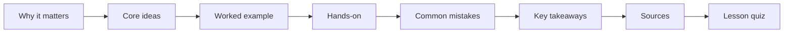

# 01.1 · How this course works and what it cannot train

This course follows the chemistry degree at the Technion, Israel's institute of technology, as a part-time self-study path. This first lesson explains how each lesson works, how to study so the knowledge stays, and, just as plainly, what a home course can never give you. You finish with a short skills check and a study plan for your first month.

## Why it matters

Imagine two learners. Both read every page of this course. The first reads each lesson twice and highlights the key lines. The second reads once, then closes the page and tries the problems, gets some wrong, and comes back to them a week later. After a year, the second learner can solve problems the first one cannot. Same hours, different method.

There is a second reason to read this lesson. People sometimes finish a home course and believe they could now work in a laboratory. They could not, and it is better to know that from day one. A clear picture of what you will and will not have saves you from a bad surprise at a job interview, and from danger at a real bench.

## Core ideas

### What the course mirrors

The Technion B.Sc. in Chemistry is a three-year, full-time degree of 124 credit points. A credit point is the Technion's unit of course weight; one point is roughly one lecture hour a week for a semester. This course follows the same subjects in the same order: maths and physics first, then the chemistry core, then advanced courses, labs and a research project.

It is built for an adult with about 10–12 hours a week. At that pace the whole path takes about five and a half to six years. If you already know university maths and physics, take off about a year.

You will not get a degree, a licence or a certificate that an employer will treat as one. You get the understanding.

### The lesson anatomy

Every lesson has the same seven parts, in the same order. Once you know them, you always know where you are.

- **Why it matters** shows a real situation where the idea decides something.
- **Core ideas** teaches the mechanism. Maths always comes in four steps: the intuition, the equation, a tiny example with numbers, and what the answer means.
- **Worked example** solves one or two problems fully, with real numbers and units.
- **Hands-on** is where you learn. It is a simulation run with a target, a Python analysis, a real-data exercise, a safe home experiment, or a pencil problem set. Answers hide in a fold-out box.
- **Common mistakes** lists the errors people really make, and how to spot them.
- **Key takeaways** is a short summary for review.
- **Sources** lists the primary sources, so you can check every claim.

After the lesson comes a short multiple-choice quiz. Each module ends with a longer module quiz. The pass mark is 70%.

### How learning actually sticks

Psychologists have tested many study habits. A large 2013 review by Dunlosky and colleagues compared ten common ones. Two came out clearly best:

- **Practice testing.** This means trying to recall or solve something without looking. Quizzes, problems and blank-page summaries all count.
- **Distributed practice.** This means spreading study over days and weeks, instead of cramming it into one session. It is also called spaced review.

Rereading and highlighting came out among the weakest. They feel productive because the page looks familiar. Familiar is not the same as known.

So the loop for every lesson is simple:

1. Read the lesson once, carefully.
2. Do the hands-on part without peeking at the answers.
3. Take the quiz.
4. Come back to the key takeaways after about 2 days, 1 week and 1 month, and try to explain them from memory.

> [!NOTE]
> The study method and the scope limits in this lesson are stable ideas. The Technion numbers (124 points, program 012042-1-000) come from the 2025/2026 catalog, the latest one posted when this was checked on 2026-10-16. Course numbers and credit values can change in later catalogs.

### Where the depth comes from

The lessons are the spine of the course. They teach each idea and give you practice. A real degree also asks for hundreds of hours of problem sets. For that depth, many modules point you to a full free course, usually from MIT OpenCourseWare (OCW), with problem sets and posted solutions. When a module says "do problem set 3 of MIT 5.111SC", that is part of the course, not an extra.

### Simulations and what they replace

About a fifth of the real degree is laboratory work. A home learner cannot do most of it: it needs reagents, fume hoods and supervision. In this course, each lab is replaced by an interactive simulation, real published data, and, where it is safe, a kitchen experiment.

A simulation here counts only if it teaches five things: the procedure, why each step is done, the safety reasoning, what can go wrong, and how to analyse the data and its error. A simulation that only shows a pretty animation does not count.

### What this course cannot train

Say this plainly to anyone who asks. The course does not train:

- **Hand skills at a real bench.** Weighing on an analytical balance, pipetting, burette technique, setting up reflux or distillation, using a separating funnel, filtering and drying a product.
- **Safe handling of real reagents.** Working with corrosive, flammable and toxic chemicals, using a fume hood, and disposing of chemical waste.
- **Operating real instruments.** Preparing an NMR sample, injecting into a gas chromatograph, looking after an HPLC column.
- **Supervised lab work.** Working in a shared lab, following its rules, and keeping a notebook that someone checks.

You will understand every experiment, its safety reasoning and its data. You will not have the hands. An employer would still have to train you at the bench. That is honest, and it is fine: understanding is the hard part, and it is what this course gives you.

## Worked example

### How long will Module 1 take?

Each lesson lists a reading time and a practice time. For this module:

| Lesson | Reading (min) | Practice (min) |
|---|---|---|
| 01.1 | 15 | 45 |
| 01.2 | 20 | 60 |
| 01.3 | 15 | 60 |
| 01.4 | 20 | 50 |
| 01.5 | 20 | 120 |

Total reading: $15 + 20 + 15 + 20 + 20 = 90$ min.
Total practice: $45 + 60 + 60 + 50 + 120 = 335$ min.

Add about 10 minutes per lesson quiz and 20 minutes for the module quiz:

$$90 + 335 + 5 \times 10 + 20 = 495 \text{ min} \approx 8.3 \text{ h}$$

Spaced review adds roughly 15 minutes per lesson over the following month, so about 1.3 hours more.

**What this means:** at 10–12 hours a week, Module 1 fits into one week, with a little room left. Later modules with MIT problem sets take two to four weeks each.

### Where do the hours go over the whole course?

The full path is about 5.5–6 years at 10–12 hours a week. Take 50 study weeks a year and 11 hours a week:

$$5.75 \text{ years} \times 50 \ \tfrac{\text{weeks}}{\text{year}} \times 11 \ \tfrac{\text{h}}{\text{week}} \approx 3200 \text{ h}$$

The 176 lessons themselves, at about 1.5 hours each, are roughly 260 hours. The other 90% is problem sets, external course material, the simulation labs and the research project. That is normal. In a real degree, most learning also happens outside the lecture.

## Hands-on

**What you need:** paper, a pen, a calculator (a phone is fine), a calendar. **Time:** about 45 minutes.

### Part 1 — Skills check (25 minutes)

This checks the high-school skills the course assumes. Work without looking anything up. Then check your answers.

1. Write 0.000 340 in scientific notation.
2. Calculate $(3.0 \times 10^{4}) \times (2.0 \times 10^{-6})$.
3. Rearrange $PV = nRT$ to give $T$.
4. A solution contains 15 g of sugar in 250 g of solution. What is the mass percent of sugar?
5. What is $\log_{10}(1000)$? What is $\log_{10}(0.01)$?
6. Convert 2.5 hours to seconds.
7. A recipe needs 0.75 kg of flour. How many grams is that?
8. If $y = 3x + 2$, what is $x$ when $y = 17$?

Answers

1. $3.40 \times 10^{-4}$. Moving the decimal point 4 places right gives a power of $-4$.
2. $6.0 \times 10^{-2}$. Multiply the numbers ($3.0 \times 2.0 = 6.0$) and add the powers ($4 + (-6) = -2$).
3. $T = \dfrac{PV}{nR}$. Divide both sides by $nR$.
4. $\dfrac{15}{250} \times 100\% = 6.0\%$.
5. $\log_{10}(1000) = 3$, because $10^3 = 1000$. $\log_{10}(0.01) = -2$, because $10^{-2} = 0.01$.
6. $2.5 \text{ h} \times 3600 \ \tfrac{\text{s}}{\text{h}} = 9000 \text{ s}$.
7. $0.75 \text{ kg} \times 1000 \ \tfrac{\text{g}}{\text{kg}} = 750 \text{ g}$.
8. $17 = 3x + 2$, so $3x = 15$ and $x = 5$.

**How to use your score.** 7–8 right: carry on. 5–6 right: carry on, and redo the ones you missed in a week. 4 or fewer: spend a week on Khan Academy's pre-algebra and algebra units first. Module 2 (calculus) builds on all of these.

### Part 2 — Your first four weeks (20 minutes)

1. Open your calendar. Choose fixed study blocks that add up to 10–12 hours a week. Short blocks on most days beat one long block.
2. Place Module 1 in week 1 and Module 2 in weeks 2–4.
3. For each lesson, add three short review slots: 2 days, 1 week and 1 month after you finish it. In each slot, write the key takeaways from memory, then compare.
4. Pick one "catch-up" block a week. Life happens; this block absorbs it.

**How you know it worked:** your calendar shows study blocks for four weeks, each lesson has three review slots, and you could tell a friend in one sentence what this course does not train.

Example plan for week 1

- Sunday 20:00–21:30: lesson 01.1 and its hands-on.
- Monday 20:00–21:30: lesson 01.2.
- Tuesday 20:00–21:30: lesson 01.3.
- Wednesday 20:00–21:00: lesson 01.4.
- Thursday: rest.
- Friday 09:00–12:00: lesson 01.5, the home measurement.
- Saturday 10:00–11:00: module quiz, review of 01.1.
- Review slots: 01.1 on Tuesday, next Sunday and in four weeks; and so on for each lesson.

## Common mistakes

- **Rereading instead of testing.** If a page feels easy, that is a warning sign. Close it and try the problems. Recall is the workout.
- **Skipping the hands-on.** The hands-on part is the lesson. Reading without it is like watching a swimming video.
- **Peeking at the answer box too early.** Struggle for a few minutes first. A wrong attempt followed by the answer teaches more than reading the answer straight away.
- **Cramming a whole module into one weekend.** It feels efficient. A month later, most of it is gone. Spread it out.
- **Believing you can now do bench work.** You will understand lab work well. You will still need supervised training before you handle real reagents.

## Key takeaways

- The course follows the Technion chemistry degree, at about 10–12 hours a week for 5.5–6 years. It gives understanding, not a degree.
- Every lesson has the same seven parts, then a quiz. The hands-on part is where you learn.
- Self-testing and spaced review work best. Rereading and highlighting work worst.
- The full depth needs the external problem sets each module points to.
- The course cannot train bench hands, reagent handling, real instruments or supervised lab work.

## Sources

- [Technion Faculty of Chemistry — Undergraduate study](https://chemistry.technion.ac.il/en/studying-chemistry-at-the-technion/undergraduate-study/) (degree structure; catalog 2025/2026 checked 2026-10-16).
- [Association for Psychological Science — Which study strategies make the grade?](https://www.psychologicalscience.org/news/releases/which-study-strategies-make-the-grade.html) (summary of Dunlosky et al., 2013, *Psychological Science in the Public Interest* 14(1)).
- [MIT OpenCourseWare — 5.111SC Principles of Chemical Science](https://ocw.mit.edu/courses/5-111sc-principles-of-chemical-science-fall-2014/).
- [MIT OpenCourseWare — 5.301 Chemistry Laboratory Techniques](https://ocw.mit.edu/courses/5-301-chemistry-laboratory-techniques-january-iap-2012/) (videos of the bench skills this course cannot train).
