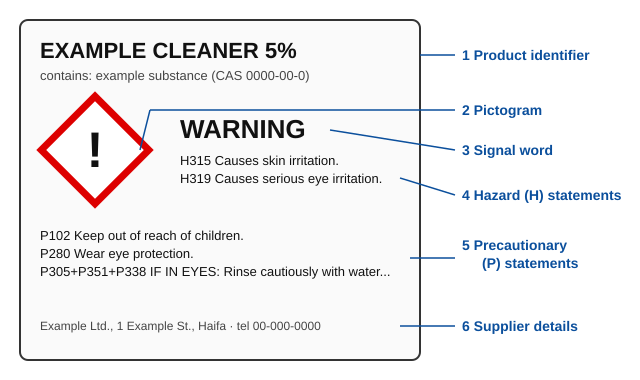

# 01.4 · Chemical safety: hazards, SDS and Israeli law

Every chemical you will meet, in a lab or under the kitchen sink, comes with a standard way of describing its dangers. This lesson teaches you to read that language: the GHS label, the safety data sheet and the PubChem safety section. It also explains the Israeli law that limits who may buy and keep hazardous chemicals, and the safety rule this course follows at home.

## Why it matters

Each year, people are hurt at home by mixing two ordinary cleaning products. A common case is bleach poured into a toilet together with an acidic toilet cleaner. Each product is safe to use alone, as the label says. Together they release chlorine, a toxic gas. Both labels warned about this. The people who were hurt did not read them, or did not know what the words meant.

Reading hazard information is the first safety skill a chemist learns. It is also one you can practise fully at home, because the information is public and free.

## Core ideas

### Hazard and risk

A **hazard** is what a substance can do to you: burn skin, catch fire, poison. It is a property of the substance. A **risk** is how likely harm is in a real situation. It depends on the hazard and on the **exposure**: how much, how concentrated, for how long, and how it reaches you (skin, eyes, breathing, swallowing).

Petrol is very flammable, a big hazard. In a closed car tank the risk is low; spilled next to a heater it is high. Safety work means reducing exposure.

### The GHS: one language for hazards

The **GHS** (Globally Harmonized System of Classification and Labelling of Chemicals) is a United Nations system. It tells manufacturers how to classify a chemical's hazards and how to show them on labels and safety sheets. It is updated every two years. The current edition is Revision 11, published in 2025; Revision 12 is expected in 2027.

A GHS label has six parts:

1. **Product identifier:** the name, and the hazardous ingredients.
2. **Pictograms:** black symbols in a red-bordered diamond. There are nine.
3. **Signal word:** **Danger** for the more severe hazards, **Warning** for the less severe.
4. **Hazard statements (H statements):** coded sentences such as "H314 Causes severe skin burns and eye damage". H2xx are physical hazards, H3xx are health hazards, H4xx are environmental hazards.
5. **Precautionary statements (P statements):** what to do, such as "P280 Wear protective gloves and eye protection".
6. **Supplier details:** who made it and how to contact them.

The nine pictograms:

| Pictogram (symbol) | Main meaning |
|---|---|
| Flame | flammable |
| Flame over a circle | oxidiser: makes other things burn more |
| Exploding bomb | explosive, self-reactive |
| Gas cylinder | gas under pressure |
| Corrosion (liquid eating a hand and a metal bar) | burns skin, damages eyes, corrodes metal |
| Skull and crossbones | acutely toxic: small amounts can kill |
| Exclamation mark | irritant, harmful, skin sensitiser |
| Health hazard (person with a star on the chest) | long-term harm: cancer, organ damage, breathing sensitiser |
| Environment (dead tree and fish) | toxic to water life |

### The safety data sheet

A **safety data sheet** (SDS) is the full document behind the label. Every supplier of a hazardous chemical must provide one. Under the GHS it always has the same 16 sections in the same order. The ones you will use most:

- **Section 2, Hazard identification:** the GHS classification and label elements.
- **Section 4, First-aid measures:** what to do after skin contact, eye contact, breathing in or swallowing.
- **Section 7, Handling and storage.**
- **Section 8, Exposure controls and personal protection:** gloves, eye protection, ventilation.
- **Section 10, Stability and reactivity:** what it must not be mixed with.
- **Section 13, Disposal.**

### PubChem: free safety data for any compound

**PubChem** is a free chemistry database run by the US National Institutes of Health. Each compound has a page with a number, its **CID** (compound ID). The "Safety and Hazards" section shows its GHS classification.

PubChem collects classifications from many companies' official notifications. So you often see several versions, with percentages such as "H318 (58.4%)". That means 58.4% of the companies that notified a classification included that statement. Read the most common one first.

### Concentration changes the hazard

PubChem describes the **pure** substance. What you buy is usually a mixture. This matters a lot.

Pure acetic acid (CID 176), called glacial acetic acid, is classified **Danger**, with the flame and corrosion pictograms: H226 flammable liquid and vapour, H314 causes severe skin burns and eye damage. Kitchen vinegar is acetic acid too, at about 4–6% in water. At that concentration it is not classified as corrosive. It stings in a cut or an eye, and that is all.

The reverse also happens. A product that seems mild can have a strong label. Always read the label of the product in your hand, not just the pure substance's page.

> [!NOTE]
> The ideas of hazard, risk, labels and SDS are stable. The details will change: the GHS is revised every two years (Revision 11 is from 2025), PubChem classifications are updated as companies notify new data, and Israeli regulations are amended. All were checked on 2026-10-16. Israel's adoption of GHS labelling for workplaces (standard SI 2302) was still in transition in the sources found; the course does not rely on it.

### Israeli law: the Hazardous Substances Law 1993

In Israel, the **Hazardous Substances Law, 1993** (חוק החומרים המסוכנים, התשנ"ג-1993) gives the Ministry of Environmental Protection control over hazardous and toxic chemicals. The main points for a learner:

- A business that deals in toxic substances needs a **poisons permit** (היתר רעלים). It is granted only to people who show they understand the substances and their safety needs. Permit holders must keep a register of every purchase and sale.
- Premises that sell hazardous substances need a business licence.
- Customs can stop an imported toxic substance going to anyone without the right permit. Breaking the law can mean a fine, prison and confiscation.

So ordering laboratory reagents to your home is not a grey area. Many are legally restricted. Even those that are not need a fume hood and training you do not have.

### The home rule in this course

Every home experiment in this course uses **kitchen and pharmacy materials only**: food, household products used as their labels allow, and pharmacy items. No lab reagents are bought. In addition:

- **Never mix bleach with acids** (vinegar, lemon juice, many toilet and descaling cleaners) **or with ammonia.** Bleach and acid release chlorine; bleach and ammonia release toxic chloramines.
- Use small amounts, good airflow and ordinary safety glasses.
- Never heat anything flammable.
- Keep everything in its original, labelled container, away from food and children.

If something goes wrong in Israel: call **101** (Magen David Adom) if there are symptoms. For advice when there are no symptoms, the **Israel Poison Information Center** at Rambam answers 24 hours a day on **04-777-1900**.

## Worked example

### Reading two bottles

You find two bottles under the sink. One is household bleach. Its label says the active ingredient is sodium hypochlorite at a few percent, with the corrosion pictogram and a warning not to mix with other products because dangerous gas (chlorine) can be released. The second is a descaler with citric acid.

**Step 1: identify the hazards.** Look up sodium hypochlorite in PubChem (CID 23665760). The most common classification is **Danger**, corrosion and environment pictograms, H314 (severe skin burns and eye damage), H318 (serious eye damage), H400 and H410 (very toxic to aquatic life). This is for concentrated solutions. Your bottle is dilute, but the label still shows the corrosion pictogram: eye contact is the main risk.

**Step 2: find what it must not meet.** SDS section 10 for bleach lists acids and ammonia. The descaler is an acid. So these two must never be used together or stored where they could mix.

**Step 3: decide the controls.** Use bleach alone, with the window open. Wear safety glasses, because H318 is about eyes. Store the two bottles apart. Rinse the toilet with water between products.

**Interpretation:** neither bottle is dangerous when used as labelled. The risk comes from combination and from eye splashes, and both are easy to prevent once you have read the label.

## Hands-on

**What you need:** a computer or phone with internet, your notebook, two or three household product labels. **Time:** about 50 minutes.

### Part 1 — Look up four substances in PubChem (25 minutes)

For each compound, open its PubChem page, scroll to "Safety and Hazards", then "GHS Classification". Record in a notebook table: name, CID, signal word, pictograms, the two most common H statements.

1. Acetic acid, CID 176.
2. Sodium hypochlorite, CID 23665760.
3. Sodium bicarbonate (baking soda), CID 516892.
4. Ethanol, CID 702.

Expected table (checked 2026-10-16)

| Substance | CID | Signal word | Pictograms | Main H statements |
|---|---|---|---|---|
| Acetic acid | 176 | Danger | flame, corrosion | H226 flammable liquid and vapour; H314 severe skin burns and eye damage |
| Sodium hypochlorite | 23665760 | Danger | corrosion, environment | H314; H318 serious eye damage (also H400/H410 aquatic toxicity) |
| Sodium bicarbonate | 516892 | none | none | not classified: almost all notifiers report it does not meet GHS hazard criteria |
| Ethanol | 702 | Danger | flame | H225 highly flammable liquid and vapour (some notifiers add H319 eye irritation) |

PubChem values can change as new notifications arrive. Small differences in percentages are normal.

### Part 2 — Read real labels (10 minutes)

Pick two or three products at home: bleach, a descaler or toilet cleaner, hand sanitiser. For each, write down the signal word, the pictograms, the H and P statements, and any "do not mix" warning. Compare with your PubChem table. Note where the product label is milder than the pure substance, and why (concentration).

### Part 3 — Risk assessment for Lesson 01.5 (15 minutes)

In Lesson 01.5 you will measure the density of water and sugar solutions with a kitchen scale and a syringe. Write a short risk assessment in your notebook, with four headings: substances and their hazards; how you could be exposed; controls; what you do if it goes wrong.

Example risk assessment

- **Substances:** tap water, table sugar (sucrose, not GHS-classified). No hazardous chemicals.
- **Exposure:** sugar solution on hands or in eyes; spills on the floor; the scale near water.
- **Controls:** wipe spills at once (sticky floors are slippery); keep the scale's electronics dry; label every jar; keep the oral syringe for this kit only, not for medicine afterwards; no needles.
- **If it goes wrong:** rinse eyes with water; clean spills with warm water.
- **Conclusion:** low risk. The main hazard is a slip or damage to the scale.

**How you know it worked:** your table matches the expected one, you found at least one "do not mix" warning on a real label, and your risk assessment names a hazard, a route of exposure and a control.

## Common mistakes

- **Reading the pure substance's page as if it were your product.** Concentration changes the classification. Read the label in your hand.
- **Treating "not classified" as "harmless in any amount".** Baking soda is not GHS-classified, but swallowing large amounts still causes harm.
- **Mixing cleaners to make them "stronger".** Bleach plus acid or ammonia releases toxic gas. Use one product, rinse, then another.
- **Confusing Warning and Danger.** Danger is the more severe signal word.
- **Buying "just a little" lab reagent online.** In Israel many reagents need a permit. It is also unsafe without a fume hood and training.

## Key takeaways

- Hazard is what a substance can do; risk is how likely harm is, given the exposure.
- A GHS label has a product identifier, pictograms, a signal word, H statements, P statements and supplier details.
- An SDS has 16 fixed sections; sections 2, 4, 7, 8, 10 and 13 are the ones you use most.
- PubChem shows the GHS data for pure substances. Concentration changes the hazard.
- Israel's Hazardous Substances Law 1993 restricts toxic chemicals to permit holders. At home, use kitchen and pharmacy materials only, and never mix bleach with acids or ammonia.

## Sources

- [UNECE — GHS Rev. 11 (2025)](https://unece.org/transport/dangerous-goods/ghs-rev11-2025) (current edition, label elements, SDS structure; Rev. 12 expected 2027).
- [PubChem — Acetic acid (CID 176)](https://pubchem.ncbi.nlm.nih.gov/compound/176), [Sodium hypochlorite (CID 23665760)](https://pubchem.ncbi.nlm.nih.gov/compound/23665760), [Sodium bicarbonate (CID 516892)](https://pubchem.ncbi.nlm.nih.gov/compound/516892), [Ethanol (CID 702)](https://pubchem.ncbi.nlm.nih.gov/compound/702) (GHS classifications, checked 2026-10-16).
- [Hazardous Substances Law, 1993 — summary by the Israel Foreign Ministry (AMPEID)](https://ampeid.org/documents/israel/hazardous-substances-law-1993/) and [InforMEA entry](https://www.informea.org/en/legislation/hazardous-substances-law-1993).
- [Rambam Health Care Campus — Israel Poison Information Center](https://www.rambam.org.il/en/departmentsandclinics/laboratories-division/clinical-pharmacology-and-toxicology/national-center-for-the-treatment-of-poisoning/) (24-hour line 04-777-1900).
