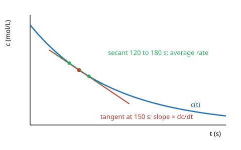

# 02.2 · Derivatives as rates of change

A derivative is the slope of a curve at one point: how fast one quantity changes when another changes a tiny bit. In chemistry the most common derivative is a reaction rate, the slope of concentration against time. This lesson gives the meaning, the five rules you need, and how to estimate a derivative from a table of measured numbers.

## Why it matters

You follow a reaction by measuring concentration every 30 seconds. Your supervisor asks for "the initial rate" to compare two catalysts. That number is a derivative, and you have to get it from data, not from a formula. If you take the slope between the first two points you get a value that is systematically too small. If you take it between neighbours on noisy data you get a jumpy mess. Knowing what a derivative is, and how numerical estimates go wrong, is the difference between a fair comparison and a wrong conclusion.

## Core ideas

> [!NOTE]
> The calculus here is stable. The software detail (how `numpy.gradient` treats the end points, default `edge_order=1`) was checked against the NumPy 2.5 manual on 2026-10-16 and could change in later versions.

### Average rate and instantaneous rate

Between two times the average rate of change is a ratio of differences:

$$\frac{\Delta c}{\Delta t} = \frac{c(t_2) - c(t_1)}{t_2 - t_1}$$

On a graph this is the slope of the secant, the straight line joining two points of the curve. Shrink the interval and the secant turns into the tangent, the line that just touches the curve at one point. Its slope is the derivative:

$$\frac{dc}{dt} = \lim_{\Delta t \to 0} \frac{c(t + \Delta t) - c(t)}{\Delta t}$$



### Rate of reaction

For a reactant A that is used up, $d[\mathrm{A}]/dt$ is negative. Chemists define the rate as a positive number, so

$$\text{rate} = -\frac{d[\mathrm{A}]}{dt}\qquad \text{units: mol L}^{-1}\,\mathrm{s}^{-1}$$

The units of a derivative are always (units of the top) divided by (units of the bottom).

### The rules you need

| Function | Derivative | Chemistry example |
|---|---|---|
| $x^n$ | $n x^{n-1}$ | $d(V^{-1})/dV = -V^{-2}$ in $p = nRT/V$ |
| $e^{ax}$ | $a\,e^{ax}$ | $d(e^{-kt})/dt = -k\,e^{-kt}$ |
| $\ln x$ | $1/x$ | $d(\ln p)/dp = 1/p$ |
| $c\,f(x)$ | $c\,f'(x)$ | constants come out front |
| $f(g(x))$ | $f'(g(x))\,g'(x)$ | chain rule (below) |

Also: the derivative of a sum is the sum of derivatives, and the product rule is $(fg)' = f'g + fg'$.

### The chain rule in one line

When a function sits inside another, differentiate the outside, keep the inside, then multiply by the derivative of the inside. For first-order decay $c = c_0 e^{-kt}$:

$$\frac{dc}{dt} = c_0\, e^{-kt}\cdot(-k) = -k\,c$$

That is the first-order rate law: the rate is proportional to what is left. You will meet it again as a differential equation in Module 3.

### Derivatives from data

With a table of values there is no formula to differentiate, so you use finite differences:

- Forward difference: $\dfrac{c_{i+1} - c_i}{h}$. Its error is proportional to the step $h$ (first-order).
- Central difference: $\dfrac{c_{i+1} - c_{i-1}}{2h}$. Its error is proportional to $h^2$ (second-order), so it is much better for the same data.

`numpy.gradient(c, t)` uses central differences inside the array and one-sided differences at the two ends.

There is a trade-off. Measurement noise of size $\sigma$ becomes noise of about $\sigma\sqrt{2}/(2h)$ in a central difference. Small steps reduce the formula error but blow up the noise. Use the largest step that still follows the curve, or fit a model and differentiate the model.

### Sensitivity: a derivative tells you "how much per unit"

Differentiate the Arrhenius equation, $k = A e^{-E_a/(RT)}$, with the chain rule:

$$\frac{dk}{dT} = k\,\frac{E_a}{RT^2}\quad\Rightarrow\quad \frac{1}{k}\frac{dk}{dT} = \frac{E_a}{RT^2}$$

For $E_a = 50$ kJ/mol at 298 K this is $0.068\ \mathrm{K^{-1}}$: the rate constant rises about 7 % per kelvin. That tells you how well a water bath must hold its temperature.

## Worked example

A reactant decays with $c_0 = 0.100$ mol/L and $k = 0.0040\ \mathrm{s^{-1}}$. Find the rate at $t = 150$ s exactly and from a table with 30 s spacing.

1. Exact: $c(150) = 0.100\,e^{-0.60} = 0.05488$ mol/L, so $dc/dt = -k\,c = -2.195\times10^{-4}$ mol L⁻¹ s⁻¹. Rate $= 2.195\times10^{-4}$ mol L⁻¹ s⁻¹.
2. Table values: $c(120) = 0.06188$, $c(150) = 0.05488$, $c(180) = 0.04868$ mol/L.
3. Forward difference: $(0.04868 - 0.05488)/30 = -2.07\times10^{-4}$. Error 6 %.
4. Central difference: $(0.04868 - 0.06188)/60 = -2.200\times10^{-4}$. Error 0.2 %.

Interpretation: on a curve that bends upward (decays slow down), a forward difference always underestimates the rate. The central difference cancels most of that bias.

Second example, the chain rule with pH. How sensitive is pH to $[\mathrm{H^+}]$? $\mathrm{pH} = -\log_{10} x = -\ln x / \ln 10$, so $d\,\mathrm{pH}/dx = -1/(x \ln 10)$. A 1 % error in $x$ gives a pH error of $0.01/2.303 = 0.004$, the same at any pH.

## Hands-on

What you need: Python with the course packages, the [Module 2 lab folder](../../labs/module-02/), 45 minutes.

### Part A — pencil (15 min)

1. Differentiate $p(V) = nRT/V$ with respect to $V$. What is $dp/dV$ for 1.00 mol at 298 K and 24.5 L? (Use $R = 8.314$ J/(mol K); answer in Pa/m³.)
2. Differentiate $\ln k = \ln A - E_a/(RT)$ with respect to $T$.
3. A table gives $c = 0.0800, 0.0710, 0.0632$ mol/L at $t = 0, 20, 40$ s. Estimate the rate at 20 s.

<details><summary>Answers to Part A</summary>

1. $dp/dV = -nRT/V^2$. With $V = 0.0245\ \mathrm{m^3}$: $-1.00 \times 8.314 \times 298 / 0.0245^2 = -4.13\times10^{6}$ Pa/m³, or about $-4.13$ kPa per litre.
2. $d(\ln k)/dT = E_a/(RT^2)$. The constant $\ln A$ has zero derivative.
3. Central difference: $(0.0632 - 0.0800)/40 = -4.20\times10^{-4}$, so rate $= 4.20\times10^{-4}$ mol L⁻¹ s⁻¹.

</details>

### Part B — Python: rate from data (30 min)

`decay_concentration.csv` holds 31 concentrations, every 30 s for 15 minutes, generated from first-order decay with small noise.

1. Open `lesson02_rates.py` and fill in `forward_difference`, `central_difference` and `fit_k`.
2. Run it:

```bash
py lesson02_rates.py
```

3. Look at `runs/lesson02_rates.png`. The right panel, rate against concentration, should be a straight line through the origin with slope $k$.

How you know it worked: $k$ from the rate plot is within 3 % of $0.0040\ \mathrm{s^{-1}}$, and the script also prints $k$ from the $\ln c$ fit of lesson [02.1](lesson-01.md) for comparison.

<details><summary>Reference solution and what to notice</summary>

`np.diff(c) / np.diff(t)`, `np.gradient(c, t)` and `np.sum(c * rate) / np.sum(c * c)`. Results with the seeded data: initial rate $3.77\times10^{-4}$ from both methods (at the first point `np.gradient` falls back to a forward difference, so it shares the 6 % bias; the true value is $4.00\times10^{-4}$), $k = 0.00395\ \mathrm{s^{-1}}$ from rate against $c$, and $k = 0.00399\ \mathrm{s^{-1}}$ from the $\ln c$ fit. The log fit uses all points at once and is less sensitive to noise than differentiating. Lesson learned: when you have a model, fit it; differentiate data only when you must. Full code: `lesson02_rates_solution.py`.

</details>

## Common mistakes

- Reporting $d[\mathrm{A}]/dt$ as the rate without the minus sign. A negative rate for a reactant is a sign slip.
- Using a forward difference at every point. It is biased on curved data. Use central differences inside the table.
- Differentiating noisy data with tiny steps. The noise grows as $1/h$. Smooth, use a larger step, or fit a model.
- Forgetting the chain rule's inner factor. $d(e^{-kt})/dt$ is $-k e^{-kt}$, not $e^{-kt}$.
- Wrong units. The derivative of mol/L with respect to s is mol L⁻¹ s⁻¹. Check that the units of your answer make sense.

## Key takeaways

- A derivative is the slope of the tangent: change in output per unit change in input, with units top/bottom.
- Reaction rate $= -d[\mathrm{A}]/dt$ for a reactant, a positive number.
- Five rules (power, exponential, log, constant factor, chain) cover nearly all chemistry derivatives.
- From data, central differences beat forward differences; noise limits how small the step can be.
- A derivative also measures sensitivity: how much an output moves when an input drifts.

## Sources

- [OpenStax Calculus Volume 1, 3.4 Derivatives as Rates of Change](https://openstax.org/books/calculus-volume-1/pages/3-4-derivatives-as-rates-of-change) — derivative as a rate, with worked problems.
- [NumPy v2.5: numpy.gradient](https://numpy.org/doc/stable/reference/generated/numpy.gradient.html) — central differences inside, one-sided at the edges.
- [OpenStax Chemistry 2e, 12.5 Collision Theory](https://openstax.org/books/chemistry-2e/pages/12-5-collision-theory) — the Arrhenius equation used in the sensitivity example.
- [MIT OCW 18.01SC Single Variable Calculus](https://ocw.mit.edu/courses/18-01sc-single-variable-calculus-fall-2010/) — the full course on differentiation.
