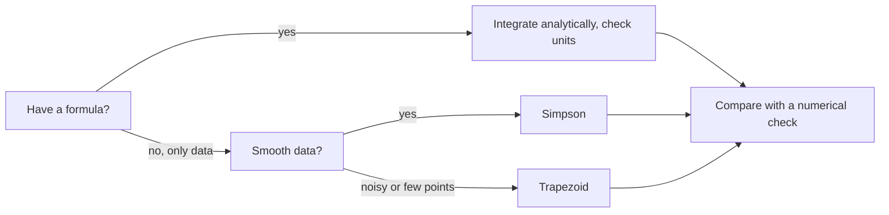

# 02.3 · Integrals as accumulated change

An integral adds up many small pieces: a rate times a short time, a pressure times a small volume change, a heat capacity times a small temperature step. This lesson shows the integral as the reverse of the derivative, the few formulas chemists use, and how to integrate measured data numerically with the trapezoid and Simpson rules.

## Why it matters

A gas expands in a piston and you need the work it does. The pressure is not constant, it falls as the volume grows, so "pressure times volume change" gives the wrong answer. Or you heat nitrogen from room temperature to 500 K and the heat capacity creeps up as it warms. In both cases the answer is an integral: the area under a curve. In thermodynamics (Modules 8 and 13) almost every useful quantity, from enthalpy to entropy, is an integral of something you can measure.

## Core ideas

> [!NOTE]
> The integration rules are stable mathematics. The N2 heat-capacity coefficients are from the NIST Chemistry WebBook (Shomate form, 100–500 K) and the SciPy function names are from SciPy 1.18; both were checked on 2026-10-16. NIST data are occasionally revised, and SciPy has renamed integrators before (`trapz` became `trapezoid`, `simps` became `simpson`).

### The integral undoes the derivative

If the rate of change of a quantity $F$ is $f(t) = dF/dt$, the total change between $t_1$ and $t_2$ is

$$F(t_2) - F(t_1) = \int_{t_1}^{t_2} f(t)\,dt$$

This is the net change theorem. On a graph, the integral is the area between the curve and the axis. Units: (units of $f$) times (units of $t$). Integrating a rate in mol L⁻¹ s⁻¹ over seconds gives mol/L, a concentration change.

### Formulas you will use

| Integrand | Antiderivative | Where it appears |
|---|---|---|
| $x^n$ ($n \ne -1$) | $\dfrac{x^{n+1}}{n+1}$ | heat from $C_p = a + bT + cT^2$ |
| $1/x$ | $\ln x$ | isothermal work, entropy $\int C_p\,dT/T$ |
| $e^{ax}$ | $\dfrac{e^{ax}}{a}$ | amount reacted in first-order decay |

### Work of an isothermal expansion

Work done by a gas on its surroundings in a reversible expansion is $w_\text{by} = \int p\,dV$. For an ideal gas at constant temperature, $p = nRT/V$, so

$$w_\text{by} = \int_{V_1}^{V_2} \frac{nRT}{V}\,dV = nRT\,\ln\frac{V_2}{V_1}$$

Tiny example: 1.00 mol at 298.15 K doubling its volume does $nRT\ln 2 = 1718$ J of work. Sign convention: chemistry (IUPAC) counts work done on the system as positive, so the system's $w = -1718$ J.

### Heat from a heat capacity that changes with temperature

At constant pressure, the heat to warm one mole is $\Delta H = \int_{T_1}^{T_2} C_p(T)\,dT$. NIST gives $C_p$ for many gases as the Shomate polynomial, with $t = T/(1000\ \mathrm{K})$:

$$C_p = A + Bt + Ct^2 + Dt^3 + E/t^2$$

Each term integrates with the power rule, which is what NIST's tabulated $H - H_{298}$ formula does for you.

### Numerical integration of data

When you only have numbers, add up simple shapes:

- Trapezoid rule: join neighbouring points with straight lines and add the trapezoids, $\sum (x_{i+1} - x_i)\,(y_i + y_{i+1})/2$. Error shrinks like $h^2$.
- Simpson's rule: fit parabolas through groups of three points. Error shrinks like $h^4$, so it is far more accurate on smooth data.

In Python: `scipy.integrate.trapezoid(y, x=x)` and `scipy.integrate.simpson(y, x=x)`. Always pass `x` when the spacing is not 1.



## Worked example

### 1. Isothermal expansion

1.00 mol of ideal gas expands reversibly at 298.15 K from 10.0 L to 25.0 L.

$$w_\text{by} = 1.00 \times 8.314 \times 298.15 \times \ln(25.0/10.0) = 2479 \times 0.9163 = 2271\ \mathrm{J}$$

Check with the trapezoid rule on 5 points (4 intervals): 2295 J, 1.1 % high. A curve that bends upward lies below its chords, so trapezoids overestimate. Simpson on the same 5 points gives 2273 J, 0.06 % high.

### 2. Heating nitrogen

Heat 1 mol N₂ at constant pressure from 298.15 K to 500 K. With NIST's Shomate coefficients, $C_p$ rises from 29.12 to 29.58 J mol⁻¹ K⁻¹. Integrating gives $\Delta H = 5911$ J/mol. Treating $C_p$ as constant at its 298 K value gives $29.12 \times 201.85 = 5879$ J/mol, only 0.5 % low. For N₂ over this range a constant $C_p$ is fine. Over 1000 K, or for a molecule like CO₂ whose $C_p$ climbs steeply, it is not.

### 3. Amount reacted

A first-order reaction has rate $= k c_0 e^{-kt}$ with $c_0 = 0.100$ mol/L and $k = 0.0040\ \mathrm{s^{-1}}$. Amount used in the first 300 s:

$$\int_0^{300} k c_0 e^{-kt}\,dt = c_0\left(1 - e^{-k \cdot 300}\right) = 0.100\,(1 - e^{-1.2}) = 0.0699\ \mathrm{mol/L}$$

## Hands-on

What you need: Python with the course packages, the [Module 2 lab folder](../../labs/module-02/), 45 minutes.

### Part A — pencil (15 min)

1. Work done by 2.00 mol ideal gas expanding reversibly at 350 K from 5.0 L to 15.0 L.
2. $C_p = 25.0 + 0.010\,T$ J mol⁻¹ K⁻¹ (T in K). Heat to warm 1 mol from 300 K to 400 K.
3. Measured rates (in $10^{-4}$ mol L⁻¹ s⁻¹) at $t = 0, 30, 60, 90$ s are 4.0, 3.0, 2.2, 1.6. Use the trapezoid rule to estimate the concentration used up in 90 s.

<details><summary>Answers to Part A</summary>

1. $2.00 \times 8.314 \times 350 \times \ln 3 = 6394$ J (6.39 kJ) done by the gas.
2. $\int (25.0 + 0.010T)\,dT = 25.0 \times 100 + 0.005\,(400^2 - 300^2) = 2500 + 350 = 2850$ J/mol.
3. $30 \times [(4.0 + 1.6)/2 + 3.0 + 2.2] \times 10^{-4} = 30 \times 8.0 \times 10^{-4} = 0.0240$ mol/L.

</details>

### Part B — Python (30 min)

1. Open `lesson03_integrals.py`. Fill in `trapezoid` (by hand, with `np.diff`), `cp_n2` (the Shomate polynomial) and `amount_used` (call `simpson`).
2. Run it:

```bash
py lesson03_integrals.py
```

How you know it worked:

- Part 1 prints the exact work 2271.4 J. Your trapezoid values approach it from above as the number of intervals grows (about 2295, 2275, 2271.5 J), and Simpson is already within 1.3 J at 4 intervals.
- Part 2 prints $\Delta H \approx 5911$ J/mol both from Simpson and from the NIST formula, and 5879 J/mol with constant $C_p$.
- Part 3 prints the same number twice (about 0.0971 mol/L): integrating the rate gives back the concentration change, the net change theorem in action.

<details><summary>Reference solution</summary>

`trapezoid`: `np.sum(np.diff(x) * (y[:-1] + y[1:]) / 2)`. `cp_n2`: `t = T/1000`, then `A + B*t + C*t**2 + D*t**3 + E/t**2`. `amount_used`: `simpson(rate, x=t)`. See `lesson03_integrals_solution.py`. Why trapezoids overestimate here: $1/V$ curves upward (it is convex), so every straight chord lies above the curve.

</details>

## Common mistakes

- Treating a changing quantity as constant. $p\,\Delta V$ with the initial pressure overestimates the work; with the final pressure it underestimates.
- Mixing litres and cubic metres. $R$ in J mol⁻¹ K⁻¹ with $V$ in L gives $p$ in J/L, which is kPa. Either is fine if consistent; the log ratio $V_2/V_1$ has no units anyway.
- Calling `simpson(y)` without `x`. SciPy then assumes spacing 1 and your answer is off by the real step size.
- Forgetting $t = T/1000$ in the Shomate equation. Using $T$ directly gives absurd heat capacities.
- Sign of work. Say which convention you use: work done by the gas, or work done on the system (IUPAC). They differ by a minus sign.

## Key takeaways

- An integral is accumulated change: area under a rate curve, with units of (y units) times (x units).
- The net change theorem: integrating a rate gives back the total change of the quantity.
- Isothermal ideal-gas work is $nRT\ln(V_2/V_1)$; heat at constant pressure is $\int C_p\,dT$.
- From data: trapezoid is simple and robust; Simpson is much more accurate for smooth data. Always pass the x values.
- Check a numerical integral against an exact case before trusting it on real data.

## Sources

- [OpenStax Calculus Volume 1, 5.4 Integration Formulas and the Net Change Theorem](https://openstax.org/books/calculus-volume-1/pages/5-4-integration-formulas-and-the-net-change-theorem) — the net change theorem with examples.
- [NIST Chemistry WebBook: Nitrogen](https://webbook.nist.gov/cgi/cbook.cgi?ID=C7727379&Mask=1) — Shomate coefficients for gas-phase N₂, 100–500 K.
- [SciPy 1.18: scipy.integrate.simpson](https://docs.scipy.org/doc/scipy/reference/generated/scipy.integrate.simpson.html) and [scipy.integrate.trapezoid](https://docs.scipy.org/doc/scipy/reference/generated/scipy.integrate.trapezoid.html) — the numerical integrators used in the lab.
- [NIST CODATA 2022: molar gas constant](https://physics.nist.gov/cgi-bin/cuu/Value?r) — $R$, exact.
