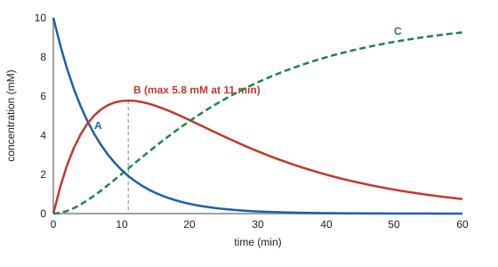

# 03.5 · Coupled systems: consecutive reactions

Most reactions do not go in one step. A turns into an intermediate B, and B turns into the product C. The rate of change of B depends on both A and B, so the equations are coupled and must be solved together. This lesson solves A → B → C three ways: with a formula, with the eigenvalues of a matrix, and numerically. It is the module's practical, because it uses everything from Module 3: linear systems, eigenvalues, first-order ODEs and the idea of turning several equations into one matrix equation.

## Why it matters

A process chemist makes a pharmaceutical intermediate B from A, but B slowly decomposes to an unwanted C. When should the reactor be stopped to collect the most B? Too early and A is left; too late and B has gone to C. The answer is a formula, $t_\text{max} = \ln(k_1/k_2)/(k_1 - k_2)$, and it comes straight from solving the coupled equations. The same mathematics describes a drug swallowed as a tablet: the gut (A) feeds the blood (B), and the liver and kidneys remove it (C). The blood level rises, peaks and falls, and pharmacologists fit exactly this curve, which they call the Bateman function.

## Core ideas

> [!NOTE]
> The mathematics is stable. The lab uses numpy 2.5 and SciPy 1.18 (`solve_ivp`, `scipy.linalg.expm`, `curve_fit`), checked 2026-10-16. The example data are generated from known constants, so you can check your fit.

### The coupled equations

For two first-order steps, $\mathrm{A} \xrightarrow{k_1} \mathrm{B} \xrightarrow{k_2} \mathrm{C}$:

$$\frac{dA}{dt} = -k_1 A, \qquad \frac{dB}{dt} = k_1 A - k_2 B, \qquad \frac{dC}{dt} = k_2 B$$

B is made from A at rate $k_1A$ and lost at rate $k_2B$. Add the three equations and the right side is zero: $A + B + C$ stays equal to $A_0$, the starting amount. That is a free check on any solution, numerical or not.

### The formula solution

Start with only A, so $A(0) = A_0$ and $B(0) = C(0) = 0$. The first equation alone is first-order decay ([03.3](lesson-03.md)): $A = A_0e^{-k_1t}$. Put it into the second, which becomes a linear equation with a source term, $dB/dt + k_2B = k_1A_0e^{-k_1t}$. Its solution is

$$B(t) = \frac{k_1 A_0}{k_2 - k_1}\left(e^{-k_1 t} - e^{-k_2 t}\right), \qquad C = A_0 - A - B$$

You can check it by differentiating. B starts at zero, rises, peaks and decays. Setting $dB/dt = 0$ gives the peak:

$$t_\text{max} = \frac{\ln(k_1/k_2)}{k_1 - k_2}, \qquad B_\text{max} = A_0\left(\frac{k_1}{k_2}\right)^{k_2/(k_2 - k_1)}$$

If $k_1 = k_2 = k$ the formula is 0/0; the limit is $B = A_0\,kt\,e^{-kt}$, peaking at $t = 1/k$.



### The same system as a matrix

Put the concentrations in a vector $\mathbf{c} = (A, B, C)$. The three equations are one:

$$\frac{d\mathbf{c}}{dt} = K\mathbf{c}, \qquad K = \begin{pmatrix} -k_1 & 0 & 0 \\ k_1 & -k_2 & 0 \\ 0 & k_2 & 0 \end{pmatrix}$$

Row $i$ of $K$ says how species $i$ changes. Each column adds up to zero: that is the mass balance. For a single equation $dc/dt = kc$ the answer is $c_0e^{kt}$. For a matrix the answer has the same form, $\mathbf{c}(t) = e^{Kt}\mathbf{c}_0$, where $e^{Kt}$ is the matrix exponential (`scipy.linalg.expm`). To see what it means, use eigenvectors ([03.2](lesson-02.md)). If $K\mathbf{v}_j = \lambda_j\mathbf{v}_j$, then $\mathbf{v}_je^{\lambda_jt}$ solves the equation on its own, and every solution is a mix of these:

$$\mathbf{c}(t) = \sum_j a_j\,\mathbf{v}_j\,e^{\lambda_j t}$$

The numbers $a_j$ come from writing $\mathbf{c}_0$ in terms of the eigenvectors, which is a linear system ([03.1](lesson-01.md)). $K$ is triangular, so its eigenvalues are its diagonal entries: $-k_1$, $-k_2$ and 0. That is why every concentration is a combination of $e^{-k_1t}$, $e^{-k_2t}$ and a constant. The eigenvalue 0 belongs to the final state, all C. This method works unchanged for networks of ten or a hundred first-order steps, where no one would derive formulas by hand. Note that $K$ is not symmetric, so use `np.linalg.eig`, not `eigh`.

### Rate-determining step and the steady-state approximation

If $k_2 \gg k_1$, B is removed almost as soon as it forms. It stays small and nearly constant, so $dB/dt \approx 0$, which gives $B \approx k_1A/k_2$ and $dC/dt \approx k_1A$. The product appears at the rate of the slow first step, which is the rate-determining step. This steady-state approximation is a main tool of kinetics (Module 22). The exact solution shows when it holds: only after a short induction period of a few times $1/k_2$.

### The trap: which step is slow?

The formula for B is unchanged if you swap $k_1$ and $k_2$, apart from the factor in front. So if you measure only B, and do not know its absolute scale (for example its absorptivity), a fast-then-slow and a slow-then-fast mechanism fit equally well. In pharmacology this is called flip-flop kinetics. The cure is to measure A or C as well, or to know B's scale independently.

Before the lab, explore how the peak moves as you change the two rate constants:

[Simulation: Kinetics — consecutive reactions A → B → C](../../simulations/kinetics/index.html?preset=consecutive)

## Worked example

### 1. When to stop the reactor

$k_1 = 0.150\ \mathrm{min^{-1}}$, $k_2 = 0.050\ \mathrm{min^{-1}}$, $A_0 = 10.0$ mM.

1. $t_\text{max} = \ln(0.150/0.050)/(0.150 - 0.050) = \ln 3/0.100 = 11.0$ min.
2. $B_\text{max} = 10.0 \times 3^{0.050/(0.050 - 0.150)} = 10.0 \times 3^{-0.5} = 5.77$ mM. At best 58 % of A can be collected as B.
3. At 20 min: $B = \dfrac{0.150 \times 10.0}{-0.100}(e^{-3.0} - e^{-1.0}) = -15.0 \times (0.0498 - 0.3679) = 4.77$ mM. $A = 10.0e^{-3.0} = 0.50$ mM, $C = 10.0 - 0.50 - 4.77 = 4.73$ mM. Waiting 9 minutes too long loses 1.0 mM of product.

### 2. A fast second step

$k_1 = 0.050\ \mathrm{min^{-1}}$, $k_2 = 1.50\ \mathrm{min^{-1}}$, $A_0 = 10.0$ mM. Now $t_\text{max} = \ln(1/30)/(-1.45) = 2.35$ min and $B_\text{max} = 10.0 \times (1/30)^{1.50/1.45} = 0.30$ mM. B never builds up. After a few times $1/k_2 = 0.67$ min, $B \approx k_1A/k_2 = A/30$: the steady state. At 10 min, $A = 6.07$ mM, so the steady-state estimate is $B = 0.202$ mM, and the exact formula gives $\frac{0.5}{1.45}(e^{-0.5} - e^{-15}) = 0.209$ mM, 3 % higher.

## Hands-on

### Part A — pencil (20 min)

1. For $k_1 = 0.20$ and $k_2 = 0.10\ \mathrm{min^{-1}}$, find $t_\text{max}$ and $B_\text{max}/A_0$.
2. Write the rate matrix for $\mathrm{A} \xrightarrow{k_1} \mathrm{B}$, $\mathrm{A} \xrightarrow{k_2} \mathrm{C}$ (two parallel steps). What are its eigenvalues?
3. Show that the columns of $K$ for A → B → C add to zero and explain in one sentence what that means.

<details><summary>Answers to Part A</summary>

1. $t_\text{max} = \ln 2/0.10 = 6.93$ min; $B_\text{max}/A_0 = 2^{0.10/(-0.10)} = 2^{-1} = 0.50$.
2. $K = \begin{pmatrix} -(k_1 + k_2) & 0 & 0 \\ k_1 & 0 & 0 \\ k_2 & 0 & 0 \end{pmatrix}$; eigenvalues $-(k_1 + k_2)$, 0, 0. A decays at the summed rate, and B and C are never destroyed, so two eigenvalues are zero.
3. Column 1: $-k_1 + k_1 + 0 = 0$; column 2: $0 - k_2 + k_2 = 0$; column 3: 0. Whatever leaves one species enters another, so the total $A + B + C$ never changes.

</details>

### Part B — module practical: solve and fit A → B → C (about 70 min)

What you need: Python with the course packages and the [Module 3 lab folder](../../labs/module-03/). The file `consecutive_example.csv` holds A, B and C every 2 minutes for an hour (generated from known constants with 0.10 mM noise).

1. Open `lesson05_consecutive.py` and fill in `analytic` (including the $k_1 = k_2$ case), `rate_matrix` and `eigen_solution`.
2. Run it:

```bash
py lesson05_consecutive.py
```

3. Read the output in three parts. Part 1 compares the formula, the eigenvector solution, `solve_ivp` and `scipy.linalg.expm`, and checks the mass balance. Part 2 fits $k_1$ and $k_2$ to all three curves at once with `curve_fit` and computes $t_\text{max}$. Part 3 fits B alone with a free scale factor from two different starting guesses.
4. Open `runs/lesson05_consecutive.png` and check that the fitted curves pass through the data and the grey line sits at the peak of B.
5. Write it up with the [lab report template](../../templates/lab-report.md): the model, the three methods and how well they agree, the fitted constants with uncertainties, $t_\text{max}$, and one paragraph on the k1/k2 ambiguity.

How you know it worked: the eigenvalues print as −0.15, −0.05 and 0; the formula, eigenvector and `solve_ivp` answers agree to better than $10^{-9}$ mM, and `expm` gives B = 4.771 mM at 20 min, as in worked example 1. The fit gives $k_1 \approx 0.147 \pm 0.002$ and $k_2 \approx 0.0501 \pm 0.0003\ \mathrm{min^{-1}}$ (model 0.150 and 0.050) and $t_\text{max} \approx 11.1$ min. In Part 3 both starting guesses give the same rms residual (about 0.095 mM) with $k_1$ and $k_2$ swapped.

<details><summary>Reference solution and what the results mean</summary>

`analytic`: the formulas above, with `np.isclose(k1, k2)` choosing the limit $A_0kte^{-kt}$. `rate_matrix`: the 3×3 array above. `eigen_solution`: `lam, V = np.linalg.eig(K)`, `a = np.linalg.solve(V, c0)`, then `V @ (a[:, None] * np.exp(np.outer(lam, t)))`, taking the real part. Full code: `lesson05_consecutive_solution.py`.

Fitting all three species pins down both constants, because A alone fixes $k_1$. With B alone and an unknown scale, one fit says the first step is fast and the second slow, the other the reverse, with a scale factor about three times larger. Only a separate measurement (A's decay, or B's absorptivity) breaks the tie. $k_2$ has the smaller uncertainty here because B and C keep changing for the whole hour, while A is almost gone after 30 minutes.

</details>

## Common mistakes

- Using the B formula when $k_1 = k_2$. It divides by zero; use the limit $A_0kte^{-kt}$, or a numerical solver.
- Getting the sign of $t_\text{max}$ wrong. Both $\ln(k_1/k_2)$ and $k_1 - k_2$ change sign together, so $t_\text{max}$ is always positive; a negative value means a slip.
- Using `eigh` on the rate matrix. $K$ is not symmetric; `eigh` reads only half of it and returns wrong values.
- Forgetting the mass-balance check. If $A + B + C$ drifts in your numerical answer, the tolerances are too loose or the rate matrix has a typo.
- Applying the steady-state approximation when $k_2$ is not much larger than $k_1$. In worked example 1 it would predict $B = 3A$, which is wrong at all times.
- Deciding which step is slow from B alone. Measure a second species.

## Key takeaways

- A → B → C is three coupled first-order ODEs; B rises, peaks at $t_\text{max} = \ln(k_1/k_2)/(k_1 - k_2)$, and falls.
- Any first-order network is $d\mathbf{c}/dt = K\mathbf{c}$; its solution is a sum of eigenvectors times $e^{\lambda t}$, with the eigenvalues of $K$ as the rates.
- Columns of $K$ summing to zero is mass balance, and it gives an eigenvalue of zero for the final state.
- When one step is much faster, the intermediate sits at a steady state and the slow step sets the rate.
- Fitting several species together determines both rate constants; the intermediate alone leaves them interchangeable.

## Sources

- [LibreTexts, Steady State Approximation](https://chem.libretexts.org/Bookshelves/Physical_and_Theoretical_Chemistry_Textbook_Maps/Supplemental_Modules_(Physical_and_Theoretical_Chemistry)/Kinetics/03%3A_Rate_Laws/3.02%3A_Reaction_Mechanisms/3.2.06%3A_Steady_State_Approximation) — consecutive first-order reactions and the condition $k_1 \ll k_2$.
- [Weiss (2023), Pharmaceutical Research](https://pmc.ncbi.nlm.nih.gov/articles/PMC10547630/) — the Bateman function, a difference of two exponentials, for absorption and elimination of a drug.
- [SciPy v1.18 manual, solve_ivp](https://docs.scipy.org/doc/scipy/reference/generated/scipy.integrate.solve_ivp.html) — the numerical solver used in the practical.
- [MIT OCW 18.03 Differential Equations](https://ocw.mit.edu/courses/18-03-differential-equations-spring-2010/) — linear systems of ODEs, eigenvalues and the matrix exponential.
