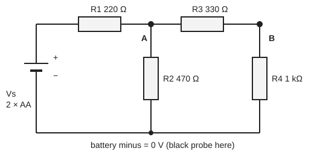

# 04.4 · Circuits, current and resistance

Every instrument in a chemistry lab is an electric circuit: a pH meter reads a tiny voltage, a conductivity cell measures how easily ions carry current, a potentiostat pushes electrons into a reaction and counts them. To trust those readings you need a few rules about current, voltage and resistance, and the habit of predicting a reading before you take it. This lesson teaches Ohm's law, Kirchhoff's rules and the link between charge and moles, then you build a resistor network from two AA cells and check your predictions with a multimeter.

## Why it matters

Electrolysis and coulometry measure amounts of substance by counting charge. Pass 0.50 A through a copper sulfate solution for 30 minutes and you plate out 0.296 g of copper, no balance needed, as long as you know the current and the time. In Module 10 you will determine an unknown amount by exactly this method. The same circuit rules tell you why a meter can disturb what it measures, why a weak battery reads fine with nothing connected and fails under load, and how to find a fault in an instrument without guessing.

## Core ideas

> [!NOTE]
> Circuit laws are stable. The Faraday constant is the CODATA 2022 value from NIST ($F = N_Ae$, exact). Component tolerances (5 % carbon-film resistors, 3½-digit multimeters) describe typical cheap parts in 2026; check the numbers printed on yours. Checked 2026-10-16.

### Current, voltage and resistance

Current $I$ is the rate at which charge flows past a point, $I = dQ/dt$, measured in amperes ($1\ \mathrm{A} = 1\ \mathrm{C/s}$). In a metal the moving charges are electrons; in a solution they are ions. Voltage (potential difference, lesson [04.3](lesson-03.md)) is the energy per charge that drives the current. Resistance $R$, in ohms (Ω), measures how much voltage it takes to push a given current through a component. For many materials the ratio is constant, which is Ohm's law:

$$V = IR$$

Tiny example: 1.5 V across 470 Ω drives $I = 1.5/470 = 3.2$ mA.

### Resistivity and conductivity

The resistance of a uniform bar depends on its shape and its material:

$$R = \rho\frac{L}{A}$$

where $L$ is the length, $A$ the cross-section area and $\rho$ the resistivity in Ω m, a property of the material. Its inverse, the conductivity $\kappa = 1/\rho$, in S/m (siemens per metre), is what a conductivity meter reports for a solution. Pure water conducts very poorly; dissolved ions make it conduct, roughly in proportion to their concentration at low concentration. That is how conductometric titrations and water-quality meters work.

### Power

A current flowing through a voltage drop converts electrical energy into heat at a rate

$$P = IV = I^2R = \frac{V^2}{R}$$

in watts. A small resistor is rated for about 0.25 W; beyond that it gets hot. Power is also why a short circuit is dangerous: with almost no resistance the current, and the heat, are limited only by the battery.

### Series and parallel

Resistors in series carry the same current and their voltages add: $R_\text{series} = R_1 + R_2 + \dots$. Resistors in parallel share the same voltage and their currents add: $1/R_\text{par} = 1/R_1 + 1/R_2 + \dots$, or for two, $R_1R_2/(R_1 + R_2)$. Two 1 kΩ resistors give 2 kΩ in series and 500 Ω in parallel. A parallel combination is always smaller than its smallest member.

### Kirchhoff's rules

Two conservation laws handle any network.

- Current law (charge is conserved): at every junction, or node, the currents in equal the currents out.
- Voltage law (energy is conserved): around any closed loop, the voltage rises and drops add to zero.

Write the current law at each node with the unknown node voltages, and you get one linear equation per node. A network with $n$ unknown nodes is an $n \times n$ linear system, the kind lesson [03.1](../module-03/lesson-01.md) solves with matrices. The lab does this for the network below.



### Real sources and real meters

A battery is an ideal voltage, the electromotive force (EMF) $\mathcal{E}$, in series with a small internal resistance $r$. Under a load current $I$ its terminal voltage falls to $V = \mathcal{E} - Ir$. A fresh AA alkaline cell has an EMF of about 1.5–1.6 V. A voltmeter is connected across a component and has a very high resistance (typically 10 MΩ), so it draws almost no current. An ammeter is connected in series and has a very low resistance; placed across a battery it is a short circuit. In this course you measure voltages and compute currents with Ohm's law, which is safer for you and your meter.

### Charge and moles: the Faraday constant

One mole of electrons carries $F = N_A e = 96\,485.332$ C/mol. A steady current $I$ for a time $t$ transfers $Q = It$, which is $n = It/F$ moles of electrons. Dividing by the electrons per ion gives moles of product. This is Faraday's law of electrolysis.

## Worked example

### 1. Copper plating

A current of 0.500 A flows for 30.0 min through copper sulfate solution. How much copper deposits ($\mathrm{Cu^{2+}} + 2e^- \to \mathrm{Cu}$, $M$ = 63.546 g/mol)?

- Charge: $Q = 0.500 \times 1800 = 900$ C.
- Moles of electrons: $900 / 96\,485 = 9.33\times10^{-3}$ mol.
- Moles of copper: half of that, $4.66\times10^{-3}$ mol.
- Mass: $4.66\times10^{-3} \times 63.546 = 0.296$ g.

If you weigh 0.281 g, the current efficiency is $0.281/0.296 = 95$ %: some charge went into a side reaction, such as hydrogen formation.

### 2. A tired battery

An AA cell reads 1.58 V with nothing connected. With a 10.0 Ω resistor across it for a few seconds it reads 1.50 V. Find the internal resistance.

- Current: $I = 1.50/10.0 = 0.150$ A.
- Lost voltage: $1.58 - 1.50 = 0.08$ V, so $r = 0.08/0.150 = 0.5$ Ω.

Interpretation: the open-circuit reading hides the battery's state. As a cell ages, $r$ grows, and the voltage under load collapses first.

## Hands-on

### Explore first: the simulation (15 min)

Build the same ladder network on the virtual bench, set the resistors to the values in the diagram and a 3.00 V source, and read the node voltages.

[Simulation: RLC circuits — DC resistor network](../../simulations/rlc/index.html?preset=dc)

Task: predict $V_A$ and $V_B$ before you read them. Target with exactly 3.00 V and the nominal values: $V_A = 1.84$ V, $V_B = 1.38$ V, battery current 5.29 mA.

### Home measurement: a resistor network (about 60 min)

> [!WARNING]
> Use only AA or AAA alkaline cells in a holder. Never connect anything to mains sockets, chargers or power banks. Never join the battery terminals with a bare wire or with the meter on its current (A or mA) setting: the wire gets hot and the cell can leak. Do not use lithium-ion packs or coin cells; keep coin cells away from children, because a swallowed coin cell causes severe internal burns. Measure resistance only with the battery disconnected.

What you need: a solderless breadboard, a 2 × AA holder with leads and two fresh AA cells, 0.25 W resistors of 220 Ω, 330 Ω, 470 Ω and 1 kΩ, a few jumper wires, a digital multimeter (any cheap 3½-digit meter), your notebook and the [Module 4 lab folder](../../labs/module-04/). All are sold in electronics shops for a few tens of shekels.

Steps:

1. Measure each resistor alone on the Ω range. Record the readings; they differ from the printed values by up to the tolerance (gold band = 5 %).
2. Build the network of the diagram on the breadboard with the battery disconnected. Measure the resistance between the two points where the battery will connect. Prediction: $R_1 + R_2 \parallel (R_3 + R_4)$, about 568 Ω.
3. Connect the battery. Set the meter to DC volts. Put the black probe on battery minus and leave it there.
4. Measure the battery voltage $V_s$ at its terminals, then $V_A$ and $V_B$.
5. Check Kirchhoff's voltage law directly: measure across $R_1$ and across $R_2$ and add them. The sum should equal $V_s$.
6. Disconnect the battery. Copy `network_example.csv`, put your numbers in the `value` column, and run the script after filling in its two TODO functions:

```bash
py lesson04_network.py
py lesson04_network.py my_network.csv
```

How you know it worked: on the example data the equivalent resistance is 568 Ω, the battery current 5.49 mA, and the predicted $V_A$ = 1.924 V and $V_B$ = 1.445 V agree with the readings to within 3 mV. On your own circuit, predictions made from your measured resistances should agree with your readings to within about 1 %. Every resistor dissipates under 10 mW, far below its 250 mW rating, so nothing gets warm.

<details><summary>Reference solution and troubleshooting</summary>

`equivalent_resistance`: `R1 + R2*(R3 + R4)/(R2 + R3 + R4)`. `node_voltages`: rearranging the two node equations gives

$$\begin{pmatrix} g_1 + g_2 + g_3 & -g_3 \\ -g_3 & g_3 + g_4 \end{pmatrix}\begin{pmatrix} V_A \\ V_B \end{pmatrix} = \begin{pmatrix} g_1 V_s \\ 0 \end{pmatrix}$$

with $g_i = 1/R_i$; solve it with `np.linalg.solve`. Full code: `lesson04_network_solution.py`.

If a reading is far off: a reading near 0 V or near $V_s$ at a node usually means a resistor is in the wrong breadboard row (shorted or open). If all readings are a few percent low, compare the battery voltage with and without the network; a tired battery sags under load. Predictions made from printed values rather than measured ones can be off by up to 5 %; that is resistor tolerance, not a broken law.

Write it up with the [lab report template](../../templates/lab-report.md): circuit diagram, measured resistances, predicted and measured voltages, differences, and one sentence on what limits the agreement.

</details>

## Common mistakes

- Connecting an ammeter, or a meter on its current range, across a battery. That is a short circuit. Measure voltage across a known resistor and use $I = V/R$.
- Measuring resistance in a powered circuit. The meter's own small current gets mixed with the circuit's and the reading is meaningless; it can also damage the meter.
- Adding parallel resistances like series ones. Two resistors in parallel always give less than the smaller one.
- Forgetting the electrons per ion in Faraday calculations. Cu²⁺ needs two electrons per atom; leaving out the factor 2 doubles the predicted mass.
- Using minutes instead of seconds in $Q = It$. Amperes are coulombs per second.
- Trusting an open-circuit battery reading. Check the voltage with the load connected.

## Key takeaways

- Ohm's law $V = IR$ links voltage, current and resistance; power is $P = IV = I^2R$.
- Series resistances add; parallel conductances add.
- Kirchhoff's current law at each node turns any network into a linear system you can solve exactly.
- Voltmeters go across, ammeters in series; measuring voltage and computing current is the safe habit.
- Charge counts moles: $n = It/F$, with $F = 96\,485$ C/mol, the basis of electrolysis and coulometry.

## Sources

- [OpenStax University Physics Volume 2, 9.3 Resistivity and Resistance](https://openstax.org/books/university-physics-volume-2/pages/9-3-resistivity-and-resistance) — resistivity and conductivity.
- [OpenStax University Physics Volume 2, 9.4 Ohm's Law](https://openstax.org/books/university-physics-volume-2/pages/9-4-ohms-law) — Ohm's law and its limits.
- [OpenStax University Physics Volume 2, 10.1 Electromotive Force](https://openstax.org/books/university-physics-volume-2/pages/10-1-electromotive-force) — EMF and internal resistance.
- [OpenStax University Physics Volume 2, 10.2 Resistors in Series and Parallel](https://openstax.org/books/university-physics-volume-2/pages/10-2-resistors-in-series-and-parallel) — combination rules.
- [OpenStax University Physics Volume 2, 10.3 Kirchhoff's Rules](https://openstax.org/books/university-physics-volume-2/pages/10-3-kirchhoffs-rules) — node and loop laws.
- [OpenStax University Physics Volume 2, 10.6 Household Wiring and Electrical Safety](https://openstax.org/books/university-physics-volume-2/pages/10-6-household-wiring-and-electrical-safety) — why mains is off limits.
- [NIST CODATA 2022: Faraday constant](https://physics.nist.gov/cgi-bin/cuu/Value?f) — $F = 96\,485.332\,12\ \mathrm{C\,mol^{-1}}$.
- [MIT OCW 8.02 Electricity and Magnetism](https://ocw.mit.edu/courses/8-02-physics-ii-electricity-and-magnetism-spring-2007/) — the full course for depth.
