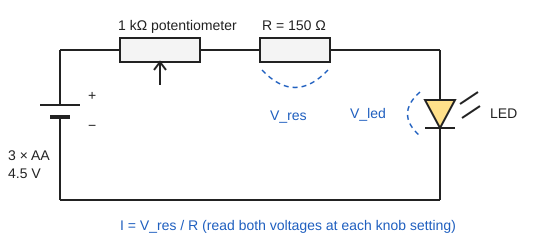

# 04.5 · Light as an electromagnetic wave and as photons

Light is the chemist's main measuring tool. It travels as an electromagnetic wave, which is why it has a wavelength and a frequency, but it is absorbed and emitted in packets called photons, each carrying an energy fixed by its frequency. Which packet size a molecule can swallow tells you what kind of change happens inside it: a spin flip, a rotation, a vibration or an electron jump. This lesson connects waves and photons to every branch of spectroscopy, and ends with the module's practical: measuring Planck's constant with LEDs, a battery and a multimeter.

## Why it matters

A chemist wants to break the H–Cl bond with light. Lesson [04.1](lesson-01.md) gave its bond energy, 4.43 eV. One photon must carry at least that much, and $E = hc/\lambda$ turns that into a wavelength: 280 nm, in the ultraviolet. Red light, however bright, will not do it; a dim UV lamp might. Choosing a lamp, a solvent that does not absorb, a spectrometer region or a sunscreen all come down to this one conversion. You will use it in UV–Vis (Module 19), IR and Raman (Module 20), NMR (Module 17) and photochemistry.

## Core ideas

> [!NOTE]
> The physics is stable. $h$, $c$ and $e$ are exact CODATA 2022 values from NIST, so the conversions below never change. LED wavelengths and voltages depend on the product; read your own from the seller's data sheet. The LED method is a teaching estimate, typically within 5–20 % of the true $h$. Checked 2026-10-16.

### Light is an electromagnetic wave

An electromagnetic wave is an electric field and a magnetic field oscillating at right angles to each other and to the direction of travel. In vacuum every such wave moves at $c = 299\,792\,458$ m/s, exactly. As for any wave (lesson [04.2](lesson-02.md)),

$$c = \lambda\nu,\qquad \tilde\nu = \frac{1}{\lambda} = \frac{\nu}{c}$$

where $\nu$ (Greek nu) is the frequency, the usual symbol in spectroscopy. Green light at 530 nm has $\nu = 3.00\times10^8 / 530\times10^{-9} = 5.66\times10^{14}$ Hz. The oscillating electric field is what pushes on the charges in a molecule (lesson [04.3](lesson-03.md)): light interacts with matter because matter is made of charges.

### Light also comes in photons

Some experiments only make sense if light arrives in lumps. In the photoelectric effect, light knocks electrons out of a metal. Below a threshold frequency, no electrons come out, however bright the light. Above it, electrons appear at once, even in dim light, and their energy depends on frequency, not on brightness. Einstein's explanation: light consists of photons, each with energy

$$E = h\nu = \frac{hc}{\lambda}$$

with Planck's constant $h = 6.626\,070\,15\times10^{-34}$ J s. Brightness is the number of photons per second; colour is the energy of each one. A molecule absorbs one photon at a time, so whether a change can happen depends on the photon energy, and how often it happens depends on the brightness.

### Two shortcuts worth memorising

$$E\,[\mathrm{eV}] = \frac{1239.84}{\lambda\,[\mathrm{nm}]},\qquad E\,[\mathrm{kJ/mol}] = \frac{119\,627}{\lambda\,[\mathrm{nm}]}$$

The second is the energy of one mole of photons (one einstein). Red light at 650 nm: 1.91 eV per photon, 184 kJ per mole of photons. In wavenumbers, $E = hc\tilde\nu$, and 1 eV corresponds to 8065.5 cm⁻¹.

### The spectrum, as a chemist sees it


Each region matches an energy gap inside molecules. Absorption happens when the photon energy equals a gap, $\Delta E = h\nu$. That is resonance (lesson 04.2) in quantum form. Rotational gaps are small, vibrational gaps are about a tenth of an eV, electronic gaps are a few eV. Compare with thermal energy, $k_BT$ = 0.026 eV at room temperature: rotations are thermally excited, vibrations mostly are not, and electronic excitation never is.

### Counting photons

A source of power $P$ (watts) at wavelength $\lambda$ emits $P/E_\text{photon}$ photons per second. A 1.0 mW green laser pointer (532 nm, 3.73×10⁻¹⁹ J per photon) emits $2.7\times10^{15}$ photons per second. In photochemistry the quantum yield, the number of molecules reacted per photon absorbed, is found exactly this way.

### An LED is a photon factory

In a light-emitting diode an electron crossing the device drops across an energy gap and emits one photon. To do that, each electron must first be lifted by at least the photon energy, so the LED barely conducts until the voltage across it reaches about $V_0 \approx hc/(e\lambda)$. Measure $V_0$ for several colours and plot it against $1/\lambda$: the slope is $hc/e$. That is the practical.

## Worked example

### 1. The HCl vibration and room temperature

The HCl band at 2886 cm⁻¹ (lesson 04.2): photon energy $E = hc\tilde\nu = 6.626\times10^{-34} \times 2.998\times10^{10}\ \mathrm{cm\,s^{-1}} \times 2886\ \mathrm{cm^{-1}} = 5.73\times10^{-20}$ J $= 0.358$ eV $= 34.5$ kJ/mol.

Compared with $RT = 2.48$ kJ/mol, that is about 14 $RT$. Interpretation: at room temperature almost every HCl molecule sits in its lowest vibrational level, which is why an IR spectrum at room temperature shows one main band rather than many. Module 21 makes this quantitative with the Boltzmann distribution.

### 2. Why NMR needs strong magnets

A 400 MHz NMR spectrometer uses photons of $E = h\nu = 6.626\times10^{-34} \times 4.00\times10^{8} = 2.65\times10^{-25}$ J, or 0.160 J/mol. That is $6\times10^{-5}\,RT$. The two spin states are almost equally populated, so only a tiny excess of nuclei can absorb. Higher fields raise the gap and the signal, which is why NMR magnets keep getting stronger. A 254 nm UV photon, by contrast, carries 471 kJ/mol, more than many single bonds.

## Hands-on

### Part A — pencil (20 min)

1. A germicidal lamp emits at 254 nm. Give the photon energy in eV and in kJ/mol.
2. What is the longest wavelength whose photons carry the 4.43 eV needed to break H–Cl?
3. A microwave oven works at 2.45 GHz. Find the wavelength and the photon energy in eV. Can a single microwave photon break a chemical bond?
4. How many photons per second does a 1.0 mW laser at 532 nm emit?

<details><summary>Answers to Part A</summary>

1. $1239.84/254 = 4.88$ eV; $119\,627/254 = 471$ kJ/mol.
2. $\lambda = 1239.84/4.43 = 280$ nm. Shorter wavelengths have enough energy. Enough energy is necessary but not sufficient: the molecule must also absorb at that wavelength.
3. $\lambda = 3.00\times10^8 / 2.45\times10^9 = 0.122$ m = 12.2 cm. $E = 6.626\times10^{-34} \times 2.45\times10^9 = 1.62\times10^{-24}$ J $= 1.0\times10^{-5}$ eV. No: it is about 400 000 times too small. Microwaves heat food by making water molecules rotate and collide, not by breaking bonds.
4. $E = 1239.84/532 = 2.33$ eV $= 3.73\times10^{-19}$ J; $10^{-3}/3.73\times10^{-19} = 2.7\times10^{15}$ photons per second.

</details>

### Part B — module practical: Planck's constant from LEDs (about 100 min)

This experiment uses every lesson of the module: energy and work (04.1), wavelength (04.2), the electronvolt (04.3), Ohm's law and safe meter use (04.4) and photons (04.5).

> [!WARNING]
> Battery power only: three AA alkaline cells in a holder, never mains, chargers or power banks. Always keep the 150 Ω resistor in series with the LED; without it the LED can overheat and burst. Use ordinary visible LEDs only, not UV or infrared LEDs and never a laser. Do not stare into a lit LED at close range, especially blue ones. Never short the battery terminals. Keep coin cells away from children.

What you need: four 5 mm LEDs of different colours with known peak wavelengths (red, amber or orange, yellow-green, blue; the seller's data sheet gives the wavelength), a 150 Ω resistor, a 1 kΩ potentiometer, a 3 × AA holder and cells, a breadboard and jumper wires, a digital multimeter, and the [Module 4 lab folder](../../labs/module-04/). The LED's longer leg is the anode (+).



Steps:

1. Build the loop of the diagram with the potentiometer turned to its maximum resistance. Measure the 150 Ω resistor first and use your measured value.
2. Insert the first LED, longer leg towards the resistor. Set the meter to DC volts.
3. Turn the knob in about 14 steps from dimmest to brightest. At each step, measure $V_\text{led}$ across the LED, then $V_\text{res}$ across the resistor. The current is $I = V_\text{res}/R$, so the meter never goes on a current range.
4. Repeat for each LED. Record everything in a CSV with the header `led,lambda_nm,R_ohm,V_led_V,V_res_V`, as in `led_example.csv`.
5. Fill in the three TODO functions in `lesson05_led_planck.py`, test on the example data, then run on yours:

```bash
py lesson05_led_planck.py
py lesson05_led_planck.py my_leds.csv
```

The script fits a straight line to the upper half of each I–V curve and extends it down to $I = 0$; that crossing is the turn-on voltage $V_0$. It then fits $V_0$ against $1/\lambda$ and reports $h = \text{slope} \times e/c$.

How you know it worked: on the example data the turn-on voltages are 1.94, 2.03, 2.13 and 2.60 V, and $h = (6.57 \pm 0.19)\times10^{-34}$ J s, within 1 % of the exact value, with an intercept of −0.03 V. On real LEDs expect 5–20 % agreement. Each $V_0$ should sit within about 0.1–0.2 V of $1239.84/\lambda$ [nm].

<details><summary>Reference solution and what real LEDs show</summary>

`current`: `V_res / R`. `turn_on_voltage`: mask `I >= 0.5*I.max()`, `s, b = np.polyfit(V[m], I[m], 1)`, return `-b/s`. `fit_planck`: `x = 1/(lam_nm*1e-9)`, `np.polyfit(x, V0, 1, cov=True)`, `h = slope*E/C`. Full code: `lesson05_led_planck_solution.py`.

Why real results scatter: the wavelength printed on the data sheet is a typical value, and each LED emits a band about 20–30 nm wide. The turn-on voltage is not sharp; where you put the fitting window shifts $V_0$ by a few hundredths of a volt. Blue and green LEDs made of a different material (InGaN) often turn on at a slightly different voltage than $hc/e\lambda$ predicts, so they can pull the slope; try the fit with and without them. A clearly non-zero intercept shows that each electron gains or loses some energy besides the photon, for example to heat. None of these is a mistake in your work: they are the limits of a 20-shekel apparatus, and naming them is part of the result.

Write the module report with the [lab report template](../../templates/lab-report.md) and an [error analysis](../../templates/error-analysis.md): aim, circuit diagram, one I–V plot, the table of $V_0$ and $\lambda$, the $V_0$ against $1/\lambda$ fit, $h$ with uncertainty, and the comparison with the exact value.

</details>

## Common mistakes

- Using $E = h\nu$ with a wavelength. Convert first: $\nu = c/\lambda$, or use $E = hc/\lambda$ directly.
- Forgetting nm-to-m conversion. 500 nm is $5.00\times10^{-7}$ m; leaving it as 500 gives an energy $10^9$ times too small.
- Thinking brighter light means more energetic photons. Brightness is the number of photons; the energy per photon depends only on frequency.
- Mixing per-photon and per-mole energies. 2 eV per photon is 193 kJ per mole of photons; compare like with like.
- Running an LED without a series resistor. The current rises steeply above $V_0$ and the LED fails within seconds.
- Reading the turn-on voltage by eye from when the LED first glows. The eye is a poor detector; use the extrapolated line.

## Key takeaways

- Light is a wave with $c = \lambda\nu$, and it is absorbed and emitted as photons of energy $E = h\nu = hc/\lambda$.
- Quick conversions: $E$ [eV] = 1239.84 / $\lambda$ [nm] and $E$ [kJ/mol] = 119 627 / $\lambda$ [nm].
- Each spectral region matches a type of molecular gap: spins, rotations, vibrations, electrons.
- Whether light can drive a change depends on the photon energy; how fast depends on the number of photons.
- An LED turns on at about $hc/e\lambda$, so a battery, a resistor and a multimeter can measure Planck's constant.

## Sources

- [OpenStax University Physics Volume 2, 16.5 The Electromagnetic Spectrum](https://openstax.org/books/university-physics-volume-2/pages/16-5-the-electromagnetic-spectrum) — regions and their uses.
- [OpenStax University Physics Volume 3, 6.2 Photoelectric Effect](https://openstax.org/books/university-physics-volume-3/pages/6-2-photoelectric-effect) — the evidence for photons.
- [OpenStax Chemistry 2e, 6.1 Electromagnetic Energy](https://openstax.org/books/chemistry-2e/pages/6-1-electromagnetic-energy) — the chemist's view of light and photons.
- [NIST CODATA 2022: Planck constant](https://physics.nist.gov/cgi-bin/cuu/Value?h) and [speed of light](https://physics.nist.gov/cgi-bin/cuu/Value?c) — exact values.
- [Science in School (2014), measuring the Planck constant](https://scienceinschool.org/2014/issue28/planck) — the LED method with I–V extrapolation, as used in schools.
- [Hu, Melville and Hepburn (2003), J. Chem. Phys. 119, 8938](https://chem.ubc.ca/node/8128) — HCl bond energy used in Why it matters.
