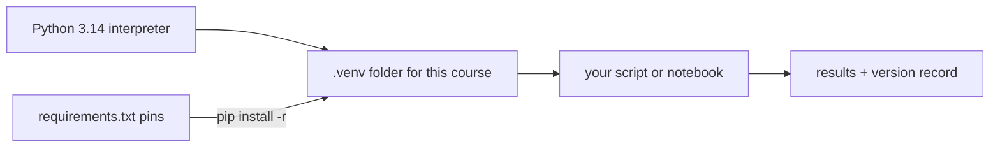

# 05.1 · Python setup and the scientific stack

From this module on, every data analysis in the course is done in Python. This lesson sets up the tools once and properly: one Python version, one isolated environment per project, and package versions that are written down so your results come out the same next year. You finish with a first chemistry script that turns formulas into molar masses and solution recipes.

## Why it matters

Imagine you fitted a calibration line in 2026 and a reviewer asks for the analysis again in 2028. You rerun the script and the slope changes in the fourth digit, or the script crashes, because a library changed a default or removed a function. Which number is right? You cannot say, unless you know exactly which versions produced the first result. Real labs hit this all the time: a spreadsheet macro that only works on one PC, a script that "worked last month". A pinned, isolated setup turns your analysis into a method someone else can repeat, which is the same idea as the lab notebook from [01.3](../module-01/lesson-03.md).

## Core ideas

> [!NOTE]
> The ideas (interpreter, packages, environments, pins) are stable. The versions are not. Checked on 2026-10-16: Python 3.14.8 is the newest 3.14 release (30 September 2026); Python 3.15.0 came out on 9 October 2026, and some scientific packages may not yet ship ready-made builds for it, so this course pins 3.14. On Windows, python.org now offers the Python install manager (version 26.4) first; the classic `.exe` installer is deprecated since 3.14. Package pins are in `labs/common/requirements.txt`: numpy 2.5.4, scipy 1.18.1, matplotlib 3.11.2, pandas 3.0.6, jupyterlab 4.6.4, uncertainties 3.2.3, lmfit 1.3.4, rdkit 2026.9.1.

### The pieces of the stack

- The **interpreter** is the program `python` that reads your `.py` file and runs it line by line.
- A **package** (library) is code someone else wrote that you load with `import`. The scientific stack is a small set of them: **numpy** (fast arrays of numbers), **scipy** (fitting, integration, ODEs, statistics), **matplotlib** (plots), **pandas** (tables), **uncertainties** (error propagation), **lmfit** (friendlier fitting), **jupyterlab** (notebooks) and **rdkit** (molecules, used in later modules).
- **PyPI**, the Python Package Index, is the public store of packages. **pip** is the tool that downloads and installs them.
- A **virtual environment** (venv) is a folder with its own copy of the interpreter's package list. Packages installed inside it do not touch any other project. You make one per project and can delete it and rebuild it in a minute.
- A **pin** is an exact version, written `numpy==2.5.4`. A **requirements file** is a list of pins. With the same Python and the same pins, everyone gets the same code.



### Why pin, and what a version number says

Most packages use **semantic versioning**: `major.minor.patch`. A patch release (2.5.3 → 2.5.4) fixes bugs. A minor release (2.4 → 2.5) adds features and may remove things that were deprecated (announced as going away) a few releases earlier. A major release (pandas 2 → 3) may change behaviour on purpose. Example: `numpy.trapz`, a common integration function, was deprecated in NumPy 2.0 and removed in 2.4. Old tutorials that use it now fail. A pin protects you from such surprises; upgrading then becomes a deliberate step that you test.

### Python in five minutes

You will meet these building blocks in every lab script:

```python
M_water = 18.015                            # a float (number with a decimal point), g/mol
n_atoms = 3                                 # an int (whole number)
name = "water"                              # a str (text)
weights = {"H": 1.0080, "O": 15.999}        # a dict: keys -> values
masses = [1.20, 1.35, 1.28]                 # a list: an ordered collection

def moles(mass_g, M):                       # a function: named, reusable steps
    return mass_g / M

print(f"{name}: {moles(9.0, M_water):.3f} mol")   # f-string: water: 0.500 mol
```

Indentation (four spaces) marks what belongs inside a function or a loop. `:.3f` in an f-string means "three digits after the decimal point"; use it to report the right number of significant figures ([01.2](../module-01/lesson-02.md)).

### Floats are not exact

Computers store numbers in binary, so most decimals are approximations: `0.1 + 0.2` prints `0.30000000000000004`. The error is about 1 part in $10^{16}$, far below any measurement uncertainty. It matters in one place: never test two floats with `==`. Use `abs(a - b) < 1e-9` or `math.isclose(a, b)`.

## Worked example

### Molar mass of sucrose and a solution recipe

Sucrose is $\mathrm{C_{12}H_{22}O_{11}}$. With the IUPAC abridged standard atomic weights (2024 table: C 12.011, H 1.0080, O 15.999 g/mol):

$$M = 12(12.011) + 22(1.0080) + 11(15.999) = 144.132 + 22.176 + 175.989 = 342.297\ \mathrm{g\,mol^{-1}}$$

To make 250 mL of a 0.100 mol/L solution you need

$$m = c\,V\,M = 0.100\ \mathrm{mol\,L^{-1}} \times 0.250\ \mathrm{L} \times 342.297\ \mathrm{g\,mol^{-1}} = 8.557\ \mathrm{g}$$

The same calculation in Python, with a dictionary of atomic weights and a dictionary of atom counts:

```python
ATOMIC_WEIGHT = {"C": 12.011, "H": 1.0080, "O": 15.999}
sucrose = {"C": 12, "H": 22, "O": 11}

M = sum(n * ATOMIC_WEIGHT[el] for el, n in sucrose.items())
m = 0.100 * 250 / 1000 * M          # mL -> L inside the formula
print(f"M = {M:.3f} g/mol, weigh {m:.3f} g")   # M = 342.297 g/mol, weigh 8.557 g
```

Notice `250 / 1000`: the code converts mL to L explicitly. Unit slips are the most common error in chemistry code, just as on paper, so convert at one clearly marked place.

Reality check: a kitchen scale reading to 1 g cannot weigh 8.557 g. On a 0.01 g pocket scale you would weigh 8.56 g and report the concentration to three significant figures.

## Hands-on

What you need: a computer (Windows, macOS or Linux) with internet access for the downloads, about 2 GB free disk space, and the [Module 5 lab folder](../../labs/module-05/). Time: about 60 minutes, most of it downloads.

### Part A — install and verify (about 40 min)

1. Install Python 3.14.
   - Windows: install the Python install manager from python.org, then in a terminal run `py install 3.14`. Check with `py list`.
   - macOS: install 3.14 from python.org. Linux: use your distribution's `python3.14` package, or python.org.
2. Get the course files (download the repo or the lab zip) and open a terminal in the repo root, the folder that contains `labs/`.
3. Create and fill the environment:

```bash
py -3.14 -m venv .venv
.venv\Scripts\python -m pip install --upgrade pip
.venv\Scripts\python -m pip install -r labs/common/requirements.txt
```

   On macOS or Linux replace `py -3.14` by `python3.14` and `.venv\Scripts\python` by `.venv/bin/python`. If you prefer, activate the environment first (`.venv\Scripts\Activate` on Windows, `source .venv/bin/activate` elsewhere); then plain `python` means the environment's Python.

4. Verify:

```bash
.venv\Scripts\python labs/module-05/check_setup.py
```

How you know it worked: the script prints `Python 3.14.x`, `virtual environment: yes`, `ok` on all eight package lines and `All good`. A `DIFFERS` or `MISSING` line names the package to fix; rerun the install line in step 3.

### Part B — your first chemistry script (about 20 min)

Open `labs/module-05/lesson01_molar_mass.py` in any editor (VS Code, or the editor in JupyterLab from lesson [05.5](lesson-05.md)). Fill in the three TODO functions: `parse_formula` (turn `"C12H22O11"` into a dictionary of counts), `molar_mass` and `mass_for_solution`. Run it from the lab folder:

```bash
cd labs/module-05
..\..\.venv\Scripts\python lesson01_molar_mass.py
..\..\.venv\Scripts\python lesson01_molar_mass.py CH3COOH
```

Expected result: a table of six kitchen substances. Table salt 58.440 g/mol and 1.461 g for 250 mL of 0.100 M; sucrose 342.297 g/mol and 8.557 g; baking soda 84.006 g/mol; citric acid 192.123 g/mol. `CH3COOH` must give the same 60.052 g/mol as `C2H4O2`, which tests that a repeated element is added, not overwritten. The script ends with `Check passed`.

Record in your notebook page ([notebook template](../../templates/notebook-page.md)): the date, `py list` output, and the `check_setup.py` output. That record is your version log for the whole module.

<details><summary>Hints and reference solution</summary>

- `re.findall(r"([A-Z][a-z]?)(\d*)", "NaHCO3")` returns `[('Na', ''), ('H', ''), ('C', ''), ('O', '3')]`. An empty count means 1: `int(number) if number else 1`.
- Use `counts[symbol] = counts.get(symbol, 0) + n` so that the second C in `CH3COOH` adds to the first.
- `molar_mass`: `return sum(n * ATOMIC_WEIGHT[s] for s, n in counts.items())`.
- `mass_for_solution`: `return conc_mol_per_L * volume_mL / 1000 * M`.

Full code: `labs/module-05/lesson01_molar_mass_solution.py`. Brackets such as `Ca(OH)2` are not handled; extending the parser to them is a good extra exercise.

</details>

## Common mistakes

- Installing into the wrong Python. `pip install numpy` may go to a system Python, not your venv. Always call `.venv\Scripts\python -m pip`, or activate first, and run `check_setup.py` to see which Python is used.
- Picking the newest Python on day one. A brand-new release (3.15.0 here) can lack ready-made builds of some packages, so pip tries to compile them and fails. Use the version the course pins.
- Naming your own file after a package. A script called `numpy.py` or `math.py` in your folder is imported instead of the real one and gives strange errors. Rename it and delete any `__pycache__` folder next to it.
- Copying code from an old tutorial. Functions get removed (`np.trapz` is gone in NumPy 2.5). If an attribute "does not exist", check the current documentation for its replacement.
- Committing the `.venv` folder to git. It is large and machine-specific. Commit the requirements file instead; the course's `.gitignore` already excludes `.venv/`.
- Hiding unit conversions. Write `volume_mL / 1000` where it happens, with the unit in the variable name.

## Key takeaways

- One Python version, one virtual environment per project, and a requirements file with exact pins make an analysis repeatable.
- Install with `python -m pip` from the environment's own Python, then verify with a version check rather than trust.
- Version numbers tell you the risk of an upgrade; deprecated functions really do disappear.
- Dictionaries, functions and f-strings already cover a useful chemistry calculator.
- Never compare floats with `==`, and keep units in variable names.

## Sources

- [Python.org downloads](https://www.python.org/downloads/) — current releases (3.14.8, 3.15.0) and the Python install manager, checked 2026-10-16.
- [Using Python on Windows (Python 3.14 docs)](https://docs.python.org/3.14/using/windows.html) — install manager commands, deprecation of the classic installer.
- [venv — creation of virtual environments](https://docs.python.org/3.14/library/venv.html) — how environments work.
- [IUPAC CIAAW abridged standard atomic weights 2024](https://www.ciaaw.org/abridged-atomic-weights.htm) — the atomic weights in the script.
- [MIT OCW 6.100L](https://ocw.mit.edu/courses/6-100l-introduction-to-cs-and-programming-using-python-fall-2022/) — a full introductory programming course if you want more depth.
