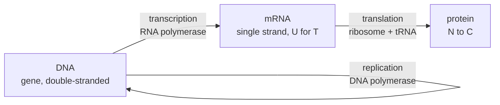

# 06.3 · Nucleic acids and the flow of information

DNA is a polymer that stores information in the order of four bases, and copies it by the simplest chemistry imaginable: each base on one strand pairs with exactly one partner on the other through hydrogen bonds. RNA carries copies of that information to the ribosome, where every three bases select one amino acid. This lesson reads nucleic acids as molecules (a charged backbone, flat stacked bases, specific hydrogen bonds), follows the information from gene to protein in Python, and pulls visible strands of DNA out of strawberries with dish soap, salt and alcohol.

## Why it matters

A lab orders two short DNA primers to copy the ubiquitin gene by PCR, the polymerase chain reaction. The reaction is heated to separate the strands, then cooled so the primers can stick. If one primer melts off at 58 °C and the other at 72 °C, no single cooling temperature suits both, and the copying fails or copies the wrong sequence. Primer design is applied physical chemistry: hydrogen bonds, stacking, salt and temperature. The same ideas explain why DNA survives in a cell, why salt is in every DNA buffer, and why a single changed letter can shorten a protein to half its length. You will meet UV absorbance of DNA in Module 19 and nucleic acid biochemistry in Module 29.

## Core ideas

> [!NOTE]
> The chemistry and the genetic code are stable. Helix dimensions are textbook B-DNA values from OpenStax Biology 2e. The Wallace rule is a rough estimate; real primer design tools use nearest-neighbour thermodynamics and salt corrections, and their versions change. The genome size (about 3.1 billion base pairs per copy) refers to the current human reference genome. Checked 2026-10-16.

### Nucleotides and the backbone

A nucleotide has three parts: a nitrogen-containing base, a five-carbon sugar, and a phosphate group. In DNA the sugar is deoxyribose; in RNA it is ribose, which has one extra –OH. The bases are of two types: purines, with two fused rings (adenine A, guanine G), and pyrimidines, with one ring (cytosine C, thymine T in DNA, uracil U in RNA).

Nucleotides join by phosphodiester bonds: the phosphate links the 3' carbon of one sugar to the 5' carbon of the next. (The prime marks number the sugar's carbons, to tell them apart from the base's atoms.) A strand therefore has a direction, written from its 5' end to its 3' end, like a protein's N to C. Each phosphate carries one negative charge at pH 7, so DNA is a long polyanion. That charge keeps DNA dissolved in water and makes strands repel each other, unless positive ions screen them.

### The double helix

Two strands wind around each other in opposite directions (antiparallel). Bases point inwards and pair: A with T through two hydrogen bonds, G with C through three. A purine always faces a pyrimidine, so every pair has the same width and the helix is uniform: 2 nm across, 0.34 nm between neighbouring pairs, and about 10 pairs per turn of 3.4 nm.

Two rules follow at once. In double-stranded DNA the amount of A equals T and G equals C (Chargaff's rule). And one strand fixes the other: the complementary strand of 5'-ATGC-3' is 5'-GCAT-3', the complement read backwards. This reverse complement is how sequences on the opposite strand are always written.

### What holds the strands together

Hydrogen bonds give the specificity, but much of the stability comes from base stacking: the flat bases sit on top of each other like coins, held by van der Waals and hydrophobic interactions (lesson [06.1](lesson-01.md)). Heating separates the strands, called melting; the temperature where half the duplex has separated is the melting temperature $T_m$. GC-rich DNA melts higher, because G–C pairs have three hydrogen bonds and stack more strongly. Salt raises $T_m$, because cations screen the repulsion between the two negative backbones, exactly the permittivity and screening story of lesson [04.3](../module-04/lesson-03.md).

For a short oligonucleotide (a synthetic strand of about 20 bases or fewer) a quick first estimate is the Wallace rule:

$$T_m \approx 2\,(\mathrm{A}+\mathrm{T}) + 4\,(\mathrm{G}+\mathrm{C})\ \ ^\circ\mathrm{C}$$

counting bases of each kind. A 20-mer with 10 G or C has $T_m \approx 2 \times 10 + 4 \times 10 = 60$ °C.

### From gene to protein



A gene is copied into messenger RNA (mRNA), with U in place of T. The ribosome reads the mRNA three bases at a time. Each triplet, a codon, specifies one amino acid. There are $4^3 = 64$ codons: 61 code for the 20 amino acids and 3 (UAA, UAG, UGA) mean stop. AUG codes for methionine and also marks the start. Because 61 codons share 20 amino acids, most amino acids have several codons; the code is degenerate.

Changing one base is a point mutation. It can be silent (a new codon for the same amino acid), missense (a different amino acid) or nonsense (a stop codon, cutting the protein short).

### How much DNA is in a cell

One copy of the human genome is about $3.1\times10^{9}$ base pairs. Stretched out, that is $3.1\times10^9 \times 0.34$ nm = 1.05 m, and most cells carry two copies, about 2 m of DNA, packed into a nucleus about 5–10 µm across by winding around proteins called histones.

## Worked example

### 1. Base composition from one number

A double-stranded DNA sample is 30 % adenine. What are the other three percentages? By Chargaff's rule T = A = 30 %. That leaves 40 % for G and C, which are equal: G = C = 20 %. The GC content is 40 %. A single-stranded virus would not obey this rule, because there is no partner strand; finding A ≠ T in a sample is evidence that it is single-stranded.

### 2. The mass and information of a genome

One base pair weighs about 650 g/mol (as the sodium salt). One genome copy: $3.1\times10^9 \times 650 / 6.022\times10^{23} = 3.3\times10^{-12}$ g, or 3.3 pg. Each base pair is one of four choices, which is 2 bits, so a copy holds $2 \times 3.1\times10^9 / 8 = 7.8\times10^8$ bytes, about 775 MB. Interpretation: a few picograms of a polymer store as much as a CD, and the cell copies it with about one error in a very large number of bases.

## Hands-on

### Part A — DNA from strawberries (home, 30 min)

> [!WARNING]
> Kitchen and pharmacy materials only. Pharmacy alcohol (70 % ethanol or isopropyl rubbing alcohol) is flammable and irritates the eyes: use about 50 mL, keep it away from flames and hot plates, work by an open window, and wear safety glasses. Do not drink it or eat anything from the experiment. Do the risk assessment from lesson [01.4](../module-01/lesson-04.md) first.

What you need: 2–3 strawberries (kiwi or split peas also work), a zip-lock bag, 2 teaspoons of washing-up liquid, half a teaspoon of salt, 100 mL of water, a sieve or coffee filter, a tall clear glass, a 20 mL oral syringe, a wooden skewer, pharmacy alcohol chilled in the freezer for an hour, and optionally a spoon of fresh pineapple juice.

Steps, with the chemistry of each:

1. Mix the water, salt and washing-up liquid. Put the strawberries in the bag, add 20 mL of the mixture and squash for two minutes. Mechanical force breaks the cell walls. The detergent is an amphiphile, like the phospholipids of lesson 06.1: it dissolves the cell and nuclear membranes and releases the DNA.
2. Optional: add the pineapple juice. It contains a protease that cuts the histone proteins off the DNA.
3. Filter about 10 mL of the liquid into the glass.
4. Tilt the glass and slowly run 15–20 mL of cold alcohol down the side so it floats on top. Do not mix.
5. Wait two minutes. White, cloudy strands appear at the boundary. Wind them onto the skewer.

How you know it worked: a cloudy white layer forms within a minute, and strands can be lifted out on the skewer. Write what you saw on a [notebook page](../../templates/notebook-page.md).

<details><summary>Why the DNA comes out, and what the strands really are</summary>

In water, DNA's negative phosphates are surrounded by water molecules and Na⁺ ions, and the high permittivity of water (about 78) keeps the Na⁺–phosphate attraction weak. Alcohol has a much lower permittivity (about 25 for ethanol), so in the alcohol layer the Coulomb attraction between Na⁺ and phosphate becomes several times stronger. The ions pair up, the strands lose their net charge, stop repelling each other and clump out of solution. Salt supplies the Na⁺, and cold alcohol lowers solubility further.

The strands are millions of DNA molecules tangled together, mixed with RNA and with pectin and other plant sugars. This is a crude extract: a real lab would purify it further and measure its purity by UV absorbance (Module 19). Strawberries are a good choice because they carry many copies of each chromosome and are soft to mash.

</details>

### Part B — from gene to protein in Python (50 min)

`ubiquitin_designed.fasta` in the [Module 6 lab folder](../../labs/module-06/) is a coding sequence for human ubiquitin. It is designed, not natural: the course chose one common human codon for each amino acid. Fill in the four TODO functions in `lesson03_dna.py` and run:

```bash
py lesson03_dna.py
```

Then answer: (1) Does your protein match residues 1–76 of [UniProt P0CG48](https://www.uniprot.org/uniprotkb/P0CG48/entry)? (2) The script proposes a forward primer (first 20 bases) and a reverse primer (reverse complement of the last 20). Are they a good pair for PCR? (3) What do the two mutations at codon 48 do?

How you know it worked: 231 bases, GC content 64.1 %; a 76-residue protein identical to UniProt; forward primer 5'-ATGCAGATCTTCGTGAAGAC-3' with Wallace $T_m$ 58 °C, reverse primer 5'-TCAGCCGCCCCGCAGCCGCA-3' with 72 °C; codon 48 AAG to AGG gives Arg at 48 and full length, AAG to TAG gives a 47-residue protein; one genome copy 1.05 m, 3.3 pg, 775 MB.

<details><summary>Reference solution and answers</summary>

`reverse_complement`: `"".join(pair[b] for b in reversed(seq))`. `gc_content`: `(seq.count("G") + seq.count("C")) / len(seq)`. `wallace_tm`: `2*at + 4*gc`. `translate`: loop in steps of 3, look up `CODON_TABLE`, stop at `"*"`. Full code: `lesson03_dna_solution.py`.

(1) Yes, all 76 residues match. (2) No: 58 °C against 72 °C is a 14 °C gap. The reverse primer is 80 % GC and would also stick to wrong places at the forward primer's temperature. Shorten it, or move it so that both primers have similar GC content and $T_m$ within a few degrees. A design tool with nearest-neighbour thermodynamics would give better numbers than the Wallace rule. (3) AGG is a missense mutation, Lys48 to Arg. Lys48 is the residue through which ubiquitin chains are linked, so this protein cannot form those chains; the K48R mutant is a classic research tool. TAG is a nonsense mutation: the protein stops after residue 47 and loses its C-terminal tail, which it needs to attach to other proteins.

</details>

## Common mistakes

- Writing the complement without reversing it. The partner of 5'-ATGC-3' is 5'-GCAT-3', not 5'-TACG-3'.
- Applying Chargaff's rule to a single strand, or to RNA. It holds for double-stranded DNA only.
- Saying G–C pairs are stronger "because of one more hydrogen bond" and stopping there. Stacking contributes as much or more, and salt changes stability a lot.
- Using the Wallace rule for long DNA or as an exact value. It is a first estimate for short primers.
- Reading the sequence in the wrong frame. Translation starts at the first base of the start codon; a shift of one base changes every codon after it.

## Key takeaways

- DNA and RNA are polyanions: a sugar–phosphate backbone with a 5' to 3' direction, carrying four kinds of base.
- A pairs with T (two hydrogen bonds), G with C (three); the duplex is 2 nm wide with 0.34 nm per pair and about 10 pairs per turn.
- Stability comes from stacking and hydrogen bonds; GC content and salt raise the melting temperature.
- Information flows DNA to mRNA to protein, three bases per amino acid, with 61 sense codons and 3 stops.
- Salt plus a low-permittivity solvent makes DNA precipitate, which is why the strawberry extraction works.

## Sources

- [OpenStax Biology 2e, 3.5 Nucleic Acids](https://openstax.org/books/biology-2e/pages/3-5-nucleic-acids) — nucleotides, sugars, bases, phosphodiester bonds.
- [OpenStax Biology 2e, 14.2 DNA Structure and Sequencing](https://openstax.org/books/biology-2e/pages/14-2-dna-structure-and-sequencing) — 2 nm diameter, 0.34 nm per base pair, 10 pairs per turn, antiparallel strands, 2 and 3 hydrogen bonds.
- [OpenStax Biology 2e, 15.1 The Genetic Code](https://openstax.org/books/biology-2e/pages/15-1-the-genetic-code) — codons, start and stop, degeneracy.
- [Genetic Science Learning Center, How to extract DNA from anything living](https://learn.genetics.utah.edu/content/labs/extraction/howto/) — the kitchen extraction and the role of each ingredient.
- [UniProt P0CG48](https://www.uniprot.org/uniprotkb/P0CG48/entry) — the ubiquitin sequence used to check the translation.
- [Wikipedia: Human genome](https://en.wikipedia.org/wiki/Human_genome) — about 3.1 billion base pairs in the reference genome.
