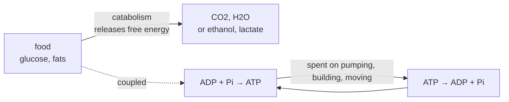

# 06.4 · Metabolism and energy currency

Every cell runs on one energy currency, ATP. Breaking food down releases free energy in large, awkward amounts; the cell captures it in many small, standard packets by making ATP from ADP and phosphate, then spends those packets wherever work is needed: pumping ions, building proteins, contracting muscle. This lesson does the bookkeeping with the free-energy equation you will meet fully in Module 8, and ends with the module's practical: you measure how much ATP a bottle of yeast makes overnight, work out how much energy that ATP stores, and see in a crystal structure how an enzyme grips the ATP molecule.

## Why it matters

A baker and a brewer use the same yeast, but treat it differently. With oxygen, yeast grows fast and makes little alcohol; without oxygen, it makes alcohol and CO₂ and grows slowly. The reason is an ATP budget: respiration with oxygen makes about 30 ATP per glucose, fermentation only 2. The same budget explains why sprinting muscles tire and why a drug that blocks ATP synthesis is a poison. Reading it needs one equation, $\Delta G = \Delta G^{\circ\prime} + RT\ln Q$.

## Core ideas

> [!NOTE]
> The thermodynamics is stable. Published values of $\Delta G^{\circ\prime}$ for ATP hydrolysis depend on pH, Mg²⁺ and ionic strength: OpenStax uses −30.5 kJ/mol, eQuilibrator's default conditions give about −26 kJ/mol. Cell concentrations vary between cell types and states; the ones used here are illustrative. ATP yields per glucose are estimates (about 30 for respiration). Checked 2026-10-16.

### Metabolism in one picture



Catabolism breaks molecules down and releases free energy; anabolism builds molecules and consumes it. ATP links the two. Each ATP molecule is made and spent again many times over: the pool is small, the flow is huge.

### ATP, a nucleotide with a charged tail

ATP is adenosine triphosphate: adenine, ribose and three phosphate groups in a row, the same building block as RNA in lesson [06.3](lesson-03.md). At pH 7 the tail carries about four negative charges, usually paired with Mg²⁺. Hydrolysis removes the last phosphate:

$$\mathrm{ATP + H_2O \rightarrow ADP + P_i}$$

The energy does not sit in a special "high-energy bond"; breaking any bond costs energy. It comes from the whole reaction: the products relieve the repulsion between crowded negative charges (lesson [04.3](../module-04/lesson-03.md)), are better solvated, and phosphate gains resonance stabilisation.

### Free energy depends on concentrations

The standard biochemical free energy $\Delta G^{\circ\prime}$ refers to pH 7 and 1 mol/L of everything else. Cells are nowhere near 1 mol/L. The actual free energy change is

$$\Delta G = \Delta G^{\circ\prime} + RT\ln Q, \qquad Q = \frac{[\mathrm{ADP}][\mathrm{P_i}]}{[\mathrm{ATP}]}$$

with concentrations in mol/L. Because the cell keeps ATP high and ADP low, $Q$ is tiny, $\ln Q$ is large and negative, and $\Delta G$ is much more negative than $\Delta G^{\circ\prime}$: about −50 to −57 kJ/mol in a working cell. The logarithm (lesson [02.1](../module-02/lesson-01.md)) turns a concentration ratio into an energy.

### Coupling: paying for uphill steps

A process with positive $\Delta G$ cannot run alone. Linked to ATP hydrolysis in one enzyme, the free energies add. If the sum is negative, the coupled process runs. That is how the sodium–potassium pump moves 3 Na⁺ out and 2 K⁺ in per ATP, building the gradients of lesson [06.1](lesson-01.md). Moving an ion costs

$$\Delta G_\text{ion} = RT\ln\frac{c_\text{to}}{c_\text{from}} + zF\,(V_\text{to} - V_\text{from})$$

a concentration term plus an electrical term, per mole of ions.

### Two ways to spend a glucose

- Respiration (with O₂): glycolysis, the citric acid cycle and oxidative phosphorylation oxidise glucose to CO₂ and water. Electrons travel via the carrier NADH to oxygen, and most ATP is made by ATP synthase in the mitochondrial membrane. Free energy released: about −2910 kJ/mol (eQuilibrator, all species at 1 mM). Yield: about 30 ATP.
- Fermentation (no O₂): glycolysis alone makes 2 ATP. Yeast then turns pyruvate into ethanol and CO₂ to recycle NADH back to NAD⁺, so glycolysis can continue. Overall: glucose → 2 ethanol + 2 CO₂ + 2 ATP. One CO₂ per ATP, which is what makes the home practical possible.

By Hess's law, oxidising glucose directly or fermenting it and then oxidising the two ethanols must release the same total. With ethanol oxidation at −1325 kJ/mol (OpenStax Appendix G), fermentation releases about $-2910 - 2(-1325) \approx -260$ kJ/mol, a rough figure because it mixes standard states.

### How an enzyme holds ATP

An ATP-using enzyme grips its fuel with the chemistry of lesson [06.2](lesson-02.md): backbone N–H groups and lysines hydrogen-bond to the phosphates, a metal ion (Mg²⁺, or Mn²⁺ in some crystals) bridges phosphates to aspartates, and the adenine hydrogen-bonds to a hinge in the backbone. You will count these in PDB 1ATP, protein kinase A.

## Worked example

### 1. ATP in a cell

Illustrative cytosol concentrations: ATP 2.25 mM, ADP 0.25 mM, Pi 1.65 mM, at 37 °C ($RT$ = 2.579 kJ/mol).

$$Q = \frac{(0.25\times10^{-3})(1.65\times10^{-3})}{2.25\times10^{-3}} = 1.83\times10^{-4}$$

$$\Delta G = -30.5 + 2.579 \ln(1.83\times10^{-4}) = -30.5 - 22.2 = -52.7\ \text{kJ/mol}$$

Interpretation: concentrations add over 70 % to the standard value. At equilibrium the ATP/ADP ratio at this phosphate level would be about $10^{-8}$; the cell holds it at 9, about $10^{9}$ times away from equilibrium.

### 2. Can one ATP pay for the sodium–potassium pump?

Use lesson 06.1's values: Na⁺ 15 mM in, 145 mM out; K⁺ 150 mM in, 4 mM out; membrane potential −70 mV inside.

Each Na⁺ moved out: $2.579\ln(145/15) + 96.485 \times (0 - (-0.070)) = 5.85 + 6.75 = 12.6$ kJ/mol. Three of them: 37.8 kJ.

Each K⁺ moved in: $2.579\ln(150/4) + 96.485 \times (-0.070 - 0) = 9.34 - 6.75 = 2.59$ kJ/mol. Two of them: 5.2 kJ.

Total: 43.0 kJ per cycle, against 52.7 kJ from one ATP. The pump runs, with about 10 kJ to spare. For Na⁺ the electrical term works against the pump; for K⁺ it helps.

## Hands-on

### Part A — pencil (20 min)

1. A cell has ATP 3.0 mM, ADP 0.8 mM and Pi 5.0 mM at 37 °C. What is $\Delta G$ for ATP hydrolysis?
2. A biosynthetic step has $\Delta G$ = +40 kJ/mol in the cell. Can one ATP (−52.7 kJ/mol) drive it? And a step of +60 kJ/mol?
3. Using about 50 kJ/mol per ATP, what fraction of the free energy of glucose does respiration (30 ATP, 2910 kJ/mol) store as ATP? And fermentation (2 ATP, 260 kJ/mol)?

<details><summary>Answers to Part A</summary>

1. $Q = (0.8\times10^{-3})(5.0\times10^{-3})/(3.0\times10^{-3}) = 1.33\times10^{-3}$; $\Delta G = -30.5 + 2.579\ln(1.33\times10^{-3}) = -30.5 - 17.1 = -47.6$ kJ/mol.
2. +40: yes, $-52.7 + 40 = -12.7$ kJ/mol. +60: no, $+7.3$ kJ/mol. The cell either couples two ATP, or splits ATP to AMP and pyrophosphate and then hydrolyses the pyrophosphate.
3. Respiration: $30 \times 50 / 2910 = 52$ %. Fermentation: $2 \times 50 / 260 = 38$ %. Fermentation releases far less, because the ethanol still holds most of the energy. With 30.5 kJ/mol per ATP respiration gives about 31 %, close to the "about 34 %" quoted by OpenStax.

</details>

### Part B — module practical: the ATP budget (about 2 h of work, plus an overnight wait)

This practical uses the whole module: gradients (06.1), hydrogen bonds in proteins (06.2), nucleotides (06.3) and free energy (06.4).

> [!WARNING]
> Kitchen materials only: dry baker's yeast, table sugar and warm tap water. Never close the bottle tightly: fermenting yeast makes gas and a capped bottle can burst. Use a loose plug of cotton wool. Water for the yeast should feel warm, not hot (about 35 °C). After a day the liquid contains alcohol: do not drink it; pour it down the sink. Label both bottles. Do the risk assessment from lesson [01.4](../module-01/lesson-04.md) first.

What you need: two clean 500 mL plastic bottles, cotton wool, a scale (0.1 g or better is ideal; a 1 g kitchen scale works with more uncertainty), 40 g of table sugar, one sachet of dry yeast (weigh it), a measuring jug, a warm spot (25–30 °C), a browser, and the [Module 6 lab folder](../../labs/module-06/).

#### 1. Ferment (30 min of work, then 24 h)

1. Into each bottle put 250 g of warm water and 20.0 g of sugar (write the exact masses). Swirl to dissolve.
2. Add the yeast to one bottle only. The other is the control: it tells you how much mass the bottles lose by evaporation alone.
3. Plug both with cotton wool. Weigh each at once (time 0), then at 1, 2, 3, 4, 6, 8, 10 and 12 hours if you can, and at 24 hours. Swirl gently before each weighing so dissolved CO₂ escapes. Record `t_h,m_yeast_g,m_control_g` as in `fermentation_example.csv`.

#### 2. Analyse (40 min)

Fill in the three TODO functions in `lesson04_atp_budget.py`, set `SUGAR_G` and `YEAST_G` to your masses, and run:

```bash
py lesson04_atp_budget.py
py lesson04_atp_budget.py my_bottles.csv
```

The script turns the mass losses into CO₂ (yeast minus control), ATP made (one per CO₂), energy stored at −52.7 kJ/mol, and an early rate per gram of yeast.

How you know it worked: on the example data, 8.4 g of CO₂ leave in 24 h, 82 % of the 10.29 g that 20 g of sucrose could give. That is 0.191 mol of ATP, storing 10.1 kJ. The early rate is 0.81 g CO₂ per hour, 2.6 mmol ATP per gram of yeast per hour.

#### 3. The enzyme that holds ATP (40 min)

1. Open `https://molstar.org/viewer/?pdb=1ATP`. Find the ATP ligand and the two Mn²⁺ ions next to its phosphates. Click the ATP: Mol* shows its non-covalent interactions with the protein as dashed lines.
2. Count the hydrogen bonds to the adenine, the ribose and the phosphates. Note which residues bridge to the phosphates through a metal ion.
3. Check your count with Python:

```bash
py fetch_pdb.py 1ATP
py lesson04_atp_site.py
```

Fill in the TODO function `polar_contacts` first. It lists every N or O atom of the protein within 3.3 Å of an N or O atom of ATP, and marks pairs that share a metal ion.

How you know it worked: 21 polar contacts with 13 residues, 6 of them through Mn²⁺ (all to Asp184), leaving 15 candidate hydrogen bonds: 3 to the adenine (Glu121 O, Val123 N, Thr183 OG1), 4 to the ribose, 8 to the phosphates (including the backbone N–H of Ala21, Ser53, Phe54 and Gly55, and Lys72 and Lys168).

#### 4. Report

Write the module report with the [lab report template](../../templates/lab-report.md) and an [error analysis](../../templates/error-analysis.md): the two-bottle method, the CO₂ curve, mol ATP with its uncertainty, energy stored, the comparison with the maximum, and a table of the ATP contacts in 1ATP.

<details><summary>Reference solution and interpretation</summary>

`atp_delta_g`: `q = (adp/1000)*(pi/1000)/(atp/1000)`, `dg0 + R*T*np.log(q)/1000`. `co2_released`: `(m_yeast[0] - m_yeast) - (m_control[0] - m_control)`. `atp_from_co2`: `co2_g / M_CO2`. `polar_contacts`: two loops over N and O atoms, keep pairs under 3.3 Å. Full code: `lesson04_atp_budget_solution.py` and `lesson04_atp_site_solution.py`.

Why less than 100 % of the CO₂: some sugar becomes new yeast cells, some CO₂ stays dissolved, and fermentation may not have finished at 24 h. With a 1 g scale each difference of two readings carries about ±0.6 g, so report the CO₂ to the nearest gram. Table sugar is sucrose; the yeast's invertase enzyme splits it into glucose and fructose first, so one sucrose gives 4 CO₂ and 4 ATP.

The 0.19 mol of ATP is more than 90 g, made and spent by a few grams of yeast: small pool, huge flow.

In 1ATP, the hinge bonds to adenine (backbone of Glu121 and Val123) are the pattern many kinase drugs copy. Lys72 and the glycine-rich loop (residues 50–55) hold the phosphates; Asp184 with the Mn²⁺ ions positions the end phosphate. A distance test cannot see hydrogens: two acceptors close together, such as a phosphate O and an Asp O, are bridged by a metal, which is why the script flags them.

</details>

## Common mistakes

- Using $\Delta G^{\circ\prime}$ as the energy available in a cell. The cell's $\Delta G$ is 1.5–2 times larger because of the concentrations.
- Leaving concentrations in mM inside $\ln Q$. Convert to mol/L; the units only cancel in $Q$ when the numbers of products and reactants are equal, which here they are not.
- Forgetting the electrical term when an ion crosses a membrane. For Na⁺ leaving a cell at −70 mV it is larger than the concentration term.
- Counting every short N/O contact in a structure as a hydrogen bond. Check for metal ions and for pairs of two acceptors.

## Key takeaways

- ATP hydrolysis releases −30.5 kJ/mol under standard conditions and about −50 to −57 kJ/mol in a cell, because $\Delta G = \Delta G^{\circ\prime} + RT\ln Q$ and the cell keeps $Q$ tiny.
- Coupling adds free energies: one ATP pays for 3 Na⁺ out and 2 K⁺ in (about 43 kJ) with some to spare.
- Respiration makes about 30 ATP per glucose, fermentation 2; fermentation also gives one CO₂ per ATP, so CO₂ counts ATP.
- Enzymes hold ATP with backbone and lysine hydrogen bonds to the phosphates, metal bridges, and hinge hydrogen bonds to adenine.

## Sources

- [OpenStax Biology 2e, 6.4 ATP](https://openstax.org/books/biology-2e/pages/6-4-atp-adenosine-triphosphate) — −30.5 kJ/mol standard, about −57 kJ/mol in cells.
- [OpenStax Biology 2e, 5.3 Active Transport](https://openstax.org/books/biology-2e/pages/5-3-active-transport) — the pump moves 3 Na⁺ out and 2 K⁺ in per ATP and is electrogenic.
- [OpenStax Biology 2e, 7.4 Oxidative Phosphorylation](https://openstax.org/books/biology-2e/pages/7-4-oxidative-phosphorylation) — ATP yield varies; about 34 % of glucose's energy captured.
- [OpenStax Biology 2e, 7.5 Metabolism without Oxygen](https://openstax.org/books/biology-2e/pages/7-5-metabolism-without-oxygen) — alcohol fermentation, CO₂ release and NAD⁺ regeneration.
- [eQuilibrator: ATP hydrolysis](https://equilibrator.weizmann.ac.il/static/classic_rxns/classic_reactions/atp.html) and [glucose oxidation](https://equilibrator.weizmann.ac.il/static/classic_rxns/classic_reactions/glucose_ox.html) — about −26 kJ/mol standard and −2910 kJ/mol at 1 mM; about 30 ATP per glucose.
- [OpenStax Chemistry 2e, Appendix G](https://openstax.org/books/chemistry-2e/pages/g-standard-thermodynamic-properties-for-selected-substances) — ΔfG° of ethanol, CO₂ and water for the Hess estimate.
- [RCSB PDB 1ATP](https://www.rcsb.org/structure/1ATP) — protein kinase A with MnATP, X-ray, 2.2 Å.
