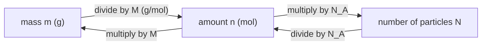

# 07.1 · Atoms, isotopes and the mole

Chemistry counts atoms, but nobody can count atoms one by one. This lesson shows what an atom is made of, why most elements are a mixture of isotopes, where the atomic weights on the periodic table come from, and how the mole links the grams on a balance to the number of particles in a flask.

## Why it matters

A mass spectrometer, an instrument that weighs single molecules after giving them a charge, shows a pesticide residue in a water sample. The strongest peak is at mass 184, and there is a second peak at 186 that is two thirds as tall. Is it a chlorine compound? Two chlorine atoms give exactly that pattern, because chlorine is a fixed mix of two isotopes. The same isotope arithmetic gives the atomic weights you use in every stoichiometry problem, and the mole turns those weights into "how many grams do I weigh". If you get this lesson right, every amount you calculate in the rest of the course starts from a sound base.

## Core ideas

> [!NOTE]
> The structure of the atom and the mole are stable ideas. Since 2019 the Avogadro constant is exact. Isotope abundances and atomic weights are revised from time to time by IUPAC; the values here are the NIST isotopic compositions and the CIAAW 2024 abridged atomic weights, checked on 2026-10-16.

### What an atom is made of

An atom has a tiny, dense **nucleus** made of **protons** (charge $+e$) and **neutrons** (no charge). Around it are **electrons** (charge $-e$), which take up almost all of the atom's volume but almost none of its mass. A proton is about 1836 times heavier than an electron.

Three numbers describe a nucleus:

- the **atomic number** $Z$: the number of protons. It decides which element the atom is. Every carbon atom has $Z = 6$.
- the **neutron number** $N$.
- the **mass number** $A = Z + N$: the number of particles in the nucleus.

A **nuclide** is one kind of nucleus, written ${}^{A}_{Z}\text{X}$, for example ${}^{37}_{17}\text{Cl}$: 17 protons, $37 - 17 = 20$ neutrons. Since the symbol already tells you $Z$, chemists often drop it and write ³⁷Cl or chlorine-37. A neutral atom has as many electrons as protons. An **ion** has gained or lost electrons: Cl⁻ has 18 electrons, Na⁺ has 10.

### Isotopes

**Isotopes** are atoms of the same element (same $Z$) with different numbers of neutrons. Chlorine in nature is about 75.8% ³⁵Cl and 24.2% ³⁷Cl. Isotopes of one element have almost the same chemistry, because chemistry is done by the electrons. They differ in mass, and that is what a mass spectrometer sees.

Masses of atoms are given relative to carbon-12. The **relative atomic mass** of ¹²C is exactly 12. On this scale ³⁵Cl is 34.968 85. The unit that goes with it is the **dalton** (Da), also called the unified atomic mass unit (u): 1 Da is one twelfth of the mass of a ¹²C atom, about $1.66 \times 10^{-27}$ kg. Note that an isotope's mass is not exactly its mass number. The difference is the nuclear binding energy, through $E = mc^2$.

### Atomic weight: the average you actually weigh

A sample of chlorine from a salt shaker contains both isotopes. Its average mass per atom, relative to ¹²C/12, is the **atomic weight** (also called standard atomic weight, $A_r$). It is the abundance-weighted mean:

$$A_r = \sum_i x_i \, m_i$$

where $x_i$ is the **abundance** (mole fraction) of isotope $i$ and $m_i$ its relative atomic mass. For chlorine:

$$A_r(\text{Cl}) = 0.7576 \times 34.9689 + 0.2424 \times 36.9659 = 35.453$$

The periodic table says 35.45. The table gives fewer digits because abundances vary a little between natural sources: chlorine from different minerals spans 35.446 to 35.457. IUPAC therefore gives some elements as an interval and publishes a rounded "abridged" value for everyday work.

### The mole

The **mole** is the SI unit of amount of substance (you met it in [Lesson 01.2](../module-01/lesson-02.md)). One mole contains exactly

$$N_A = 6.022\,140\,76 \times 10^{23} \text{ mol}^{-1}$$

particles. The particles can be atoms, molecules, ions or formula units; always say which.

The useful fact is this: the **molar mass** $M$ of a substance, in g/mol, has the same number as its atomic or molecular weight. So $M(\text{Cl}) = 35.45$ g/mol and $M(\text{H}_2\text{O}) = 2 \times 1.008 + 15.999 = 18.015$ g/mol. You wrote code for this in [Lesson 05.1](../module-05/lesson-01.md). Three quantities are linked by two relations:

$$n = \frac{m}{M}, \qquad N = n \, N_A$$

where $m$ is the mass, $n$ the amount in moles, and $N$ the number of particles.



### Isotope patterns

Each atom in a molecule picks its isotope independently, so the chance of a combination is the product of the abundances. For Cl₂ the three possible masses are 70 (³⁵Cl³⁵Cl), 72 (two ways: ³⁵Cl³⁷Cl and ³⁷Cl³⁵Cl) and 74 (³⁷Cl³⁷Cl):

$$P_{70} = 0.7576^2 = 0.574, \quad P_{72} = 2 \times 0.7576 \times 0.2424 = 0.367, \quad P_{74} = 0.2424^2 = 0.059$$

Divide by the tallest peak: 100 : 64 : 10. This is the binomial expansion $(a + b)^2$. Bromine, nearly 50 : 50, gives 1 : 2 : 1 for two Br atoms. These patterns are why chemists can spot Cl and Br in a mass spectrum at a glance (Module 17 uses this).

## Worked example

### 1. Magnesium from three isotopes

NIST gives ²⁴Mg 23.985 04 (78.99%), ²⁵Mg 24.985 84 (10.00%), ²⁶Mg 25.982 59 (11.01%).

$$A_r = 0.7899 \times 23.98504 + 0.1000 \times 24.98584 + 0.1101 \times 25.98259$$
$$= 18.94580 + 2.49858 + 2.86068 = 24.3051$$

The CIAAW abridged value is 24.305. Check: the answer must lie between the lightest and heaviest isotope, and close to the most abundant one. It does.

### 2. How many ions in a teaspoon of salt?

A teaspoon holds 5.00 g of NaCl. $M = 22.990 + 35.45 = 58.44$ g/mol.

$$n = \frac{5.00 \text{ g}}{58.44 \text{ g mol}^{-1}} = 0.0856 \text{ mol}$$

$$N = 0.0856 \text{ mol} \times 6.022 \times 10^{23} \text{ mol}^{-1} = 5.15 \times 10^{22} \text{ formula units}$$

Each formula unit is one Na⁺ and one Cl⁻, so there are $1.03 \times 10^{23}$ ions. NaCl is an ionic solid with no separate molecules, which is why we say "formula units".

## Hands-on

**What you need:** paper, a calculator, Python with the course packages and the [Module 7 lab folder](../../labs/module-07/). **Time:** about 50 minutes.

### Part A — pencil (20 min)

1. How many protons, neutrons and electrons are in ⁵⁶Fe³⁺?
2. Copper is 69.15% ⁶³Cu (62.9296) and 30.85% ⁶⁵Cu (64.9278). Calculate its atomic weight.
3. Boron has two isotopes, ¹⁰B (10.0129) and ¹¹B (11.0093). Its atomic weight is 10.81. What fraction is ¹⁰B?
4. How many molecules are in 1.00 g of sucrose, C₁₂H₂₂O₁₁? Use H 1.008, C 12.011, O 15.999.
5. Predict the M : M+2 : M+4 heights for CH₂Br₂, using Br 50.69% ⁷⁹Br and 49.31% ⁸¹Br.

<details><summary>Answers to Part A</summary>

1. $Z = 26$ protons, $56 - 26 = 30$ neutrons, $26 - 3 = 23$ electrons.
2. $0.6915 \times 62.9296 + 0.3085 \times 64.9278 = 43.5158 + 20.0302 = 63.546$.
3. Let $x$ be the ¹⁰B fraction: $10.0129x + 11.0093(1 - x) = 10.81$, so $x = (11.0093 - 10.81)/(11.0093 - 10.0129) = 0.200$, about 20%. NIST gives 19.9(7)%.
4. $M = 12 \times 12.011 + 22 \times 1.008 + 11 \times 15.999 = 342.30$ g/mol. $n = 1.00/342.30 = 2.921 \times 10^{-3}$ mol, and $N = 1.76 \times 10^{21}$ molecules.
5. $a = 0.5069$, $b = 0.4931$: $a^2 : 2ab : b^2 = 0.2569 : 0.4999 : 0.2431$. Divided by the tallest: 51 : 100 : 49, close to 1 : 2 : 1, with the middle peak tallest.

</details>

### Part B — Python (30 min)

1. Open `lesson01_isotopes.py`. Fill in `atomic_weight()`.
2. Fill in `isotope_pattern()`: loop over every isotope combination, add up the mass, multiply the abundances.
3. Run it from the lab folder:

```bash
py lesson01_isotopes.py
```

**How you know it worked:** every computed atomic weight agrees with the CIAAW 2024 value to the digits CIAAW gives (Cl 35.453 against 35.45, Mg 24.305, Cu 63.546). Cl₂ prints `70: 100  72: 64  74: 10`. CH₂Br₂ prints 51 : 100 : 49 at 172, 174 and 176, with small ¹³C peaks at the odd masses.

Extension: add the pattern for chloroform, CHCl₃. Explain why its M and M+2 peaks are almost the same height. The reference solution is `lesson01_isotopes_solution.py`.

<details><summary>Expected CHCl₃ result</summary>

`118: 100  119: 1  120: 96  121: 1  122: 31  124: 3`. With three Cl atoms the pattern is $(a + b)^3$: $a^3 : 3a^2b : 3ab^2 : b^3$. Because $3b/a = 3 \times 0.2424/0.7576 = 0.96$, the M+2 peak is 96% of M.

</details>

## Common mistakes

- **Using the mass number as the mass.** ³⁵Cl weighs 34.9689, not 35. For atomic weights use the relative atomic masses; for nominal isotope patterns, round only at the end.
- **Using percentages as if they were fractions.** 75.76% is 0.7576 in the formula. If your atomic weight comes out near 3500, you forgot to divide by 100.
- **Mixing up atomic number and mass number.** $Z$ (protons) defines the element. $A$ changes between isotopes.
- **Forgetting the "two ways" in a pattern.** ³⁵Cl³⁷Cl and ³⁷Cl³⁵Cl are different arrangements with the same mass. Missing the factor 2 makes the M+2 peak half as tall as it should be.
- **Not saying what the mole counts.** "1 mol of chlorine" is ambiguous: 35.45 g of Cl atoms or 70.90 g of Cl₂ molecules. Write the formula.

## Key takeaways

- $Z$ protons define the element; $A = Z + N$; isotopes differ only in $N$.
- The atomic weight is the abundance-weighted mean of the isotope masses, on the scale ¹²C = 12.
- One mole is exactly $6.022\,140\,76 \times 10^{23}$ particles. The molar mass in g/mol equals the atomic or molecular weight.
- $n = m/M$ and $N = nN_A$ link grams, moles and particles.
- Isotope patterns are products of abundances: Cl₂ 100 : 64 : 10, Br₂ about 1 : 2 : 1.

## Sources

- [NIST — Atomic Weights and Isotopic Compositions for All Elements](https://physics.nist.gov/cgi-bin/Compositions/stand_alone.pl) (isotope masses and abundances used in the lab; retrieved 2026-10-16).
- [IUPAC CIAAW — Abridged standard atomic weights (2024)](https://www.ciaaw.org/abridged-atomic-weights.htm) (the values used for molar masses in this course).
- [NIST — CODATA value of the Avogadro constant](https://physics.nist.gov/cgi-bin/cuu/Value?na) (exact since 2019).
- [OpenStax Chemistry 2e, 2.3 Atomic Structure and Symbolism](https://openstax.org/books/chemistry-2e/pages/2-3-atomic-structure-and-symbolism).
- [OpenStax Chemistry 2e, 3.1 Formula Mass and the Mole Concept](https://openstax.org/books/chemistry-2e/pages/3-1-formula-mass-and-the-mole-concept).
- [MIT OpenCourseWare 5.111SC Principles of Chemical Science (Fall 2014)](https://ocw.mit.edu/courses/5-111sc-principles-of-chemical-science-fall-2014/) (for more depth).
