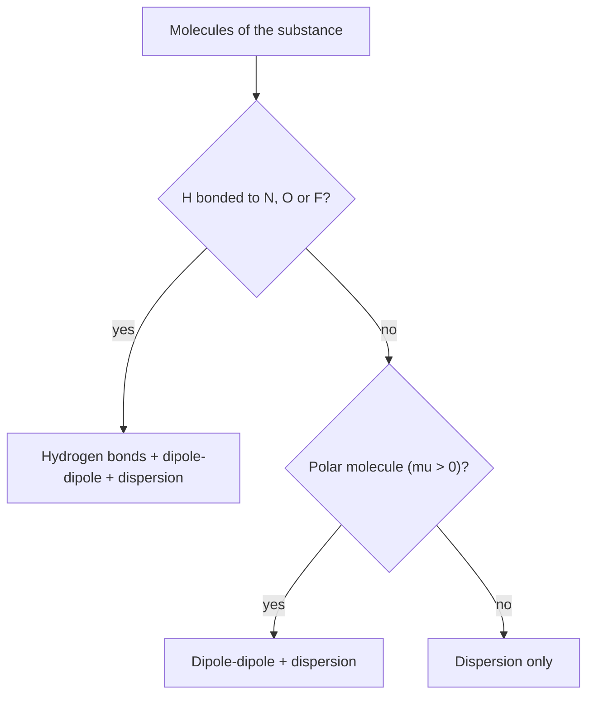

# 07.4 · VSEPR, polarity and intermolecular forces

A Lewis structure is flat; molecules are not. This lesson turns a Lewis structure into a three-dimensional shape with one simple idea, that electron pairs push each other as far apart as they can. From the shape you can tell whether a molecule is polar, and from that, how strongly its molecules attract each other. Those attractions decide whether a substance is a gas, a liquid or a solid at room temperature.

## Why it matters

Water has a molar mass of 18 g/mol and boils at 100 °C. Methane, 16 g/mol, boils at −162 °C. If water followed the trend of its heavier relatives H₂S and H₂Se, it would boil near −80 °C, and there would be no liquid oceans and no life. The difference comes from the shape of the water molecule and the forces it makes possible. The same reasoning tells you why oil and water do not mix, why a chromatography column separates two compounds (Module 19), and why a drug fits its protein target (Module 6).

## Core ideas

> [!NOTE]
> VSEPR and the kinds of intermolecular force are stable teaching models. Bond angles and dipole moments quoted here are standard experimental values (OpenStax Chemistry 2e). Boiling points in the lab come from PubChem, retrieved on 2026-10-17.

### VSEPR: electron domains repel

**VSEPR** (valence shell electron pair repulsion) says that the regions of electron density around a central atom arrange themselves as far apart as possible. Each region is an **electron domain**: a single bond, a double bond, a triple bond, or a lone pair each count as one domain.

First count the domains around the central atom. That fixes the **electron-domain geometry**:

| Domains | Electron-domain geometry | Ideal angle |
|---|---|---|
| 2 | linear | 180° |
| 3 | trigonal planar | 120° |
| 4 | tetrahedral | 109.5° |
| 5 | trigonal bipyramidal | 90°, 120° |
| 6 | octahedral | 90° |

The **molecular shape** describes where the atoms are, not the lone pairs. With lone pairs present, the shape gets a different name:

| Molecule | Domains (bonds + lone pairs) | Shape | Angle |
|---|---|---|---|
| CO₂ | 2 + 0 | linear | 180° |
| BF₃ | 3 + 0 | trigonal planar | 120° |
| CH₄ | 4 + 0 | tetrahedral | 109.5° |
| NH₃ | 3 + 1 | trigonal pyramidal | 107° |
| H₂O | 2 + 2 | bent | 104.5° |
| SF₄ | 4 + 1 | seesaw | about 90° and 120° |
| XeF₄ | 4 + 2 | square planar | 90° |

A lone pair is held by only one nucleus, so it spreads out more than a bonding pair and pushes the bonds closer together. That is why the angle falls from 109.5° in CH₄ to 107° in NH₃ to 104.5° in H₂O.

### Polar molecules: add the bond dipoles

Each polar bond has a **bond dipole**, an arrow from the $\delta+$ end to the $\delta-$ end (chemists often draw it the other way, toward the negative end; be consistent). The **dipole moment** $\mu$ of the whole molecule is the vector sum of the bond dipoles, measured in debye (D). You met dipole moments in [Lesson 04.3](../module-04/lesson-03.md).

- CO₂ has two polar C=O bonds pointing in opposite directions. They cancel: $\mu = 0$. CO₂ is non-polar.
- H₂O is bent, so the two O–H dipoles do not cancel: $\mu = 1.85$ D. Water is polar.
- CCl₄ is a symmetric tetrahedron: $\mu = 0$. Replace one Cl by H (CHCl₃) and the symmetry breaks: $\mu = 1.04$ D.

A molecule is non-polar if it has no polar bonds, or if its shape is so symmetric that the bond dipoles cancel.

### Intermolecular forces

**Intermolecular forces** (IMFs) are attractions between molecules. They are much weaker than the covalent bonds inside a molecule; boiling water breaks IMFs, not O–H bonds. From weakest to strongest for molecules of similar size:

- **Dispersion forces** (London forces): every molecule's electron cloud fluctuates, creating a brief dipole that induces a dipole in its neighbour. All molecules have them. They grow with the number of electrons, since bigger electron clouds are more **polarisable** (easier to distort), and with surface contact. Long n-pentane boils at 36 °C; compact neopentane, the same formula C₅H₁₂, at 9.5 °C.
- **Dipole–dipole forces**: permanent dipoles line up, positive end to negative end.
- **Hydrogen bonds**: a strong dipole–dipole attraction between an H atom bonded to N, O or F and a lone pair on another N, O or F. The H is very $\delta+$ and very small, so the other atom's lone pair can get close.
- **Ion–dipole forces**: between an ion and polar molecules, for example Na⁺ surrounded by water. This is how salt dissolves.



The stronger the IMFs, the more energy is needed to pull the molecules apart, so the higher the boiling point. When you compare molecules of very different size, dispersion can win: iodine, I₂, is non-polar but a solid at room temperature because it has 106 electrons.

## Worked example

### 1. The shape and polarity of ammonia and of BF₃

NH₃: N has three bonds and one lone pair, four domains, so the electron-domain geometry is tetrahedral. The atoms form a **trigonal pyramid** with H–N–H about 107°. The three N–H dipoles all point toward N (N is more electronegative, 3.04 against 2.20), and because of the pyramid they do not cancel. NH₃ is polar, $\mu = 1.47$ D.

BF₃: three bonds, no lone pairs on B, so **trigonal planar**, 120°. The B–F bonds are very polar ($\Delta\chi = 3.98 - 2.04 = 1.94$), but three equal vectors at 120° in a plane add to zero. BF₃ is non-polar.

### 2. Ranking boiling points

Rank CH₄, HCl, HF and Ar (all with 10 to 18 electrons).

- CH₄ (10 electrons): non-polar, dispersion only.
- Ar (18 electrons): one atom, dispersion only, but more electrons than CH₄.
- HCl (18 electrons): polar, dipole–dipole plus dispersion.
- HF (10 electrons): hydrogen bonds.

Prediction: CH₄ < Ar < HCl < HF. Measured: −161.5, −185.8, −85.1, 19.5 °C. Three of four are right; Ar boils below CH₄. Dispersion depends on surface and polarisability, not only on electron count, and CH₄'s electrons (shared over five atoms) are more spread out. Rules of thumb rank well when the differences are large and can fail when they are small.

## Hands-on

**What you need:** paper, Python with the course packages and the [Module 7 lab folder](../../labs/module-07/); optional: a plastic comb or balloon and a tap. **Time:** about 50 minutes.

### Part A — shapes and polarity (15 min)

For each molecule give the number of domains, the electron-domain geometry, the molecular shape, and whether it is polar: H₂S, CH₂Cl₂, SO₃, PCl₅, ClF₃, XeF₂.

<details><summary>Answers to Part A</summary>

- H₂S: 4 domains (2 bonds, 2 lone pairs), tetrahedral, bent (92°, smaller than water because S is larger). Polar, 0.97 D.
- CH₂Cl₂: 4 domains, tetrahedral, tetrahedral shape. The C–Cl and C–H dipoles do not cancel: polar, 1.6 D.
- SO₃: 3 domains (count each S=O as one), trigonal planar. Non-polar.
- PCl₅: 5 domains, trigonal bipyramidal. Non-polar by symmetry.
- ClF₃: 5 domains (3 bonds, 2 lone pairs). The lone pairs take the roomy equatorial positions: T-shaped. Polar.
- XeF₂: 5 domains (2 bonds, 3 lone pairs, all equatorial): linear. Non-polar.

</details>

### Part B — the hydrogen-bonding anomaly in real data (30 min)

The file `hydride_boiling_points.csv` holds the normal boiling points of the hydrides of groups 14 to 17 from PubChem.

1. Open `lesson04_boiling.py` and fill in `extrapolate_period2()`: draw a straight line through the period 3 and period 4 hydrides of a group and extend it back to period 2. That is the boiling point the period-2 hydride would have without hydrogen bonds.
2. Run it and open `runs/hydrides.png`:

```bash
py lesson04_boiling.py
```

3. Explain in two sentences why the anomaly is largest for water, although HF has the most polar bond.

**How you know it worked:** the table shows an anomaly of about −26 °C for CH₄ (no hydrogen bonds; the straight-line guess is crude), +80 °C for NH₃, +179 °C for H₂O and +123 °C for HF. The plot shows group 14 rising smoothly while groups 15 to 17 have a "V" at period 2.

<details><summary>Reference answer to step 3</summary>

Each water molecule has two H atoms and two lone pairs, so it can form up to four hydrogen bonds and build a network in three dimensions. HF has three lone pairs but only one H, and NH₃ three H atoms but only one lone pair, so each forms on average fewer hydrogen bonds per molecule than water. The reference code is `lesson04_boiling_solution.py`.

</details>

### Part C — optional: a charged comb and a stream of water (5 min)

> [!CAUTION]
> Keep the stream thin and away from sockets and electronic devices. Dry your hands before you touch anything electrical.

Run the tap to a thin, steady stream. Charge a plastic comb or balloon by rubbing it on dry hair or wool and bring it close to the stream, without touching. The stream bends toward the comb. Then think about this: it also bends toward a comb with the opposite charge. A charged object pulls on any polarisable stream, because it induces and orients dipoles (and moves the dissolved ions). The demonstration shows that water responds strongly to an electric field. It is not, on its own, proof that the water molecule has a permanent dipole.

## Common mistakes

- **Naming the electron-domain geometry as the shape.** Water's domains are tetrahedral, but the molecule is bent. The shape counts atoms only.
- **Counting a double bond as two domains.** A double or triple bond is one domain.
- **"Polar bonds mean a polar molecule."** CO₂, BF₃ and CCl₄ have polar bonds and no dipole.
- **Calling a C–H…O contact a hydrogen bond.** In this course's sense, H must be bonded to N, O or F.
- **Thinking boiling breaks covalent bonds.** Steam is still H₂O molecules. Boiling only overcomes the forces between them.
- **Ignoring size.** Dispersion grows with the number of electrons. Large non-polar molecules (I₂, long alkanes) can have higher boiling points than small polar ones.

## Key takeaways

- Count electron domains (bonds of any order and lone pairs count once): 2 linear, 3 trigonal planar, 4 tetrahedral, 5 trigonal bipyramidal, 6 octahedral.
- Lone pairs repel more than bonds and squeeze bond angles (109.5° → 107° → 104.5°).
- A molecule is polar when its bond dipoles do not cancel, which depends on the shape.
- IMFs: dispersion (all molecules, grows with size), dipole–dipole, hydrogen bonds (H on N, O, F), ion–dipole.
- Stronger IMFs mean higher boiling points; hydrogen bonding raises water's boiling point by about 180 °C above its group trend.

## Sources

- [OpenStax Chemistry 2e, 7.6 Molecular Structure and Polarity](https://openstax.org/books/chemistry-2e/pages/7-6-molecular-structure-and-polarity) (VSEPR geometries, bond angles, dipole moments).
- [OpenStax Chemistry 2e, 10.1 Intermolecular Forces](https://openstax.org/books/chemistry-2e/pages/10-1-intermolecular-forces) (dispersion, dipole–dipole, hydrogen bonding; the pentane isomers).
- [PubChem (NIH)](https://pubchem.ncbi.nlm.nih.gov/) (hydride boiling points; the CID of each compound is in `hydride_boiling_points.csv`; retrieved 2026-10-17).
- [NIST Chemistry WebBook — Water, phase change data](https://webbook.nist.gov/cgi/cbook.cgi?ID=C7732185&Units=SI&Mask=4) (cross-check of water's boiling point, 373.17 K).
- [MIT OpenCourseWare 5.111SC Principles of Chemical Science (Fall 2014)](https://ocw.mit.edu/courses/5-111sc-principles-of-chemical-science-fall-2014/) (lectures on VSEPR and molecular shape).
