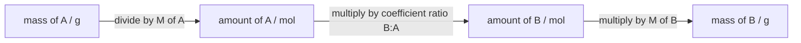

# 07.5 · Stoichiometry and limiting reagents

Stoichiometry is the bookkeeping of chemistry: how many moles of each substance react and form, worked out from a balanced equation. This lesson shows how to balance an equation, how to find which reactant runs out first, and how to compare what you made with what you could have made. You then use those ideas at home to measure the strength of your own vinegar with baking soda, a kitchen scale and a straight-line fit.

## Why it matters

A pharmaceutical plant makes aspirin from salicylic acid and acetic anhydride. Salicylic acid is the expensive part, so the plant adds acetic anhydride in excess and lets salicylic acid run out first. The amount of salicylic acid alone then decides how much aspirin can come out, and every gram below that figure is money lost or a sign that something went wrong. The same logic decides how much fuel an engine needs per litre of air, how much lime a water works adds to soften water, and how many tablets of antacid neutralise a stomach full of acid. In every case the question is the same: which reactant limits the reaction, and how much product does it allow?

## Core ideas

> [!NOTE]
> Balancing, mole ratios and yields are stable ideas. Molar masses here come from PubChem (retrieved 2026-10-17) and agree with the IUPAC atomic weights used in [Lesson 07.1](lesson-01.md). Vinegar strengths on labels and in shops vary by brand and country; read your own label.

### A balanced equation counts atoms

A chemical equation lists the **reactants** (left) and **products** (right). It is **balanced** when every element has the same number of atoms on both sides, and the total charge is the same on both sides. The numbers in front of the formulas are the **stoichiometric coefficients**.

Propane burning in air:

$$\mathrm{C_3H_8 + 5\,O_2 \rightarrow 3\,CO_2 + 4\,H_2O}$$

Check: C 3 = 3; H 8 = 4 × 2; O 5 × 2 = 3 × 2 + 4. To balance by inspection, start with the element that appears in the fewest formulas (here C, then H) and leave the free element (O₂) for last. For awkward reactions, write the atom counts as a matrix and find the coefficients from its null space, as in [Lesson 03.1](../module-03/lesson-01.md).

Never change a subscript to balance an equation. $\mathrm{H_2O_2}$ is hydrogen peroxide, not "more water".

### Coefficients are mole ratios

The equation for vinegar and baking soda is

$$\mathrm{NaHCO_3 + CH_3COOH \rightarrow CH_3COONa + H_2O + CO_2}$$

It reads: 1 mol of sodium hydrogen carbonate (baking soda) reacts with 1 mol of acetic acid to give 1 mol each of sodium acetate, water and carbon dioxide. The coefficients count moles, not grams. To use them you always go through moles:



For a solution, the amount comes from the concentration instead of a mass: $n = cV$, with $c$ in mol/L and $V$ in litres. Molar masses: NaHCO₃ 84.007 g/mol, CH₃COOH 60.052 g/mol, CO₂ 44.009 g/mol.

### The limiting reagent

Reactants are rarely mixed in exactly the ratio of the equation. The **limiting reagent** is the one that runs out first; it stops the reaction and fixes how much product forms. The others are **in excess**, and some of each is left over.

To find it, divide each reactant's amount by its coefficient. The smallest result is the limiting reagent:

$$\text{limiting reagent} = \text{the reactant with the smallest } \frac{n_i}{\nu_i}$$

where $n_i$ is the amount available and $\nu_i$ its coefficient. For $\mathrm{2\,H_2 + O_2 \rightarrow 2\,H_2O}$ with 3 mol H₂ and 2 mol O₂: $3/2 = 1.5$ for H₂ and $2/1 = 2$ for O₂, so H₂ is limiting, even though there is more of it. Comparing raw moles, or worse, grams, gives the wrong answer whenever the coefficients differ.

### Theoretical, actual and percent yield

The **theoretical yield** is the amount of product the limiting reagent allows if every molecule reacts as the equation says. The **actual yield** is what you weigh at the end. The **percent yield** is

$$\text{percent yield} = \frac{\text{actual yield}}{\text{theoretical yield}} \times 100\,\%$$

Real yields are below 100 % because reactions do not go to completion (equilibrium, Module 8), side reactions make other products, and product is lost in filtering, washing and transfers. A yield above 100 % is a warning sign, not a success: the product is usually still wet or impure.

### A titration without a burette: the break point

Add more and more baking soda to a fixed volume of vinegar and weigh the CO₂ that escapes. At first the baking soda is limiting: each extra gram gives the same extra CO₂, so the mass loss rises in a straight line. Once all the acid is used up, the acid is limiting and extra baking soda just sits there: the line goes flat. The baking soda mass at the corner, the **break point**, contains exactly as many moles as the acid in the vinegar. This is the idea behind every titration you will do in Modules 8 and 10: find the point where the reagents are present in their equation ratio.

## Worked example

### 1. Vinegar and baking soda

You add 3.00 g of baking soda to 50.0 mL of vinegar labelled 5 % acetic acid (5.0 g per 100 mL). Which reagent is limiting, how much CO₂ can form, and what is left over?

**Step 1: amounts.**

$$n(\mathrm{NaHCO_3}) = \frac{3.00\ \text{g}}{84.007\ \text{g/mol}} = 0.03571\ \text{mol}$$

The vinegar holds $50.0\ \text{mL} \times 5.0\ \text{g}/100\ \text{mL} = 2.50$ g of acetic acid:

$$n(\mathrm{CH_3COOH}) = \frac{2.50\ \text{g}}{60.052\ \text{g/mol}} = 0.04163\ \text{mol}$$

**Step 2: limiting reagent.** Both coefficients are 1, so compare directly: $0.03571 < 0.04163$. Baking soda is limiting.

**Step 3: theoretical yield of CO₂.** 1 mol NaHCO₃ gives 1 mol CO₂:

$$m(\mathrm{CO_2}) = 0.03571\ \text{mol} \times 44.009\ \text{g/mol} = 1.572\ \text{g}$$

**Step 4: excess.** $0.04163 - 0.03571 = 0.00592$ mol acetic acid is left, that is $0.355$ g.

**Interpretation.** The break point for this vinegar would be at $0.04163 \times 84.007 = 3.50$ g of baking soda. Below 3.50 g the mass loss is $1.572/3.00 = 0.524$ g per gram of baking soda; above it the loss stays at $0.04163 \times 44.009 = 1.83$ g.

### 2. Percent yield of aspirin

A teaching lab reacts 2.00 g of salicylic acid (C₇H₆O₃, 138.12 g/mol) with 5.00 mL of acetic anhydride (C₄H₆O₃, 102.09 g/mol, density 1.082 g/mL):

$$\mathrm{C_7H_6O_3 + C_4H_6O_3 \rightarrow C_9H_8O_4 + CH_3COOH}$$

Check the balance: C 7 + 4 = 9 + 2; H 6 + 6 = 8 + 4; O 3 + 3 = 4 + 2.

- Salicylic acid: $2.00/138.12 = 0.01448$ mol.
- Acetic anhydride: $5.00 \times 1.082 = 5.41$ g, so $5.41/102.09 = 0.05299$ mol.

Coefficients are 1:1, so salicylic acid is limiting, with the anhydride in almost fourfold excess (on purpose, as in the plant). Theoretical yield of aspirin (180.16 g/mol): $0.01448 \times 180.16 = 2.609$ g. The student weighs 2.10 g of dry crystals:

$$\text{percent yield} = \frac{2.10}{2.609} \times 100\,\% = 80.5\,\%$$

That is a normal result for one recrystallisation; some aspirin stays dissolved in the cold wash liquid.

## Hands-on

**What you need:** paper; white vinegar (read the label: 4 % to 6 % acidity); about 50 g of baking soda; 12 identical plastic cups or jars of at least 300 mL; a 20 mL oral syringe (no needle); a teaspoon; a kitchen scale (a 0.1 g or 0.01 g pocket scale is best, see [Lesson 01.5](../module-01/lesson-05.md)); safety glasses; Python and the [Module 7 lab folder](../../labs/module-07/). **Time:** about 90 minutes.

### Part A — pencil problems (20 min)

1. Balance: (a) $\mathrm{Fe_2O_3 + CO \rightarrow Fe + CO_2}$; (b) $\mathrm{C_6H_{12}O_6 + O_2 \rightarrow CO_2 + H_2O}$; (c) $\mathrm{Al + HCl \rightarrow AlCl_3 + H_2}$.
2. An antacid tablet holds 500 mg of calcium carbonate, CaCO₃ (100.09 g/mol). Stomach acid is about 0.10 mol/L HCl. What volume of stomach acid can one tablet neutralise? ($\mathrm{CaCO_3 + 2\,HCl \rightarrow CaCl_2 + H_2O + CO_2}$)
3. 10.0 g of H₂ and 64.0 g of O₂ react to form water. Which is limiting, how much water forms, and how much of the other gas is left?

<details><summary>Answers to Part A</summary>

1. (a) $\mathrm{Fe_2O_3 + 3\,CO \rightarrow 2\,Fe + 3\,CO_2}$; (b) $\mathrm{C_6H_{12}O_6 + 6\,O_2 \rightarrow 6\,CO_2 + 6\,H_2O}$; (c) $\mathrm{2\,Al + 6\,HCl \rightarrow 2\,AlCl_3 + 3\,H_2}$.
2. $n(\mathrm{CaCO_3}) = 0.500/100.09 = 4.995$ mmol, so $n(\mathrm{HCl}) = 9.99$ mmol. $V = 9.99\ \text{mmol} / 0.10\ \text{mol/L} = 0.100$ L, about 100 mL.
3. $n(\mathrm{H_2}) = 10.0/2.016 = 4.96$ mol, $4.96/2 = 2.48$; $n(\mathrm{O_2}) = 64.0/32.00 = 2.00$ mol, $2.00/1 = 2.00$. O₂ is limiting. Water: $4.00$ mol $\times\ 18.015 = 72.1$ g. H₂ left: $4.96 - 4.00 = 0.96$ mol, that is 1.9 g.

</details>

### Part B — home experiment: how strong is your vinegar? (45 min)

> [!WARNING]
> Kitchen materials only: food vinegar and baking soda. Wear safety glasses; vinegar stings in the eyes (rinse with plenty of water if it splashes). Do not use "cleaning" or concentrated vinegar (above 10 %), and never use acetic acid from a hardware or lab supplier: concentrated acetic acid causes severe burns (PubChem GHS H314). Never do the reaction in a closed bottle; the CO₂ builds up pressure. Use tall cups because the mixture foams. Do the risk assessment from [Lesson 01.4](../module-01/lesson-04.md) first.

1. Label 12 cups with the baking soda masses 0.5, 1.0, 1.5 … 6.0 g. (With a 1 g scale, use 100 mL of vinegar per cup and 1, 2 … 12 g of baking soda instead.)
2. With the syringe, put 50.0 mL of vinegar (two and a half fills) into each cup.
3. For one cup at a time: put the cup with its vinegar and a clean teaspoon on the scale and weigh them together ($m_1$). Weigh the baking soda on a piece of paper ($m_s$). Tip it in slowly, a little at a time, so it does not foam over. Stir gently with the teaspoon and leave it in the cup.
4. Wait 15 minutes, stirring now and then to release dissolved CO₂, then weigh the cup with the spoon again ($m_2$). Mass lost: $\Delta m = m_1 + m_s - m_2$.
5. Write the values in your notebook and in a file `my_vinegar.csv` with the header `m_bicarb_g,mass_loss_g`.
6. Pour everything down the sink with plenty of water. Sodium acetate solution is harmless.

### Part C — find the break point in Python (25 min)

1. Open `lesson05_limiting.py` and complete the three TODOs in `fit_break_point()`: for each trial break point, fit two straight lines that meet there, and keep the best one.
2. Run it on the example data first, then on yours (the second number is the vinegar volume in mL):

```bash
py lesson05_limiting.py
py lesson05_limiting.py my_vinegar.csv 50
```

3. Write it up with the [lab report template](../../templates/lab-report.md): aim, method, data table, the plot from `runs/limiting.png`, the concentration of your vinegar next to its label value, and two sources of error.

**How you know it worked:** on the example data the break point is at 3.6 g, the vinegar comes out near 0.86 mol/L (5.2 % w/v; the true value used to simulate it is 5.0 %), and the rising slope is about 0.45 g per gram, so about 86 % of the CO₂ escaped. Your own vinegar should agree with its label within about ±10 %.

<details><summary>Reference solution for the TODOs</summary>

```python
A = np.column_stack([np.ones_like(x), np.minimum(x, xb), np.maximum(x - xb, 0.0)])
coef, *_ = np.linalg.lstsq(A, y, rcond=None)
sse = float(np.sum((A @ coef - y) ** 2))
if best is None or sse < best[0]:
    best = (sse, xb, *coef)
```

For a fixed break point the model is linear in its three parameters, so ordinary least squares ([Lesson 05.3](../module-05/lesson-03.md)) solves it exactly; scanning the break point finds the best corner. The full script is `lesson05_limiting_solution.py`.

Why use the break point and not the plateau? Some CO₂ stays dissolved, so the plateau (1.61 g in the example) underestimates the acid by about 12 %. That loss makes both lines lower but does not move the corner, because the corner depends only on when the acid runs out.

</details>

## Common mistakes

- **Comparing grams, or moles without the coefficients.** Divide each amount by its coefficient before you decide which reagent limits.
- **Changing subscripts to balance.** Only the coefficients may change; a subscript changes the substance.
- **Forgetting to convert mL to L in $n = cV$.** A factor of 1000 is the most common slip in solution stoichiometry. Write the units in every line.
- **Using the plateau to get the acid content.** Dissolved CO₂ and evaporation bias the plateau; the break point is far less sensitive to both.
- **Reporting a yield above 100 % as a good result.** Dry the product to constant mass and check its purity first.
- **Weighing different things at $m_1$ and $m_2$.** Everything on the scale the first time (cup, vinegar, spoon) must be on it the second time.

## Key takeaways

- A balanced equation has the same atoms and the same charge on both sides; its coefficients are mole ratios.
- Always go mass → moles → ratio → moles → mass; for solutions, $n = cV$.
- The limiting reagent has the smallest $n_i/\nu_i$; it fixes the theoretical yield.
- Percent yield = actual / theoretical × 100 %; real yields are lower because of incomplete reaction, side reactions and losses.
- In a series with one reagent fixed, the break point marks the equation ratio. That is the principle of every titration.

## Sources

- [OpenStax Chemistry 2e, 4.1 Writing and Balancing Chemical Equations](https://openstax.org/books/chemistry-2e/pages/4-1-writing-and-balancing-chemical-equations) (balancing by inspection).
- [OpenStax Chemistry 2e, 4.3 Reaction Stoichiometry](https://openstax.org/books/chemistry-2e/pages/4-3-reaction-stoichiometry) (mole ratios and the mass–mole route).
- [OpenStax Chemistry 2e, 4.4 Reaction Yields](https://openstax.org/books/chemistry-2e/pages/4-4-reaction-yields) (limiting reactant, theoretical and percent yield).
- [PubChem — Acetic acid (CID 176)](https://pubchem.ncbi.nlm.nih.gov/compound/176) (molar mass 60.05 g/mol; GHS H226 and H314 for the concentrated acid; retrieved 2026-10-17).
- [PubChem — Sodium bicarbonate (CID 516892)](https://pubchem.ncbi.nlm.nih.gov/compound/516892) (molar mass 84.007 g/mol; retrieved 2026-10-17).
- [PubChem — Acetic anhydride (CID 7918)](https://pubchem.ncbi.nlm.nih.gov/compound/7918) (molar mass 102.09 g/mol; density 1.082 g/cm³ at 20 °C; retrieved 2026-10-17).
