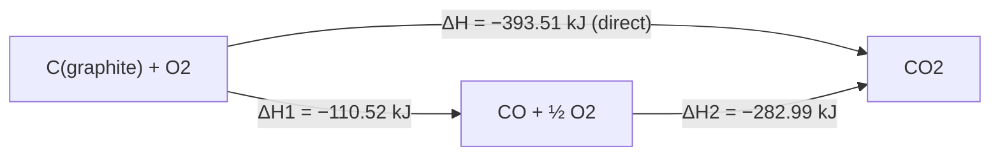

# 08.1 · Thermochemistry and Hess's law

Every reaction moves energy, usually as heat. Thermochemistry is the bookkeeping of that heat: how much a reaction gives out or takes in, how to measure it with a thermometer and a cup, and how to calculate it from a table without doing the experiment at all. The key tool is Hess's law: because enthalpy depends only on where you start and where you end, you can add up known steps to get any reaction you need. This lesson builds that tool, and you will use it to predict the result of the calorimetry experiment in lesson 08.7 before you do it.

## Why it matters

A gas stove in Israel burns propane–butane from a cylinder. A camping stove may burn ethanol. Per gram, which gives more heat, and by how much? A cold pack for a sports injury contains a salt that cools water when it dissolves. Which salt, and how cold will it get? An engineer sizing a cooling system for a chemical reactor needs the heat released per kilogram of product, or the reactor overheats. All three questions are answered with the same short calculation from a table of formation enthalpies. You do not need to burn anything to know the answer.

## Core ideas

> [!NOTE]
> The ideas here (heat, enthalpy, state functions, Hess's law) are stable and over a century old. The numbers come from OpenStax Chemistry 2e Appendix G (298.15 K, standard pressure 1 bar), checked 2026-10-17. Different tables differ in the last digit or two; that is normal and does not change any conclusion here.

### System, surroundings and the sign of q

The **system** is the part you study: the reacting chemicals. The **surroundings** are everything else: the water in the cup, the cup, the air. **Heat**, $q$, is energy that flows between them because of a temperature difference.

The sign is always from the system's point of view:

- **Exothermic**: the system releases heat, $q < 0$. The surroundings warm up. Burning gas, neutralising an acid.
- **Endothermic**: the system absorbs heat, $q > 0$. The surroundings cool down. A cold pack, melting ice.

### Measuring heat with a thermometer

Heat that flows into a sample raises its temperature. How much depends on the mass and the material:

$$q = m\,c\,\Delta T$$

Here $m$ is the mass (g), $c$ the **specific heat** (J g⁻¹ K⁻¹, the heat needed to warm 1 g by 1 K) and $\Delta T = T_\text{final} - T_\text{initial}$. Water has $c = 4.184$ J g⁻¹ K⁻¹, which is large: it takes a lot of heat to warm water, so water makes a good heat sink.

Tiny example: 100 g of water warms from 20.0 °C to 25.0 °C. It gained $q = 100 \times 4.184 \times 5.0 = 2092$ J, about 2.1 kJ. If a reaction in that water caused the warming, the reaction released 2.1 kJ: $q_\text{reaction} = -2.1$ kJ.

A **calorimeter** is any container that keeps the heat inside so you can measure it this way. A foam coffee cup with a lid is a good one for reactions in solution. You will build one in lesson 08.7.

[Simulation: Calorimetry — coffee-cup calorimeter](../../simulations/calorimetry/index.html?preset=coffee-cup)

### Enthalpy: heat at constant pressure

Most chemistry happens open to the air, at constant pressure. The heat exchanged at constant pressure has a name: the **enthalpy change**, $\Delta H$. For a reaction written with moles, $\Delta_r H$ is in kJ per mole of reaction as written:

$$\mathrm{CH_4(g) + 2\,O_2(g) \rightarrow CO_2(g) + 2\,H_2O(l)} \qquad \Delta_r H^\circ = -890.6\ \text{kJ/mol}$$

This says: burning 1 mol of methane releases 890.6 kJ. Double the equation, double $\Delta H$. Reverse it, flip the sign. The superscript ° means **standard state**: each substance pure, at 1 bar, usually at 25 °C (298.15 K). The phases matter: water as a gas instead of a liquid gives −802.6 kJ/mol, because the 44 kJ/mol needed to evaporate each mole of water is not given back.

Enthalpy is a **state function**: its value depends only on the state (what substances, how much, which phase, temperature, pressure), not on how the system got there. Altitude is a state function; the distance you walked to reach it is not.

### Hess's law

Because $H$ is a state function, the enthalpy change for a reaction is the same whether it happens in one step or in many. If you can write the reaction as a sum of steps, its $\Delta H$ is the sum of the steps' $\Delta H$. That is **Hess's law**.



Burning carbon to pure CO is hard to do cleanly, so it is hard to measure. Burning carbon to CO₂ and CO to CO₂ are both easy. Subtracting gives the hard one: $\Delta H_1 = -393.51 - (-282.99) = -110.52$ kJ/mol.

### Formation enthalpies: one table for all reactions

The **standard enthalpy of formation**, $\Delta_f H^\circ$, is $\Delta H$ for making 1 mol of a compound from its elements in their standard states. For water: $\mathrm{H_2(g) + \tfrac12 O_2(g) \rightarrow H_2O(l)}$, $\Delta_f H^\circ = -285.83$ kJ/mol. Elements in their standard state have $\Delta_f H^\circ = 0$ by definition (O₂ gas, graphite, solid iron).

Any reaction can be routed through the elements: take the reactants apart into elements (minus their formation enthalpies), then build the products (plus theirs). So

$$\Delta_r H^\circ = \sum_\text{products} \nu\,\Delta_f H^\circ - \sum_\text{reactants} \nu\,\Delta_f H^\circ$$

where $\nu$ is each stoichiometric coefficient from the balanced equation (lesson [07.5](../module-07/lesson-05.md)). One table of a few hundred compounds gives the enthalpy of millions of reactions. The same table also lists ions in water, written (aq), so you can handle dissolving and reactions in solution.

### Where the energy comes from

At the molecular level, breaking a bond always costs energy and making one always releases it (lesson [04.1](../module-04/lesson-01.md): a bond is a potential-energy well). A reaction is exothermic when the bonds made are stronger overall than the bonds broken. CO₂ and water have very strong bonds, which is why burning anything containing C and H releases heat.

## Worked example

### 1. Methane versus ethanol as a fuel

From Appendix G: CH₄(g) −74.6, CO₂(g) −393.51, H₂O(l) −285.83, C₂H₅OH(l) −277.6 kJ/mol; O₂ is 0.

Methane, $\mathrm{CH_4 + 2O_2 \rightarrow CO_2 + 2H_2O(l)}$:

$$\Delta_r H^\circ = [-393.51 + 2(-285.83)] - [-74.6 + 0] = -965.17 + 74.6 = -890.6\ \text{kJ/mol}$$

Ethanol, $\mathrm{C_2H_5OH + 3O_2 \rightarrow 2CO_2 + 3H_2O(l)}$:

$$\Delta_r H^\circ = [2(-393.51) + 3(-285.83)] - [-277.6] = -1644.51 + 277.6 = -1366.9\ \text{kJ/mol}$$

Per mole, ethanol wins. Per gram, divide by the molar mass: methane $890.6 / 16.043 = 55.5$ kJ/g, ethanol $1366.9 / 46.069 = 29.7$ kJ/g. Methane gives almost twice as much heat per gram. Ethanol already contains an oxygen atom: it is partly "burnt" before you light it.

### 2. Will baking soda cool a cup of water?

Dissolving baking soda: $\mathrm{NaHCO_3(s) \rightarrow Na^+(aq) + HCO_3^-(aq)}$. With Na⁺(aq) −240.1, HCO₃⁻(aq) −691.11 and NaHCO₃(s) −950.8 kJ/mol:

$$\Delta_\text{sol} H^\circ = (-240.1 - 691.11) - (-950.8) = +19.6\ \text{kJ/mol}$$

Positive: endothermic, the water will cool. For 5.00 g (5.00 / 84.006 = 0.0595 mol), the system absorbs $0.0595 \times 19.6 = 1.17$ kJ. Taking that heat from about 105 g of solution with $c \approx 4.18$ J g⁻¹ K⁻¹:

$$\Delta T = \frac{-1170\ \text{J}}{105\ \text{g} \times 4.18\ \text{J g}^{-1}\text{K}^{-1}} = -2.7\ \text{K}$$

A drop of about 2.7 °C: easy to see with a kitchen thermometer. That is the prediction you will test in lesson 08.7. The real drop will be a little smaller, because the cup also gives up some heat and because the table value is for a very dilute solution.

## Hands-on

What you need: a computer with Python 3.14 and the [Module 8 lab folder](../../labs/module-08/) (setup is in its README), a calculator, your notebook. Time: about 1 hour.

### Part A — pencil (20 min)

1. A 250 g mug of tea cools from 80 °C to 60 °C. How much heat did it give to the room? Treat tea as water.
2. Propane, $\mathrm{C_3H_8(g) + 5O_2 \rightarrow 3CO_2 + 4H_2O(l)}$, with C₃H₈(g) −103.8 kJ/mol. Find $\Delta_r H^\circ$ and the heat per gram.
3. Given $\mathrm{N_2 + 2O_2 \rightarrow 2NO_2}$, $\Delta H = +66.4$ kJ and $\mathrm{N_2 + 2O_2 \rightarrow N_2O_4}$, $\Delta H = +11.1$ kJ, find $\Delta H$ for $\mathrm{N_2O_4 \rightarrow 2NO_2}$ by Hess's law.
4. Ammonium nitrate dissolving (cold packs): NH₄NO₃(s) −365.56, NH₄⁺(aq) −132.5, NO₃⁻(aq) −205.0 kJ/mol. Is it endothermic? Which cools 100 g of water more, 5 g of NH₄NO₃ or 5 g of NaHCO₃?

<details><summary>Answers to Part A</summary>

1. $q = 250 \times 4.184 \times (60 - 80) = -20\,900$ J for the tea, so about 21 kJ went to the room.
2. $[3(-393.51) + 4(-285.83)] - [-103.8] = -2220.0$ kJ/mol; $2220.0 / 44.097 = 50.3$ kJ/g. A little less than methane per gram, far more than ethanol.
3. Reverse the second step and add: $-11.1 + 66.4 = +55.3$ kJ. Endothermic: N₂O₄ needs heat to split into NO₂.
4. $(-132.5 - 205.0) - (-365.56) = +28.1$ kJ/mol, endothermic. Per 5 g: NH₄NO₃ $5/80.04 \times 28.1 = 1.75$ kJ; NaHCO₃ 1.17 kJ. Ammonium nitrate cools more, which is why it is used in cold packs.

</details>

### Part B — Python: one table, many reactions (30 min)

Open `lesson01_hess.py`. Fill in the two TODO functions: `reaction_value` (the sum of $\nu\,\Delta_f H^\circ$) and `delta_t` ($\Delta T = q/mc$). Then run:

```bash
py lesson01_hess.py
```

How you know it worked: methane −890.6, propane −2220.0, ethanol −1366.9, hydrogen −285.8 kJ/mol; per gram 55.5, 50.3, 29.7 and 141.8 kJ/g; the Hess check prints −393.51 kJ both ways; and the baking-soda prediction is −2.65 K. Add a reaction of your own to `REACTIONS` (for example methanol combustion; CH₃OH(l) is in the table) and check it by hand.

<details><summary>Reference solution</summary>

`reaction_value`: `return sum(nu * table[sp][column] for sp, nu in reaction.items())`. `delta_t`: `return q_joule / (mass_g * c)`. Full code in `lesson01_hess_solution.py`. Methanol: $[-393.51 + 2(-285.83)] - [-239.2] = -726.0$ kJ/mol, 22.7 kJ/g.

Hydrogen has by far the most energy per gram, but it is a gas with very low density, so per litre of tank it is poor. Choosing a fuel needs both numbers.

</details>

### Part C — simulation (10 min)

Open the coffee-cup preset of the calorimetry simulation (link in Core ideas). Dissolve the salt it offers, read the temperature curve, and compare the $\Delta H$ it reports with a value you calculate from Appendix G. Write the result on a [notebook page](../../templates/notebook-page.md).

## Common mistakes

- **Wrong sign.** The water warmed, so $q_\text{water} > 0$, so the reaction's $\Delta H < 0$. Always say whose $q$ you are writing.
- **Forgetting the coefficients.** In methane combustion, water counts twice. Multiply every $\Delta_f H^\circ$ by its $\nu$.
- **Giving O₂ a formation enthalpy.** Elements in their standard state are zero. O (atomic) or O₃ are not.
- **Mixing up phases.** H₂O(l) and H₂O(g) differ by 44 kJ/mol. Read the phase in the equation and in the table.
- **Using °C where a difference is fine and K where it is not.** In $q = mc\Delta T$ a difference of 1 °C equals 1 K; in formulas with $T$ itself (lesson 08.2) you must use kelvin.

## Key takeaways

- $q = mc\Delta T$ turns a temperature change into heat; the sign is from the system's view (exothermic $q < 0$).
- $\Delta H$ is the heat at constant pressure, in kJ per mole of reaction as written; it scales with the coefficients and flips when the reaction is reversed.
- Enthalpy is a state function, so steps add (Hess's law), and $\Delta_r H^\circ = \sum \nu\,\Delta_f H^\circ(\text{products}) - \sum \nu\,\Delta_f H^\circ(\text{reactants})$.
- Compare fuels per gram as well as per mole; oxygen already in a fuel lowers its heat per gram.
- Dissolving baking soda is endothermic (+19.6 kJ/mol): 5 g in 100 g of water should cool it by about 2.7 K.

## Sources

- [OpenStax Chemistry 2e, 5.1 Energy Basics](https://openstax.org/books/chemistry-2e/pages/5-1-energy-basics) — heat, specific heat, $q = mc\Delta T$.
- [OpenStax Chemistry 2e, 5.2 Calorimetry](https://openstax.org/books/chemistry-2e/pages/5-2-calorimetry) — coffee-cup calorimeter and sign conventions.
- [OpenStax Chemistry 2e, 5.3 Enthalpy](https://openstax.org/books/chemistry-2e/pages/5-3-enthalpy) — enthalpy, state functions, Hess's law, formation enthalpies.
- [OpenStax Chemistry 2e, Appendix G](https://openstax.org/books/chemistry-2e/pages/g-standard-thermodynamic-properties-for-selected-substances) — all $\Delta_f H^\circ$ values used here except NaHCO₃(s).
- [Wikipedia, Sodium bicarbonate](https://en.wikipedia.org/wiki/Sodium_bicarbonate) — $\Delta_f H^\circ$(NaHCO₃, s) = −950.8 kJ/mol, molar mass 84.006 g/mol.
- [MIT OCW 5.111SC](https://ocw.mit.edu/courses/5-111sc-principles-of-chemical-science-fall-2014/) — thermodynamics lectures for more depth.
