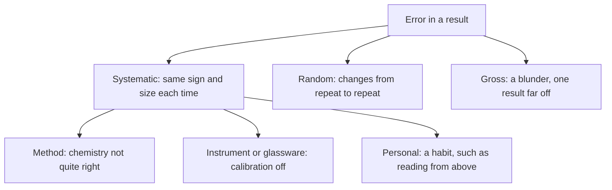

# 09.1 · Types of error, accuracy and precision

Every analytical result is wrong by some amount; the job is to know how wrong and in which way. This lesson sorts errors into the kinds that repeats can show and the kinds they cannot, and gives you the tools analysts use to find hidden bias: a certified reference material, the recovery of a known amount, and a series of samples of different size that splits a constant error from a proportional one. You practise them in a simulation, in Python and on your kitchen scale with a handful of coins.

## Why it matters

A water lab reports chloride in tap water. Two analysts each run a certified reference sample six times. Analyst A's results scatter by almost 1 mg/L. Analyst B's results agree to within 0.1 mg/L, and her manager is pleased. But B's mean is 4.6 % below the certified value, every time. Every customer sample she reports is low by the same amount, and her tight repeats hide it. Without a reference sample, nobody would know. In [Lesson 01.5](../module-01/lesson-05.md) you met random and systematic error with a syringe; here you learn how a lab finds, sizes and fixes them, which is the first half of Technion course 01240220.

## Core ideas

> [!NOTE]
> The classification of errors and the use of reference materials are stable, decades-old practice. The vocabulary follows Harvey's open textbook (Analytical Chemistry 2.1) and the GUM (JCGM 100:2008), checked on 2026-10-17. The coin mass (one shekel, 3.5 g) is from the Bank of Israel's coin page; coins in other countries have their own published masses.

### Error, bias and the true value

The **measurand** is the quantity you want, for example "chloride in this water, in mg/L". Its **true value** is never known exactly. The **error** of one result is the result minus the true value. In practice you compare with a **reference value** you trust, such as the value on the certificate of a **certified reference material (CRM)**: a material whose content has been measured very carefully by a national lab or an accredited producer, with a stated uncertainty.

The **bias** of a method is the mean of many results minus the reference value:

$$\text{bias} = \bar{x} - \mu_\text{ref} \qquad \text{relative error} = \frac{\bar{x} - \mu_\text{ref}}{\mu_\text{ref}} \times 100\,\%$$

The **recovery** is the same idea written as a ratio: $R = 100\,\% \times \bar{x}/\mu_\text{ref}$. A recovery of 95.4 % means 4.6 % of the analyte "went missing".

### Three kinds of error



- **Systematic errors** (determinate errors) have a cause you can, in principle, find. A **method error** comes from the chemistry: an indicator that changes colour a little after the true end point, a precipitate that is slightly soluble. An **instrument error** comes from a scale, a pipette or a meter that is out of calibration. A **personal error** comes from the analyst: a parallax habit ([Lesson 07.7](../module-07/lesson-07.md)), or judging a colour change late.
- **Random errors** (indeterminate errors) come from many small, uncontrolled effects: electrical noise, tiny temperature changes, the last digit you estimate on a burette. They make repeats scatter. Averaging reduces them; that is Lesson 09.2.
- **Gross errors** are blunders: a spilled drop, a number copied wrongly, the wrong flask. They produce one result far from the rest. You find them by looking at the data and keeping a good notebook ([Lesson 01.3](../module-01/lesson-03.md)), and you test a suspicious value with Grubbs' test in Lesson 09.2.

### Accuracy and precision

**Precision** is how close repeats are to each other; you measure it with the standard deviation $s$. **Trueness** is how close the mean is to the reference value; you measure it with the bias. **Accuracy** of a single result needs both: small scatter and small bias. Analyst B above is precise but not true. Analyst A is true on average but imprecise.

Precision depends on the conditions. **Repeatability** is the scatter for one analyst, one instrument, one day. **Reproducibility** is the scatter across analysts, instruments, days or labs. Reproducibility is always the larger of the two, because it includes the day-to-day and lab-to-lab systematic differences.

### Is the bias real?

A mean of six results is itself uncertain, and so is the CRM. Combine the standard uncertainty of the mean ($s/\sqrt{n}$, Lesson 01.5) with that of the certificate. A certificate usually gives an expanded uncertainty $U$ with a coverage factor $k = 2$; the standard uncertainty is $U/k$. Then use the same $z$-score as in Lesson 01.5:

$$z = \frac{|\bar{x} - \mu_\text{ref}|}{\sqrt{s^2/n + (U/k)^2}}$$

If $z \le 2$, the data give no evidence of bias. If $z$ is well above 2, look for a cause. Lesson 09.2 replaces this rule of thumb with a proper $t$-test.

### Constant and proportional errors

A systematic error can behave in two ways as the sample gets bigger.

- A **constant error** has the same size in milligrams whatever the sample size. An example is the extra titrant needed to make an indicator change colour, about the same in every titration. Its *relative* effect shrinks as the sample grows.
- A **proportional error** is a fixed fraction of the result. An example is a titrant whose concentration you took as 1.5 % too high: every result is 1.5 % low. Its relative effect does not change with sample size.

To tell them apart, analyse different amounts of the same reference material and plot the amount found against the amount taken. For a perfect method the line has the expected slope and passes through zero. Fit a straight line (as in [Lesson 05.3](../module-05/lesson-03.md)):

$$\text{found} = b_0 + b_1 \cdot m_\text{sample}$$

The **intercept** $b_0$ is the constant error. The **slope** $b_1$, compared with the expected slope, gives the proportional error.

### What to do with a systematic error

Once found, a systematic error is either removed (recalibrate the burette, standardise the titrant again, change the indicator), corrected (subtract a blank, divide by the recovery), or, if it cannot be removed, included in the uncertainty budget as a Type B term. Ignoring it is the one option that is never right.

## Worked example

### 1. Two analysts and a CRM

A chloride CRM is certified at $25.0 \pm 0.3$ mg/L ($k = 2$), so its standard uncertainty is 0.15 mg/L. Each analyst runs it six times (`crm_analysts.csv`, simulated):

| | Mean (mg/L) | $s$ (mg/L) | Bias (mg/L) | Relative error | Recovery |
|---|---|---|---|---|---|
| Analyst A | 25.21 | 0.64 | +0.21 | +0.8 % | 100.8 % |
| Analyst B | 23.84 | 0.085 | −1.16 | −4.6 % | 95.4 % |

**Analyst A.** $u = \sqrt{0.64^2/6 + 0.15^2} = \sqrt{0.262^2 + 0.15^2} = 0.30$ mg/L, so $z = 0.21/0.30 = 0.7$. No evidence of bias. A's problem is precision: a single result could easily be 1 mg/L off.

**Analyst B.** $u = \sqrt{0.085^2/6 + 0.15^2} = 0.154$ mg/L, so $z = 1.16/0.154 = 7.5$. The bias is real. Notice that the CRM's own uncertainty now dominates $u$; B's repeats are so tight that the certificate is the limit. B must find the cause before she reports anything.

### 2. Constant or proportional?

To find B's problem, she titrates weighed portions of pure NaCl, which contains 606.6 mg chloride per gram (35.453/58.443). The fit of chloride found against sample mass (`sample_size_series.csv`, simulated) gives:

- intercept $b_0 = +0.62 \pm 0.29$ mg, a constant error of about 0.6 mg;
- slope $b_1 = 598.5 \pm 1.6$ mg/g, against 606.6 expected: a proportional error of $598.5/606.6 - 1 = -1.33\ \%$.

Both are real (each is more than twice its uncertainty). The constant error matters most for small samples: on 0.050 g (30.3 mg chloride) it is +2 %; on 0.300 g it is +0.3 %. The proportional error is −1.3 % at every size. A likely cause of the proportional error is a titrant that is weaker than its label; a likely cause of the constant error is the indicator blank. The cure is to standardise the titrant again and to subtract a blank titration.

## Hands-on

**What you need:** a computer with the [Module 9 lab folder](../../labs/module-09/) set up (Python 3.14 and the pinned packages from `labs/common/requirements.txt`); for Part C, a kitchen or pocket scale (0.1 g is best), a small dish and ten coins of one kind (in Israel, one-shekel coins); the [error analysis template](../../templates/error-analysis.md). **Time:** about 75 minutes.

### Part A — see the two kinds of error (20 min)

[Simulation: Measurement error — repeat readings](../../simulations/measurement-error/index.html?preset=repeat)

Task: take 5, then 20, then 50 repeat readings. Write down the mean and the standard deviation each time. Target: the standard deviation stays about the same while the uncertainty of the mean, $s/\sqrt{n}$, falls by about a factor of 3 from 5 to 50 readings.

[Simulation: Measurement error — a biased instrument](../../simulations/measurement-error/index.html?preset=bias)

Task: measure the hidden reference value with the biased instrument, then with the reference standard switched on. Target: estimate the bias to within its uncertainty, and show that taking more repeats does not shrink it.

### Part B — bias and the sample-size series in Python (25 min)

1. Open `lesson01_bias.py` and complete the two TODOs: the bias of each analyst, and the straight-line fit with its uncertainties.
2. Run it from the lab folder:

```bash
py lesson01_bias.py
```

3. Look at `runs/lesson01_bias.png`. The left plot shows found minus expected chloride against sample mass. A pure constant error would be a flat line above zero; a pure proportional error would be a sloping line through the origin. Which do you see?

**How you know it worked:** the output matches Worked examples 1 and 2, and the coin series on the example data gives an intercept of $+0.26 \pm 0.04$ g and a slope of $3.502 \pm 0.006$ g per coin.

<details><summary>Reference solution for the TODOs</summary>

```python
# TODO 1
bias = mean - CERTIFIED
# TODO 2
(b1, b0), cov = np.polyfit(x, y, 1, cov=True)
return b0, np.sqrt(cov[1, 1]), b1, np.sqrt(cov[0, 0])
```

`np.polyfit` returns the highest power first, so the slope comes before the intercept, and the covariance matrix follows the same order. The left plot falls from about +0.2 mg to about −1.8 mg: the line starts above zero (the constant error) and slopes down (the proportional error). Both are present. The full script is `lesson01_bias_solution.py`.

</details>

### Part C — home: is your kitchen scale biased? (30 min)

> [!WARNING]
> Coins and a kitchen scale only. Wash your hands after handling coins, and keep small coins away from young children (choking hazard).

1. Put the dish on the scale, press tare, and wait 10 seconds. Write down the reading with zero coins.
2. Add the coins one at a time. After each, wait for the reading to settle and write it down. Do not press tare again.
3. Make `my_coins.csv` with the columns `n_coins,reading_g` (copy `coins_example.csv` and replace the numbers).
4. Run the script with your file and the nominal coin mass:

```bash
py lesson01_bias.py my_coins.csv 3.5
```

5. Fill in the error analysis template: which errors did you find, which can you not separate, and why?

**How you know it worked:** the intercept tells you the scale's constant error directly; for a well-behaved scale it is within about ±0.1 g of zero (the example scale, at +0.26 g, is not). The slope will be close to the nominal mass, but it mixes two things: the scale's proportional error and the real mass of your slightly worn coins. You cannot separate them without a reference mass you trust. That is exactly why labs buy CRMs and calibrated weights.

## Common mistakes

- **Judging a method by its precision alone.** Tight repeats say nothing about bias. Always run a reference material or a spiked sample as well.
- **Expecting repeats to reveal a systematic error.** They cannot; they reveal only scatter. A bias appears only against an independent reference.
- **Forgetting the reference's own uncertainty.** A certificate gives $U$ at $k = 2$; divide by 2 before combining it with $s/\sqrt{n}$.
- **Checking bias at one sample size only.** A constant error looks large on small samples and vanishes on large ones. Test at least two sizes, or run a series.
- **Throwing away an awkward result without a reason.** A gross error needs evidence: a note in the notebook, or a statistical test (Lesson 09.2).

## Key takeaways

- Errors are systematic (method, instrument, personal), random or gross; only random errors show up as scatter and shrink with averaging.
- Precision is scatter; trueness is bias; accuracy needs both.
- Bias and recovery are measured against a certified reference material; combine $s/\sqrt{n}$ with the certificate's $U/k$ before deciding whether a bias is real.
- A sample-size series separates a constant error (the intercept) from a proportional error (the slope).
- A systematic error is removed, corrected, or included in the uncertainty budget, never ignored.

## Sources

- [LibreTexts — Harvey, Analytical Chemistry 2.1, 4.1 Characterizing Measurements and Results](https://chem.libretexts.org/Bookshelves/Analytical_Chemistry/Analytical_Chemistry_2.1_by_David_Harvey/Analytical_Chemistry_2.1_(Harvey)/04%3A_Evaluating_Analytical_Data/4.01%3A_Characterizing_Measurements_and_Results) (mean, accuracy, precision).
- [LibreTexts — Harvey, Analytical Chemistry 2.1, 4.2 Characterizing Experimental Errors](https://chem.libretexts.org/Bookshelves/Analytical_Chemistry/Analytical_Chemistry_2.1_by_David_Harvey/Analytical_Chemistry_2.1_(Harvey)/04%3A_Evaluating_Analytical_Data/4.02%3A_Characterizing_Experimental_Errors) (determinate and indeterminate errors, constant and proportional errors, the sample-size method).
- [JCGM 100:2008 — Guide to the Expression of Uncertainty in Measurement](https://www.bipm.org/en/doi/10.59161/jcgm100-2008e) (error, uncertainty, correction of systematic effects).
- [Bank of Israel — New Agora and Sheqel Series](https://boi.org.il/en/economic-roles/coins/new-agora-and-sheqel-series/) (one-shekel coin, 3.5 g; retrieved 2026-10-17).
