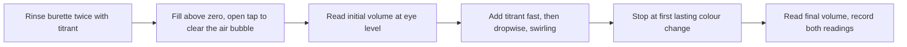

# 10.1 · The titration bench: indicators, burettes and endpoints

This module is the first real analytical lab course, done as simulations, Python analysis and a few safe kitchen experiments. Lesson 10.1 sets up the bench you will use all module: a burette you read correctly, a titrant whose concentration you know because you standardised it, and an indicator chosen from the titration curve rather than from habit. You will compute how large an error a poor indicator causes, write an uncertainty budget for one titration, and measure the size of a drop, the smallest step your home titrations can take. This course trains understanding, not bench hands: the simulation teaches the decisions, not the feel of a stopcock.

## Why it matters

A quality-control chemist at a dairy titrates the acidity of every batch of milk. The burette is the same in every lab, but two choices decide whether the number is right. If the sodium hydroxide was never standardised, every result carries the same hidden error, perhaps 2 %. If the indicator changes colour at the wrong pH, the titration stops before the acid is used up, and a weak acid can read 36 % low. Neither error shows up in the repeats. You catch them only by thinking about the chemistry first, as in lesson [08.7](../module-08/lesson-07.md), where the cabbage end point made results about 1 % high.

## Core ideas

> [!NOTE]
> Stable: the charge balance, indicator theory and the budget method. Values used here were checked on 2026-10-17: indicator ranges and pKa values from Harvey, Analytical Chemistry 2.1, Table 9.2.3; Class A 50 mL burette tolerance ±0.05 mL (ASTM E287, via Ricca); KHP molar mass 204.22 g/mol. Prices and brands of kitchen equipment change; the method does not.

### The bench and the procedure

A **burette** is a long graduated tube with a tap (the **stopcock**) that delivers a measured volume of **titrant**, the solution of known concentration. The **titrand** is the sample in the flask. Each step of the routine has a reason:



Rinsing with titrant, not water, stops leftover water from diluting it. An air bubble in the tip that escapes during the titration counts as delivered volume that never reached the flask. Reading at eye level, at the bottom of the curved surface (the **meniscus**), avoids **parallax**, the shift you saw in the glassware simulation of lesson [07.7](../module-07/lesson-07.md). A 50 mL burette has marks every 0.1 mL, and you estimate the second decimal: 23.47 mL, not 23.5 mL.

### Equivalence point and end point

The **equivalence point** is where the moles of titrant exactly match the analyte, by the reaction's stoichiometry. The **end point** is where you see the signal, here a colour change. The difference between them, as a fraction of the equivalence volume, is the **titration error**:

$$\text{titration error} = \frac{V_\text{end} - V_\text{eq}}{V_\text{eq}} \times 100\,\%$$

### How an indicator picks its pH

An **acid–base indicator** is itself a weak acid, HIn, whose acid and base forms have different colours. Your eye sees a change when the ratio of the two forms moves from about 10 : 1 to 1 : 10. By the Henderson–Hasselbalch equation (lesson [08.4](../module-08/lesson-04.md)) that is a window of about $\mathrm{p}K_\text{In} \pm 1$. Phenolphthalein (p$K_\text{In}$ 9.6, colourless to pink, visible from about pH 8.3) and methyl orange (p$K_\text{In}$ 3.7, red to yellow) sit at opposite ends.

The rule is simple: the indicator's window must fall inside the steep jump of the titration curve. For a strong acid with a strong base at 0.1 M, the jump runs from about pH 4 to 10, so almost any indicator works. For a weak acid like acetic acid (p$K_a$ 4.76), the curve is buffered up to equivalence and the jump starts only around pH 7, ending near pH 11. Methyl red, which changes near pH 5, changes when only about two thirds of the acid has reacted. Lesson [09.5](../module-09/lesson-05.md) builds these curves.

### Computing the error from the charge balance

You do not need to guess. The **charge balance** says the solution is electrically neutral. For acetic acid (HA) titrated with NaOH:

$$[\mathrm{H^+}] + [\mathrm{Na^+}] = [\mathrm{OH^-}] + [\mathrm{A^-}]$$

Write $[\mathrm{Na^+}]$ and $[\mathrm{A^-}]$ in terms of the volumes, with $\alpha = K_a/(K_a + [\mathrm{H^+}])$ the fraction of the acid present as A⁻, and $\Delta = [\mathrm{H^+}] - [\mathrm{OH^-}]$. Solving for the base volume gives a closed formula for the volume at which the titrand reaches any chosen pH:

$$V_b = V_a\,\frac{C_a\,\alpha - \Delta}{C_b + \Delta}$$

Put in the indicator's pH and you get $V_\text{end}$ directly. For a strong acid, set $\alpha = 1$. Tiny example: 25.00 mL of 0.1000 M acetic acid, 0.1000 M NaOH, end point at pH 5.0. Then $[\mathrm{H^+}] = 10^{-5}$, $\alpha = 1.75 \times 10^{-5}/(1.75 \times 10^{-5} + 10^{-5}) = 0.636$, and $V_b = 25.00 \times (0.0636 - 0.00001)/0.10001 = 15.90$ mL against 25.00 mL at equivalence: a 36 % error.

### Standardising the titrant

Sodium hydroxide cannot be weighed accurately: the solid absorbs water and carbon dioxide from the air. So you make it roughly and then **standardise** it, titrating a weighed **primary standard**, a pure, stable, non-hygroscopic solid of known formula. For bases the classic choice is **potassium hydrogen phthalate** (KHP, KHC₈H₄O₄, 204.22 g/mol), a monoprotic weak acid (p$K_a$ 5.4), titrated to a phenolphthalein end point. Store the NaOH in a closed plastic bottle: CO₂ turns some of it into carbonate, which shifts end points between pH 6 and 10.

### The uncertainty budget of a volume

A titrant volume has several Type B terms (lesson [01.5](../module-01/lesson-05.md)). For a Class A 50 mL burette:

| Source | Value | Standard uncertainty |
|---|---|---|
| Tolerance (calibration of the scale) | ±0.05 mL, rectangular | $0.05/\sqrt{3} = 0.029$ mL |
| Reading, two readings of ±0.02 mL each | combined | $\sqrt{2} \times 0.02 = 0.028$ mL |
| End point, ± half a drop (0.025 mL) | rectangular | $0.025/\sqrt{3} = 0.014$ mL |

They add in quadrature: $u(V) = \sqrt{0.029^2 + 0.028^2 + 0.014^2} = 0.043$ mL. On a 25 mL titration that is 0.17 %. Lesson [09.3](../module-09/lesson-03.md) explains why squares add.

## Worked example

### Standardising NaOH with KHP

You weigh 0.5105 g of dried KHP on an analytical balance (readability 0.1 mg), dissolve it in about 50 mL of water, add two drops of phenolphthalein, and titrate. Initial reading 0.42 mL, final 25.27 mL, so $V = 24.85$ mL.

$$n(\mathrm{KHP}) = \frac{0.5105\ \text{g}}{204.22\ \text{g/mol}} = 2.4998 \times 10^{-3}\ \text{mol}$$

$$c(\mathrm{NaOH}) = \frac{2.4998 \times 10^{-3}\ \text{mol}}{0.02485\ \text{L}} = 0.10059\ \text{mol/L}$$

Uncertainty: the mass is a difference of two balance readings, $u(m) = 0.1\ \text{mg}/\sqrt{6} = 0.04$ mg, or 0.008 %. The volume budget above gives 0.043 mL, or 0.17 %. KHP purity (99.95–100.05 %) adds 0.03 %. The volume dominates:

$$\frac{u(c)}{c} = \sqrt{0.008^2 + 0.17^2 + 0.03^2}\ \% = 0.17\ \%, \qquad c = 0.1006 \pm 0.0002\ \text{mol/L}$$

Three such titrations agreeing within 0.2 % give you a titrant you can trust for the rest of the week.

### Choosing the indicator for vinegar

The script in the Hands-on computes the error for five indicators on 25.00 mL of 0.1000 M acid. For HCl, every indicator from methyl red to phenolphthalein gives an error under 0.1 %; even methyl orange is only 0.4 % early. For acetic acid, methyl orange is 92 % early, methyl red 36 %, bromothymol blue 0.45 %, phenol red 0.09 % and phenolphthalein 0.08 % late. The choice for vinegar is phenolphthalein, or phenol red. Red cabbage works because its blue-green appears around pH 8, in the same region.

## Hands-on

What you need: a computer with the [Module 10 lab folder](../../labs/module-10/) and Python set up as in Module 5; for Part C a 10 mL oral syringe (no needle), a kitchen scale with 0.01 g resolution, a cup of water or the baking-soda titrant from lesson 08.7, and paper towels. Time: about 60 minutes.

### Part A — simulation: pick the indicator (20 min)

[Simulation: Titration bench — choosing an indicator](../../simulations/titration/index.html?preset=indicator-choice)

1. Titrate the strong acid with each indicator offered. Record the end-point volume and the error the simulation reports.
2. Switch to the weak acid and repeat.
3. Read the burette at eye level every time; the simulation adds parallax if you do not.

Target: an error under 0.2 % for the weak acid. If you overshoot, note by how many drops and try again, adding single drops for the last 0.5 mL.

### Part B — Python: compute every indicator's error (20 min)

Open `lesson01_indicator.py` and fill in the two TODO functions using the formula in Core ideas. Then run:

```bash
py lesson01_indicator.py
```

It prints a table of end-point volumes and errors for HCl and acetic acid, saves a plot with the indicator windows to `runs/lesson01_indicators.png`, and analyses the drop data. With the example drop file it prints a drop mass of 44.9 mg.

<details><summary>Reference solution</summary>

`volume_at_ph` sets `h = 10 ** -ph`, `delta = h - KW / h`, `alpha = 1 if ka is None else ka / (ka + h)` and returns `v_a * (c_a * alpha - delta) / (c_b + delta)`. `titration_error_percent` returns `100 * (v_end - v_eq) / v_eq`. Expected errors for acetic acid: −92.15, −36.38, −0.45, −0.09 and +0.08 %. Full code in `lesson01_indicator_solution.py`.

</details>

### Part C — home: how big is one drop? (20 min)

> [!WARNING]
> Use only water or the baking-soda solution from lesson 08.7. Wear safety glasses if you use the baking-soda solution. Never put a needle on the syringe. Work over a tray.

1. Fill the syringe with liquid, wipe the outside dry, and weigh it. Record the mass to 0.01 g.
2. Push out exactly 40 drops into a cup, slowly, one at a time, holding the syringe vertical.
3. Weigh the syringe again. The difference divided by 40 is the mass of one drop.
4. Repeat twice more. Write `trial,n_drops,m_before_g,m_after_g` into a CSV file and run `py lesson01_indicator.py my_drops.csv`.

How you know it worked: the three drop masses agree within about 2 mg and come out between 30 and 60 mg. A drop from a burette is about 0.05 mL, so yours should be similar. The script tells you what one drop is as a percentage of the 7 g of titrant used in lesson 08.7: about 0.6 %. That is the best end-point resolution you can expect at home, and it sets the "half a drop" term in the 10.6 project budget. Record it on a [notebook page](../../templates/notebook-page.md).

## Common mistakes

- **Choosing the indicator by habit.** Phenolphthalein is right for weak acids with strong bases, but methyl red with acetic acid stops a third of the way. Check the indicator window against the curve.
- **Rinsing the burette with water only.** The leftover water dilutes the titrant and every result comes out high. Rinse twice with titrant.
- **Leaving the air bubble in the tip.** If it escapes during the titration, the volume reading includes it. Clear it before the first reading.
- **Reading the top of the meniscus, or from above.** Read the bottom of the curve with your eye level with it; use a white card with a black stripe behind the burette.
- **Using the nominal NaOH concentration.** Unstandardised NaOH can be several percent off and drifts as it absorbs CO₂. Standardise against KHP, and repeat weekly.
- **Recording 23.5 mL.** A burette reads to two decimals; the estimated second digit is part of the data.

## Key takeaways

- The end point is what you see; the equivalence point is what you want. Their gap is the titration error.
- An indicator works when its window, about p$K_\text{In} \pm 1$, lies inside the steep jump of the curve. Weak acids need an indicator near pH 8–10.
- The charge balance gives the base volume at any pH in closed form, so the titration error can be calculated, not guessed.
- NaOH is standardised against a primary standard such as KHP; the burette volume usually dominates the uncertainty, about 0.17 % for a 25 mL titration.
- One drop sets the resolution: about 0.05 mL from a burette, about 0.6 % of a home titration with a syringe.

## Sources

- [Harvey, Analytical Chemistry 2.1, 9.1 Overview of Titrimetry](https://chem.libretexts.org/Bookshelves/Analytical_Chemistry/Analytical_Chemistry_2.1_by_David_Harvey/Analytical_Chemistry_2.1_(Harvey)/09%3A_Titrimetric_Methods/9.01%3A_Overview_of_Titrimetry) — equivalence point, end point, titration error.
- [Harvey, Analytical Chemistry 2.1, 9.2 Acid–Base Titrations](https://chem.libretexts.org/Bookshelves/Analytical_Chemistry/Analytical_Chemistry_2.1_by_David_Harvey/Analytical_Chemistry_2.1_(Harvey)/09%3A_Titrimetric_Methods/9.02%3A_AcidBase_Titrations) — Table 9.2.3 of indicators, KHP standardisation, carbonate error.
- [Harvey, Analytical Chemistry 2.1, 16.8 Recommended Primary Standards](https://chem.libretexts.org/Bookshelves/Analytical_Chemistry/Analytical_Chemistry_2.1_by_David_Harvey/Analytical_Chemistry_2.1_(Harvey)/16%3A_Appendix/16.08%3A_Recommended_Primary_Standards) — KHP and other primary standards.
- [Ricca Chemical, Volumetric glassware](https://riccachemical.com/pages/tech-tips/volumetric-glassware) — Class A 50 mL burette ±0.05 mL.
- [ChemCollective, Standardization of NaOH with a KHP solution](https://chemcollective.org/activities/info/101) — a free virtual lab to check your procedure against.
