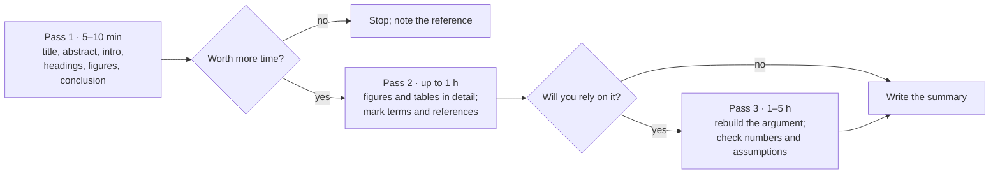

# 11.1 · Reading a research paper efficiently

A research paper is not a textbook chapter: it is an argument that one claim is true, built from evidence the authors chose to show you. This lesson teaches a fast, repeatable way to read one: three passes of increasing depth, figures before text, and a few questions that tell you what the paper claims, how strong the evidence is, and where it is weak. You finish by summarising a real open-access chemistry paper in 150 words.

## Why it matters

In lesson [09.6](../module-09/lesson-06.md) you measured a food colour with phone photos. Suppose you now want to measure the dye in a sweet, and a search finds forty papers on "smartphone colorimetry". A working chemist meets this every week. The skill is to decide in ten minutes whether a paper is worth an hour, and in that hour to find the one number that would change your mind.

## Core ideas

### A paper is an argument

A **research paper** (or **primary article**) reports new work for the first time. It has passed **peer review**: two or three experts read it for the journal before publication. Peer review catches many errors, but not all. Reviewers rarely see the raw data and never repeat the experiment. So read a paper as a judge reads a case, and ask four things:

1. **Claim.** What do the authors say is true? Usually one sentence near the end of the abstract.
2. **Evidence.** Which figure or table supports it? If none does, it is an opinion.
3. **Method.** Could the evidence look like this even if the claim were false?
4. **Limitation.** Which sample, condition or comparison was not tested?

### The parts of a paper

Most chemistry papers follow **IMRaD**: Introduction, Methods, Results and Discussion. It is the order of the lab report in lesson [01.3](../module-01/lesson-03.md), because the report copies the paper.

| Part | Read it for |
|---|---|
| Title and abstract | The claim, in one paragraph. |
| Introduction | The gap the paper fills; the last paragraph often states the aim. |
| Methods (Experimental) | Sample size, controls, reference method, how the error was found. |
| Results | The figures and tables: the evidence. |
| Discussion and conclusion | How far the authors stretch the results. |
| Supporting Information (SI) | Raw data, extra spectra, full calibration tables. |

Mensh and Kording point out that a good paper has one central message that every section serves. Your job is to find it and test whether the sections support it.

### Three passes

The computer scientist S. Keshav described a method that works in any field: read the paper three times, each pass deeper.

**Pass 1 (5–10 minutes).** Read the title, abstract, introduction, section headings, every figure and table (without the text around them) and the conclusion. Then answer Keshav's **five Cs**: **Category** (a new method, a measurement, a review?), **Context** (which earlier work it builds on), **Correctness** (do the assumptions look reasonable?), **Contributions** (what is new?) and **Clarity** (is it well written?). If you cannot answer them, the paper is unclear or you lack background; both are worth knowing.

**Pass 2 (up to an hour).** Read with care but skip derivations. Study each figure, mark unknown terms and useful references. Afterwards you can explain the main point and its evidence to someone else.

**Pass 3 (one to five hours).** Only for papers you will use or review. Rebuild the work in your head: what would you need to repeat it? Check the numbers. Keshav says this pass takes four or five hours for a beginner and about an hour for an experienced reader.

### Figures first

In chemistry, the evidence lives in figures and tables. Read each one before the text that describes it, and ask:

- What is on each axis, in what units (lesson [05.2](../module-05/lesson-02.md))?
- How many measurements does each point stand for, and are the error bars a standard deviation, a standard error or a confidence interval?
- Is there a comparison: a blank, a control, a reference method, a certified material?
- What would this figure look like if the claim were false?

If the text says "excellent agreement" but the table shows a 15 % difference, believe the table.

### Check the paper against itself

Most problems can be found with a calculator and the paper's own numbers. Recompute one derived value from a table. Compare the results with the acceptance criteria stated in the Methods, such as a recovery range (lesson [09.4](../module-09/lesson-04.md)). Compare the abstract with the tables. Ask whether the limit of detection fits the purpose: a method can be far less sensitive than another and still good enough, if the amounts that matter are far above its limit.

### Scientific English

Scientific English is small and regular. **Hedging words** carry meaning: "shows" is stronger than "suggests", which is stronger than "may indicate". **Signal words** mark the argument: "however" (a limitation follows), "therefore" (a conclusion). **Tense** says whose work it is: the present tense states accepted facts, the past tense reports this paper's work. Keep a personal glossary, and do not translate whole sentences; you lose the structure.

> [!NOTE]
> The reading method and the questions here are stable. What changes is how papers are published (open access, preprints, data repositories) and where you find them; lesson 11.2 covers that. Both example papers were checked on 2026-10-17 and are open access under CC BY 4.0.

## Worked example

### Two passes through a smartphone dye paper

The paper: Coutinho, Gomes and Santos, "Development of a Fast, Low-Cost, and Green Method to Quantify Allura Red AC Dye in Candies through Digital Images Using a Smartphone", *ACS Omega* 10 (2025) 58514–58521, [doi:10.1021/acsomega.5c06279](https://doi.org/10.1021/acsomega.5c06279). Allura Red AC (food additive E129) is a red azo dye. Open the paper and follow along.

**Pass 1 (8 minutes).** The claim: a phone camera in a 3D-printed box, with a multivariate model of the red, green and blue (RGB) values, measures E129 in candies as well as a UV–vis method, far faster and with less waste. There are four figures and three tables (filtration options, recovery, results for ten candies). Five Cs: a new analytical method (category), built on digital image colorimetry and a published UV–vis method (context); it assumes the RGB values respond only to E129 (correctness); it offers water-based preparation and about 5 minutes instead of about 6 hours per analysis (contributions); clearly written (clarity). Decision: worth a second pass.

**Pass 2 (40 minutes).** Table 3 is the core evidence: ten candies by both methods, with an F-test and a paired t-test. No difference is significant at 95 %, and the largest relative difference is 7.69 %. That supports the claim. Now check the paper against itself.

*Is the phone method sensitive enough?* The abstract gives detection limits of $7.47 \times 10^{-7}$ mg/mL (UV–vis) and $5.51 \times 10^{-5}$ mg/mL (phone):

$$\frac{5.51 \times 10^{-5}}{7.47 \times 10^{-7}} \approx 74$$

The phone is about 74 times less sensitive. But the legal limit quoted is $3.0 \times 10^{-1}$ mg/mL, the highest candy extract was about $5 \times 10^{-3}$ mg/mL, and the phone's limit of quantification, $1.67 \times 10^{-4}$ mg/mL, is far below both. For checking candies against the law, the lower sensitivity does not matter. This is **fitness for purpose**: a method is good if it answers the question asked.

*Does it meet its own criteria?* Section 2.6 states an acceptance range for recovery of 80–120 %. Table 2 gives low-level recoveries (spike $5.00 \times 10^{-4}$ mg/mL, three candies, three repeats) of about 77–79 % for both methods: just below the range. A careful reader asks whether the shared sample preparation loses dye, and whether that matters for real samples near the low end.

*What limits the claim?* The authors say only one phone model was tested and every candy had E129 as its only declared dye. Mixed-dye candies are untested.

**The structured summary (118 words):**

> Coutinho et al. (2025) present a smartphone method for the red food dye E129 in candies. Candy is dissolved in water, filtered, and photographed in a 3D-printed box; a partial least-squares model of the RGB values gives the concentration. On ten commercial candies the results agree with an adapted UV–vis method (paired t-test not significant at 95 %; largest difference 7.7 %), and the analysis takes about 5 minutes instead of about 6 hours. The phone method is about 74 times less sensitive than UV–vis, but its limit is far below the legal limit, so it is fit for screening. Low-level recoveries (77–79 %) fall just below the paper's own 80 % criterion. Only one phone and single-dye candies were tested.

The shape: what was done, how, the main evidence with numbers, the limits. No adjectives such as "novel" or "excellent".

## Hands-on

What you need: the paper below (free online), the worksheet `paper_summary_worksheet.md` from the [Module 11 lab folder](../../labs/module-11/), your notebook, a calculator and a timer. Time: about 90 minutes.

The paper: Jacinto, Maza Mejía, Khan, López, Sotomayor and Picasso, "Using a Smartphone-Based Colorimetric Device with Molecularly Imprinted Polymer for the Quantification of Tartrazine in Soda Drinks", *Biosensors* 13 (2023) 639, [doi:10.3390/bios13060639](https://doi.org/10.3390/bios13060639). Tartrazine (E102) is a yellow azo dye. A **molecularly imprinted polymer** (MIP) is a plastic made around a template molecule, so that it later binds that molecule more strongly than others.

1. **First pass (10 minutes, timed).** Read only the title, abstract, introduction, headings, figure and table captions, and the conclusion. Stop. In the worksheet, answer the five Cs in one line each and write the claim in one sentence.
2. **Second pass (40 minutes).** For each figure and table, write what it shows and which part of the claim it supports. Find the comparison of the phone method with the reference method: which reference method, how many drinks, how many repeats? Find the limit of detection, the working range, the repeatability (RSD), the data availability statement, and any test of other dyes.
3. **Check the paper against itself (15 minutes).** Recompute the relative error, $(x_{\text{phone}} - x_{\text{ref}})/x_{\text{ref}} \times 100$, for every drink, and compare with the printed column and the abstract. Is the LOD fit for purpose? Which validation step from lesson [09.4](../module-09/lesson-04.md) (blank, spike recovery, standard additions, certified material) is missing?
4. **Write the summary (25 minutes).** At most 150 words, your own words, in the shape of the worked example. Do not copy sentences from the abstract. Read it aloud: could someone who has not seen the paper explain the method and its main weakness?

How you know it worked: your claim sentence names the analyte, the sample, the readout and the reference method; your summary has at least three numbers with units; and your check finds at least one discrepancy and one missing validation step.

Reference answers for steps 2 and 3

The reference method is ultra-high-performance liquid chromatography (UHPLC); five soda drinks, three repeats each (Table 4). LOD 1.2 mg/L, working range 0–20 mg/L, repeatability RSD 3.3–5.3 % (n = 10) at three levels. The data availability statement reads "Not applicable". Sunset yellow, another yellow dye, was not tested; the selectivity claim rests on an earlier study.

| Drink | Phone / (mg/L) | UHPLC / (mg/L) | Recomputed error | Printed |
|---|---|---|---|---|
| M1 | 13.6 | 12.8 | +6.3 % | 6.3 |
| M2 | 17.4 | 19.4 | −10.3 % | −10.3 |
| M3 | 11.2 | 9.6 | +16.7 % | 16.7 |
| M4 | 18.1 | 16.8 | +7.7 % | 7.7 |
| M5 | 14.0 | 12.6 | +11.1 % | 15.9 |

M5 is printed as 15.9 % but recomputes to 11.1 %. The abstract's "between 6 % and 16 %" hides that M2 reads lower than the reference, so the phone is not simply biased high. The drinks contain about 10–19 mg/L, 8–16 times the LOD, so sensitivity is adequate. Missing: spike recovery and a certified reference material; five drinks is a small comparison set.

## Common mistakes

- **Reading from the first word to the last.** An hour goes before you know whether the paper is relevant. Do a timed first pass and decide.
- **Trusting the abstract.** It is the authors' best case, rounded. Check it against the tables.
- **Copying sentences into your summary.** It is plagiarism and hides whether you understood. Close the paper, write from your notes, then check the facts.
- **Ignoring what the error bars are.** A standard deviation, a standard error and a 95 % confidence interval differ by large factors (lesson [09.2](../module-09/lesson-02.md)). Find the definition in the caption or the Methods.
- **Treating one discrepancy as proof the paper is wrong.** Say exactly what it affects and whether the conclusion depends on it.
- **Skipping the Supporting Information.** Raw calibration data and extra controls often live there.

## Key takeaways

- A paper is an argument: find the claim, its evidence, the method's weak points and what was not tested.
- Read in three passes: 5–10 minutes to decide, up to an hour to understand, longer only for papers you will rely on.
- Read figures and tables first, and check that the text says what the data show.
- Check the paper against itself: recompute a number, compare with its own criteria, compare the abstract with the tables.
- A good summary states what, how, the main evidence with numbers, and the limitations, in your own words.

## Sources

- [Keshav (2007), How to read a paper, ACM SIGCOMM CCR 37(3), 83–84](https://doi.org/10.1145/1273445.1273458) (three passes, the five Cs, time per pass).
- [Mensh and Kording (2017), Ten simple rules for structuring papers, PLOS Computational Biology 13(9), e1005619](https://doi.org/10.1371/journal.pcbi.1005619) (one central message per paper).
- [Coutinho, Gomes and Santos (2025), ACS Omega 10(48), 58514–58521](https://doi.org/10.1021/acsomega.5c06279) (worked example; CC BY 4.0; checked 2026-10-17).
- [Jacinto et al. (2023), Biosensors 13(6), 639](https://doi.org/10.3390/bios13060639) (hands-on paper; CC BY 4.0; Table 4 and data statement checked 2026-10-17).
