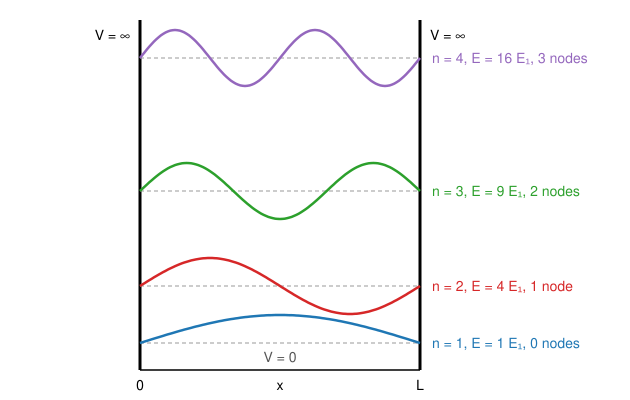

# 12.2 · The Schrödinger equation and the particle in a box

The Schrödinger equation is to chemistry what Newton's laws are to engineering: it decides the energy levels of every atom and molecule. This lesson introduces the wavefunction and the time-independent Schrödinger equation, solves it exactly for the simplest system, a particle trapped in a box, and uses that answer to predict the colour of a dye. Then you solve the same equation numerically by turning it into a matrix eigenvalue problem, the method behind the solver you will use for the rest of the module.

## Why it matters

Cyanine dyes are used in photography, DNA staining and medical imaging. Chemists tune their colour by adding CH=CH units to the chain: each pair of carbons moves the absorption about 100 nm to the red. Why such regular steps? The π electrons of the chain behave almost like particles in a box, and the box gets longer with each unit. The same picture explains why quantum dots change colour with size. Beyond the box, every quantum chemistry program you will meet in Module 31 does, at its heart, what you do in this lesson's lab: write the Hamiltonian as a matrix and find its eigenvalues.

## Core ideas

> [!NOTE]
> The theory is stable. Constants are CODATA 2022 (NIST, checked 2026-10-17). The dye maxima are from the LibreTexts cyanine dye page (data from Simpson, 1948). The lab uses numpy 2.5 and `scipy.linalg.eigh_tridiagonal` from scipy 1.18 as pinned in `labs/common/requirements.txt`.

### The wavefunction

In quantum mechanics a particle is described by a wavefunction $\psi(x)$, a function of position. It is not a path. Its meaning comes from the Born rule: $|\psi(x)|^2\,dx$ is the probability of finding the particle between $x$ and $x + dx$. Because the particle must be somewhere,

$$\int_{-\infty}^{\infty} |\psi(x)|^2\,dx = 1$$

and a wavefunction scaled to satisfy this is called normalised. A good wavefunction must be finite, single-valued and continuous.

### The time-independent Schrödinger equation

For a particle of mass $m$ moving in one dimension in a potential energy $V(x)$, the states of definite energy obey

$$-\frac{\hbar^2}{2m}\frac{d^2\psi}{dx^2} + V(x)\,\psi = E\,\psi$$

The first term is the kinetic energy. It depends on the curvature of $\psi$ (the second derivative from [02.2](../module-02/lesson-02.md)): a wavefunction that bends sharply carries a lot of kinetic energy. The left-hand side is often written $\hat H\psi$, with $\hat H$ the Hamiltonian operator. So the equation is $\hat H\psi = E\psi$, an eigenvalue equation like $A\mathbf{v} = \lambda\mathbf{v}$ in [03.2](../module-03/lesson-02.md). The allowed energies are the eigenvalues; the wavefunctions are the eigenvectors. Quantisation is not added by hand: it comes out because only certain $E$ give a $\psi$ that behaves well at the edges.

### The particle in a box

Put the particle on a line of length $L$ with $V = 0$ inside and walls of infinite height at $x = 0$ and $x = L$. The particle cannot be inside the walls, so $\psi(0) = \psi(L) = 0$. Inside, the equation is $\psi'' = -(2mE/\hbar^2)\psi$, solved by sines. Fitting a whole number of half-waves between the walls gives

$$\psi_n(x) = \sqrt{\frac{2}{L}}\sin\frac{n\pi x}{L},\qquad E_n = \frac{n^2h^2}{8mL^2},\qquad n = 1, 2, 3, \dots$$



What the formula says:

- There is no $n = 0$: the lowest energy $E_1$ is above zero. This zero-point energy is the uncertainty principle of [12.1](lesson-01.md) in exact form.
- State $n$ has $n - 1$ nodes, points inside the box where $\psi = 0$. More nodes means more curvature and more energy.
- Levels spread apart as $n^2$, and they crowd together for a heavier particle or a longer box ($1/mL^2$).

Tiny example: an electron in a 1.00 nm box has $E_1 = h^2/(8m_eL^2) = 6.03\times10^{-20}$ J $= 0.376$ eV, and $E_n = 0.376\,n^2$ eV.

### Conjugated molecules as boxes

In a conjugated chain the π electrons are spread over the whole chain. Model them as particles in a box of length $L$. Each level holds two electrons (Pauli, [07.2](../module-07/lesson-02.md)), so $N$ π electrons fill levels 1 to $N/2$. The lowest-energy absorption lifts one electron from the highest occupied level (HOMO, $n = N/2$) to the lowest unoccupied one (LUMO, $n = N/2 + 1$):

$$\Delta E = \frac{h^2}{8m_eL^2}\left[\left(\tfrac{N}{2}+1\right)^2 - \left(\tfrac{N}{2}\right)^2\right] = \frac{h^2(N + 1)}{8m_eL^2},\qquad \lambda = \frac{8m_e c L^2}{h(N+1)}$$

For the symmetric cyanines $\mathrm{(CH_3)_2N{-}(CH{=}CH)_k{-}CH{=}N^+(CH_3)_2}$, $N$ is the number of chain carbons plus three (each carbon gives one π electron, and the two nitrogens give three between them). Longer chains: $L^2$ grows faster than $N + 1$, so $\lambda$ moves to the red.

### Solving it on a computer: finite differences

Most potentials have no exact solution, so we solve numerically. Put the wavefunction on a grid of points $x_i$ spaced $\Delta x$ apart. The second derivative becomes the central difference

$$\frac{d^2\psi}{dx^2}\bigg|_{x_i} \approx \frac{\psi_{i+1} - 2\psi_i + \psi_{i-1}}{\Delta x^2}$$

Substitute it into the Schrödinger equation and it becomes a matrix equation $\mathbf{H}\boldsymbol\psi = E\boldsymbol\psi$. With $t = \hbar^2/(2m\Delta x^2)$, the matrix $\mathbf{H}$ has $2t + V(x_i)$ on the diagonal and $-t$ on the two neighbouring diagonals, zero elsewhere (a tridiagonal matrix). Its eigenvalues are the energies; its eigenvectors, divided by $\sqrt{\Delta x}$, are normalised wavefunctions. Points outside the grid are taken as $\psi = 0$, which is exactly the infinite wall.

The error of the central difference shrinks as $\Delta x^2$: halve the spacing and the energy error drops about four times. This is the cheapest, most transparent way to solve any one-dimensional problem, and in the rest of the module you use it for tunnelling, vibrations and the hydrogen atom.

### Finite walls

Real walls are not infinitely high. If the walls have height $V_0$, the wavefunction does not stop at the wall: it decays exponentially into it. The particle has a real probability of being where classically it has too little energy. The levels drop below the infinite-box values (the wave has more room), and only a finite number of states are bound. That leakage is the start of tunnelling, the subject of [12.3](lesson-03.md).

Explore both cases, then change the box width and mass and watch the levels move as $1/mL^2$:

[Simulation: Quantum box — particle in a box](../../simulations/quantum-box/index.html?preset=box)

## Worked example

### 1. How long is the box in a cyanine dye?

The three-carbon dye (dye I) absorbs at 309 nm. It has $N = 3 + 3 = 6$ π electrons. Find the box length.

1. Rearrange: $L = \sqrt{\lambda h (N + 1)/(8 m_e c)}$.
2. $L = \sqrt{309\times10^{-9} \times 6.626\times10^{-34} \times 7 / (8 \times 9.109\times10^{-31} \times 2.998\times10^{8})}$.
3. Numerator $1.433\times10^{-39}$, denominator $2.185\times10^{-21}$, ratio $6.56\times10^{-19}$ m², so $L = 8.10\times10^{-10}$ m $= 0.810$ nm.

The chain between the two nitrogens has 4 bonds of about 0.139 nm, 0.556 nm. The fitted box is longer by about 0.127 nm at each end: the π electrons spill a little beyond the nitrogen atoms.

### 2. Predict a longer dye

Dye III has 7 chain carbons, so $N = 10$ and 8 bonds between the nitrogens. Keep the same end extension: $L = 8 \times 0.139 + 2 \times 0.127 = 1.366$ nm.

$$\lambda = \frac{8 m_e c L^2}{h(N+1)} = \frac{8 \times 9.109\times10^{-31} \times 2.998\times10^{8} \times (1.366\times10^{-9})^2}{6.626\times10^{-34} \times 11} = 559\ \text{nm}$$

The measured value is 512 nm. A model with no adjustable physics beyond a box gets within 10 %, and it gets the trend exactly right. In the module practical ([12.6](lesson-06.md)) you fit the bond length and end extension to all three dyes at once and the fit lands within 1 nm of each.

## Hands-on

What you need: pencil and calculator; Python with the course packages and the [Module 12 lab folder](../../labs/module-12/). Time: about 60 minutes.

### Part A — pencil (15 min)

1. An electron is in a 0.50 nm box. Find $E_1$ and $E_2$ in eV and the wavelength of the $1 \to 2$ absorption.
2. Without recalculating: what happens to that wavelength if the box doubles to 1.0 nm? If the particle were a proton?
3. For $n = 1$ and $n = 2$ in a box of length $L$, which is more likely to be found in the middle third of the box ($L/3 < x < 2L/3$)? Decide from a sketch of $\psi^2$ first.

<details><summary>Answers to Part A</summary>

1. $E_1 = 4 \times 0.376 = 1.504$ eV (the box is half as long, so four times the energy); $E_2 = 6.017$ eV. $\Delta E = 4.51$ eV, $\lambda = 1239.84/4.51 = 275$ nm, in the ultraviolet.
2. $\lambda \propto L^2$: doubling the box makes the wavelength four times longer, 1099 nm (near infrared). A proton is 1836 times heavier, so $\lambda$ is 1836 times longer: the levels are so close that the motion is nearly classical.
3. $n = 1$: $\psi^2$ peaks in the middle, probability 0.609. $n = 2$: there is a node in the middle, probability 0.196. Classically the answer would be 1/3 for both.

</details>

### Part B — Python: write your own solver (40 min)

1. Open `lesson02_box.py`. Fill in `my_solve` (build the tridiagonal Hamiltonian with `np.diag` and diagonalise it with `np.linalg.eigh`) and `exact_box` ($E_n$ in eV).
2. Run it from the lab folder:

```bash
py lesson02_box.py
```

3. Look at `runs/lesson02_box.png`: the box levels with their wavefunctions, and a finite well.
4. Record on a [notebook page](../../templates/notebook-page.md) the energy table, the error table and the finite-well results.

How you know it worked:

- With 200 grid points the first five energies match $0.37603\,n^2$ eV to better than $10^{-3}$ relative, and the numerical values are slightly low.
- The error for $n = 1$ falls from $1.2\times10^{-3}$ (25 points) to $5\times10^{-6}$ (400 points), about four times per halving of $\Delta x$.
- The 1.00 nm well with 1.00 eV walls holds only 2 bound states, at 0.191 eV and 0.706 eV, well below the infinite-box values 0.376 and 1.504 eV. About 6 % of the ground-state probability is inside the walls.

<details><summary>Reference solution and what to notice</summary>

```python
dx = x[1] - x[0]
t = c / dx**2
Hm = np.diag(2 * t + V) + np.diag(-t * np.ones(len(x) - 1), 1) + np.diag(-t * np.ones(len(x) - 1), -1)
E, psi = np.linalg.eigh(Hm)
return E[:n_states], psi[:, :n_states] / np.sqrt(dx)
```

Full code: `lesson02_box_solution.py`. The shared module `qm_solver.py` does the same with `scipy.linalg.eigh_tridiagonal`, which stores only the three diagonals and asks for just the lowest states, so it handles 10 000 points easily.

What to notice: the errors grow with $n$, because higher states curve more sharply and need more points per wavelength. A rule of thumb is at least 20 points per node-to-node half-wave. The finite well shows why real dye molecules need the end extension of the worked example: the electrons are not stopped dead at the last atom.

</details>

Then open the simulation with the `box` preset, set the width to 1.0 nm and an electron mass, and check that the ground level reads 0.376 eV. Double the width and confirm the level falls to a quarter.

## Common mistakes

- Starting the box at $n = 0$. $\psi_0 = \sin 0 = 0$ everywhere, which is no particle at all; the lowest state is $n = 1$.
- Treating $|\psi|^2$ as a probability without the $dx$. It is a probability density, in units of 1/length; integrate it over a region.
- Counting π electrons wrongly. Each level holds two electrons; the HOMO is $n = N/2$, and the first absorption goes to $N/2 + 1$, not from $n = 1$.
- Forgetting $\sqrt{\Delta x}$ when normalising the numerical eigenvectors. `eigh` returns vectors with $\sum \psi_i^2 = 1$, but you need $\sum \psi_i^2\,\Delta x = 1$.
- Putting the walls on the grid. If the first and last grid points are the walls, you must force $\psi = 0$ there; it is simpler to keep them just outside the grid.
- Trusting a numerical level without a convergence check. Halve $\Delta x$; if the energy moves in a digit you care about, the grid was too coarse.

## Key takeaways

- $|\psi|^2$ is a probability density; the time-independent Schrödinger equation $\hat H\psi = E\psi$ is an eigenvalue problem whose eigenvalues are the allowed energies.
- Particle in a box: $E_n = n^2h^2/(8mL^2)$, $n - 1$ nodes, a zero-point energy, and levels that crowd together for heavy particles or long boxes.
- A conjugated dye's first absorption is roughly $\lambda = 8m_ecL^2/[h(N+1)]$; longer chains absorb further to the red.
- On a grid the Hamiltonian is a tridiagonal matrix; its eigenvalues converge as $\Delta x^2$.
- Finite walls let the wavefunction leak, lowering the levels and allowing only a few bound states.

## Sources

- [LibreTexts Physical Chemistry, chapter 3](https://chem.libretexts.org/Bookshelves/Physical_and_Theoretical_Chemistry_Textbook_Maps/Physical_Chemistry_(LibreTexts)/03%3A_The_Schrodinger_Equation_and_a_Particle_in_a_Box) — the Schrödinger equation, Born interpretation, particle in a box.
- [LibreTexts Zielinski et al., 4.2 Cyanine Dyes](https://chem.libretexts.org/Bookshelves/Physical_and_Theoretical_Chemistry_Textbook_Maps/Book%3A_Quantum_States_of_Atoms_and_Molecules_(Zielinksi_et_al)/04%3A_Electronic_Spectroscopy_of_Cyanine_Dyes/4.02%3A_Cyanine_Dyes) — dye maxima 309, 409 and 512 nm; π-electron count; box length with an end overshoot.
- [SciPy v1.18 manual, scipy.linalg.eigh_tridiagonal](https://docs.scipy.org/doc/scipy/reference/generated/scipy.linalg.eigh_tridiagonal.html) — the tridiagonal eigensolver used in `qm_solver.py`.
- [NIST CODATA 2022: electron mass](https://physics.nist.gov/cgi-bin/cuu/Value?me) — $m_e = 9.109\,383\,7139\times10^{-31}$ kg.
- [MIT OCW 5.61 Physical Chemistry (Field, Fall 2017)](https://ocw.mit.edu/courses/5-61-physical-chemistry-fall-2017/) — lectures on the Schrödinger equation and the particle in a box.
