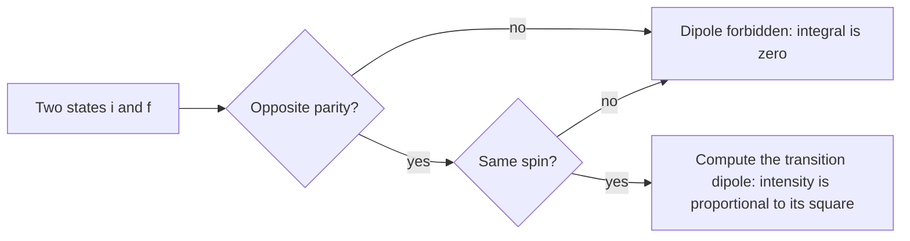

# 12.6 · Many-electron atoms, molecular orbitals and selection rules

Hydrogen is the last system that quantum mechanics solves exactly. With two or more electrons, the electrons repel each other and chemists switch to approximations: the variational principle, orbitals with screened charges, and molecular orbitals built from atomic ones. This lesson shows how those approximations explain helium, the shell order of the periodic table and why O₂ is magnetic. It ends with the rules that decide which transitions show up in a spectrum. The module practical then puts your numerical solver to work on all of it.

## Why it matters

Liquid oxygen sticks between the poles of a strong magnet; liquid nitrogen pours straight through. A Lewis structure with an O=O double bond and all electrons paired cannot explain that, but a molecular-orbital diagram can, in two lines. Likewise, a spectroscopist who sees no band where a gap clearly exists needs to know whether the transition is forbidden or just weak. Every later spectroscopy module uses selection rules, and Module 31's calculations are variational calculations with molecular orbitals.

## Core ideas

> [!NOTE]
> The ideas are stable. The helium energies are the NIST ionisation energy (24.587 eV) and the high-precision non-relativistic ground-state energy (−2.903724 hartree), checked 2026-10-17. The lab uses `qm_solver.py`, numpy 2.5 and scipy 1.18 (`curve_fit`).

### Spin and the Pauli principle

Electrons carry an intrinsic angular momentum, spin, with $m_s = +\tfrac12$ or $-\tfrac12$. The Pauli principle says that the total wavefunction must change sign when two electrons are swapped. Its practical form is the rule you used in [07.2](../module-07/lesson-02.md): no two electrons in an atom share all four quantum numbers $n, \ell, m, m_s$, so each orbital holds at most two, with opposite spins.

### Helium and the variational principle

Helium's Hamiltonian contains the attraction of each electron to the nucleus ($Z = 2$) and the repulsion $1/r_{12}$ between the electrons. That last term makes an exact solution impossible. The variational principle gives a way forward: for any trial wavefunction $\psi_\text{trial}$,

$$E_\text{trial} = \frac{\int \psi_\text{trial}^*\hat H\psi_\text{trial}\,d\tau}{\int \psi_\text{trial}^*\psi_\text{trial}\,d\tau} \ge E_0$$

the true ground-state energy. So guess a wavefunction with a parameter and minimise $E_\text{trial}$.

Trial for helium: both electrons in a 1s orbital with an effective charge $\zeta$ instead of 2. Working out the integrals (in atomic units, hartree) gives

$$E(\zeta) = \zeta^2 - 2Z\zeta + \tfrac58\zeta$$

The three terms are the kinetic energy, the attraction to the nucleus and the electron–electron repulsion. Setting $dE/d\zeta = 0$ gives $\zeta = Z - \tfrac{5}{16} = 1.6875$, and $E = -\zeta^2 = -2.8477$ hartree $= -77.49$ eV. The exact value is $-2.9037$ hartree ($-79.01$ eV), so this one-parameter guess is within 2 %, and above the exact value as the principle demands.

The physics is in $\zeta$: each electron sees the nucleus partly screened by the other, an effective nuclear charge of 1.69 instead of 2. That is the $Z_\text{eff}$ of [07.2](../module-07/lesson-02.md), now calculated.

### The orbital approximation for bigger atoms

For larger atoms, treat each electron as moving in the average field of the nucleus and all the other electrons: hydrogen-like orbitals with screened charges. Screening breaks hydrogen's degeneracy. An s electron penetrates closer to the nucleus than a p electron of the same shell (its centrifugal barrier is zero, [12.5](lesson-05.md)), so it is less screened and lower in energy. Hence the order $2s < 2p$, $3s < 3p < 3d$, and the near-tie between 4s and 3d that gives the transition metals their irregular configurations.

### Molecular orbitals from atomic orbitals

In a molecule, write each molecular orbital (MO) as a linear combination of atomic orbitals (LCAO), $\psi = c_A\phi_A + c_B\phi_B$. Applying the variational principle to the coefficients turns the problem into a matrix eigenvalue problem, exactly the Hückel calculation of [03.2](../module-03/lesson-02.md). For two identical atoms it always gives an in-phase bonding MO, lower than the atomic orbitals, and an out-of-phase antibonding MO (with a node between the nuclei), raised by slightly more.

Fill the MOs with electrons, two per orbital, and define

$$\text{bond order} = \tfrac12\left(N_\text{bonding} - N_\text{antibonding}\right)$$

For second-row diatomics the valence MOs, from low to high, are $\sigma_{2s}$, $\sigma^*_{2s}$, then $\sigma_{2p}$ and two degenerate $\pi_{2p}$, then two degenerate $\pi^*_{2p}$ and $\sigma^*_{2p}$. For O₂ and F₂ the $\sigma_{2p}$ lies below $\pi_{2p}$; for B₂, C₂ and N₂ the order of these two is swapped, because 2s–2p mixing pushes $\sigma_{2p}$ up. Hund's rule applies to degenerate MOs too.

| Molecule | Valence electrons | Bond order | Unpaired electrons |
|---|---|---|---|
| N₂ | 10 | 3 | 0 |
| O₂ | 12 | 2 | 2 (one in each $\pi^*$) |
| F₂ | 14 | 1 | 0 |
| Ne₂ | 16 | 0 (not bound) | 0 |

O₂'s two unpaired electrons make it paramagnetic, which is why liquid oxygen is held by a magnet.

### Selection rules: which transitions light can drive

Light's oscillating electric field pushes on the molecule's dipole moment $\hat\mu = q\,x$ (Module 4). A transition from state $i$ to state $f$ can absorb light only if the transition dipole

$$\mu_{fi} = \int \psi_f^*\,\hat\mu\,\psi_i\,d\tau$$

is non-zero, and its intensity is proportional to $|\mu_{fi}|^2$. A quick test uses parity. $x$ is odd ($x \to -x$ flips its sign). If $\psi_i$ and $\psi_f$ have the same parity, the integrand is odd and the integral over a symmetric region is zero. So a dipole transition must connect states of opposite parity.

| System | Rule | Reason |
|---|---|---|
| Particle in a box | $\Delta n$ odd | $\psi_n$ alternate parity about the centre |
| Harmonic oscillator | $\Delta v = \pm1$ only | $x$ connects only neighbouring levels |
| Anharmonic oscillator | $\Delta v = \pm1$ strong, $\pm2, \pm3$ weak | the wavefunctions are no longer pure Hermite functions |
| Rigid rotor (with dipole) | $\Delta J = \pm1$ | a photon carries one unit of angular momentum |
| Hydrogen atom | $\Delta\ell = \pm1$, any $\Delta n$ | same, so s→p and p→d are allowed, s→s and s→d are not |
| Any atom or molecule | $\Delta S = 0$ | the electric field does not act on spin |

"Forbidden" means zero in this approximation; weaker mechanisms can still make such lines appear faintly (Module 20).



## Worked example

### 1. Helium's ionisation energy from the variational result

1. Variational He: $E = -2.8477$ hartree. He⁺ is hydrogen-like with $Z = 2$: $E = -Z^2/2 = -2.0000$ hartree, exactly.
2. Ionisation energy: $-2.0000 - (-2.8477) = 0.8477$ hartree $\times 27.211 = 23.07$ eV.
3. The measured value is 24.587 eV (NIST). The error, 1.5 eV, is almost exactly the error in the helium energy, since He⁺ is exact.

Without screening ($\zeta = 2$), $E(2) = 4 - 8 + 1.25 = -2.75$ hartree, worse by 0.10 hartree. A single 1s shape cannot capture how the two electrons avoid each other. Trial functions that include $r_{12}$ explicitly reach the exact value.

### 2. O₂, O₂⁺ and O₂⁻

O₂ has 12 valence electrons: $(\sigma_{2s})^2(\sigma^*_{2s})^2(\sigma_{2p})^2(\pi_{2p})^4(\pi^*_{2p})^2$. Bonding 8, antibonding 4, bond order 2, two unpaired $\pi^*$ electrons.

- O₂⁺ (remove one $\pi^*$ electron): bond order $\tfrac12(8 - 3) = 2.5$, one unpaired electron, a shorter and stronger bond.
- O₂⁻, superoxide (add one $\pi^*$ electron): bond order $\tfrac12(8 - 5) = 1.5$, one unpaired electron, a longer and weaker bond.

All three are paramagnetic. The Lewis structure of O₂ predicts the bond order correctly but not the magnetism; the MO picture gets both.

## Hands-on

This is the module practical. It uses the solver from 12.2, the potentials of 12.3–12.5 and the rules above. What you need: pencil; Python with the course packages and the [Module 12 lab folder](../../labs/module-12/) (`qm_solver.py`, `cyanine_dyes.csv`); the [lab report template](../../templates/lab-report.md). Time: about 110 minutes.

### Part A — pencil (20 min)

1. Write the valence MO configuration of N₂ and of N₂⁺. Which has the shorter bond?
2. Is B₂ paramagnetic? (Use the order for B₂–N₂, with $\pi_{2p}$ below $\sigma_{2p}$.)
3. For each pair, allowed or forbidden as an electric-dipole transition: box $n = 1 \to 3$; oscillator $v = 0 \to 1$; hydrogen 1s → 2s; hydrogen 2p → 3d; rotor $J = 2 \to 4$.
4. Predict $\zeta$ and $E$ for the two-electron ion Li⁺ ($Z = 3$) with the same trial function. The exact energy is about −7.280 hartree.

<details><summary>Answers to Part A</summary>

1. N₂: $(\sigma_{2s})^2(\sigma^*_{2s})^2(\pi_{2p})^4(\sigma_{2p})^2$, bond order 3. N₂⁺ loses a bonding $\sigma_{2p}$ electron: bond order 2.5. N₂ has the shorter bond.
2. B₂ has 6 valence electrons: $(\sigma_{2s})^2(\sigma^*_{2s})^2(\pi_{2p})^2$. The two $\pi$ electrons go into separate degenerate orbitals with parallel spins (Hund), so yes, B₂ is paramagnetic. Its magnetism is the experimental evidence for the swapped order.
3. Box 1 → 3: forbidden ($\Delta n$ even, same parity). Oscillator 0 → 1: allowed. 1s → 2s: forbidden ($\Delta\ell = 0$). 2p → 3d: allowed ($\Delta\ell = +1$). Rotor 2 → 4: forbidden ($\Delta J = 2$).
4. $\zeta = 3 - 5/16 = 2.6875$; $E = -\zeta^2 = -7.2227$ hartree, 0.8 % above the exact value. The relative error shrinks as $Z$ grows, because the electron repulsion matters less against a larger nuclear charge.

</details>

### Part B — Python: the solver at work (70 min)

1. Open `lesson06_practical.py`. It imports the solver and runs four parts. Fill in `dipole_matrix` (the integral $\int\psi_m x\psi_n\,dx$ as a matrix product), `helium_energy` and `dye_lambda` (the particle-in-a-box formula of 12.2, with box length $L = (\text{carbons} + 1)\beta + 2\delta$).
2. Run it from the lab folder:

```bash
py lesson06_practical.py
```

3. Look at `runs/lesson06_practical.png`: the box and oscillator dipole tables as heat maps, and the helium energy curve.

How you know it worked:

- Part 1, validation: the worst relative error is about $5\times10^{-6}$ for the box and $7\times10^{-6}$ for the oscillator. If either is above $10^{-4}$, check your grid.
- Part 2, selection rules: in the box table every entry with $m + n$ even is 0.0000, and the $\Delta n = 3$ entries are about ten times smaller than the $\Delta n = 1$ entries. The harmonic table is non-zero only next to the diagonal, with values growing as $\sqrt{v+1}$ (0.5000, 0.7071, 0.8660, 1.0000). The HCl Morse table has small entries further out: $|\langle 0|x|2\rangle|/|\langle 0|x|1\rangle| = 0.096$, so from the wavefunctions alone the overtone is about 100 times weaker than the fundamental.
- Part 3, helium: best $\zeta = 1.6875$, $E = -2.8477$ hartree $= -77.49$ eV, 1.53 eV above the exact energy; predicted ionisation energy 23.07 eV against 24.59 eV measured.
- Part 4, dyes: with $\beta = 0.139$ nm and no end correction the model gives 146, 255 and 371 nm, far too short. The fit gives $\beta = 0.1243$ nm and $\delta = 0.156$ nm and reproduces 309, 410 and 512 nm; it predicts 613 nm for the nine-carbon dye.

<details><summary>Reference solution and what to notice</summary>

`dipole_matrix` returns `np.abs(psi.T @ (x[:, None] * psi) * dx)`; `helium_energy` returns `zeta**2 - 2 * Z * zeta + 5 / 8 * zeta`; `dye_lambda` computes `N = carbons + 3` and `L = ((carbons + 1) * beta + 2 * delta) * 1e-9` and returns `8 * M_E * C_LIGHT * L**2 / (H * (N + 1)) * 1e9`. Full code: `lesson06_practical_solution.py`.

What to notice:

- The selection rules come out of the numbers without any symmetry argument. Computational chemistry programs work the same way: they compute $\mu_{fi}$ for every pair of states and report intensities.
- The real HCl overtone is weaker still, because the dipole moment itself also depends on the bond length; Module 20 adds that.
- The dye fit has two parameters and three points, so it is not a strong test. The fitted $\beta$ is shorter than a real C–C bond and $\delta$ absorbs the difference: the two parameters are correlated. The prediction for the next dye is the real test; Physical Chemistry Lab 2 (Module 30) returns to dye spectra.

</details>

### Part C — write it up (20 min)

Write a two-page report with the [lab report template](../../templates/lab-report.md): the method (finite differences, grid, validation), the three results (selection-rule tables, helium, dyes) with numbers and units, and a discussion of where each model fails and why. These Python models do not train bench skills; they train the reasoning you will use to plan and interpret real spectra.

## Common mistakes

- Expecting the variational energy to fall below the true energy. It is always at or above it; a "better than exact" result means an error in the integrals.
- Forgetting to swap the $\sigma_{2p}$ and $\pi_{2p}$ order between N₂ and O₂. It does not change the bond orders, but it changes the predicted magnetism of B₂ and C₂.
- Counting core electrons in the bond order. Core bonding and antibonding MOs cancel; use the valence electrons.
- Reading "forbidden" as "never observed". Forbidden transitions can appear weakly; allowed ones can be weak if $\mu_{fi}$ is small.
- Using $\Delta n = \pm1$ for hydrogen. In atoms the rule is on $\ell$: 1s → 3p is allowed (it is the second Lyman line).
- Measuring $x$ from a wall when testing parity in a box. Parity is about the centre of the symmetric potential.

## Key takeaways

- The Pauli principle limits each orbital to two electrons of opposite spin; electron repulsion makes many-electron atoms need approximations.
- The variational principle gives an upper bound; for helium a screened 1s trial gives $\zeta = 1.6875$ and an energy 2 % above exact.
- Screening and penetration order the subshells $s < p < d$ within a shell in many-electron atoms.
- LCAO molecular orbitals with bond order $\tfrac12(N_b - N_a)$ explain bond strengths and why O₂ is paramagnetic.
- Transitions need a non-zero transition dipole: opposite parity and $\Delta S = 0$; box $\Delta n$ odd, oscillator $\Delta v = \pm1$, rotor $\Delta J = \pm1$, atoms $\Delta\ell = \pm1$.

## Sources

- [LibreTexts Physical Chemistry, chapter 8: Multielectron Atoms](https://chem.libretexts.org/Bookshelves/Physical_and_Theoretical_Chemistry_Textbook_Maps/Physical_Chemistry_(LibreTexts)/08%3A_Multielectron_Atoms) — helium, the variational method, $\zeta = 27/16$, the Pauli principle.
- [LibreTexts Physical Chemistry, chapter 9: Chemical Bonding in Diatomic Molecules](https://chem.libretexts.org/Bookshelves/Physical_and_Theoretical_Chemistry_Textbook_Maps/Physical_Chemistry_(LibreTexts)/09%3A_Chemical_Bonding_in_Diatomic_Molecules) — LCAO, H₂⁺, MO diagrams and bond orders of second-row diatomics.
- [LibreTexts Zielinski et al., 4.6 Selection Rules for the Particle in a Box](https://chem.libretexts.org/Bookshelves/Physical_and_Theoretical_Chemistry_Textbook_Maps/Book%3A_Quantum_States_of_Atoms_and_Molecules_(Zielinksi_et_al)/04%3A_Electronic_Spectroscopy_of_Cyanine_Dyes/4.06%3A_Selection_Rules_for_the_Particle-in-a-Box) — transition dipole integral and parity.
- [NIST Handbook of Basic Atomic Spectroscopic Data: helium](https://physics.nist.gov/PhysRefData/Handbook/Tables/heliumtable1.htm) — He I ionisation energy 24.587387 eV.
- [MIT OCW 5.61 Physical Chemistry (Field, Fall 2017)](https://ocw.mit.edu/courses/5-61-physical-chemistry-fall-2017/) — lectures on helium, the variational method, LCAO-MO theory and selection rules.
