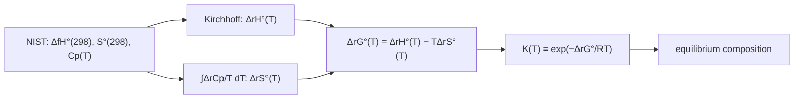

# 13.4 · Free energy and chemical potential

Entropy decides direction, but only when you count the surroundings too, which is awkward in a lab where the surroundings are "the room". Free energy packs the surroundings into a property of the system alone. This lesson derives the Gibbs and Helmholtz energies from the second law, shows how G changes with pressure and temperature using the partial derivatives of lesson 02.5, introduces chemical potential, and ends with the result that ties the module together: an equilibrium constant at any temperature, calculated from NIST tables.

## Why it matters

In lesson 08.2 you estimated that ammonia synthesis has $K \approx 3\times10^{-4}$ at 700 K by assuming $\Delta H$ and $\Delta S$ do not change with temperature. A plant designer who used that number would overestimate the equilibrium yield and size the recycle loop wrong. The correct value, from the same NIST data plus heat capacities, is 3.6 times smaller. The gap grows with temperature. This lesson gives you the method to get it right, and the chemical potential that explains *why* high pressure helps.

## Core ideas

> [!NOTE]
> The Gibbs energy, chemical potential and $\Delta_r G^\circ = -RT\ln K$ are settled theory. The ammonia numbers use NIST WebBook Shomate coefficients (from the NIST-JANAF tables, Chase 1998) and CODATA $\Delta_f H^\circ$, and are checked against the JANAF $\log K_f$ values, all retrieved 2026-10-17. Standard pressure $p^\circ$ = 1 bar.

### From total entropy to free energy

At constant $T$ and $p$, the surroundings receive heat $-\Delta H$ (lesson [13.2](lesson-02.md)), so $\Delta S_\text{surr} = -\Delta H/T$. Then

$$\Delta S_\text{total} = \Delta S - \frac{\Delta H}{T} = -\frac{\Delta H - T\Delta S}{T} = -\frac{\Delta G}{T}$$

with the **Gibbs energy** $G = H - TS$. "Total entropy rises" becomes "$G$ of the system falls": at constant $T$ and $p$, a process runs when $\Delta G < 0$. This is lesson [08.2](../module-08/lesson-02.md)'s rule, now derived. At constant $T$ and $V$ the same argument gives the **Helmholtz energy** $A = U - TS$. $-\Delta G$ is also the most non-expansion work (for example electrical, $\Delta G = -nFE$ in a cell) a process can deliver; $-\Delta A$ is the most total work.

### How G depends on T and p

Combine the first law for a reversible change, $dU = T\,dS - p\,dV$, with the definitions $H = U + pV$ and $G = H - TS$:

$$dG = V\,dp - S\,dT \qquad\Rightarrow\qquad \left(\frac{\partial G}{\partial p}\right)_T = V, \quad \left(\frac{\partial G}{\partial T}\right)_p = -S$$

$G$ falls as $T$ rises (entropy is positive), fastest for gases, which have the largest $S$; lesson 13.5 uses this to explain melting and boiling. $G$ rises with pressure, by $V$ per unit pressure. For one mole of ideal gas, integrate $V_m = RT/p$:

$$G_m(p) = G_m^\circ + RT\ln\frac{p}{p^\circ}$$

Compressing 1 mol of gas at 298 K from 1 to 10 bar raises $G$ by $RT\ln 10 = 5.71$ kJ. For liquid water ($V_m$ = 18 cm³/mol) the same 9 bar raises it by only $V\,\Delta p$ = 16 J. That is why condensed phases are taken as pressure-independent in most equilibrium work.

### Maxwell relations: free information from mixed partials

Because $dG = V\,dp - S\,dT$ is exact, its mixed partials are equal (lesson [02.5](../module-02/lesson-05.md)):

$$\left(\frac{\partial S}{\partial p}\right)_T = -\left(\frac{\partial V}{\partial T}\right)_p$$

This is a **Maxwell relation**. The right side is easy to measure (thermal expansion), the left is not. For an ideal gas $(\partial V/\partial T)_p = nR/p$, so $(\partial S/\partial p)_T = -nR/p$, which integrates to $S = S^\circ - nR\ln(p/p^\circ)$: the formula used without proof in lesson [13.3](lesson-03.md).

### Chemical potential

In a mixture, $G$ also depends on the amounts. The **chemical potential** of component $i$ is its partial molar Gibbs energy:

$$\mu_i = \left(\frac{\partial G}{\partial n_i}\right)_{T,\,p,\,n_{j\neq i}}$$

For a pure substance $\mu = G_m$. Matter moves from high $\mu$ to low $\mu$, as heat moves from high $T$ to low $T$: water evaporates when $\mu$(liquid) > $\mu$(vapour), a solute diffuses down its $\mu$ gradient. For an ideal gas in a mixture with partial pressure $p_i$:

$$\mu_i = \mu_i^\circ + RT\ln\frac{p_i}{p^\circ}$$

### Reaction Gibbs energy, Q and K

For a reaction $\sum \nu_i X_i = 0$ (products positive $\nu$, reactants negative), the Gibbs energy change per mole of reaction is $\Delta_r G = \sum \nu_i\mu_i$. Substituting $\mu_i$:

$$\Delta_r G = \Delta_r G^\circ + RT\ln Q, \qquad Q = \prod_i \left(\frac{p_i}{p^\circ}\right)^{\nu_i}$$

The mixture reacts forward while $\Delta_r G < 0$ and stops at equilibrium, $\Delta_r G = 0$, where $Q = K$:

$$\Delta_r G^\circ = -RT\ln K$$

$K$ is dimensionless because each pressure is divided by $p^\circ$. High pressure helps ammonia synthesis because $Q$ contains $(p^\circ/p)^2$ for the two moles of gas lost: at fixed $K$, the mole fractions must shift towards NH₃.

### K at any temperature

The **Gibbs–Helmholtz equation**, $\left(\partial(G/T)/\partial T\right)_p = -H/T^2$, applied to the reaction gives the van 't Hoff equation of lesson [08.3](../module-08/lesson-03.md), $d\ln K/dT = \Delta_r H^\circ/RT^2$. With $\Delta_r H^\circ$ itself changing with $T$, the cleanest route in practice is direct:



## Worked example

### 1. K for ammonia synthesis at 700 K, done properly

$\mathrm{N_2 + 3H_2 \rightleftharpoons 2NH_3}$. From the NIST data (lab helper `thermo13.py`):

| | 298.15 K | 700 K |
|---|---|---|
| $\Delta_r H^\circ$ (kJ/mol) | −91.88 | −105.32 (Kirchhoff, lesson 13.2) |
| $\Delta_r S^\circ$ (J mol⁻¹ K⁻¹) | −198.11 | −228.03 ($\int \Delta_r C_p/T\,dT$) |

$$\Delta_r G^\circ(700) = -105.32 + 700 \times 0.22803 = +54.30\ \text{kJ/mol}$$

$$K = \exp\left(\frac{-54\,300}{8.3145 \times 700}\right) = e^{-9.33} = 8.9\times10^{-5}$$

The NIST-JANAF table gives $\log_{10}K_f(\mathrm{NH_3}) = -2.029$ at 700 K, so $K = 10^{2 \times (-2.029)} = 8.75\times10^{-5}$. Agreement within 1.5 %, the size of the small difference between the CODATA and JANAF formation enthalpies. The Module 8 shortcut, using the 298 K values at 700 K, gives $\Delta_r G^\circ = -91.88 + 700 \times 0.19811 = +46.8$ kJ/mol and $K = 3.2\times10^{-4}$, 3.6 times too large. Both $\Delta_r H$ and $\Delta_r S$ change with temperature; their errors partly cancel in $\Delta_r G$, but not enough.

### 2. Which way will the reactor mixture go?

A sample from a converter at 700 K has partial pressures N₂ 50 bar, H₂ 150 bar, NH₃ 10 bar.

$$Q = \frac{(10)^2}{(50)(150)^3} = 5.93\times10^{-7}$$

$$\Delta_r G = 54.30 + \frac{8.3145 \times 700}{1000}\ln(5.93\times10^{-7}) = 54.30 - 83.45 = -29.2\ \text{kJ/mol}$$

Negative, so more ammonia forms although $\Delta_r G^\circ$ is strongly positive. The sign of $\Delta_r G^\circ$ tells you about the standard state (everything at 1 bar), not about your mixture. Here $Q \ll K$; the gas keeps reacting until $Q$ rises to $8.9\times10^{-5}$.

## Hands-on

What you need: the [Module 13 lab folder](../../labs/module-13/) with Python 3.14 (numpy, scipy, matplotlib), a calculator and your notebook. Time: about 60 minutes.

### Part A — Python: K(T) from NIST data (40 min)

This is the module's core calculation. Open `lesson04_k_from_nist.py` and write the three TODO functions:

- `k_constant_dh_ds`: the Module 8 approximation, $K = \exp[-(\Delta H_{298} - T\Delta S_{298})/RT]$;
- `delta_g_actual`: $\Delta_r G = \Delta_r G^\circ + RT\ln Q$;
- `nh3_mole_fraction`: the equilibrium mole fraction of NH₃ from a 1 : 3 N₂ : H₂ feed at total pressure $p$. With extent $\xi$, the amounts are $1-\xi$, $3-3\xi$, $2\xi$ (total $4-2\xi$); solve $K = y_{\mathrm{NH_3}}^2/(y_{\mathrm{N_2}}\,y_{\mathrm{H_2}}^3)\,(p^\circ/p)^2$ for $\xi$ with `scipy.optimize.brentq`.

The full-$C_p$ value of $K$ comes from `reaction_k` in `thermo13.py`. Read that file first: it is under 100 lines, and every equation in it is from this lesson or lesson 13.2. Then run:

```bash
py lesson04_k_from_nist.py
```

How you know it worked: the table shows $K$ from NIST $C_p(T)$ within about 4 % of the JANAF column at every temperature (8.88 × 10⁻⁵ against 8.75 × 10⁻⁵ at 700 K), while the constant-$\Delta H$ column drifts to 1.8 times too large at 500 K and 5 times at 800 K. The reactor mixture gives $\Delta_r G$ = −29.2 kJ/mol. At 700 K the equilibrium NH₃ mole fraction rises from 0.003 at 1 bar to 0.300 at 200 bar. The plot `runs/lesson04_lnK.png` is a van 't Hoff plot: the full curve bends, the constant-$\Delta H$ line is straight. Record the 700 K values on a [notebook page](../../templates/notebook-page.md).

<details><summary>Reference solution</summary>

`k_constant_dh_ds`: `return math.exp(-(dh298_kj * 1000 - t * ds298_j) / (R * t))`. `delta_g_actual`: `return dg0_kj + R * t * math.log(q) / 1000`. `nh3_mole_fraction`: inside `f(xi)` compute the three mole fractions, return `math.log(y_nh3**2 / (y_n2 * y_h2**3) * (P_STD / p_bar) ** 2) - math.log(k)`; then `xi = brentq(f, 1e-12, 1 - 1e-12)` and `return 2 * xi / (4 - 2 * xi)`. Working with logarithms keeps the root finder stable when $K$ is tiny. Full code in `lesson04_k_from_nist_solution.py`.

The yields assume ideal gases. At 200 bar real N₂, H₂ and NH₃ are not ideal, and an engineer replaces partial pressures by fugacities; lesson 13.6 introduces the same idea for solutions as activity.

</details>

### Part B — pencil (20 min)

1. Use $dA = -S\,dT - p\,dV$ to write a Maxwell relation for $(\partial S/\partial V)_T$. Evaluate it for an ideal gas and integrate to get $\Delta S$ for an isothermal expansion.
2. A reaction has $\Delta_r G^\circ = +10.0$ kJ/mol at 500 K. A mixture has $Q = 0.010$. Which way does it go?
3. Why can a table give $\Delta_f G^\circ$ of NH₃ at 298 K as −16.4 kJ/mol, yet a bottle of ammonia gas does not decompose? (Hint: decomposition is the reverse reaction.)

<details><summary>Answers to Part B</summary>

1. Mixed partials of $A$: $(\partial S/\partial V)_T = (\partial p/\partial T)_V$. Ideal gas: $p = nRT/V$, so $(\partial p/\partial T)_V = nR/V$. Integrating, $\Delta S = nR\ln(V_2/V_1)$, as in lesson 13.3.
2. $\Delta_r G = 10.0 + (8.3145 \times 500/1000)\ln 0.010 = 10.0 - 19.1 = -9.1$ kJ/mol. Forward, despite the positive $\Delta_r G^\circ$.
3. Formation of NH₃ from N₂ and H₂ is favoured at 298 K, so decomposition has $\Delta G^\circ = +16.4$ kJ/mol per mole of NH₃ and $K \ll 1$. Even if it were favoured, it would also need a catalyst to run at a noticeable rate.

</details>

## Common mistakes

- **Using $\Delta_r G^\circ$ to predict the direction in a real mixture.** Direction comes from $\Delta_r G = \Delta_r G^\circ + RT\ln Q$.
- **Using the 298 K values of $\Delta H$ and $\Delta S$ at high temperature.** Fine within about 100 K; beyond that, include $C_p$. At 800 K the error in $K$ for ammonia synthesis is a factor of 5.
- **Forgetting $p^\circ$.** $K$ and $Q$ are built from $p_i/p^\circ$, with $p^\circ$ = 1 bar. Tables based on 1 atm (older books) give slightly different $K$ for reactions that change the number of gas moles.
- **Stoichiometry in $K$.** $K$ belongs to the equation as written: doubling the equation squares $K$. JANAF lists $K_f$ per mole of compound, so ammonia synthesis has $K = K_f^2$.
- **Swapping $\mu$ and $\mu^\circ$.** $\mu^\circ$ is a constant for the standard state; $\mu$ depends on the actual pressure or concentration.

## Key takeaways

- At constant $T$ and $p$, $\Delta G = -T\Delta S_\text{total}$: a process runs when $G$ falls.
- $dG = V\,dp - S\,dT$; mixed partials give Maxwell relations, such as $(\partial S/\partial p)_T = -(\partial V/\partial T)_p$.
- Ideal gas: $\mu = \mu^\circ + RT\ln(p/p^\circ)$; condensed phases barely depend on pressure.
- $\Delta_r G = \Delta_r G^\circ + RT\ln Q$, and $\Delta_r G^\circ = -RT\ln K$ at equilibrium.
- $K(T)$ from tables: $\Delta_r H^\circ(T)$ and $\Delta_r S^\circ(T)$ from $C_p$, then $\Delta_r G^\circ(T)$. For NH₃ at 700 K the NIST route agrees with JANAF within 1.5 %; the constant-$\Delta H$ shortcut is 3.6 times off.

## Sources

- [MIT OpenCourseWare 5.60, lecture notes](https://ocw.mit.edu/courses/5-60-thermodynamics-kinetics-spring-2008/pages/lecture-notes/) — Gibbs and Helmholtz energies, fundamental equations, Maxwell relations, chemical potential, equilibrium constants.
- [NIST-JANAF Thermochemical Tables](https://janaf.nist.gov/) and the [ammonia table](https://janaf.nist.gov/tables/H-083.html) — $\log K_f$ and $\Delta_f G^\circ$ of NH₃ from 298 to 1200 K used as the check.
- [NIST Chemistry WebBook: Ammonia](https://webbook.nist.gov/cgi/cbook.cgi?ID=C7664417&Mask=1) — Shomate coefficients and CODATA $\Delta_f H^\circ$, $S^\circ$.
- [LibreTexts Physical Chemistry](https://chem.libretexts.org/Bookshelves/Physical_and_Theoretical_Chemistry_Textbook_Maps/Physical_Chemistry_%28LibreTexts%29) — further reading on chemical potential and the Gibbs–Helmholtz equation.
