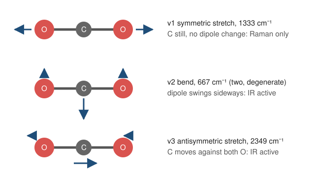

# 14.4 · From coupled masses to the vibrations of CO2

Carbon dioxide is three masses joined by two springs, exactly the free chain of lesson 14.3 with a lighter mass in the middle. Its normal modes are a symmetric stretch, an antisymmetric stretch and a bend, and only two of them absorb infrared light. That single fact, which comes straight out of the mode shapes, is why CO2 is a greenhouse gas while N2 and O2 are not. In this lesson you predict all the vibrations of CO2 from a couple of force constants, find out where the simplest model fails and how one extra constant fixes it, and use the result to predict the spectrum of 13CO2 before you look it up.

## Why it matters

Atmospheric scientists track the rise of CO2 by measuring its infrared absorption, and they tell fossil carbon from other sources partly by the ratio of 13C to 12C, which shows up as a shifted band. Both measurements rest on the normal-mode picture. In the chemistry lab the same picture tells you which bands to expect in an IR spectrum, which ones only Raman will show, and how an isotope label moves a band, a standard trick for proving which atoms take part in a vibration. CO2 is the smallest molecule that has all of these features, so it is the one to learn them on.

## Core ideas

> [!NOTE]
> The physics is stable. The measured wavenumbers are the fundamentals listed by the NIST CCCBDB and the atomic masses are NIST values (atomic mass constant from CODATA 2022), checked 2026-10-17. The force constants you fit are model parameters: they depend on the model, and anharmonic corrections would change them by a few percent.



### How many modes?

Each atom can move in three directions, so three atoms have 9 ways to move. Three are translations of the whole molecule. A linear molecule can rotate about two axes (rotating about its own axis moves no nucleus), so 2 more are rotations. That leaves $3N - 5 = 4$ vibrations for a linear molecule ($3N - 6$ for a bent one such as H2O). For CO2 they are the symmetric stretch $\nu_1$, two bends $\nu_2$ (one in each perpendicular plane, with the same frequency: degenerate) and the antisymmetric stretch $\nu_3$.

### The stretches: a free chain with unequal masses

Along the axis CO2 is the free chain of [14.3](lesson-03.md) with masses $m_\mathrm O$, $m_\mathrm C$, $m_\mathrm O$ and one force constant $k$ per bond. The eigenproblem (done by hand in [03.2](../module-03/lesson-02.md)) gives

$$\omega_\text{trans} = 0,\qquad \omega_1^2 = \frac{k}{m_\mathrm O},\qquad \omega_3^2 = \frac{k}{m_\mathrm O}\left(1 + \frac{2m_\mathrm O}{m_\mathrm C}\right)$$

In $\nu_1$ the oxygens move out and in together and the carbon stays put, so the carbon mass does not appear. In $\nu_3$ the carbon moves against both oxygens. With one $k$, the ratio $\nu_3/\nu_1 = \sqrt{1 + 2m_\mathrm O/m_\mathrm C}$ is fixed at 1.915. The measured ratio is $2349/1333 = 1.762$. The simplest model is 8 % off.

### One more constant: bond-bond interaction

Real bonds are not independent springs. Stretching one C=O bond shifts electron density and changes how stiff the other one is. Add an interaction term to the potential energy, with stretches $s_1$ and $s_2$ of the two bonds:

$$V = \tfrac12 k\,(s_1^2 + s_2^2) + k_{12}\,s_1 s_2$$

In the symmetric stretch both bonds stretch together ($s_1 = s_2$), in the antisymmetric one oppositely ($s_1 = -s_2$), so

$$\omega_1^2 = \frac{k + k_{12}}{m_\mathrm O},\qquad \omega_3^2 = (k - k_{12})\left(\frac{1}{m_\mathrm O} + \frac{2}{m_\mathrm C}\right)$$

Two equations, two unknowns. This is a small valence force field, the kind of model spectroscopists used to fit for decades. A positive $k_{12}$ means it costs extra energy to stretch both bonds at once.

### The bend

Sideways displacements $y$ bend the molecule by an angle $\delta = (y_{\mathrm O1} - 2y_\mathrm C + y_{\mathrm O2})/r$, with $r \approx 1.16$ Å the C=O bond length. With a bending constant $k_\delta$ (energy per radian squared), $V = \tfrac12 k_\delta\delta^2$. The same eigen-solver on the $y$ coordinates gives two zero modes (sideways translation and rotation) and the bend:

$$\omega_2^2 = \frac{2k_\delta}{m_\mathrm O\,r^2}\left(1 + \frac{2m_\mathrm O}{m_\mathrm C}\right)$$

Bending is much softer than stretching, which is why $\nu_2$ is the lowest mode.

### Which modes absorb infrared light?

Light's oscillating electric field can only push a vibration that changes the molecule's dipole moment. Give the atoms partial charges $-q$, $+2q$, $-q$. In $\nu_1$ the two oxygens move in opposite directions by the same amount: their dipole contributions cancel at every instant, so $\nu_1$ is IR inactive. In $\nu_3$ and $\nu_2$ the carbon moves against both oxygens and the dipole oscillates: IR active. $\nu_1$ does show up in Raman spectroscopy, which senses changes in polarisability instead; for a molecule with a centre of symmetry no mode is both IR and Raman active (Module 20).

The bend absorbs at $1/667\ \mathrm{cm^{-1}}$ = 15.0 µm. Earth's surface at 288 K radiates most strongly near $2898/288 \approx 10$ µm (Wien's law) and strongly at 15 µm too. N2 and O2 have a single, symmetric stretch with no dipole change, so they cannot absorb there. That is the mechanism of the CO2 greenhouse effect in one sentence.

### Two refinements

- Fermi resonance. $2\nu_2 = 1334$ cm⁻¹ lands almost exactly on $\nu_1 = 1333$ cm⁻¹, and the two states mix. The Raman spectrum shows not one line but a pair near 1285 and 1388 cm⁻¹ (McCluskey and Stoker, 2006). The CCCBDB value 1333 is the "unperturbed" position a model like ours should use.
- Quantum levels. Each normal mode is a quantum harmonic oscillator of lesson [12.4](../module-12/lesson-04.md), with levels $(v + \tfrac12)h c\tilde\nu$. The zero-point energy of CO2 is $\tfrac12(\nu_1 + 2\nu_2 + \nu_3)$ = 2508 cm⁻¹ = 30.0 kJ/mol.

[Simulation: Oscillators — CO2 normal modes](../../simulations/oscillators/index.html?preset=co2)

## Worked example

### 1. Where the one-constant model fails

Masses: $m_\mathrm O$ = 15.9949 u, $m_\mathrm C$ = 12.0000 u, $u = 1.66054\times10^{-27}$ kg. Fit $k$ to the antisymmetric stretch, $\tilde\nu_3$ = 2349 cm⁻¹:

- $\omega_3 = 2\pi c\tilde\nu_3 = 2\pi \times 2.99792\times10^{10} \times 2349 = 4.425\times10^{14}$ rad/s, so $\omega_3^2 = 1.958\times10^{29}$ s⁻².
- $1/m_\mathrm O + 2/m_\mathrm C = (0.06252 + 0.16667)/u = 0.22919/u = 1.3802\times10^{26}$ kg⁻¹.
- $k = 1.958\times10^{29} / 1.3802\times10^{26} = 1418$ N/m.
- Predicted symmetric stretch: $\tilde\nu_1 = \sqrt{k/m_\mathrm O}/(2\pi c) = 1227$ cm⁻¹. Measured: 1333 cm⁻¹.

Fitting $k$ to $\nu_1$ instead (lesson 03.2) gives 1675 N/m and predicts $\nu_3$ = 2552 cm⁻¹, 9 % too high. No single $k$ fits both. Solving the two equations with $k_{12}$:

$$k + k_{12} = m_\mathrm O\,\omega_1^2 = 1675\ \mathrm{N/m},\qquad k - k_{12} = 1418\ \mathrm{N/m}$$

so $k$ = 1547 N/m and $k_{12}$ = +128 N/m, 8 % of $k$. The interaction is small but it is what the one-constant model missed.

### 2. Predicting the 13CO2 band

Change $m_\mathrm C$ to 13.0034 u and keep both force constants (the electrons, and so the potential, do not care about the nuclear mass). Then $\nu_1$ does not change at all, because the carbon stands still in it. For $\nu_3$ only the mass factor changes:

$$\frac{\tilde\nu_3(^{13}\mathrm C)}{\tilde\nu_3(^{12}\mathrm C)} = \sqrt{\frac{0.06252 + 2/13.0034}{0.06252 + 2/12.0000}} = \sqrt{\frac{0.21633}{0.22919}} = 0.97154$$

$\tilde\nu_3 = 2349 \times 0.97154 = 2282$ cm⁻¹, a shift of 67 cm⁻¹. The measured 13CO2 band in CO2 ice sits at 2282.4 cm⁻¹ (SSHADE). A model with two springs predicts an isotope shift to better than 1 cm⁻¹.

## Hands-on

### Part A — the simulation (15 min)

Start each mode from its shape and watch the carbon atom. Then switch the carbon mass between 12 and 13 u.

Task: with the default force constants, read the frequency of each stretch for 12C and 13C. Target: $\nu_1$ unchanged; $\nu_3$ falls by about 3 %. Set the interaction constant to zero and watch the $\nu_3/\nu_1$ ratio jump to 1.92.

### Part B — read the real spectrum (20 min)

Open the NIST Chemistry WebBook gas-phase IR spectrum of carbon dioxide (link in Sources). Find the strong band near 2349 cm⁻¹ (4.26 µm) and the one near 667 cm⁻¹ (15.0 µm). Look at 1333 cm⁻¹: there is nothing, as the mode shape predicts. Weaker bands above 3500 cm⁻¹ are combination bands, where two modes are excited by one photon. Write in your notebook the wavelength of each band and which mode it is.

### Part C — Python (40 min)

Fill in `fit_k_k12`, `fit_k_bend` and `dipole_change` in `lesson04_co2.py` and run it:

```bash
py lesson04_co2.py
```

How you know it worked: the script prints $k$ = 1418 N/m for the one-constant model with $\nu_1$ = 1227 cm⁻¹; then $k$ = 1547 N/m, $k_{12}$ = 128 N/m and $k_\delta$ = 0.769 aJ/rad², reproducing 1333.0, 667.0 and 2349.0 cm⁻¹; mode shapes (−1, 0, 1) for the symmetric stretch and (0.375, −1, 0.375) for the antisymmetric stretch and the bend; IR inactive, active, active; zero-point energy 30.0 kJ/mol; and for 13C16O2 the wavenumbers 1333.0, 648.0 and 2282.1 cm⁻¹.

<details><summary>Reference solution and what to notice</summary>

`fit_k_k12`: $s = m_\mathrm O\omega_1^2 = k + k_{12}$ and $d = \omega_3^2/(1/m_\mathrm O + 2/m_\mathrm C) = k - k_{12}$; return $(s + d)/2$ and $(s - d)/2$. `fit_k_bend`: $k_\delta = \omega_2^2 r^2 m_\mathrm O / [2(1 + 2m_\mathrm O/m_\mathrm C)]$. `dipole_change`: `np.dot(charges, shape)`. Full code: `lesson04_co2_solution.py`.

What to notice: in the antisymmetric stretch and the bend the carbon moves 1/0.375 = 2.67 times further than each oxygen, because the centre of mass must stay put ($2 \times 16 \times 0.375 = 12 \times 1$). The 18O molecule shifts every mode, including $\nu_1$ (1257 cm⁻¹), because now the moving atoms changed. The bend of 13CO2 moves to 648 cm⁻¹, nearer the middle of Earth's thermal emission. All numbers are harmonic; the real fundamentals are lower than harmonic values by a few percent (CCCBDB lists harmonic 1351, 672 and 2396 cm⁻¹), so force constants fitted to fundamentals are slightly too small.

Write it up with the [spectrum assignment template](../../templates/spectrum-assignment.md): each observed band, its wavenumber, the mode, IR or Raman activity, and the model's prediction.

</details>

## Common mistakes

- Using the reduced mass of one C=O bond for CO2. The modes involve all three atoms; use the three-mass eigenproblem.
- Expecting three IR bands for three atoms. A linear triatomic has four vibrations, of which the symmetric stretch is IR inactive and the two bends coincide, so you see two fundamentals.
- Forgetting the degeneracy of the bend. It counts twice in the zero-point energy and in the $3N - 5$ total.
- Shifting the symmetric stretch for 13C. The carbon does not move in $\nu_1$, so its mass does not enter.
- Mixing atomic mass units and kilograms. Convert with $u = 1.66054\times10^{-27}$ kg before using N/m.
- Reading "IR inactive" as "does not exist". The symmetric stretch is there; Raman sees it, as a Fermi doublet near 1285 and 1388 cm⁻¹.

## Key takeaways

- Linear CO2 has $3N - 5 = 4$ vibrations: $\nu_1$ (1333), $\nu_2$ (667, doubly degenerate) and $\nu_3$ (2349 cm⁻¹).
- The three-mass chain gives $\omega_1^2 = (k + k_{12})/m_\mathrm O$ and $\omega_3^2 = (k - k_{12})(1/m_\mathrm O + 2/m_\mathrm C)$; one constant alone misses the ratio by 8 %.
- Only modes that change the dipole moment absorb IR: $\nu_2$ and $\nu_3$. The 15 µm bend is why CO2 absorbs Earth's heat radiation.
- With fixed force constants, isotopes move bands predictably; $\nu_1$ ignores the carbon mass, $\nu_3$ of 13CO2 falls to about 2282 cm⁻¹.
- Each normal mode is a quantum oscillator; their half-quanta add up to the zero-point energy.

## Sources

- [NIST CCCBDB: CO2 experimental vibrations](https://cccbdb.nist.gov/exp2x.asp?casno=124389) — fundamentals 1333 (unperturbed), 667 and 2349 cm⁻¹; harmonic 1351, 672, 2396 cm⁻¹.
- [NIST Chemistry WebBook: carbon dioxide IR spectrum](https://webbook.nist.gov/cgi/cbook.cgi?ID=C124389&Type=IR-SPEC&Index=1) — the gas-phase spectrum for Part B.
- [SSHADE: 13CO2 ν3 band in CO2 ice](https://www.sshade.eu/data/BAND_ABS_CO2_CO2-I_2282) — 2282.4 ± 0.4 cm⁻¹ at 70 K.
- [McCluskey and Stoker (2006), arXiv:physics/0601182](https://arxiv.org/abs/physics/0601182) — the ν1/2ν2 Fermi dyad near 1285 and 1388 cm⁻¹ in the Raman spectrum.
- [NIST CODATA 2022: atomic mass constant](https://physics.nist.gov/cgi-bin/cuu/Value?u) — $u = 1.660\,539\,068\,92\times10^{-27}$ kg.
- [LibreTexts, Normal Modes](https://chem.libretexts.org/Bookshelves/Physical_and_Theoretical_Chemistry_Textbook_Maps/Supplemental_Modules_(Physical_and_Theoretical_Chemistry)/Spectroscopy/Vibrational_Spectroscopy/Vibrational_Modes/Normal_Modes) — counting modes, 3N − 5 and 3N − 6.
