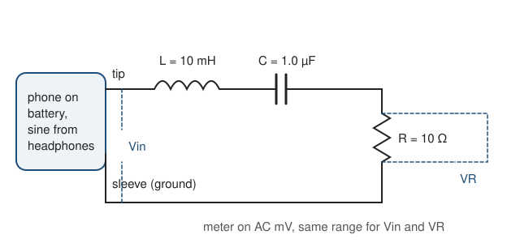

# 14.6 · Project: RLC resonance curve and Q factor

This is the module's practical piece. You build a circuit of a resistor, an inductor and a capacitor in series, drive it with a sine tone from your phone, and measure how strongly it responds at each frequency. The result is a resonance curve: a peak at one frequency, with a width set by how much energy the circuit loses. It is the electrical twin of the spring from lessons 14.1 and 14.2, and it has the same shape as an absorption line in a spectrum. You fit it in Python, read off the resonance frequency and Q, and work back to the values of the parts. Everything runs on batteries; nothing touches the mains.

## Why it matters

Every NMR probe contains a tuned RLC circuit. Before each experiment the spectroscopist "tunes and matches" it so that its resonance sits at the nuclear frequency and its Q is high enough to pick up a faint signal; tune it badly and the spectrum loses most of its signal. Radio receivers, quartz clocks and the filters in every instrument rely on the same resonance. And the curve you measure, response against driving frequency with a width $f_0/Q$, is the same Lorentzian shape as a spectral line, where the width tells you how fast the excited state loses its energy (lesson [14.5](lesson-05.md)). Measuring one carefully, with your own parts, ties the whole module together.

## Core ideas

> [!NOTE]
> The physics is stable. The equipment details were checked on 2026-10-17: phyphox 1.2.1 has a redesigned Tone Generator (up to three tones, selectable waveforms); use one sine tone. Phone headphone outputs, USB-C audio adapters and cheap multimeters vary a lot, which is why the method below measures a ratio instead of trusting any one of them.

### Three parts, three behaviours

With an alternating voltage at angular frequency $\omega = 2\pi f$, each part has an impedance, the AC version of resistance (lesson [04.4](../module-04/lesson-04.md) for DC):

- Resistor: $Z_R = R$. Current and voltage in step.
- Inductor (a coil): $Z_L = j\omega L$. It opposes changes of current, more so at high frequency. $L$ is in henry (H); $j = \sqrt{-1}$ marks a 90° phase shift.
- Capacitor: $Z_C = 1/(j\omega C)$. It blocks slow signals and passes fast ones. $C$ is in farad (F).

In series the impedances add:

$$Z = R_\text{tot} + j\left(\omega L - \frac{1}{\omega C}\right),\qquad |Z| = \sqrt{R_\text{tot}^2 + \left(\omega L - \frac{1}{\omega C}\right)^2}$$

$R_\text{tot}$ is all the resistance in the loop: the resistor plus the wire of the coil.

### Resonance

The inductor's and capacitor's reactances cancel when $\omega L = 1/(\omega C)$:

$$f_0 = \frac{1}{2\pi\sqrt{LC}}$$

At $f_0$ the circuit is purely resistive, $|Z| = R_\text{tot}$, and the current is largest. Below $f_0$ the capacitor dominates; above it the inductor does. With $L$ = 10 mH and $C$ = 1.0 µF, $f_0$ = 1592 Hz, nicely in the audio range a phone can produce.

### The resonance curve and Q

You measure the voltage across the resistor, $V_R = |I| R$, and across the whole circuit, $V_\text{in}$. Their ratio is

$$H(f) = \frac{V_R}{V_\text{in}} = \frac{A}{\sqrt{1 + Q^2\left(\dfrac{f}{f_0} - \dfrac{f_0}{f}\right)^2}},\qquad A = \frac{R}{R_\text{tot}},\qquad Q = \frac{1}{R_\text{tot}}\sqrt{\frac{L}{C}}$$

$H$ peaks at $f_0$ with height $A$. It falls to $A/\sqrt2$ (half the power) at two frequencies $f_1$ and $f_2$ whose difference is the bandwidth, $f_2 - f_1 = f_0/Q$. So the width of the curve measures $Q$, just as the line width did in 14.5.

Why a ratio? The phone's output level changes with frequency and with the load, and a cheap meter reads AC less accurately at high frequency. Both effects multiply $V_\text{in}$ and $V_R$ by the same factor at a given frequency, if you read both on the same meter range, so they cancel in $H$.

### The same equation as a spring

Write the circuit with the charge $q$ on the capacitor (current $I = \dot q$):

$$L\ddot q + R_\text{tot}\dot q + \frac{q}{C} = V(t)$$

Compare $m\ddot x + b\dot x + kx = F(t)$ from [03.4](../module-03/lesson-04.md). Inductance plays mass, resistance plays friction, $1/C$ plays stiffness. So $\omega_0 = 1/\sqrt{LC}$ matches $\sqrt{k/m}$, and $Q = \omega_0 L/R_\text{tot}$ matches $\omega_0 m/b = \omega_0/(2\gamma)$. Everything you learned about the spring's ringdown and Q carries over.

### Real parts are not ideal

A small 10 mH coil has tens of ohms of wire resistance, and at kilohertz frequencies it loses a little more in its core than its DC resistance suggests. Its stated value is good to perhaps ±5–10 %, a capacitor's to ±5–10 %. So the measured $Q$ is lower than one computed from the printed values and the DC resistance, and the fit tells you by how much. With these parts $Q$ is only about 2–3: a broad resonance, easy to measure with a multimeter. (A tuned NMR probe circuit reaches Q of a hundred or more.)



[Simulation: RLC circuits — resonance curve and Q](../../simulations/rlc/index.html?preset=resonance)

## Worked example

### 1. Predict the curve from the parts

Printed values: $L$ = 10 mH, $C$ = 1.0 µF, $R$ = 10 Ω. The ohmmeter reads 28 Ω for the coil, so $R_\text{tot}$ = 38 Ω.

- $f_0 = 1/(2\pi\sqrt{0.010 \times 1.0\times10^{-6}}) = 1/(2\pi \times 1.0\times10^{-4}) = 1592$ Hz.
- $\sqrt{L/C} = \sqrt{0.010/1.0\times10^{-6}} = 100\ \Omega$, so $Q = 100/38 = 2.6$.
- Bandwidth $f_0/Q = 605$ Hz. With $x = 1/(2Q) = 0.190$ the half-power points are $f_0(\sqrt{1 + x^2} \mp x)$ = 1318 and 1923 Hz.
- Peak height $A = R/R_\text{tot} = 10/38 = 0.26$.

So sweep from about 300 Hz to 8 kHz, with steps of 100 Hz between 1.2 and 2 kHz where the curve changes fastest.

### 2. Work back from the fit

A fit to measured ratios gives $f_0 = 1592.3 \pm 2.4$ Hz, $Q = 2.400 \pm 0.018$ and $A = 0.2348 \pm 0.0010$, with the resistor measured at 10.1 Ω.

- $R_\text{tot} = R/A = 10.1/0.2348 = 43.0\ \Omega$.
- $L = Q R_\text{tot}/(2\pi f_0) = 2.400 \times 43.0/(2\pi \times 1592.3) = 10.32$ mH.
- $C = 1/(2\pi f_0 Q R_\text{tot}) = 1/(2\pi \times 1592.3 \times 2.400 \times 43.0) = 0.968$ µF.

Both parts are within their tolerances of the printed values. $R_\text{tot}$ is 5 Ω more than the 38.1 Ω measured with the ohmmeter: the coil's losses at 1.6 kHz. That is why the measured $Q$ (2.40) is below the predicted 2.6.

## Hands-on

> [!WARNING]
> Battery or USB power only. Drive the circuit from a phone running on its own battery (or a laptop's headphone output with the laptop unplugged from its charger). Never connect anything in this project to a mains socket, a mains adapter, a mains-powered amplifier or a speaker system. Do not wear earphones while the tone generator runs, and turn the phone volume down before you plug in: the circuit draws only a few milliamperes, but a full-volume tone in earphones can damage hearing. Never join the tip and sleeve of the jack directly; the 10 Ω resistor protects the phone's output. Use a non-polarised (film or ceramic) capacitor, not an electrolytic one. Measure resistances only with the plug pulled out. Keep small parts away from children.

What you need (electronics shops sell all of it for a few tens of shekels): a solderless breadboard and jumper wires; a 10 mH inductor (a small radial or axial choke); a 1.0 µF film capacitor rated 50 V or more; 10 Ω and 47 Ω resistors (0.25 W); a 3.5 mm stereo plug with screw terminals or clip leads (plus a USB-C to 3.5 mm audio adapter if your phone has no headphone jack); a digital multimeter with an AC millivolt range; phyphox; your notebook and the [Module 14 lab folder](../../labs/module-14/). Time: about 2 hours.

### Part A — explore in the simulation (15 min)

Build the same circuit, sweep the frequency and watch the current peak.

Task: with $L$ = 10 mH, $C$ = 1.0 µF and $R_\text{tot}$ = 38 Ω, read $f_0$ and $Q$. Target: 1592 Hz and 2.6. Then cut $R_\text{tot}$ to 10 Ω and see the peak grow taller and narrower: $Q$ = 10, bandwidth 159 Hz.

### Part B — build and measure (60 min)

1. With nothing connected, measure the resistor and the coil on the ohmmeter. Write both down.
2. Build the circuit of the diagram on the breadboard: tip → inductor → capacitor → resistor → sleeve. Keep the resistor next to the sleeve (ground) end.
3. Unplug any earphones. Turn the phone volume to about a third. Open phyphox, the Tone Generator, choose a single sine tone at 1600 Hz, and start it. Then connect the plug.
4. Set the meter to AC volts. Measure $V_\text{in}$ between tip and sleeve. Adjust the volume until $V_\text{in}$ is under 200 mV at every frequency you will use (check 300 Hz, where it is largest), then fix the meter on the 200 mV range if it has a range button. Use the same range for every reading.
5. For each frequency in your list (for example 300, 500, 800, 1000, 1200, 1400, 1500, 1600, 1700, 1800, 2000, 2300, 2700, 3200, 4000, 5000, 6500 Hz), read $V_\text{in}$ and then $V_R$ across the resistor. Wait for each reading to settle.
6. Type the data as `f_Hz,Vin_mV,VR_mV`, as in `rlc_example.csv`. Stop the tone and unplug.
7. Swap the 10 Ω resistor for 47 Ω and repeat steps 5–6 at a few frequencies. Predict first: $Q$ should fall to about $100/75 \approx 1.3$.

### Part C — fit and report (45 min)

Fill in `response` and `derived` in `lesson06_rlc.py`. Put your measured $R$ and coil resistance into `R_OHM` and `R_COIL_DC` at the top. Run on the example data, then on yours:

```bash
py lesson06_rlc.py
py lesson06_rlc.py my_rlc.csv
```

How you know it worked: on the example data the fit gives $f_0$ = 1592.3 ± 2.4 Hz, $Q$ = 2.400 ± 0.018, peak 0.2348, χ² = 6.6 for 17 degrees of freedom, half-power points 1295 and 1958 Hz, and $R_\text{tot}$ = 43.0 Ω, $L$ = 10.32 mH, $C$ = 0.968 µF. On your circuit, $f_0$ should land within about 10 % of the predicted 1592 Hz (part tolerances), $Q$ between about 1.5 and 3, the fitted $R_\text{tot}$ a few ohms above the ohmmeter's sum, and χ² per degree of freedom near 1 if your 0.5 % reading uncertainty was realistic.

<details><summary>Reference solution, troubleshooting and the report</summary>

`response`: `A / np.sqrt(1 + Q**2 * (f/f0 - f0/f)**2)`. `derived`: $R_\text{tot} = R/A$, $L = QR_\text{tot}/(2\pi f_0)$, $C = 1/(2\pi f_0 Q R_\text{tot})$. Full code: `lesson06_rlc_solution.py`. The fit passes `sigma` and `absolute_sigma=True`, so the parameter uncertainties come from your stated reading uncertainty (lesson [05.3](../module-05/lesson-03.md)); χ² tells you whether that statement was honest.

Troubleshooting. No peak at all, $V_R$ tiny everywhere: the capacitor is open (wrong breadboard row) or you used an electrolytic one. $V_R$ almost equal to $V_\text{in}$ at every frequency: the inductor or capacitor is shorted by a jumper. $V_\text{in}$ dips sharply near $f_0$: normal, the phone's output has some internal resistance and the circuit's impedance is lowest there; the ratio takes care of it. Readings jumpy above 3 kHz: many cheap meters are specified for AC only up to a few hundred hertz or 1 kHz; the ratio still works while both readings are steady, but drop points where they are not. A peak far from 1592 Hz: check the capacitor marking (105 = 1.0 µF; 104 = 0.1 µF would put $f_0$ near 5 kHz).

The report (module practical). Use the [lab report template](../../templates/lab-report.md) with the [error analysis template](../../templates/error-analysis.md). Include: the circuit diagram and part values (printed and measured); the table of readings; the plot of $H$ against $f$ on a log axis with the fit and the half-power band; $f_0$, $Q$ and $A$ with uncertainties; the derived $R_\text{tot}$, $L$, $C$ against the printed values; the 47 Ω check; one paragraph comparing the circuit with the spring of 14.2 (which parameter is the mass, the friction, the stiffness) and with a spectral line (what the width means). Say honestly what the project does not train: you did not use an oscilloscope, so you saw amplitudes but not the phase shift that swings from +90° to −90° across the resonance.

</details>

## Common mistakes

- Using $f_0 = 1/\sqrt{LC}$ without the $2\pi$. That is $\omega_0$ in rad/s; in hertz divide by $2\pi$.
- Ignoring the coil's resistance. With only the 10 Ω resistor in $R_\text{tot}$ the predicted $Q$ is 10, four times too high.
- Reading $V_\text{in}$ once and assuming it stays constant. The phone's output changes with frequency and load; read it at every point.
- Letting the meter switch ranges between $V_\text{in}$ and $V_R$. Different ranges can have different frequency responses, and the ratio no longer cancels them.
- Measuring resistance with the tone running. The ohmmeter's own current mixes with the signal; unplug first.
- Taking points only on a linear grid. The curve is narrow on a log scale near $f_0$; put most points between about $0.7f_0$ and $1.4f_0$.

## Key takeaways

- A series RLC circuit resonates at $f_0 = 1/(2\pi\sqrt{LC})$, where the reactances cancel and the impedance is just $R_\text{tot}$.
- $Q = \sqrt{L/C}/R_\text{tot}$, and the half-power bandwidth is $f_0/Q$.
- Measuring the ratio $V_R/V_\text{in}$ on one meter range cancels source and meter errors at each frequency.
- From $f_0$, $Q$ and the peak height you can recover $R_\text{tot}$, $L$ and $C$; real coils lose more at kilohertz than their DC resistance shows.
- $L\ddot q + R\dot q + q/C = V$ is the driven spring in disguise, and its resonance curve has the shape of a spectral line.

## Sources

- [OpenStax University Physics Volume 2, 15.2 Simple AC Circuits](https://openstax.org/books/university-physics-volume-2/pages/15-2-simple-ac-circuits) — reactance of inductors and capacitors.
- [OpenStax University Physics Volume 2, 15.3 RLC Series Circuits with AC](https://openstax.org/books/university-physics-volume-2/pages/15-3-rlc-series-circuits-with-ac) — series impedance.
- [OpenStax University Physics Volume 2, 15.5 Resonance in an AC Circuit](https://openstax.org/books/university-physics-volume-2/pages/15-5-resonance-in-an-ac-circuit) — resonance, bandwidth and Q.
- [OpenStax University Physics Volume 1, 15.6 Forced Oscillations](https://openstax.org/books/university-physics-volume-1/pages/15-6-forced-oscillations) — the mechanical twin.
- [phyphox wiki: Tone Generator](https://phyphox.org/wiki/index.php/Experiment:_Tone_Generator) and [phyphox 1.2.1 version history](https://phyphox.org/docs/reference/version-history/1.2.1/) — the sine source and its 2026 redesign.
- [SciPy v1.18 manual, scipy.optimize.curve_fit](https://docs.scipy.org/doc/scipy/reference/generated/scipy.optimize.curve_fit.html) — weighted non-linear fitting with `absolute_sigma`.
