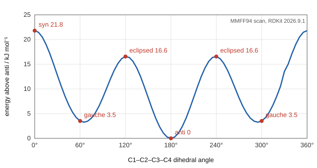

# 15.2 · Conformations and strain

A single bond can rotate, so a molecule like butane is not one rigid shape but a crowd of shapes that turn into each other millions of times a second. These shapes are called conformations. This lesson shows how to draw them, why some cost more energy than others, and how the energy differences decide which shapes dominate. It ends with the cyclohexane chair, the most important ring in organic chemistry, and a force-field calculation that you run yourself.

## Why it matters

Glucose in water is a six-membered ring. Of its two ring forms, the one with every OH and the CH₂OH group pointing out sideways, "equatorial", makes up about two thirds of the sugar in solution. That shape preference shapes starch, cellulose and how enzymes grip sugars (Module 16). In drug design the same logic applies: a molecule binds its target in one conformation, and if that shape costs 10 kJ/mol to reach, only about 2 % of the molecules are in it at any moment. Conformational energy is a direct lever on activity, and the arithmetic is the Boltzmann factor you met with equilibrium constants in [08.3](../module-08/lesson-03.md).

## Core ideas

> [!NOTE]
> These ideas are stable. The strain energies are the values in OpenStax Organic Chemistry (2023), checked 2026-10-17. The lab uses the MMFF94 force field in RDKit 2026.9.1; a different force field or version gives slightly different numbers.

### Conformations and Newman projections

**Conformations** are the shapes a molecule can take by rotating about single bonds, without breaking any bond. They are not isomers you can put in separate bottles: they interconvert far too fast at room temperature.

A **Newman projection** looks straight down one C–C bond. The front carbon is a dot where its three bonds meet; the back carbon is a circle with its three bonds sticking out from the edge. The **dihedral angle** (torsion angle) is the angle between a bond on the front carbon and a bond on the back carbon, seen in this view.

- **Staggered**: the back bonds sit between the front bonds (dihedral 60°, 180°, 300°).
- **Eclipsed**: the back bonds hide behind the front bonds (0°, 120°, 240°).

### Ethane: torsional strain

Eclipsed ethane is 12 kJ/mol above staggered ethane. The extra energy is **torsional strain**: the electron pairs of eclipsed C–H bonds repel, and in the staggered form a filled C–H σ orbital also overlaps with an empty σ* orbital on the next carbon, which lowers its energy. Each H/H eclipsing costs about 4.0 kJ/mol, and there are three. At room temperature 12 kJ/mol is a small barrier; ethane rotates freely.

### Butane: steric strain on top

Look down the C2–C3 bond of butane, CH₃CH₂CH₂CH₃, and follow the two methyl groups.

| Conformation | CH₃–C–C–CH₃ dihedral | Energy above anti / kJ mol⁻¹ | Why |
|---|---|---|---|
| anti | 180° | 0 | methyls as far apart as possible |
| gauche | 60°, 300° | 3.8 | methyls close enough to bump |
| eclipsed CH₃/H | 120°, 240° | 16 | two CH₃/H (6.0 each) and one H/H (4.0) eclipsing |
| syn (fully eclipsed) | 0° | 19 | methyls eclipse each other |

The gauche cost is **steric strain**: repulsion when atoms are forced closer than their van der Waals radii allow ([07.4](../module-07/lesson-04.md)). Every chain alkane prefers zig-zag anti arrangements, which is why the skeletal formulas of 15.1 are drawn as zig-zags.



### From energy to population

At temperature $T$, the ratio of molecules in two conformations with energy difference $\Delta E$ follows the Boltzmann distribution:

$$\frac{N_\text{high}}{N_\text{low}} = g\,e^{-\Delta E/RT}$$

where $g$ counts how many equivalent forms the higher state has. This is the same as $K = e^{-\Delta G^\circ/RT}$ from 08.3 when entropy differences are small. At 298 K, $RT = 2.48$ kJ/mol. A useful rule: every 5.7 kJ/mol is a factor of 10.

For butane, $e^{-3.8/2.48} = 0.22$ for each gauche form, and there are two ($g = 2$), so

$$x_\text{anti} = \frac{1}{1 + 2(0.22)} = 0.70$$

About 70 % anti and 30 % gauche at room temperature. The eclipsed forms are maxima, not stable conformations: molecules pass through them but do not stay.

### Ring strain

Rings cannot always reach ideal angles. **Angle strain** is the cost of bending bond angles away from 109.5°. Cyclopropane has C–C–C angles of 60°, eclipsed C–H bonds all round, and a total ring strain of 115 kJ/mol, measured from its heat of combustion against a strain-free CH₂ value. That strain is why cyclopropane rings open easily. Cyclobutane and cyclopentane pucker to relieve some eclipsing. Cyclohexane can be strain-free.

### The cyclohexane chair

Cyclohexane folds into a **chair**: four carbons in a plane, one above and one below. Every C–C–C angle is close to 111° and every C–H bond is staggered, so the ring has essentially no angle or torsional strain.

Each carbon in the chair has two kinds of position:

- **Axial**: straight up or down, parallel to the ring's axis. Three axial H's point up, three down, alternating around the ring.
- **Equatorial**: out to the side, roughly in the "equator" of the ring.

A **ring flip** turns one chair into the other through a higher-energy twist-boat. It takes about 45 kJ/mol and happens about 10⁵ times a second at room temperature. In the flip, every axial position becomes equatorial and vice versa, but "up" stays up.

### Axial substituents pay 1,3-diaxial strain

An axial substituent points into the same space as the two axial H's on carbons 3 and 5 of the ring. These **1,3-diaxial interactions** are the same steric clash as gauche butane: an axial methyl is gauche to two ring C–C bonds. For methylcyclohexane the axial chair is 7.6 kJ/mol higher, so

$$K = \frac{[\text{equatorial}]}{[\text{axial}]} = e^{7.6/2.48} = 21 \quad\Rightarrow\quad 95\,\%\ \text{equatorial}$$

| Substituent | Axial − equatorial / kJ mol⁻¹ | Equatorial at 298 K |
|---|---|---|
| –OH | 4.2 | 84 % |
| –CH₃ | 7.6 | 95 % |
| –C(CH₃)₃ (tert-butyl) | 22.8 | 99.99 % |

The values are twice the per-interaction numbers in OpenStax Table 4.1, because each axial group meets two axial H's. A tert-butyl group is so large that it locks the ring: it is equatorial essentially all the time, and other groups on the ring must take whatever position that leaves them.

## Worked example

### 1. What energy gap gives a 99 : 1 ratio?

A drug chemist wants a ring substituent to sit equatorial 99 % of the time. What axial − equatorial energy difference is needed at 37 °C (310 K)?

1. $K = 99/1 = 99$.
2. $\Delta E = RT\ln K = (8.314 \times 10^{-3}\ \text{kJ mol}^{-1}\text{K}^{-1})(310\ \text{K})\ln 99 = 2.577 \times 4.595 = 11.8$ kJ/mol.

A methyl group (7.6) is not enough; a tert-butyl group (22.8) is far more than enough. An isopropyl group, about 9 kJ/mol, gives about 97 %.

### 2. Which chair of *cis*-1-tert-butyl-4-methylcyclohexane wins?

In the *cis* isomer both groups point to the same face of the ring (both "up"). On carbons 1 and 4 of a chair, one up position is axial and the other is equatorial. So one group must be axial in either chair.

- Chair A: tert-butyl equatorial, methyl axial. Cost 7.6 kJ/mol.
- Chair B: tert-butyl axial, methyl equatorial. Cost 22.8 kJ/mol.

The difference is $22.8 - 7.6 = 15.2$ kJ/mol, so $K = e^{15.2/2.48} = 460$: 99.8 % chair A. The tert-butyl group decides, and the methyl is forced axial. In the *trans* isomer both groups can be equatorial at once, so *trans* is the more stable isomer, by about 7.6 kJ/mol.

## Hands-on

What you need: Avogadro 2.0.0 or [MolView](https://molview.org/) (Lesson 15.1); Python with the course packages and the [Module 15 lab folder](../../labs/module-15/) (`lesson02_conformers.py`, `org15.py`); a [notebook page](../../templates/notebook-page.md). Time: about 60 minutes.

### Part A — turn the bond yourself (15 min)

1. Build butane in Avogadro and optimise it. With the **Bond-Centric Manipulation** tool, click the C2–C3 bond and drag to rotate one end. (In MolView, load butane and use the dihedral measurement on C1–C2–C3–C4 while you rotate the whole model to the Newman view.)
2. Measure the C1–C2–C3–C4 dihedral of the optimised structure. It should be anti, about 180°.
3. Build methylcyclohexane. Measure the CH₃–C1–C2–C3 dihedral. Then build the other chair, with the methyl axial, by drawing the methyl on an axial H (or let Part B find it), and measure again. Write both values down; you need them in Part B.

How you know it worked: anti butane is 180°; the equatorial methyl gives about 175–180°, the axial one about 70–75°.

### Part B — a force-field torsion scan (30 min)

A **force field** is a set of simple energy formulas for bond stretching, angle bending, torsion and contacts, with parameters fitted to experiment and quantum calculations. MMFF94 is a standard one for organic molecules. It is fast, so you can scan a whole rotation in seconds.

1. Open `lesson02_conformers.py`. Write `boltzmann_ratio` and `classify_methyl` (use your two dihedrals from Part A to pick a threshold).
2. Run it from the lab folder:

```bash
py lesson02_conformers.py
```

3. Open `runs/butane_scan.png` and compare it with the figure above and the table of energies in Core ideas.

How you know it worked: gauche − anti 3.5 kJ/mol, CH₃/H eclipsed 16.6, syn 21.8 kJ/mol; a gauche population factor of 0.24. For methylcyclohexane: 25 chair conformers (20 equatorial, 5 axial), axial − equatorial 5.7 kJ/mol, 91 % equatorial.

<details><summary>Reference solution and what to notice</summary>

`boltzmann_ratio` returns `math.exp(-delta_e_kj / (R_KJ * T))`; `classify_methyl` returns `"equatorial" if dihedral_deg > 130 else "axial"`. Full code: `lesson02_conformers_solution.py`.

What to notice:

- The butane scan is within 1–3 kJ/mol of the textbook values, which is good for a model that takes milliseconds per point.
- The methylcyclohexane gap, 5.7 kJ/mol, is about 2 kJ/mol below the measured 7.6 kJ/mol, so the force field predicts 91 % equatorial instead of 95 %. A force field is a fitted model; always compare it with a measured number before you trust its predictions for new molecules. Module 31 does the same comparison with quantum-chemistry programs.
- The script holds the dihedral fixed while everything else relaxes. That is called a relaxed scan; a rigid scan (rotate without relaxing) gives higher barriers.

</details>

### Part C — pencil drill (15 min)

1. At 298 K, 1,2-dichloroethane is 77 % anti and 23 % gauche in the gas phase (two gauche forms). Estimate the gauche − anti energy.
2. Which is more stable, *cis*- or *trans*-1,2-dimethylcyclohexane? Explain with the chairs.
3. Bromocyclohexane has an axial − equatorial difference of about 2.0 kJ/mol. What percentage is equatorial at 298 K?

<details><summary>Answers</summary>

1. Per gauche form: $N_g/N_a = 0.115/0.77 = 0.149$. $\Delta E = -RT\ln 0.149 = 2.48 \times 1.90 = 4.7$ kJ/mol. (Forgetting the factor 2 gives 1.2 kJ/mol less.)
2. *Trans*: on adjacent carbons, *trans* means one up and one down, which can be both equatorial (diequatorial chair). *Cis* must have one axial and one equatorial in either chair. *Trans* is more stable, by about the axial methyl cost; both isomers also carry one gauche interaction between the two methyls.
3. $K = e^{2.0/2.48} = 2.24$, so $2.24/3.24 = 69$ % equatorial. Halogens are small near the ring because the C–Br bond is long.

</details>

## Common mistakes

- Calling conformations isomers. They interconvert by rotation in nanoseconds; configurations (lesson 15.3) need bonds broken.
- Treating eclipsed forms as populated states. They are energy maxima; molecules pass through them.
- Forgetting the degeneracy factor $g$: butane has two gauche forms, so the gauche fraction is twice the single Boltzmann factor.
- Drawing a chair with axial bonds tilted. Axial bonds are vertical and alternate up and down; equatorial bonds are parallel to ring bonds once removed.
- Thinking a ring flip changes *cis* to *trans*. A flip swaps axial and equatorial but keeps up as up; only breaking bonds changes *cis* to *trans*.
- Trusting a force-field number without a check. Compare it with a measured value first.

## Key takeaways

- Staggered beats eclipsed: ethane's barrier is 12 kJ/mol of torsional strain; butane adds 3.8 kJ/mol of steric strain for gauche.
- Populations follow $N_\text{high}/N_\text{low} = g\,e^{-\Delta E/RT}$; 5.7 kJ/mol is a factor of 10 at room temperature.
- Small rings carry angle strain (cyclopropane 115 kJ/mol); the cyclohexane chair is strain-free.
- Substituents prefer equatorial positions because axial ones suffer 1,3-diaxial strain; methyl 7.6 kJ/mol gives 95 % equatorial, tert-butyl locks the ring.
- A force field such as MMFF94 reproduces trends quickly; check it against experiment before relying on it.

## Sources

- [OpenStax Organic Chemistry, 3.6 Conformations of Ethane](https://openstax.org/books/organic-chemistry/pages/3-6-conformations-of-ethane) — Newman projections, the 12 kJ/mol barrier.
- [OpenStax Organic Chemistry, 3.7 Conformations of Other Alkanes](https://openstax.org/books/organic-chemistry/pages/3-7-conformations-of-other-alkanes) — butane energies 3.8, 16 and 19 kJ/mol; eclipsing costs 4.0 and 6.0 kJ/mol.
- [OpenStax Organic Chemistry, 4.3 Stability of Cycloalkanes: Ring Strain](https://openstax.org/books/organic-chemistry/pages/4-3-stability-of-cycloalkanes-ring-strain) — cyclopropane strain 115 kJ/mol.
- [OpenStax Organic Chemistry, 4.5 Conformations of Cyclohexane](https://openstax.org/books/organic-chemistry/pages/4-5-conformations-of-cyclohexane) — the chair and the ring flip.
- [OpenStax Organic Chemistry, 4.7 Conformations of Monosubstituted Cyclohexanes](https://openstax.org/books/organic-chemistry/pages/4-7-conformations-of-monosubstituted-cyclohexanes) — methylcyclohexane 7.6 kJ/mol and 95 : 5; 1,3-diaxial strain table.
- [RDKit 2026.09.1 documentation](https://www.rdkit.org/docs/GettingStartedInPython.html) — conformer generation and the MMFF94 force field.
