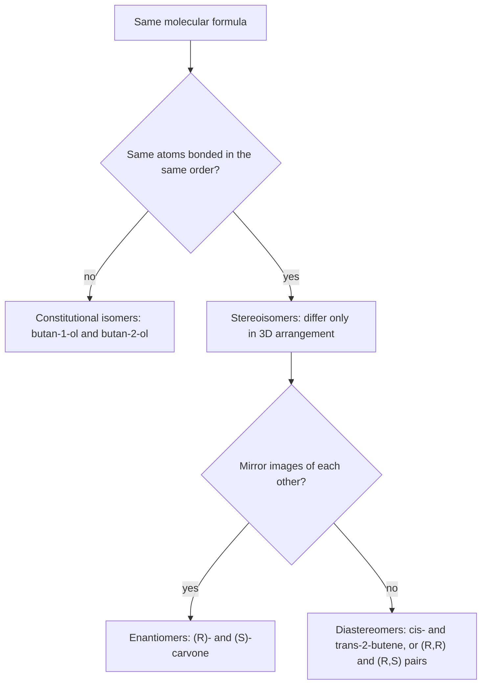

# 15.3 · Stereochemistry and chirality

Two molecules can have the same atoms joined in the same order and still be different compounds, because their atoms point in different directions in space. This lesson teaches you to see that difference, to name it with R, S, E and Z, and to predict when it matters. Your nose can detect it, a polarimeter can measure it, and enzymes depend on it.

## Why it matters

Chew spearmint gum, then crush a few caraway seeds from the spice shelf. The two smells are clearly different, yet the main odour molecule in each is carvone. Spearmint carries (R)-carvone and caraway (S)-carvone: mirror images of each other, with identical boiling points, densities and NMR spectra. Your smell receptors are proteins built from chiral amino acids, so they tell the two apart. Drugs work the same way. Many are sold as one mirror form because the other one is inactive or causes side effects, and regulators ask for each form to be studied. A chemist who cannot assign configuration cannot read a drug label, a patent or a synthesis plan.

## Core ideas

> [!NOTE]
> The rules here are stable: the Cahn–Ingold–Prelog (CIP) rules as given in the IUPAC 2013 recommendations (P-9), checked 2026-10-17. RDKit 2026.9.1 implements them in its new CIP labeller; older RDKit labelling functions can disagree in rare complex cases.

### The family tree of isomers

**Isomers** have the same molecular formula but are different compounds.



Stereoisomers differ in **configuration**: changing one into the other needs a bond broken. That is the difference from the conformations of [15.2](lesson-02.md), which interconvert by rotation.

### Chirality and stereocentres

An object is **chiral** if it cannot be superimposed on its mirror image, like a left and a right hand. A molecule is chiral if its mirror image is a different molecule. The usual cause is a **stereocentre** (stereogenic centre): an sp³ carbon with four different groups. Swap any two groups and you get the mirror-image configuration.

Quick tests:

- A carbon with two identical groups (two H's, two CH₃'s) is not a stereocentre.
- A molecule with an internal **plane of symmetry** is **achiral** (not chiral), even if it has stereocentres.

### Assigning R and S: the CIP rules

1. **Rank the four groups** on the stereocentre by the atomic number of the atom directly attached: higher atomic number, higher priority. Br > Cl > O > N > C > H.
2. **Break ties** by moving outwards. Compare the sets of atoms attached to each tied atom, highest first, at the first point of difference. –CH₂OH (O, H, H) beats –CH(CH₃)₂ (C, C, H), because O beats C at the first comparison.
3. **Multiple bonds** count as duplicated atoms: C=O counts as C bonded to (O, O), and C≡N as (N, N, N).
4. **Orient** the molecule so the lowest-priority group (often H) points away from you. Trace 1 → 2 → 3. Clockwise is **R** (Latin *rectus*, right); counter-clockwise is **S** (*sinister*, left).

A shortcut on paper: if the lowest-priority group points towards you (on a wedge), find the direction and reverse it.

R and S are names for a geometry. They say nothing about the direction a compound rotates light; (R)-carvone happens to be (−), but another R compound can be (+).

### E and Z for double bonds

A C=C double bond cannot rotate (15.1), so groups on it are fixed on the same side or opposite sides. Rank the two groups on each carbon by the CIP rules. If the two higher-priority groups are on the same side, the bond is **Z** (*zusammen*, together); opposite sides, **E** (*entgegen*, opposite). For simple cases E is trans and Z is cis, but E/Z also works when every position carries a different group. *Cis*- and *trans*-2-butene are diastereomers: stereoisomers that are not mirror images.

### Several stereocentres and meso compounds

A molecule with $n$ stereocentres has at most $2^n$ stereoisomers. 2-Bromo-3-chlorobutane has two stereocentres and four stereoisomers: two pairs of enantiomers, (2R,3R)/(2S,3S) and (2R,3S)/(2S,3R). Any member of one pair is a diastereomer of any member of the other.

When the two stereocentres carry the same set of groups, one of the combinations has an internal mirror plane. 2,3-Dibromobutane and tartaric acid each have only three stereoisomers: a chiral (R,R)/(S,S) pair and a single **meso compound**, (R,S), which is achiral. Its mirror image is itself.

### How enantiomers differ, and how to measure it

Enantiomers have identical physical properties in a non-chiral environment: melting point, boiling point, solubility in water, IR and NMR spectra. They differ in two ways:

- With **chiral partners**: enzymes, receptors, chiral chromatography columns.
- In **optical activity**: one rotates the plane of plane-polarised light clockwise (+, dextrorotatory), the other by the same amount anticlockwise (−, laevorotatory).

A **polarimeter** measures the observed rotation $\alpha$. The **specific rotation** removes the effect of path length $l$ (in dm) and concentration $c$ (in g/mL):

$$[\alpha] = \frac{\alpha}{l\,c}$$

A 50 : 50 mixture of enantiomers is a **racemic mixture** (racemate); it rotates light by 0°. For a mixture, the **enantiomeric excess** is

$$ee = \frac{|\,x_R - x_S\,|}{x_R + x_S} \times 100\,\% = \frac{[\alpha]_\text{observed}}{[\alpha]_\text{pure}} \times 100\,\%$$

The second form works when rotation is proportional to the excess, which is the normal case.

## Worked example

### 1. The configuration of L-alanine

L-Alanine, the amino acid in your proteins, is CH₃–CH(NH₂)–COOH, SMILES `C[C@@H](C(=O)O)N`. The central carbon carries H, CH₃, NH₂ and COOH: four different groups, so it is a stereocentre.

1. Attached atoms: N (7), C of COOH (6), C of CH₃ (6), H (1). N is first and H is last.
2. Tie between the two carbons. COOH carbon carries (O, O, O): the C=O counts twice, plus the OH. CH₃ carries (H, H, H). O beats H, so COOH is second and CH₃ third.
3. Priorities: NH₂ (1) > COOH (2) > CH₃ (3) > H (4).
4. In a model of L-alanine with H pointing away, NH₂ → COOH → CH₃ runs counter-clockwise. So L-alanine is **(S)**-alanine. RDKit agrees (Part C).

Almost all protein amino acids are S. Cysteine is the exception: it is L but R, because its CH₂SH group outranks COOH (S beats O). L and D are an older naming system based on a drawing convention; R and S come from the rules above.

### 2. Enantiomeric excess from a polarimeter

A chemist makes (S)-carvone and dissolves 0.500 g in ethanol to 10.0 mL. In a 1.00 dm cell the solution rotates light by +2.70°. Pure (S)-carvone measured the same way gives $[\alpha] = +60.0°$ (an illustrative value for this example; look up the real one for your solvent and wavelength).

1. $c = 0.500\ \text{g} / 10.0\ \text{mL} = 0.0500$ g/mL.
2. $[\alpha]_\text{obs} = 2.70 / (1.00 \times 0.0500) = +54.0°$.
3. $ee = 54.0 / 60.0 = 90.0\,\%$. So $x_S - x_R = 0.900$ and $x_S + x_R = 1$, giving 95.0 % S and 5.0 % R.

A 90 % ee sounds high, but one molecule in twenty is still the wrong enantiomer, which can matter for a drug.

## Hands-on

What you need: spearmint (gum, tea or fresh leaves) and caraway seeds from the kitchen; MolView or Avogadro; Python with the course packages and the [Module 15 lab folder](../../labs/module-15/) (`lesson03_stereo.py`); a [notebook page](../../templates/notebook-page.md). Time: about 60 minutes.

### Part A — kitchen: smell the enantiomers (10 min)

> [!CAUTION]
> Use only food products as sold. Do not use essential oils on skin or swallow them; sniff from a cup held a hand's width away. Skip this part if you are allergic to mint or caraway.

1. Put a few caraway seeds, lightly crushed with a spoon, in one cup and a spearmint tea bag or a piece of spearmint gum in another.
2. Sniff each, with a sip of water in between. Write down what each smells like.
3. Other substances in the plants add to each smell, and some people find the difference small. The point is that chirality is detected by chiral receptors.

### Part B — models: try to superimpose (15 min)

1. In MolView, search for `(R)-2-butanol` and `(S)-2-butanol` (or draw 2-butanol and use the wedge tool). Show both in 3D.
2. Rotate one so its H points away from you and its CH₃ and C₂H₅ point the same way as in the other. Try to make the OH groups line up as well. You cannot: they are enantiomers.
3. Build meso-2,3-dibromobutane (`C[C@H](Br)[C@@H](C)Br`). Rotate about the C2–C3 bond to the conformation where the two Br's eclipse each other. Find the mirror plane that cuts the C2–C3 bond in half.

How you know it worked: you can see the mirror plane in the meso compound, and you cannot superimpose the two 2-butanols.

### Part C — RDKit checks your assignments (20 min)

1. Open `lesson03_stereo.py`. Write `mirror` (swap `@` and `@@` in the SMILES) and `relation` (identical, enantiomers, diastereomers or constitutional isomers).
2. Run it from the lab folder:

```bash
py lesson03_stereo.py
```

How you know it worked: (R)-carvone shows `R`; L-alanine `S`; the E and Z butenes are labelled correctly; the five pairs come out as enantiomers, enantiomers, diastereomers, diastereomers and constitutional isomers; tartaric acid and 2,3-dibromobutane have 3 stereoisomers each (one meso), 2-bromo-3-chlorobutane 4 (none meso).

<details><summary>Reference solution and what to notice</summary>

`mirror` swaps through a placeholder so the same characters are not swapped twice: `smiles.replace("@@", "\0").replace("@", "@@").replace("\0", "@")`, then returns the canonical SMILES. `relation` compares canonical SMILES: equal → identical; equal to the mirror → enantiomers; equal without stereo (`isomericSmiles=False`) → diastereomers; else constitutional isomers. Full code: `lesson03_stereo_solution.py`.

What to notice:

- The second pair, `C[C@@H](O)CC` and `CC[C@H](C)O`, look like they differ only in `@`, but the atoms are written in a different order. `@` and `@@` describe the order of neighbours in the string, so you cannot compare the symbols by eye. Canonical SMILES fixes this.
- The meso test is "is it its own mirror image?", exactly the definition.

</details>

### Part D — pencil drill (15 min)

1. Assign R or S to (a) `C[C@H](Br)CC` and (b) the stereocentre of (R)-carvone, by hand, then check with Part C. For (b), rank the ring CH₂ next to C=O against the ring CH₂ next to C=C.
2. How many stereoisomers does 2,3,4-trihydroxybutanal (an aldotetrose sugar, `OCC(O)C(O)C=O`) have? Is any of them meso?
3. Is *cis*-1,2-dimethylcyclohexane chiral?

<details><summary>Answers</summary>

1. (a) S: Br > CH₂CH₃ > CH₃ > H. (b) R. On the ring stereocentre, the isopropenyl carbon (C, C, C) ranks first. Then compare the two ring CH₂ groups: both are (C, H, H), so go one step further. The branch towards the ketone reaches a C=O carbon with (O, O, C); the branch towards the alkene reaches a C=C carbon with (C, C, H). O beats C, so the CH₂ next to C=O is second. With H away the order runs clockwise.
2. Two stereocentres (C2 and C3), and the two ends are different (CH₂OH against CHO), so no meso form: $2^2 = 4$ stereoisomers. They are D- and L-erythrose and D- and L-threose.
3. No. It has two stereocentres (R,S), and in the average flat-ring picture it has a mirror plane. Its two chairs are mirror images that interconvert by ring flip, so it behaves as a meso compound and is not optically active.

</details>

## Common mistakes

- Ranking by the size or mass of the whole group instead of the atomic number at the first point of difference. –CH₂Br beats –C(CH₃)₃ because Br beats C.
- Forgetting to reverse the answer when the lowest-priority group points towards you.
- Assuming R means (+). The sign of rotation must be measured; it is not predicted by R or S.
- Counting $2^n$ stereoisomers without checking for meso forms when the two halves of the molecule are the same.
- Comparing `@` and `@@` between two SMILES strings by eye. The symbols depend on the order of the neighbours in each string; compare canonical SMILES.
- Calling a carbon with two identical groups a stereocentre, for example the C2 of propan-2-ol.

## Key takeaways

- Stereoisomers share constitution; enantiomers are non-superimposable mirror images, and every other stereoisomer pair is a diastereomer pair.
- A carbon with four different groups is a stereocentre; a molecule with an internal mirror plane is achiral even with stereocentres (meso).
- CIP rules: rank by atomic number at the first point of difference, duplicate multiple bonds, lowest priority away, clockwise is R. Same rules give E and Z.
- Enantiomers differ only with chiral partners and in the sign of optical rotation; $ee = [\alpha]_\text{obs}/[\alpha]_\text{pure}$.
- Your nose, enzymes and drug regulators all tell enantiomers apart.

## Sources

- [OpenStax Organic Chemistry, 5.1 Enantiomers and the Tetrahedral Carbon](https://openstax.org/books/organic-chemistry/pages/5-1-enantiomers-and-the-tetrahedral-carbon) — chirality and mirror images.
- [OpenStax Organic Chemistry, 5.5 Sequence Rules for Specifying Configuration](https://openstax.org/books/organic-chemistry/pages/5-5-sequence-rules-for-specifying-configuration) — the CIP procedure.
- [OpenStax Organic Chemistry, 5.7 Meso Compounds](https://openstax.org/books/organic-chemistry/pages/5-7-meso-compounds) — tartaric acid and the internal mirror plane.
- [IUPAC 2013 Recommendations, P-9 Specification of Configuration and Conformation](https://iupac.qmul.ac.uk/BlueBook/P9.html) — the official CIP rules, R/S and E/Z.
- [PubChem, Carvone, (−)- (CID 439570)](https://pubchem.ncbi.nlm.nih.gov/compound/439570) — (5R)-carvone, SMILES with stereochemistry.
- [PubChem, Carvone, (+)- (CID 16724)](https://pubchem.ncbi.nlm.nih.gov/compound/16724) — (5S)-carvone.
