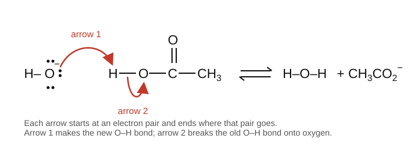

# 15.4 · Curved arrows, acids and bases in organic chemistry

A mechanism is the step-by-step story of which electrons move where during a reaction. Organic chemists tell that story with curved arrows, and almost every step in it is an acid meeting a base in one form or another. This lesson teaches the arrow grammar and the pKa reasoning that the rest of Modules 15 and 16 rely on. It builds on the Lewis structures of [07.3](../module-07/lesson-03.md) and the pKa scale of [08.4](../module-08/lesson-04.md).

## Why it matters

A student wants to dissolve a mixture of benzoic acid and phenol, and to separate them, with a basic water wash. Sodium hydrogen carbonate (baking soda) pulls the carboxylic acid into the water as its salt and leaves the phenol behind; sodium hydroxide would take both. The choice follows from three pKa values and one subtraction. The same subtraction tells you whether hydroxide can make an acetylide from ethyne (it cannot) or whether sodium amide can (it can), which decides whether a planned synthesis works at all. Chemists make this kind of decision dozens of times a day.

## Core ideas

> [!NOTE]
> The arrow conventions and acid-strength factors are stable. pKa values are those in OpenStax Organic Chemistry (2023) and PubChem, checked 2026-10-17. Values above about 16 or below about −2 cannot be measured in water directly; tables extrapolate them, so different tables disagree by a unit or more. Use one table consistently.

### Curved arrows: the grammar

A curved arrow shows the movement of **one pair of electrons**.

1. The tail starts **at electrons**: a lone pair or a bond. Never at an atom's nucleus or at a positive charge.
2. The head points **where the pair goes**: to an atom, to make a new bond or a new lone pair, or to a bond position between two atoms.
3. Atoms do not move by arrows; they follow their electrons.
4. Charges are conserved: the total charge is the same on both sides.
5. No second-row atom (C, N, O) ends with more than eight electrons. If an arrow adds a bond to a full atom, another arrow must remove one.

A half-headed "fishhook" arrow moves one electron; it is for radical reactions and is not used in this module.



### Nucleophiles and electrophiles

- A **nucleophile** ("nucleus-loving") is electron-rich: it has a lone pair or a π bond to donate. Examples: HO⁻, CH₃O⁻, NH₃, I⁻, CN⁻, an alkene.
- An **electrophile** ("electron-loving") is electron-poor: it has a positive or δ+ atom that can accept a pair. Examples: H⁺, a carbocation, the δ+ carbon of C–Br or C=O, BF₃.

These are the organic names for **Lewis bases** (electron-pair donors) and **Lewis acids** (electron-pair acceptors). A Brønsted acid–base reaction is the special case where the electrophile is a proton. Every polar arrow runs from a nucleophile to an electrophile.

### Four steps that build every polar mechanism

| Step | Arrows | Example |
|---|---|---|
| Proton transfer | base lone pair → H; H–A bond → A | HO⁻ + CH₃COOH → H₂O + CH₃COO⁻ |
| Nucleophilic attack | nucleophile pair → electrophilic atom | Br⁻ + a carbocation → C–Br |
| Loss of a leaving group | C–X bond → X | (CH₃)₃C–Br → (CH₃)₃C⁺ + Br⁻ |
| Rearrangement | C–H or C–C bond → adjacent C⁺ | a hydride shift in a carbocation ([15.5](lesson-05.md)) |

When a step combines two of these at once, for example attack and leaving-group loss in SN2, you draw both arrows in one step.

### Which way does a proton transfer go?

For an acid HA reacting with a base B⁻,

$$\mathrm{HA + B^- \rightleftharpoons A^- + HB}\qquad K = \frac{K_a(\mathrm{HA})}{K_a(\mathrm{HB})} = 10^{\,\mathrm{p}K_a(\mathrm{HB}) - \mathrm{p}K_a(\mathrm{HA})}$$

The equilibrium favours the side with the **weaker acid** (higher pKa). Each pKa unit of difference is a factor of 10 in $K$, and $\Delta G^\circ = -RT\ln K$ ([08.3](../module-08/lesson-03.md)) is −5.7 kJ/mol per unit at 298 K.

| Acid | pKa | Conjugate base |
|---|---|---|
| HCl | −7 | Cl⁻ |
| H₃O⁺ | −1.7 | H₂O |
| CH₃COOH (acetic acid) | 4.76 | CH₃COO⁻ |
| H₂CO₃ (carbonic acid) | 6.37 | HCO₃⁻ |
| NH₄⁺ | 9.25 | NH₃ |
| C₆H₅OH (phenol) | 9.99 | C₆H₅O⁻ |
| H₂O | 15.7 | HO⁻ |
| CH₃CH₂OH (ethanol) | 16.0 | CH₃CH₂O⁻ |
| CH₃COCH₃ (acetone) | 20 | enolate |
| HC≡CH (ethyne) | 25 | HC≡C⁻ |
| NH₃ | 35 | NH₂⁻ |
| CH₄ | 60 | CH₃⁻ |

Water appears here as 15.7, not the 14.0 you could derive from $K_w$ in 08.4. Organic tables treat water as a solute at 55.5 mol/L, which adds $\log 55.5 = 1.74$. The convention keeps water consistent with the other acids in the same table; just do not mix the two values.

### What makes an acid strong: ARIO

An acid is strong when its conjugate base is stable, that is, when the negative charge left behind is well accommodated. Four factors, in rough order of importance:

1. **Atom.** Across a row, a more electronegative atom holds the charge better: CH₄ (60) < NH₃ (35) < H₂O (15.7) < HF (3.2). Down a group, a larger atom spreads the charge over more volume: HF < HCl < HBr < HI. Size wins over electronegativity down a group.
2. **Resonance.** Acetate shares its charge over two oxygens; ethoxide has it on one. That is the main reason acetic acid (4.76) is about 10¹¹ times stronger than ethanol (16.0).
3. **Induction.** Electronegative atoms nearby pull electron density through the σ bonds and stabilise the anion: acetic acid 4.76, chloroacetic acid 2.87, trifluoroacetic acid 0.3. The effect fades quickly with distance.
4. **Orbital.** A lone pair in an orbital with more s character is held closer to the nucleus: ethyne (sp, 25) ≫ ethene (sp², 44) ≫ ethane-like CH (sp³, about 50–60). This is the s-character argument from [15.1](lesson-01.md).

## Worked example

### 1. Separating benzoic acid from phenol

Benzoic acid has pKa 4.20 (PubChem). Will HCO₃⁻ deprotonate it? Will it deprotonate phenol?

1. Benzoic acid + HCO₃⁻ ⇌ benzoate + H₂CO₃. $\log K = 6.37 - 4.20 = 2.17$, so $K = 150$. It goes to the right, and H₂CO₃ then falls apart into CO₂ and water, which pulls it further. Benzoate is an ion and dissolves in water.
2. Phenol + HCO₃⁻ ⇌ phenoxide + H₂CO₃. $\log K = 6.37 - 9.99 = -3.62$, $K = 2.4 \times 10^{-4}$. Almost no phenoxide forms; phenol stays in the organic layer.
3. Phenol + HO⁻ ⇌ phenoxide + H₂O. $\log K = 15.7 - 9.99 = 5.7$. Sodium hydroxide takes both acids, so it cannot separate them.

Decision: wash with sodium hydrogen carbonate solution. The CO₂ fizz is your sign that the carboxylic acid is reacting.

### 2. Arrows for a two-step reaction

tert-Butyl bromide in water gives tert-butyl alcohol. Write the steps with arrows (you will meet this as SN1 in 15.5):

1. **Loss of the leaving group.** One arrow from the C–Br bond onto Br. Products: the (CH₃)₃C⁺ carbocation and Br⁻. Charge check: 0 → (+1) + (−1).
2. **Nucleophilic attack.** One arrow from a lone pair on the O of water to C⁺. Product: (CH₃)₃C–OH₂⁺, an oxonium ion. The O now has three bonds and one lone pair, formal charge +1 (07.3).
3. **Proton transfer.** Two arrows: from a lone pair of a second water molecule to one H on the oxonium, and from that O–H bond onto the O. Products: (CH₃)₃C–OH and H₃O⁺. A protonated alcohol has pKa about −2, close to H₃O⁺ (−1.7), so $K$ is near 1; the large excess of water pushes it to the right.

Every arrow starts at electrons, every product has full octets, and the charge is conserved at each step.

## Hands-on

What you need: pencil and paper (or a tablet); Python with the course packages and the [Module 15 lab folder](../../labs/module-15/) (`lesson04_pka.py`, `pka_table.csv`). Time: about 55 minutes.

### Part A — arrow drills (25 min)

Draw each step with all lone pairs and formal charges, add the curved arrows, and name the nucleophile and the electrophile.

1. NH₃ + HCl → NH₄⁺ + Cl⁻.
2. CH₃O⁻ + CH₃–I → CH₃–O–CH₃ + I⁻ (one step).
3. BF₃ + (CH₃CH₂)₂O → (CH₃CH₂)₂O⁺–BF₃⁻.
4. An alkene's π bond attacks H⁺ from HBr: CH₂=CH₂ + H–Br → CH₃–CH₂⁺ + Br⁻.
5. Acetone + HO⁻ → enolate + H₂O: HO⁻ removes an H from the CH₃ next to C=O. Draw the arrows and both resonance forms of the enolate.
6. Find the error: a student draws an arrow from H⁺ to the O of water to make H₃O⁺.

<details><summary>Answers</summary>

1. Arrow from the N lone pair to H; arrow from the H–Cl bond onto Cl. Nucleophile (base) NH₃, electrophile (acid) the H of HCl. $\log K = 9.25 - (-7) \approx 16$: complete.
2. Arrow from an O lone pair to the C of CH₃I; arrow from the C–I bond onto I, drawn at the same time. Nucleophile CH₃O⁻, electrophile the δ+ carbon. This is SN2 (15.5).
3. One arrow from an O lone pair of the ether to B. BF₃ has only six electrons on B, so it can accept a pair without losing anything. Lewis base: the ether; Lewis acid: BF₃. Formal charges O +1, B −1.
4. Arrow from the middle of the C=C bond to the H of HBr; arrow from the H–Br bond onto Br. The π bond is the nucleophile, H the electrophile. The carbon that did not receive the H becomes C⁺.
5. Arrow from an O lone pair of HO⁻ to an α-H; arrow from that C–H bond to the C–C bond, making C=C; arrow from the C=O π bond onto O. Resonance forms: negative charge on carbon (C⁻ next to C=O) and on oxygen (C=C–O⁻). $\log K = 15.7 - 20 = -4.3$, so only a small fraction is enolate at any moment, enough for the aldol reaction in Module 16.
6. Arrows start at electrons, and H⁺ has none. The arrow must run from a lone pair on the water O to H⁺.

</details>

### Part B — Python: K for proton transfers (20 min)

1. Open `lesson04_pka.py`. Write `k_proton_transfer` (from the two pKa values) and `delta_g_kj`.
2. Run it from the lab folder:

```bash
py lesson04_pka.py
```

3. Add two reactions of your own to `REACTIONS`, for example ethanol + amide and HCN + hydroxide. Predict the result before you run it.

How you know it worked: acetic acid + hydroxide log K 10.9 (ΔG° −62.4 kJ/mol); phenol + hydrogen carbonate −3.6 (left); ethyne + hydroxide −9.3 (left); ethyne + amide +10.0 (right); acetone + hydroxide −4.3; HCl + water +5.3. Only amide, vinyl and methyl anions deprotonate ethyne by a factor of 1000 or more.

<details><summary>Reference solution and what to notice</summary>

`k_proton_transfer` returns `10 ** (pka_right_acid - pka_left_acid)`; `delta_g_kj` returns `-R_KJ * T * math.log(k)`. Full code: `lesson04_pka_solution.py`.

What to notice:

- Acetic acid + hydrogen carbonate has K of only 40, yet in practice it goes to completion. CO₂ escapes, which removes a product (Le Chatelier, 08.3). Equilibrium arguments need all the steps.
- "Lies to the left" is not "nothing happens". Acetone + hydroxide in 1 mol/L hydroxide gives about 1 enolate per 20 000 acetone molecules, which is enough for a reaction that consumes the enolate as it forms.

</details>

### Part C — rank by ARIO (10 min)

Rank each set from strongest to weakest acid and name the main factor: (a) CH₃OH, CH₃NH₂, CH₃SH; (b) CH₃COOH, ClCH₂COOH, Cl₂CHCOOH; (c) cyclohexanol and phenol.

<details><summary>Answers</summary>

(a) CH₃SH > CH₃OH > CH₃NH₂. S is below O (size wins down a group); O is more electronegative than N in the same row. (b) Cl₂CHCOOH > ClCH₂COOH > CH₃COOH: induction, two Cl's more than one. (c) Phenol (9.99) > cyclohexanol (about 16–18): the phenoxide charge is shared into the ring by resonance.

</details>

## Common mistakes

- Starting an arrow at a proton or a positive charge. Arrows start at electrons: lone pairs or bonds.
- Reversing the K formula. The equilibrium lies on the side of the weaker acid, the one with the higher pKa.
- Mixing pKa tables, such as 14.0 for water from one and 15.7 from another, and getting K wrong by a factor of 50.
- Making a fifth bond to carbon. If an arrow adds a bond to a carbon that has four, another arrow must take one away.
- Forgetting charges. Count formal charges on every atom after each step; the total must not change.

## Key takeaways

- A curved arrow moves one electron pair from a lone pair or bond to an atom or bond; charges and octets must work out at every step.
- Nucleophiles (Lewis bases) donate pairs; electrophiles (Lewis acids, including H⁺) accept them. Arrows run from nucleophile to electrophile.
- Four steps build polar mechanisms: proton transfer, nucleophilic attack, loss of a leaving group, rearrangement.
- $K = 10^{\,\mathrm{p}K_a(\text{product acid}) - \mathrm{p}K_a(\text{reactant acid})}$: proton transfers favour the weaker acid.
- Acid strength follows conjugate-base stability: atom, resonance, induction, orbital.

## Sources

- [OpenStax Organic Chemistry, 2.8 Acid and Base Strength](https://openstax.org/books/organic-chemistry/pages/2-8-acid-and-base-strength) — the pKa table (HCl, HNO₃, acetic acid, HCN, water 15.74, ethanol 16.00).
- [OpenStax Organic Chemistry, 2.11 Acids and Bases: The Lewis Definition](https://openstax.org/books/organic-chemistry/pages/2-11-acids-and-bases-the-lewis-definition) — Lewis acids such as BF₃.
- [OpenStax Organic Chemistry, 6.5 Using Curved Arrows in Polar Reaction Mechanisms](https://openstax.org/books/organic-chemistry/pages/6-5-using-curved-arrows-in-polar-reaction-mechanisms) — the arrow rules.
- [OpenStax Organic Chemistry, 9.7 Alkyne Acidity](https://openstax.org/books/organic-chemistry/pages/9-7-alkyne-acidity-formation-of-acetylide-anions) — pKa of ethyne 25, ammonia 35, ethene 44, methane 60.
- [Hans Reich collection, pKa values](https://organicchemistrydata.org/hansreich/resources/pka/) — the Williams (water) and Bordwell (DMSO) compilations for values not listed here.
- [PubChem, Phenol (CID 996)](https://pubchem.ncbi.nlm.nih.gov/compound/996) — pKa 9.99 at 25 °C; benzoic acid (CID 243) 4.20, chloroacetic acid (CID 300) 2.87, trifluoroacetic acid (CID 6422) 0.3.
