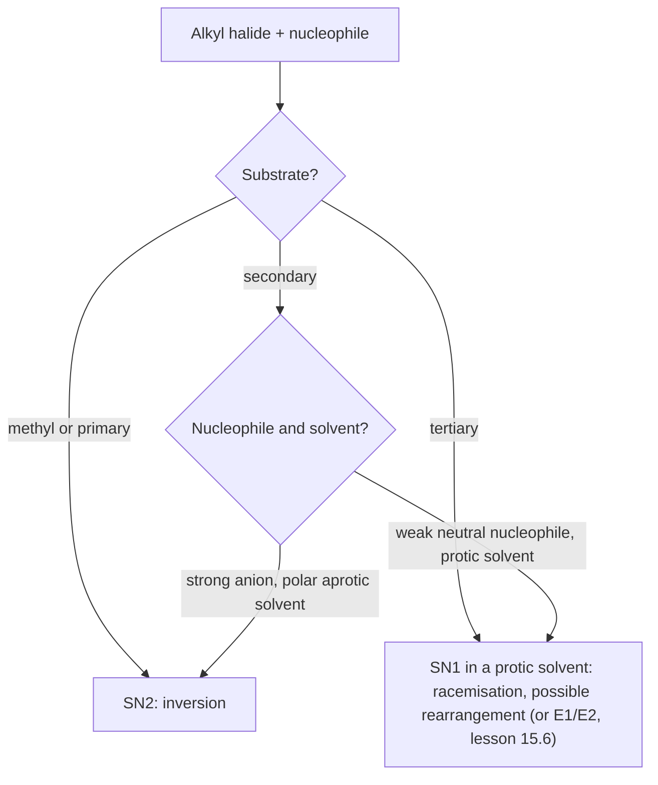

# 15.5 · Nucleophilic substitution: SN1 and SN2

In a substitution reaction one group on a carbon is swapped for another: a nucleophile comes in and a leaving group goes out. It happens by two different mechanisms, one in a single step and one in two, and they give different rate laws, different stereochemistry and different side products. This lesson shows how to tell them apart from kinetic data and how to predict which one a reaction will choose. It uses the arrows and pKa reasoning of [15.4](lesson-04.md), the R/S labels of [15.3](lesson-03.md) and the rate laws of [03.3](../module-03/lesson-03.md).

## Why it matters

Your liver uses substitution all the time. S-adenosylmethionine hands a methyl group to DNA, hormones and drugs in an SN2 reaction, and the same reaction type is how many pharmaceutical ingredients are made in industry. The two mechanisms have real consequences. A chemist who needs one pure enantiomer of a drug must run an SN2, which inverts the stereocentre cleanly, and not an SN1, which scrambles it. Some carcinogens are reactive alkylating agents that attach alkyl groups to DNA by the same chemistry, which is why safety data sheets flag them.

## Core ideas

> [!NOTE]
> These mechanisms are stable textbook chemistry. The relative rates are those in OpenStax Organic Chemistry (2023), checked 2026-10-17. The kinetic data in the lab are generated by a model (`make_data.py`), not measured.

### The players

$$\mathrm{Nu^- + R\text{–}LG \longrightarrow Nu\text{–}R + LG^-}$$

- **Substrate** R–LG: usually an alkyl halide (R–Cl, R–Br, R–I) or an alkyl sulfonate. The carbon bonded to LG is the **electrophilic carbon**: the C–LG bond is polar, C δ+.
- **Nucleophile** Nu: a lone-pair donor, often an anion (HO⁻, CH₃O⁻, CN⁻, I⁻, N₃⁻) or a neutral molecule (H₂O, NH₃).
- **Leaving group** LG: takes the bonding pair with it. Good leaving groups are weak bases, the conjugate bases of strong acids: I⁻ (HI, pKa about −10), Br⁻, Cl⁻ (HCl, −7), sulfonates. HO⁻ (water 15.7) and H₂N⁻ (ammonia 35) are very poor leaving groups; you cannot push HO⁻ off an alcohol directly. Protonate the OH first and the leaving group becomes water, a weak base.

### SN2: one step, backside attack

SN2 means substitution, nucleophilic, bimolecular. The nucleophile attacks the carbon from the side opposite the leaving group, at 180°, while the C–LG bond breaks. One step, two arrows: from the Nu lone pair to C, and from the C–LG bond onto LG.

At the **transition state** (the highest-energy point of the step) the carbon is partly bonded to both Nu and LG, and its other three groups lie flat in a plane. As the reaction finishes they flip over to the other side, like an umbrella turning inside out in the wind. Consequences:

- **Rate law**: both partners are in the one step, so rate $= k_2[\mathrm{R\text{–}LG}][\mathrm{Nu}]$. Double either, and the rate doubles.
- **Stereochemistry**: complete **inversion of configuration** (Walden inversion). (S)-2-bromobutane with hydroxide gives (R)-butan-2-ol.
- **Substrate**: the nucleophile needs a clear path to the back of the carbon. Methyl > primary > secondary ≫ tertiary (essentially no SN2). Neopentyl, (CH₃)₃CCH₂–X, is primary but blocked by the next carbon and almost unreactive.
- **Nucleophile**: stronger nucleophiles react faster. Relative rates with CH₃Br: H₂O 1, CH₃COO⁻ 500, NH₃ 700, Cl⁻ 1 000, HO⁻ 10 000, CH₃O⁻ 25 000, I⁻ 100 000, CN⁻ and HS⁻ 125 000.
- **Solvent**: **polar aprotic** solvents (no O–H or N–H: acetone, DMSO, DMF, acetonitrile) dissolve salts but leave the anion poorly solvated and reactive. **Protic** solvents (water, alcohols) wrap anions in hydrogen bonds and slow SN2. Azide + 1-bromobutane is 200 000 times faster in HMPA than in methanol.

### SN1: two steps through a carbocation

SN1 means substitution, nucleophilic, unimolecular.

1. **Ionisation** (slow): the C–LG bond breaks by itself, giving a **carbocation** R⁺ and LG⁻. One arrow, from the C–LG bond onto LG.
2. **Capture** (fast): the nucleophile attacks the carbocation. One arrow, from Nu to C⁺. If the nucleophile is water or an alcohol, a proton transfer follows (15.4, worked example 2).

The slow step is the **rate-determining step**: the overall rate cannot be faster than it. Only the substrate is in it, so

$$\text{rate} = k_1[\mathrm{R\text{–}LG}]$$

independent of the nucleophile's concentration and almost independent of its strength. Consequences:

- **Substrate**: rate follows carbocation stability. Tertiary > secondary ≫ primary, methyl (no SN1). Allylic and benzylic carbocations are also stabilised, by resonance. Alkyl groups stabilise C⁺ by donating electron density through neighbouring C–H and C–C bonds (**hyperconjugation**).
- **Stereochemistry**: the carbocation is sp² and flat (15.1). The nucleophile can add to either face, so a stereocentre comes out **racemised**: a mixture of both configurations, usually with a small excess of inversion because the departing LG⁻ briefly shields one face.
- **Solvent**: polar protic solvents stabilise both ions formed in step 1. 2-Chloro-2-methylpropane ionises about 100 000 times faster in water than in ethanol.
- **Rearrangements**: a carbocation can become a more stable one by moving an H (with its pair, a **hydride shift**) or an alkyl group (an **alkyl shift**) from the neighbouring carbon. Secondary next to tertiary rearranges; the product carries the nucleophile on the new carbon.

### Choosing between them



| Factor | Favours SN2 | Favours SN1 |
|---|---|---|
| Substrate | methyl, 1° (2°) | 3°, allylic, benzylic (2°) |
| Nucleophile | strong, often anionic, high concentration | weak, neutral; often the solvent |
| Leaving group | good (I, Br, OTs) | good (I, Br, OTs) |
| Solvent | polar aprotic | polar protic |
| Stereochemistry | inversion | racemisation |
| Rate law | $k[\mathrm{RX}][\mathrm{Nu}]$ | $k[\mathrm{RX}]$ |

Strong bases with secondary and tertiary substrates also give elimination; that competition is lesson [15.6](lesson-06.md).

## Worked example

### 1. Reading a rate law

1-Bromobutane reacts with sodium iodide in acetone. Doubling [I⁻] from 0.10 to 0.20 mol/L at the same [RBr] raises the initial rate from $1.0 \times 10^{-5}$ to $2.0 \times 10^{-5}$ mol L⁻¹ s⁻¹.

1. Order in iodide: $n = \log(2.0/1.0)/\log(0.20/0.10) = 1$.
2. A first-order dependence on the nucleophile means it is in the rate-determining step: SN2. That fits a primary substrate and a polar aprotic solvent.
3. $k_2 = \text{rate}/([\mathrm{RBr}][\mathrm{I^-}]) = 1.0\times10^{-5}/(0.050 \times 0.10) = 2.0 \times 10^{-3}$ L mol⁻¹ s⁻¹.

Had the rate stayed at $1.0 \times 10^{-5}$, the order would be 0: SN1.

### 2. Predict the product, with stereochemistry

(a) (S)-2-Bromobutane + NaCN in DMSO. Secondary substrate, strong anionic nucleophile, polar aprotic solvent: SN2. Backside attack inverts the carbon. Product: 2-methylbutanenitrile, `CC[C@@H](C)C#N`. CIP check: CN (N, N, N) > C₂H₅ > CH₃ > H, the same ranking positions as Br > C₂H₅ > CH₃ > H. So the geometric inversion also flips the letter: **(R)**-2-methylbutanenitrile. (The letter flips only when the ranking stays the same; always re-rank.)

(b) 2-Bromo-3-methylbutane, (CH₃)₂CH–CHBr–CH₃, warmed in water. Secondary substrate, weak nucleophile, protic solvent: SN1.

1. Ionisation gives a secondary carbocation at C2.
2. The H on C3, next door, moves with its bonding pair to C2 (hydride shift). C3 becomes a tertiary carbocation, (CH₃)₂C⁺–CH₂CH₃, which is more stable.
3. Water adds to C3; a proton transfer gives the alcohol.

Main product: 2-methylbutan-2-ol, (CH₃)₂C(OH)CH₂CH₃, not the "expected" 3-methylbutan-2-ol. Rearranged products are the fingerprint of a carbocation.

## Hands-on

What you need: pencil and paper; MolView or Avogadro; Python with the course packages and the [Module 15 lab folder](../../labs/module-15/) (`lesson05_kinetics.py`, `sn_runs.csv`); the [lab report template](../../templates/lab-report.md) if you want to write Part B up. Time: about 60 minutes.

### Part A — see the backside attack (10 min)

1. Build (S)-2-bromobutane in Avogadro or MolView (search `(S)-2-bromobutane`). Turn it so you look along the C–Br bond from the side opposite Br. That is the nucleophile's view: the three other groups form an umbrella.
2. Now build (R)-butan-2-ol. Lay it next to your bromide with OH where the nucleophile came from. The umbrella has flipped.
3. Build 2-bromo-2-methylpropane and look at the back of the C–Br bond. Three methyl groups block it: no SN2.

### Part B — Python: SN1 or SN2 from kinetic data (30 min)

`sn_runs.csv` holds model data for two substrates, each run with two starting nucleophile concentrations (0.10 and 0.20 mol/L) and 0.050 mol/L substrate. Substrate A is "1-bromobutane + iodide in acetone"; substrate B is "2-chloro-2-methylpropane in aqueous ethanol with added azide".

1. Open `lesson05_kinetics.py`. Write `initial_rate` (minus the slope of a line through the first five points) and `order_in_nucleophile`.
2. Run it from the lab folder:

```bash
py lesson05_kinetics.py
```

3. Open `runs/sn_runs.png`. For which substrate do the two curves overlap?

How you know it worked: substrate A initial rates about $7.7 \times 10^{-6}$ and $1.6 \times 10^{-5}$ mol L⁻¹ s⁻¹, order 1.04 → SN2; substrate B about $1.28 \times 10^{-5}$ in both runs, order −0.01 → SN1. The stereochemistry demo prints (S) start → (R) SN2 product, and both R and S for SN1.

<details><summary>Reference solution and what to notice</summary>

`initial_rate` returns `-np.polyfit(t[:n_points], c[:n_points], 1)[0]`; `order_in_nucleophile` returns `math.log(rate2 / rate1) / math.log(nu2 / nu1)`. Full code: `lesson05_kinetics_solution.py`.

What to notice:

- The true initial rate for A, run 1, is $k_2 S_0 [\mathrm{Nu}]_0 = 2.0\times10^{-3} \times 0.050 \times 0.10 = 1.0 \times 10^{-5}$. The fit gives 23 % less, because over the first 1200 s the curve already bends. Change `n_points` to 3 and to 10 and see the trade-off between noise and curvature. The ratio of the two runs, and so the order, is much less sensitive, because both runs share the same bias.
- An order of −0.01 is zero within the noise. Report it as "zero order in azide", not as a negative order.
- The SN2 reaction template inverts the stereocentre on purpose (`@` → `@@`). RDKit does not know mechanisms: it applies the rule you give it. Choosing the rule is the chemist's job.

</details>

### Part C — mechanism drills (20 min)

For each reaction: SN1 or SN2? Draw the arrows, the product with stereochemistry, and the rate law.

1. CH₃CH₂CH₂Br + NaN₃ in DMF.
2. (R)-3-bromo-3-methylhexane in methanol.
3. (R)-2-iodooctane + NaI (radioactive iodide) in acetone. What happens to the optical rotation over time?
4. 3,3-Dimethylbutan-2-ol + concentrated HBr (two products; hint: a methyl shift).
5. Why does CH₃CH₂OH not react with NaBr, while CH₃CH₂OH in HBr does give CH₃CH₂Br?

<details><summary>Answers</summary>

1. SN2: primary, strong nucleophile, polar aprotic. CH₃CH₂CH₂N₃ (1-azidopropane); rate $= k[\mathrm{RBr}][\mathrm{N_3^-}]$. No stereocentre.
2. SN1: tertiary, weak nucleophile, protic solvent. Ionisation gives a flat tertiary cation; methanol adds to both faces. Product: 3-methoxy-3-methylhexane as a near-racemic mixture of R and S (slight excess of inversion). Rate $= k[\mathrm{RBr}]$. (Elimination products also form; 15.6.)
3. SN2: each substitution inverts the carbon. Iodide in, iodide out, so the product is the enantiomer. The rotation falls to zero as the sample racemises. In the classic experiment, racemisation ran at exactly twice the rate of radioactive iodide uptake, because each inversion turns one R into one S, which cancels the rotation of one other R molecule. That proved inversion on every substitution.
4. Protonation of OH, loss of water, a secondary cation at C2. A methyl on C3 moves with its pair to C2, giving a tertiary cation at C3. Br⁻ adds: the main product is 2-bromo-2,3-dimethylbutane (rearranged); the minor one, 3-bromo-2,2-dimethylbutane, is unrearranged.
5. HO⁻ is a terrible leaving group (conjugate acid water, 15.7). In HBr the OH is first protonated; the leaving group is now H₂O (conjugate acid H₃O⁺, −1.7), and Br⁻ displaces it by SN2 on the primary carbon.

</details>

## Common mistakes

- Drawing SN2 with the nucleophile attacking from the front, and forgetting the inversion. Attack is always from the back.
- Writing SN1 for a primary halide. Primary carbocations are too unstable; primary substrates react by SN2 (or not at all).
- Assuming the R/S letter always flips in SN2. The geometry inverts; the letter flips only if the priority order stays the same.
- Using a strong nucleophile's concentration to speed up an SN1. It does not appear in the rate law; change the solvent or substrate instead.
- Missing rearrangements. Whenever a carbocation forms next to a more substituted carbon, check for a hydride or alkyl shift.
- Calling HO⁻ a leaving group. Convert OH to H₂O⁺ (acid) or to a sulfonate first.

## Key takeaways

- SN2: one step, backside attack, rate $= k[\mathrm{RX}][\mathrm{Nu}]$, inversion; methyl > 1° > 2°, never 3°; strong nucleophiles and polar aprotic solvents.
- SN1: ionisation then capture, rate $= k[\mathrm{RX}]$, racemisation, possible rearrangements; 3°, allylic and benzylic substrates, protic solvents.
- Good leaving groups are weak bases: I⁻, Br⁻, Cl⁻, sulfonates, H₂O. HO⁻ and NH₂⁻ do not leave.
- The order in nucleophile, from initial rates at two concentrations, tells the mechanism.
- Carbocations rearrange by hydride or alkyl shifts towards more substituted, more stable cations.

## Sources

- [OpenStax Organic Chemistry, 11.2 The SN2 Reaction](https://openstax.org/books/organic-chemistry/pages/11-2-the-sn2-reaction) — second-order kinetics, backside attack, inversion.
- [OpenStax Organic Chemistry, 11.3 Characteristics of the SN2 Reaction](https://openstax.org/books/organic-chemistry/pages/11-3-characteristics-of-the-sn2-reaction) — substrate order, nucleophile relative rates (Table 11.1), leaving groups, the 200 000-fold solvent effect.
- [OpenStax Organic Chemistry, 11.4 The SN1 Reaction](https://openstax.org/books/organic-chemistry/pages/11-4-the-sn1-reaction) — first-order kinetics, carbocation intermediate, racemisation.
- [OpenStax Organic Chemistry, 11.5 Characteristics of the SN1 Reaction](https://openstax.org/books/organic-chemistry/pages/11-5-characteristics-of-the-sn1-reaction) — carbocation stability, the 100 000-fold ethanol-to-water solvent effect.
- [MIT OCW 5.12 Organic Chemistry I (Spring 2005)](https://ocw.mit.edu/courses/5-12-organic-chemistry-i-spring-2005/) — lecture notes and problem sets on substitution and elimination.
