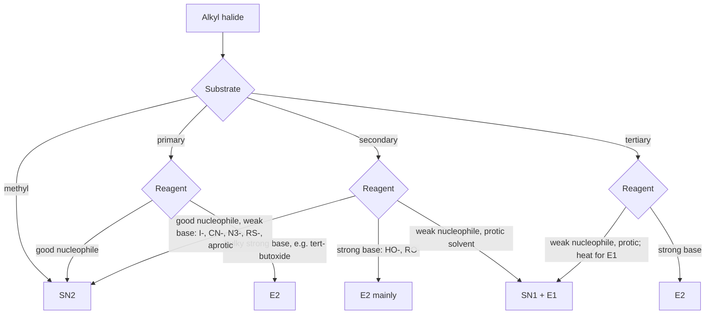

# 15.6 · Elimination: E1 and E2

When a base meets an alkyl halide, it has two choices. It can attack the carbon, which is substitution, or it can pull off a hydrogen from the next carbon, so that the halide leaves and a double bond forms. That second path is elimination, and it is how most alkenes are made. This lesson covers its two mechanisms, the rules that decide which alkene forms, and the decision map for all four reactions of alkyl halides.

## Why it matters

A chemist who adds sodium ethoxide to 2-bromo-2-methylpropane hoping to make an ether gets almost none: the flask fills with 2-methylpropene gas instead. Elimination is the most common way a substitution plan fails. It is also used on purpose: the industrial and laboratory routes to many alkenes, and dehydration steps in biochemistry (fumarase, the citric-acid cycle enzyme, runs one in reverse), are eliminations. Knowing which product forms, and when, saves wasted syntheses.

## Core ideas

> [!NOTE]
> The mechanisms and rules are stable textbook chemistry. Product percentages are from OpenStax Organic Chemistry (2023); enthalpies of formation are NIST WebBook values (Prosen, Maron and Rossini, 1951), checked 2026-10-17.

### β-Elimination

Call the carbon bearing the leaving group Cα and its neighbours Cβ. In a **β-elimination** a base removes an H from a Cβ, the Cα–LG bond breaks, and a C=C forms between Cα and Cβ:

$$\mathrm{B^- + H\text{–}C_\beta\text{–}C_\alpha\text{–}LG \longrightarrow B\text{–}H + C_\beta{=}C_\alpha + LG^-}$$

If Cα has several different β-carbons, several alkenes can form. Which one wins is the main question of this lesson.

### E2: one step, anti-periplanar

E2 (elimination, bimolecular) happens in one step, with three arrows: from the base's lone pair to the β-H; from the C–H bond into the new C=C π position; from the C–LG bond onto LG.

- **Rate law**: rate $= k[\mathrm{RX}][\mathrm{base}]$.
- **Base**: a strong base is needed: HO⁻, CH₃CH₂O⁻, (CH₃)₃CO⁻ (tert-butoxide), NH₂⁻.
- **Geometry**: the C–H and C–LG bonds must be **anti-periplanar**, in one plane and on opposite sides, with an H–Cβ–Cα–LG dihedral of 180°. In a Newman projection (15.2) they are anti. Only then do the breaking C–H orbital and the breaking C–LG orbital line up to become the new π bond.
- **Evidence**: replacing the β-H with deuterium slows E2 about sevenfold (a **kinetic isotope effect**). The C–H bond is breaking in the rate-determining step, so E2 is concerted.

In cyclohexanes, anti-periplanar means **trans-diaxial**: both the H and the leaving group must be axial. Neomenthyl chloride, with Cl axial in its stable chair, eliminates about 200 times faster than menthyl chloride, whose Cl is equatorial until the ring flips to a strained chair. The two isomers even give different alkenes, because different H's are available.

### Zaitsev's rule and alkene stability

**Zaitsev's rule**: in elimination with a small base, the major product is the more substituted alkene, the one with more carbon groups on the C=C. The reason is stability, and you can measure it. Here are NIST gas-phase enthalpies of formation of the C₄H₈ alkenes:

| Alkene | Carbon groups on C=C | ΔfH°(g) / kJ mol⁻¹ |
|---|---|---|
| 1-butene | 1 | −0.6 |
| (Z)-2-butene | 2 (same side) | −7.7 |
| (E)-2-butene | 2 (opposite sides) | −10.8 |
| 2-methylpropene | 2 (same carbon) | −17.9 |

All four have the same formula, so lower ΔfH° means more stable. Each extra alkyl group on the C=C is worth roughly 5–7 kJ/mol, through hyperconjugation and because sp²–sp³ bonds are stronger than sp³–sp³ bonds. E beats Z by 3 kJ/mol because in the Z isomer the two methyls crowd each other.

The more stable alkene forms faster because the E2 transition state already has partial double-bond character, so it feels part of that stability. That makes Zaitsev's rule a kinetic preference, not an equilibrium: 2-bromobutane with sodium ethoxide in ethanol gives 81 % 2-butenes and 19 % 1-butene, while equilibrium would give only about 1 % 1-butene.

### Hofmann product with a bulky base

A large base such as potassium tert-butoxide struggles to reach an inner β-H and takes the more exposed one on a CH₃ group instead. It gives more of the **less substituted** alkene, called the **Hofmann product**. 2-Bromo-2-methylbutane with ethoxide gives 70 % 2-methyl-2-butene (Zaitsev) and 30 % 2-methyl-1-butene; with tert-butoxide the less substituted 2-methyl-1-butene becomes the major product.

### E1: two steps through a carbocation

E1 shares its first step with SN1:

1. Ionisation (slow): R–LG → R⁺ + LG⁻.
2. Loss of a β-proton (fast): a weak base, often the solvent, removes an H next to C⁺. One arrow from a base lone pair to H, one from the C–H bond into the C⁺–C π position.

- **Rate law**: rate $= k[\mathrm{RX}]$, the same as SN1.
- **Substrates**: tertiary (and secondary) in polar protic solvents, with weak bases: the same conditions as SN1, so E1 and SN1 usually occur together.
- **Products**: Zaitsev; no geometric requirement, because the cation is flat; rearrangements possible.
- **Heat favours elimination.** Elimination makes more molecules than substitution, so its $\Delta S$ is larger and positive. In $\Delta G = \Delta H - T\Delta S$ ([08.2](../module-08/lesson-02.md)) the entropy term wins at higher temperature. Acid-catalysed dehydration of alcohols with heat is E1 (for secondary and tertiary alcohols).

### The decision map



Two questions do most of the work: how hindered is the carbon, and is the reagent a strong base or only a good nucleophile? Iodide, cyanide, azide and thiolates are good nucleophiles but weak bases (their conjugate acids have pKa below 11), so they substitute. Hydroxide and alkoxides are strong bases and eliminate whenever substitution is hindered.

## Worked example

### 1. 2-Bromobutane and sodium ethoxide

Substrate: secondary. Reagent: ethoxide, a strong, small base. Solvent: ethanol. Decision map: E2 mainly (some SN2 ether forms too).

1. β-carbons: C1 (a CH₃) and C3 (a CH₂). Removing H from C1 gives 1-butene; from C3 gives 2-butene, as E or Z.
2. Zaitsev: 2-butene is more substituted, so it is the major product: 81 % 2-butenes against 19 % 1-butene.
3. Within 2-butene, E dominates. For the anti-periplanar H–C3–C2–Br arrangement, look down C2–C3: in the conformation that gives E, the two methyls are anti; in the one that gives Z, they are gauche (3.8 kJ/mol higher, 15.2). The E transition state is lower, so more E forms.
4. Enthalpy check with NIST data: (E)-2-butene ΔfH° = −10.8, 1-butene −0.6 kJ/mol. The Zaitsev product is 10 kJ/mol more stable.

### 2. Same halide, two bases

2-Bromo-2-methylbutane, (CH₃)₂CBr–CH₂CH₃, is tertiary, so SN2 is out. Its β-H's are on the two CH₃ groups (6 H, giving 2-methyl-1-butene) and on the CH₂ (2 H, giving 2-methyl-2-butene, trisubstituted).

- With sodium ethoxide: 70 % 2-methyl-2-butene (Zaitsev), 30 % 2-methyl-1-butene.
- With potassium tert-butoxide: the bulky base reaches the outer CH₃ hydrogens more easily, and 2-methyl-1-butene (Hofmann) becomes the major product.

Same substrate, opposite selectivity: choose the base for the alkene you want.

## Hands-on

What you need: Avogadro or MolView; Python with the course packages and the [Module 15 lab folder](../../labs/module-15/) (`lesson06_elimination.py`, `butenes_nist.csv`); a [notebook page](../../templates/notebook-page.md). Time: about 60 minutes.

### Part A — find the anti-periplanar H (15 min)

1. Build 2-bromobutane and optimise it. Rotate about the C2–C3 bond (Avogadro: Bond-Centric Manipulation tool) until one H on C3 is at 180° to the Br. Measure the H–C3–C2–Br dihedral to confirm.
2. Note where the two methyl groups are in that conformation. Rotate to the other anti-periplanar H on C3. Which conformation leads to (E)-2-butene and which to (Z)?
3. Build trans-1-bromo-2-methylcyclohexane in its diequatorial chair. Is there an H trans-diaxial to Br? Flip the ring (rebuild with both groups axial) and look again.

How you know it worked: with H and Br anti, the methyls are anti for the E path and gauche for the Z path. In the diequatorial chair of trans-1-bromo-2-methylcyclohexane, no ring H is anti to Br; in the diaxial chair, only the H on C6 is.

### Part B — Python: enumerate and rank (25 min)

1. Open `lesson06_elimination.py`. It already enumerates the β-elimination products with an RDKit reaction SMARTS and adds E/Z isomers. Write `substitution_degree` (count carbon groups on the two C=C carbons) and `equilibrium_fractions` (Boltzmann weights from ΔfH°).
2. Run it from the lab folder:

```bash
py lesson06_elimination.py
```

How you know it worked: 2-bromobutane gives three alkenes. (E)-2-butene: 2 substituents, −10.80 kJ/mol, equilibrium share 76.8 %; (Z)-2-butene: 2, −7.70, 22.0 %; 1-butene: 1, −0.63, 1.3 %. 2-Bromo-2-methylpropane gives only 2-methylpropene; 1-bromobutane only 1-butene.

<details><summary>Reference solution and what to notice</summary>

`substitution_degree` sums, for each alkene carbon, its carbon neighbours other than its partner. `equilibrium_fractions` computes `w = [math.exp(-h / (R_KJ * T)) for h in dfh_list]` and returns each weight divided by the sum. Full code: `lesson06_elimination_solution.py`.

What to notice:

- Equilibrium would give 1.3 % 1-butene; the real E2 reaction gives 19 %. The product ratio is set by the rates of competing transition states, not by product stability alone. Zaitsev's rule is a tendency, not a law.
- The reaction SMARTS makes every alkene that one HX loss can make. It knows nothing about bases, anti-periplanar geometry or rates. Enumeration tells you the candidates; chemistry picks the winner.
- The estimate ignores entropy differences between the isomers. They are small for these isomers but not zero; Module 21 shows how to compute them.

</details>

### Part C — decision drills (20 min)

Give the mechanism (SN1, SN2, E1, E2) and the major product.

1. 1-Bromopropane + NaCN in DMSO.
2. 1-Bromopropane + potassium tert-butoxide in tert-butanol.
3. 2-Bromopropane + NaOH in ethanol, heated.
4. 2-Chloro-2-methylpropane in water at 25 °C.
5. Cyclohexanol + concentrated H₂SO₄, heated, product distilled off as it forms.
6. Neomenthyl chloride + NaOEt. Why is it 200 times faster than menthyl chloride?

<details><summary>Answers</summary>

1. SN2: primary, good nucleophile and weak base, polar aprotic. Butanenitrile, CH₃CH₂CH₂CN.
2. E2: a bulky strong base cannot reach the carbon. Propene.
3. E2 mainly: secondary, strong base, heat. Propene, with some propan-2-ol by SN2.
4. SN1 + E1: tertiary, weak nucleophile, protic. Mostly tert-butyl alcohol, with some 2-methylpropene.
5. E1 dehydration: OH protonated, water leaves, secondary cation, loses H⁺. Cyclohexene. Distilling it off as it forms pulls the equilibrium (08.3); heat favours elimination.
6. E2. In neomenthyl chloride's stable chair, Cl is axial and an H on the adjacent C bearing the isopropyl group is axial too: trans-diaxial, ready to react. It gives the more substituted 1-menthene (Zaitsev). Menthyl chloride has Cl equatorial; it must flip to a chair with all three groups axial, which few molecules occupy, and then only one anti H is available, giving 2-menthene.

</details>

## Common mistakes

- Removing an H from Cα instead of Cβ. The H comes from the carbon next to the one carrying the leaving group.
- Ignoring geometry in rings. E2 needs the H and the leaving group trans-diaxial; an equatorial leaving group does not eliminate until the ring flips.
- Calling every strong nucleophile a strong base. I⁻, CN⁻, N₃⁻ and RS⁻ substitute on secondary carbons; HO⁻ and RO⁻ eliminate.
- Applying Zaitsev with tert-butoxide. Bulky bases give more of the less substituted alkene.
- Forgetting that E1 and SN1 go together. Same first step, same conditions; heat shifts the balance to E1.
- Drawing a five-bond carbon in the E2 step. Three arrows, three bond changes, all at once.

## Key takeaways

- E2: one step, rate $= k[\mathrm{RX}][\mathrm{B}]$, strong base, H and leaving group anti-periplanar (trans-diaxial in rings).
- E1: through the SN1 carbocation, rate $= k[\mathrm{RX}]$, weak base, competes with SN1; heat favours it.
- Zaitsev: small bases give the more substituted alkene, which NIST data show is more stable (trans-2-butene −10.8 vs 1-butene −0.6 kJ/mol). Bulky bases give the Hofmann product.
- Decision map: methyl → SN2; 1° → SN2 unless the base is bulky; 2° → E2 with strong bases, SN2 with weak-base nucleophiles, SN1/E1 in protic solvents; 3° → E2 with strong bases, SN1/E1 otherwise.

## Sources

- [OpenStax Organic Chemistry, 11.7 Elimination Reactions: Zaitsev's Rule](https://openstax.org/books/organic-chemistry/pages/11-7-elimination-reactions-zaitsevs-rule) — 81 : 19 for 2-bromobutane; 70 : 30 for 2-bromo-2-methylbutane with ethoxide.
- [OpenStax Organic Chemistry, 11.8 The E2 Reaction and the Deuterium Isotope Effect](https://openstax.org/books/organic-chemistry/pages/11-8-the-e2-reaction-and-the-deuterium-isotope-effect) — rate law, anti-periplanar geometry, isotope effect.
- [OpenStax Organic Chemistry, 11.9 The E2 Reaction and Cyclohexane Conformation](https://openstax.org/books/organic-chemistry/pages/11-9-the-e2-reaction-and-cyclohexane-conformation) — trans-diaxial requirement; menthyl and neomenthyl chloride, 200-fold rate difference.
- [OpenStax Organic Chemistry, 11.10 The E1 and E1cB Reactions](https://openstax.org/books/organic-chemistry/pages/11-10-the-e1-and-e1cb-reactions) — E1 mechanism and kinetics.
- [OpenStax Organic Chemistry, 11.12 A Summary of Reactivity](https://openstax.org/books/organic-chemistry/pages/11-12-a-summary-of-reactivity-sn1-sn2-e1-e1cb-and-e2) — the decision summary.
- [NIST Chemistry WebBook, trans-2-butene](https://webbook.nist.gov/cgi/cbook.cgi?ID=C624646&Mask=1) — ΔfH°(g) = −10.8 kJ/mol; the same source gives 1-butene −0.63, cis-2-butene −7.7 and 2-methylpropene −17.9 kJ/mol (Prosen, Maron and Rossini, 1951).
