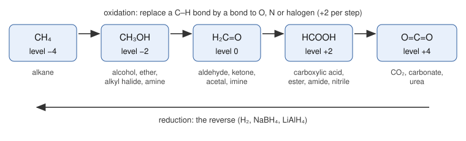
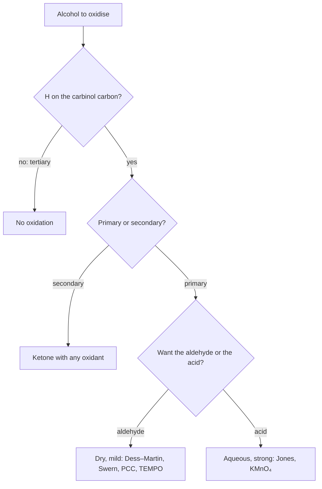

# 16.1 · Alcohols, ethers and oxidation

Module 15 gave you the four basic moves of organic reactions: proton transfer, substitution, elimination and addition. This module uses them on the groups that do most of the work in real synthesis. It starts with alcohols because almost every other group can be made from an alcohol or turned into one. You will learn to read the oxidation level of a carbon at a glance, choose the right oxidant, make ethers without losing your alkyl halide to elimination, and open epoxides at the carbon you want.

## Why it matters

A flavour chemist needs hexanal, the "cut grass" note, from 1-hexanol. If she uses aqueous chromic acid (the Jones reagent), the aldehyde does not survive: it oxidises further to hexanoic acid, which smells of goats. If she uses the Dess–Martin reagent in dry dichloromethane, she stops cleanly at the aldehyde. The same starting material, two reagents, two very different products. The rule behind the choice is short, and it comes from the mechanism you will meet in lesson 16.2.

## Core ideas

> [!NOTE]
> The ideas here (oxidation levels, SN2 for ethers, the reason mild oxidants stop at aldehydes) are settled teaching chemistry. The preferred reagents change: chromium(VI) reagents such as PCC and Jones are still taught as the classic examples, but industry now avoids them because Cr(VI) is toxic and carcinogenic, and uses Dess–Martin periodinane, Swern or TEMPO/bleach instead. Reagent advice and the RDKit version (2026.9.1) were checked on 2026-10-17.

### Oxidation levels of carbon

In organic chemistry, "oxidation" usually means a carbon loses a bond to hydrogen and gains a bond to a more electronegative atom (O, N, a halogen). A quick count gives each carbon an **oxidation level**: −1 for every attached H, +1 for every bond to O, N or halogen (a double bond counts twice), 0 for bonds to carbon.



Two practical rules follow:

- Groups at the same level interconvert **without** an oxidant or reductant. An alcohol, an alkyl bromide and an ether are all at one level; an aldehyde, its hydrate and its acetal at the next; an acid, an ester, an amide and a nitrile at the next. Lesson 16.3 lives entirely on one rung.
- Moving up a rung needs an oxidant; moving down needs a reductant (H₂ with a catalyst, NaBH₄, LiAlH₄). Each rung is two electrons.

This is the same bookkeeping as oxidation numbers in lesson [08.5](../module-08/lesson-05.md), applied to one carbon at a time.

### Alcohols as acids, bases and leaving groups

An alcohol O–H is about as acidic as water: $\mathrm{p}K_a$ about 16 for ethanol, 18 for tert-butanol. Strong bases such as NaH remove the proton completely to give an **alkoxide** ($\mathrm{RO^-}$), a good nucleophile. Phenol is far more acidic ($\mathrm{p}K_a$ 10) because the negative charge of phenoxide spreads into the ring (the resonance argument of lesson [15.4](../module-15/lesson-04.md)).

Hydroxide is a poor leaving group. To substitute or eliminate an OH you first make it a better one:

| Goal | Reagent | What happens |
|---|---|---|
| R–OH → R–Br (primary, secondary) | PBr₃ | O attacks P, the O–P group leaves in an SN2 step (inversion, lesson [15.5](../module-15/lesson-05.md)) |
| R–OH → R–Cl | SOCl₂ | similar; the by-products SO₂ and HCl are gases |
| tertiary R–OH → R–Br | HBr | protonated OH leaves as water, SN1 through a carbocation |
| R–OH → alkene | H₂SO₄ or H₃PO₄, heat | E1 for secondary and tertiary alcohols, Zaitsev product (lesson [15.6](../module-15/lesson-06.md)) |

### Oxidising alcohols

An alcohol is oxidised by removing the H from oxygen and the H from the **carbinol carbon** (the carbon bearing the OH). The oxidant first bonds to oxygen (a chromate ester for Cr(VI), an iodine(V) ester for Dess–Martin), then a base takes the C–H proton while the oxidant leaves, forming C=O. So:

- **Primary** alcohols (RCH₂OH) give aldehydes, which can go on to carboxylic acids.
- **Secondary** alcohols (R₂CHOH) give ketones and stop: a ketone has no H on the carbonyl carbon.
- **Tertiary** alcohols (R₃COH) have no H on the carbinol carbon and are not oxidised under these conditions.

Why does the Jones reagent take a primary alcohol all the way to the acid while PCC or Dess–Martin stop at the aldehyde? Jones works in water. An aldehyde in water adds water to give a **hydrate**, RCH(OH)₂, which is itself an alcohol with an H on the carbinol carbon, so it is oxidised again. In a dry solvent there is no hydrate and the aldehyde survives.



### Ethers: the Williamson synthesis and cleavage

An ether R–O–R′ is made most reliably by the **Williamson synthesis**: an alkoxide attacks an alkyl halide in an SN2 reaction. Because SN2 needs an unhindered carbon, the halide must be methyl or primary; the alkoxide can be as hindered as you like. A secondary or tertiary halide with a strong base gives mostly E2 elimination instead. So for every unsymmetrical ether you choose the disconnection that puts the less hindered group on the halide.

Ethers are unreactive, which makes them good solvents (diethyl ether, THF). They are cleaved only by strong acids such as HBr or HI: the oxygen is protonated, then bromide or iodide attacks. A methyl or primary group is attacked by SN2; a tertiary group leaves as a carbocation (SN1).

### Epoxides: strained ethers that open

An **epoxide** (oxirane) is a three-membered cyclic ether. Its ring strain, similar to cyclopropane's (lesson [15.2](../module-15/lesson-02.md)), makes it react with nucleophiles that ignore ordinary ethers. Which carbon is attacked depends on the conditions:

- **Basic or neutral, strong nucleophile** (RO⁻, HO⁻, RMgBr, NH₃): SN2 at the **less substituted** carbon, with inversion there.
- **Acidic, weak nucleophile** (H₂O or ROH with H₂SO₄): the protonated epoxide opens at the **more substituted** carbon, which carries more of the positive charge; the attack is still from the back side.

A Grignard reagent plus ethylene oxide adds a two-carbon unit ending in OH: $\mathrm{RMgBr} + \mathrm{C_2H_4O} \rightarrow \mathrm{RCH_2CH_2OH}$ after acid work-up. You will use this in lesson 16.7.

## Worked example

### 1. The breathalyser reaction, balanced by oxidation levels

The old roadside breath tester turned orange dichromate green when ethanol reduced it to Cr³⁺. Balance ethanol → acetic acid with acidic dichromate.

The carbinol carbon of ethanol (CH₃–**C**H₂–OH) has two H (−2) and one bond to O (+1): level −1. The carboxyl carbon of acetic acid has a double bond and a single bond to O (+3) and no H: level +3. The methyl carbon does not change. So each ethanol gives up **4 electrons**. Each Cr goes from +6 to +3 and takes 3 electrons, so one $\mathrm{Cr_2O_7^{2-}}$ takes 6. The lowest common multiple is 12: 3 ethanol and 2 dichromate. Balance O with water and H with H⁺:

$$3\,\mathrm{CH_3CH_2OH} + 2\,\mathrm{Cr_2O_7^{2-}} + 16\,\mathrm{H^+} \rightarrow 3\,\mathrm{CH_3COOH} + 4\,\mathrm{Cr^{3+}} + 11\,\mathrm{H_2O}$$

Check: O is 3 + 14 = 17 on the left and 6 + 11 = 17 on the right; H is 18 + 16 = 34 and 12 + 22 = 34; charge is −4 + 16 = +12 and +12. Counting electrons on the carbon replaced the half-equation method of lesson 08.5.

### 2. Which Williamson route to ETBE?

Ethyl tert-butyl ether, $\mathrm{(CH_3)_3C{-}O{-}CH_2CH_3}$, is a petrol additive. There are two disconnections at the oxygen:

- Route 1: sodium ethoxide + tert-butyl bromide. The halide is tertiary. Ethoxide is a strong base, so E2 wins and you get 2-methylpropene, not the ether.
- Route 2: potassium tert-butoxide + bromoethane. The halide is primary and unhindered; the bulky alkoxide is fine as a nucleophile on a primary carbon. This route works.

The rule: put the hindered group on oxygen, the small group on the halide.

## Hands-on

What you need: the [Module 16 lab folder](../../labs/module-16/) with Python 3.14 and RDKit 2026.9.1 (pinned in `labs/common/requirements.txt`), paper and pencil, and a [notebook page](../../templates/notebook-page.md). Time: about 60 minutes. Everything here is on paper or on screen; do not try any of these reactions at home.

### Part A — Python: an oxidation-level calculator (25 min)

Open `lesson01_oxidation.py`. Write the two functions marked TODO:

- `oxidation_level(atom)`: −1 per attached H, plus the bond order of every bond to O, N or a halogen.
- `alcohol_class(mol)`: find the C–OH carbon with the SMARTS pattern `[CX4][OX2H]` and count its carbon neighbours (0 methyl, 1 primary, 2 secondary, 3 tertiary).

Then run:

```bash
py lesson01_oxidation.py
```

How you know it worked: methane to CO₂ prints −4, −2, 0, +2, +4. Ethanol prints `[-3, -1]` and acetic acid `[-3, 3]`. The alcohol table shows 1-butanol as primary (mild: butanal, strong: butanoic acid) and tert-butanol as tertiary with "no reaction" for both oxidants. That second table comes from the course's small reaction library in `org16.py`; read its `oxidise_mild` and `oxidise_strong` entries and match each SMARTS template to a rule in Core ideas.

<details><summary>Reference solution for Part A</summary>

`oxidation_level`: `level = -atom.GetTotalNumHs()`, then for each bond `other = bond.GetOtherAtom(atom)` and, if `other.GetSymbol()` is in `ELECTRONEGATIVE`, `level += int(bond.GetBondTypeAsDouble())`. `alcohol_class`: loop over `m.GetSubstructMatches(Chem.MolFromSmarts("[CX4][OX2H]"))`, take `match[0]`, count neighbours with symbol C, return `names[count]`. Full code in `lesson01_oxidation_solution.py`.

The methyl carbon of ethanol is at level −3, although ethanol is "an alcohol". Oxidation levels belong to atoms, not to molecules.

</details>

### Part B — product drill (20 min)

Draw each product, then type its SMILES into the `ANSWERS` dictionary near the bottom of `lesson01_oxidation.py` and run the script again. It compares your answer with a hashed key.

a. 1-butanol with PCC in dichloromethane.
b. Cyclohexanol with the Jones reagent.
c. Phenol with NaH, then iodomethane.
d. 2-methyl-2-butanol with H₂SO₄ and heat.
e. Methylmagnesium bromide with ethylene oxide, then dilute acid.

<details><summary>Worked answers to Part B</summary>

a. Butanal, `CCCC=O`. PCC is dry and mild: the primary alcohol stops at the aldehyde.
b. Cyclohexanone, `O=C1CCCCC1`. A secondary alcohol gives a ketone whatever the oxidant.
c. Anisole (methoxybenzene), `COc1ccccc1`. NaH makes phenoxide; phenoxide attacks CH₃I by SN2. The aryl group must be on oxygen: SN2 never happens at an sp² ring carbon.
d. 2-methyl-2-butene, `CC=C(C)C`. Tertiary alcohol, E1: protonate the OH, lose water to give the tertiary cation, lose the H that gives the more substituted alkene (Zaitsev).
e. 1-propanol, `CCCO`. The Grignard carbon opens the epoxide by SN2 at a CH₂; acid work-up protonates the alkoxide. One carbon plus two carbons gives three.

</details>

### Part C — pencil: two epoxide openings (15 min)

2,2-Dimethyloxirane is opened (1) with sodium methoxide in methanol and (2) with methanol and a drop of H₂SO₄. Draw the curved arrows and the product for each.

<details><summary>Worked answer to Part C</summary>

(1) Basic: methoxide attacks the unhindered CH₂ by SN2; the C–O bond breaks and leaves an alkoxide on the tertiary carbon, which methanol protonates. Product: 1-methoxy-2-methyl-2-propanol, `COCC(C)(C)O`.

(2) Acidic: the epoxide oxygen is protonated first. The C–O bond to the tertiary carbon is the weaker one, and that carbon carries more positive charge, so methanol attacks there. Product: 2-methoxy-2-methyl-1-propanol, `COC(C)(C)CO`. Same atoms, opposite regiochemistry: the conditions decide.

</details>

## Common mistakes

- **Expecting a tertiary alcohol to oxidise.** No H on the carbinol carbon, no C=O. If a problem shows a tertiary alcohol turning into a ketone, a carbon–carbon bond must have broken, which these reagents do not do.
- **Using Jones when you need the aldehyde.** Water turns the aldehyde into its hydrate, which oxidises again. Use a dry, mild oxidant.
- **Putting the hindered group on the halide in a Williamson synthesis.** Tertiary and most secondary halides eliminate with alkoxides. Check the halide carbon first.
- **Trying SN2 on an aryl halide.** Bromobenzene does not react with methoxide by SN2; to make an aryl ether the aryl part is the phenoxide.
- **Mixing up epoxide regiochemistry.** Base: less substituted carbon. Acid: more substituted carbon. Write the conditions next to the arrow before you draw the product.

## Key takeaways

- Oxidation level of a carbon: −1 per H, +1 per bond to O, N or halogen; each rung of the ladder is two electrons.
- Primary alcohols give aldehydes (dry, mild oxidant) or acids (aqueous, strong); secondary alcohols give ketones; tertiary alcohols do not oxidise.
- OH must be made into a better leaving group (PBr₃, SOCl₂, protonation) before substitution or elimination.
- The Williamson ether synthesis is SN2: methyl or primary halide, any alkoxide.
- Epoxides open at the less substituted carbon with strong nucleophiles and at the more substituted carbon under acid.

## Sources

- [OpenStax Organic Chemistry, 17.6 Reactions of Alcohols](https://openstax.org/books/organic-chemistry/pages/17-6-reactions-of-alcohols) — conversion to halides, dehydration, tosylates.
- [OpenStax Organic Chemistry, 17.7 Oxidation of Alcohols](https://openstax.org/books/organic-chemistry/pages/17-7-oxidation-of-alcohols) — primary, secondary and tertiary alcohols with Dess–Martin, Jones and other oxidants.
- [OpenStax Organic Chemistry, 18.2 Preparing Ethers](https://openstax.org/books/organic-chemistry/pages/18-2-preparing-ethers) — the Williamson synthesis and its limits.
- [OpenStax Organic Chemistry, 18.3 Reactions of Ethers: Acidic Cleavage](https://openstax.org/books/organic-chemistry/pages/18-3-reactions-of-ethers-acidic-cleavage) — HBr and HI cleavage by SN1 and SN2.
- [MIT OpenCourseWare 5.13 Organic Chemistry II](https://ocw.mit.edu/courses/5-13-organic-chemistry-ii-fall-2006/) — course scope for this module.
- [RDKit: Getting Started in Python](https://www.rdkit.org/docs/GettingStartedInPython.html) — SMILES, SMARTS substructure search and reaction SMARTS used in the labs.
