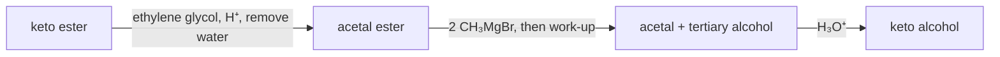

# 16.2 · Aldehydes, ketones and nucleophilic addition

The carbonyl group, C=O, is the centre of organic synthesis. Its carbon is electron-poor and flat, so nucleophiles attack it from above or below, and the oxygen ends up carrying the negative charge. This one move, nucleophilic addition, explains how aldehydes and ketones become alcohols, imines, acetals and alkenes, and it is also the first step of every reaction in lessons 16.3 and 16.4. This lesson covers the move, the main nucleophiles, and how to use it backwards to plan an alcohol synthesis.

## Why it matters

Formalin, the preservative in biology labs, is sold as "37 % formaldehyde in water". Yet almost none of it is H₂C=O: 99.9 % is the hydrate, methanediol. Acetone in water, by contrast, is 99.9 % acetone. The same addition of water to C=O, with equilibrium constants a million times apart. If you can explain that difference, you can predict which carbonyl in a molecule reacts first, which is the decision behind every selective reduction or protection in lesson 16.7.

## Core ideas

> [!NOTE]
> Nucleophilic addition and the reactivity order are settled theory. The hydration constants are orders of magnitude (OpenStax 19.5 gives 99.9 % hydrate for formaldehyde and 0.1 % for acetone; formaldehyde $K \approx 10^3$, hexafluoroacetone about $10^6$, acetaldehyde close to 1). Sources checked 2026-10-17.

### The carbonyl as an electrophile

Oxygen is more electronegative than carbon, and the C=O π bond is polarised: a resonance form puts + on carbon and − on oxygen. The lowest empty orbital is the C=O π*, largest on carbon. A nucleophile attacks carbon at about 107° to the C=O axis (the Bürgi–Dunitz angle), the π bond breaks, and a **tetrahedral alkoxide** forms. Protonation gives the product.

There are two styles:

- **Strong, basic nucleophiles** (H⁻ from NaBH₄ or LiAlH₄, carbanions from RMgBr, ylides): addition is fast and effectively irreversible. Acid is added afterwards (the **work-up**).
- **Weak, neutral nucleophiles** (H₂O, ROH, RNH₂): addition is reversible and is speeded up by acid, which protonates the oxygen and makes the carbon more electrophilic.

A flat carbonyl is attacked equally from both faces. If the new carbon is a stereocentre, an achiral reagent gives a racemic mixture (lesson [15.3](../module-15/lesson-03.md)).

### Aldehydes versus ketones: the hydration test

The equilibrium $\mathrm{R_2C{=}O + H_2O \rightleftharpoons R_2C(OH)_2}$ measures how much a carbonyl "wants" a nucleophile. With water's activity taken as 1, the hydrate fraction is $K/(1+K)$:

| Carbonyl | $K_\text{hyd}$ | % hydrate |
|---|---|---|
| hexafluoroacetone, (CF₃)₂C=O | ~10⁶ | 99.9999 |
| formaldehyde, H₂C=O | ~10³ | 99.9 |
| acetaldehyde, CH₃CHO | ~1 | ~50 |
| acetone, (CH₃)₂C=O | ~10⁻³ | 0.1 |

Two effects explain the order. **Sterics**: the tetrahedral product crowds its four groups closer together (109° instead of 120°), which costs more with two alkyl groups than with H. **Electronics**: alkyl groups donate electron density and stabilise the C=O; CF₃ groups withdraw it and make the carbonyl more eager. The same order, aldehydes before ketones, holds for every nucleophile in this lesson.

### Hydride: reduction to alcohols

**NaBH₄** in methanol or ethanol reduces aldehydes to primary alcohols and ketones to secondary alcohols. It is mild: esters, acids, amides, nitro groups and C=C survive. **LiAlH₄** in dry ether is much stronger and also reduces esters and acids (lesson 16.3); it reacts violently with water, so it is used dry and quenched with care. Both deliver H⁻ to the carbonyl carbon; the work-up protonates oxygen. On the oxidation ladder of lesson [16.1](lesson-01.md), each is one rung down.

### Grignard reagents: making C–C bonds

A **Grignard reagent**, RMgBr, made from R–Br and magnesium in dry ether, behaves as the carbanion R⁻. It adds to:

- formaldehyde → primary alcohol (one carbon added);
- other aldehydes → secondary alcohols;
- ketones → tertiary alcohols;
- ethylene oxide → primary alcohol with two carbons added (lesson 16.1);
- CO₂ → carboxylic acid.

Grignard reagents are also very strong bases ($\mathrm{p}K_a$ of an alkane is about 50). Any O–H, N–H or acidic C–H in the molecule, or water in the solvent, protonates them at once and destroys them. A halide that also carries an OH cannot be turned into a Grignard reagent until the OH is protected.

### Amines: imines and enamines

A **primary amine** (RNH₂) adds to C=O to give a carbinolamine, which loses water to give an **imine** (C=N–R, also called a Schiff base). A **secondary amine** (R₂NH) cannot form C=N–R with a neutral N, so it loses a proton from the neighbouring carbon instead and gives an **enamine** (C=C–NR₂). Both reactions are fastest near pH 4–5: enough acid to protonate the OH leaving group, not so much that the amine is all protonated and stops being a nucleophile. Reducing an imine as it forms gives an amine (**reductive amination**, lesson 16.6).

### Alcohols: hemiacetals, acetals and protection

One alcohol adds reversibly to give a **hemiacetal**, R₂C(OH)(OR′). With acid and a second alcohol, the OH is protonated, leaves as water, and a second OR′ adds: an **acetal**, R₂C(OR′)₂. Every step is reversible, so you drive acetal formation by removing water, and you reverse it with aqueous acid. Glucose in solution is a cyclic hemiacetal (lesson 16.6).

Acetals are stable to bases, hydrides and Grignard reagents. That makes them **protecting groups**: convert a ketone into its ethylene glycol acetal, do chemistry elsewhere in the molecule, then remove the acetal with aqueous acid.



### The Wittig reaction: C=O to C=C

A **phosphorus ylide**, Ph₃P=CHR (made from Ph₃P, an alkyl halide and a strong base), adds to an aldehyde or ketone. The four-membered oxaphosphetane falls apart to an alkene and triphenylphosphine oxide; the very strong P=O bond drives it. The new C=C appears exactly where the C=O was, which an elimination (lesson 15.6) cannot guarantee.

## Worked example

### 1. How much free aldehyde is there?

A recipe calls for 0.10 mol/L acetaldehyde in water. With $K_\text{hyd} \approx 1$, the free aldehyde is

$$[\mathrm{CH_3CHO}] = \frac{0.10}{1 + K} = \frac{0.10}{2} = 0.050\ \text{mol/L}$$

For formaldehyde ($K \approx 10^3$) the same 0.10 mol/L gives only $0.10/1001 = 1.0\times10^{-4}$ mol/L of free H₂C=O. Yet formalin still reacts fast as formaldehyde, because the hydrate gives it back quickly as it is used up (Le Chatelier, lesson [08.3](../module-08/lesson-03.md)). An equilibrium constant tells you where the mixture sits, not how fast it can supply the reactive form.

### 2. Three Grignard routes to 2-phenyl-2-butanol

Target: $\mathrm{CH_3CH_2C(OH)(CH_3)C_6H_5}$. The carbinol carbon carries three carbon groups: ethyl, methyl and phenyl. Each one can be the Grignard reagent, and the rest becomes the ketone:

| Grignard | Ketone | Comment |
|---|---|---|
| C₆H₅MgBr | butanone, CH₃COCH₂CH₃ | both cheap; a good route |
| CH₃MgBr | propiophenone, C₆H₅COCH₂CH₃ | fine; propiophenone comes from Friedel–Crafts acylation (lesson 16.5) |
| CH₃CH₂MgBr | acetophenone, C₆H₅COCH₃ | fine; acetophenone is a common catalogue compound |

All three are correct on paper. You choose by what you have (lesson 16.7 calls this the starting-material catalogue) and by side reactions: a very hindered ketone with a bulky Grignard tends to be reduced or enolised instead of adding. The lab script finds these disconnections automatically and checks each with the reaction library. The product is racemic, because the Grignard reagent attacks either face of the flat ketone.

## Hands-on

What you need: the [Module 16 lab folder](../../labs/module-16/) with Python 3.14 and RDKit 2026.9.1, paper and pencil, and a [notebook page](../../templates/notebook-page.md). Time: about 60 minutes. Paper and screen only; none of these reagents belong in a kitchen.

### Part A — Python: hydrates and disconnections (25 min)

Open `lesson02_addition.py` and write the two TODO functions:

- `hydrate_percent(k)`: the hydrate fraction $K/(1+K)$ as a percentage.
- `grignard_disconnections(smiles)`: for each carbon attached to the carbinol carbon, copy the molecule (`Chem.RWMol`), remove that C–C bond, make the C–O bond double, attach a Br to the carbon you cut off, sanitize, and split the two fragments. The comments in the file give each RDKit call.

Run it, then run it on an alcohol of your own:

```bash
py lesson02_addition.py
py lesson02_addition.py "CC(O)CCc1ccccc1"
```

How you know it worked: acetone shows about 0.1 % hydrate and formaldehyde 99.9 %. 2-phenyl-2-butanol gives exactly the three pairs in worked example 2, and the reaction library marks all three "checks". 4-phenyl-2-butanol gives two pairs (CH₃Br + 3-phenylpropanal, and 2-phenylethyl bromide + acetaldehyde).

<details><summary>Reference solution for Part A</summary>

`hydrate_percent`: `return 100 * k / (1 + k)`. In `grignard_disconnections`: `rw = Chem.RWMol(m)`, `rw.RemoveBond(carbinol, nb.GetIdx())`, `rw.GetBondBetweenAtoms(carbinol, oxygen).SetBondType(Chem.BondType.DOUBLE)`, `br = rw.AddAtom(Chem.Atom(35))`, `rw.AddBond(nb.GetIdx(), br, Chem.BondType.SINGLE)`, reset explicit H counts, `Chem.SanitizeMol(rw)`, then `Chem.GetMolFrags(rw.GetMol(), asMols=True)` and pick the fragment that contains Br as the halide. Full code in `lesson02_addition_solution.py`.

</details>

### Part B — product drill (20 min)

Draw each product and type its SMILES into `ANSWERS` in `lesson02_addition.py`:

a. Cyclohexanone with NaBH₄, then water.
b. Benzaldehyde with ethylmagnesium bromide, then dilute acid.
c. Acetone with methylamine, a trace of acid, water removed.
d. Cyclohexanone with Ph₃P=CH₂.
e. Acetaldehyde with excess methanol, acid catalyst, water removed.

<details><summary>Worked answers to Part B</summary>

a. Cyclohexanol, `OC1CCCCC1`. Hydride adds to carbon, water protonates the alkoxide.
b. 1-phenyl-1-propanol, `CCC(O)c1ccccc1`, racemic. Ethyl adds to the aldehyde carbon: a secondary alcohol.
c. N-methyl imine of acetone, `CN=C(C)C`. Primary amine: addition, then loss of water.
d. Methylenecyclohexane, `C=C1CCCCC1`. The CH₂ of the ylide replaces the O.
e. 1,1-dimethoxyethane, `COC(C)OC`, the dimethyl acetal. Removing water pulls the equilibrium through the hemiacetal to the acetal.

</details>

### Part C — pencil: a protecting-group plan (15 min)

You want 5-hydroxy-5-methyl-2-hexanone, $\mathrm{CH_3COCH_2CH_2C(CH_3)_2OH}$, from methyl 4-oxopentanoate, $\mathrm{CH_3COCH_2CH_2CO_2CH_3}$, and methylmagnesium bromide. Why does adding CH₃MgBr directly fail, and what three steps work?

<details><summary>Worked answer to Part C</summary>

The ketone is more reactive than the ester, so CH₃MgBr attacks the ketone first, the wrong group. Plan: (1) ethylene glycol and TsOH, removing water, protects the ketone as a 1,3-dioxolane; esters do not form acetals. (2) Two equivalents of CH₃MgBr add twice to the ester (addition, loss of methoxide to give a ketone, second addition), then work-up gives the tertiary alcohol. (3) Aqueous acid removes the acetal and gives back the ketone. The `lesson07_practical.py` route checker in lesson 16.7 accepts step 3 as `acetal_deprotect`; try it there.

</details>

## Common mistakes

- **Expecting NaBH₄ to reduce an ester or acid.** It reduces aldehydes and ketones only. Use LiAlH₄ for esters and acids.
- **Making a Grignard reagent from a halide that carries an OH, NH or C=O.** It destroys itself. Protect first or change the order of steps.
- **Forgetting the work-up.** The first product of a hydride or Grignard addition is an alkoxide; the alcohol appears only after acid or water is added. In a written route, show it.
- **Drawing an enamine from a primary amine (or an imine from a secondary one).** Count the H atoms on nitrogen: two H allow C=N–R, one H forces C=C–NR₂.
- **Treating acetal formation as irreversible.** Acetals form only with water removed and fall apart in aqueous acid; that is exactly why they work as protecting groups.
- **Assigning R or S to a Grignard product from an achiral reagent.** Attack on both faces gives a racemate.

## Key takeaways

- Nucleophiles add to the carbonyl carbon; the oxygen takes the negative charge, then a proton.
- Aldehydes react faster and add more completely than ketones (sterics and electronics); hydration constants span about $10^{-3}$ to $10^6$.
- NaBH₄: aldehydes and ketones only. LiAlH₄: almost every C=O. RMgBr: new C–C bond, needs dry conditions and no acidic H.
- Primary amines give imines, secondary amines give enamines; best near pH 4–5.
- Acetals protect aldehydes and ketones against bases, hydrides and Grignard reagents; aqueous acid removes them.
- The Wittig reaction turns C=O into C=C at exactly that position.

## Sources

- [OpenStax Organic Chemistry, 19.4 Nucleophilic Addition Reactions](https://openstax.org/books/organic-chemistry/pages/19-4-nucleophilic-addition-reactions-of-aldehydes-and-ketones) — mechanism, reactivity of aldehydes versus ketones.
- [OpenStax Organic Chemistry, 19.5 Hydration](https://openstax.org/books/organic-chemistry/pages/19-5-nucleophilic-addition-of-h2o-hydration) — 99.9 % hydrate for formaldehyde, 0.1 % for acetone; acid and base catalysis.
- [OpenStax Organic Chemistry, 19.7 Hydride and Grignard Reagents](https://openstax.org/books/organic-chemistry/pages/19-7-nucleophilic-addition-of-hydride-and-grignard-reagents-alcohol-formation) — reductions and Grignard additions.
- [OpenStax Organic Chemistry, 19.8 Imine and Enamine Formation](https://openstax.org/books/organic-chemistry/pages/19-8-nucleophilic-addition-of-amines-imine-and-enamine-formation) — mechanism and the pH optimum.
- [OpenStax Organic Chemistry, 19.10 Acetal Formation](https://openstax.org/books/organic-chemistry/pages/19-10-nucleophilic-addition-of-alcohols-acetal-formation) — acetals as protecting groups.
- [OpenStax Organic Chemistry, 19.11 The Wittig Reaction](https://openstax.org/books/organic-chemistry/pages/19-11-nucleophilic-addition-of-phosphorus-ylides-the-wittig-reaction) — ylides and alkene synthesis.
- [Geminal diol](https://en.wikipedia.org/wiki/Geminal_diol) — order-of-magnitude hydration constants for formaldehyde, acetone and hexafluoroacetone, with their textbook sources.
