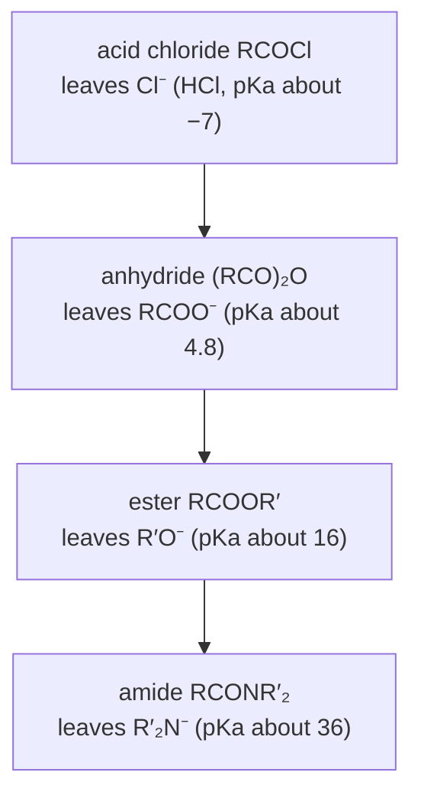

# 16.3 · Carboxylic acids and their derivatives

Carboxylic acids, esters, amides, acid chlorides, anhydrides and nitriles all sit on the same rung of the oxidation ladder. They interconvert without any oxidant or reductant, by one mechanism: a nucleophile adds to the carbonyl carbon, and a leaving group departs. This lesson explains why acids are acidic, why some derivatives react in seconds and others survive for years, and how to push an equilibrium such as esterification to a useful yield. It ends with aspirin, the most famous acylation in teaching labs.

## Why it matters

Open an old bottle of aspirin tablets and you may smell vinegar. Aspirin, acetylsalicylic acid, is an ester. Moisture slowly hydrolyses it back to salicylic acid and acetic acid. That is why aspirin is packed dry and why pharmacopoeias set a limit on free salicylic acid. Meanwhile the amide bonds in your proteins, the same functional group family, survive in water for years. The difference between those lifetimes comes from one number: how good the leaving group is.

## Core ideas

> [!NOTE]
> Acidity, the addition–elimination mechanism and the reactivity ladder are settled theory. The $\mathrm{p}K_a$ values come from OpenStax 20.4 and PubChem (aspirin 3.49 at 25 °C), checked 2026-10-17. The esterification constant $K \approx 4$ is the classic textbook value for acetic acid with ethanol; measured values range from about 2 to 4 depending on conditions and whether activities are used.

### Why carboxylic acids are acidic

A carboxylic acid, RCOOH, has $\mathrm{p}K_a$ around 4–5, about $10^{11}$ times more acidic than an alcohol. Removing the proton gives a **carboxylate**, whose negative charge is shared equally by two oxygens (two equivalent resonance forms, so both C–O bonds have the same length). Substituents move the $\mathrm{p}K_a$ by induction and resonance, as in lesson [15.4](../module-15/lesson-04.md):

| Acid | $\mathrm{p}K_a$ | Why |
|---|---|---|
| trifluoroacetic acid | −0.23 | three F pull electron density, stabilise the anion |
| 4-nitrobenzoic acid | 3.41 | NO₂ withdraws by induction and resonance |
| benzoic acid | 4.19 | reference |
| 4-methoxybenzoic acid | 4.46 | OCH₃ donates by resonance, destabilises the anion |
| acetic acid | 4.76 | the alkyl group donates weakly |

With Henderson–Hasselbalch (lesson [08.4](../module-08/lesson-04.md)), $[\mathrm{A^-}]/[\mathrm{HA}] = 10^{\,\mathrm{pH}-\mathrm{p}K_a}$. At blood pH 7.4, any ordinary carboxylic acid is more than 99 % ionised; in the stomach at pH 1.5, aspirin is about 99 % neutral. Neutral molecules cross membranes more easily, which matters for how drugs are absorbed.

### Nucleophilic acyl substitution: add, then eliminate

An aldehyde or ketone (lesson [16.2](lesson-02.md)) adds a nucleophile and stops, because H⁻ and R⁻ are terrible leaving groups. An acid derivative, RC(=O)Y, has a group Y that can leave. The nucleophile adds to give a **tetrahedral intermediate**; the C=O then reforms and pushes out Y⁻:

$$\mathrm{RC(=O)Y + Nu^- \;\rightarrow\; [RC(O^-)(Y)(Nu)] \;\rightarrow\; RC(=O)Nu + Y^-}$$

The net result looks like an SN2 at the carbonyl carbon, but it is two steps, and the intermediate is real.

### The reactivity ladder

The better the leaving group, the faster the reaction. A good leaving group is a weak base, so rank by the $\mathrm{p}K_a$ of its conjugate acid H–Y:



Two extra effects push in the same direction. The lone pair on N in an amide (or O in an ester) donates into the C=O by resonance, which makes the carbonyl less electrophilic; in amides this resonance is strong enough to make the C–N bond partly double and the amide group planar (the peptide bond of lesson [06.2](../module-06/lesson-02.md)). Chlorine donates almost nothing.

The practical rule: **you can always go down the ladder directly**. An acid chloride with an alcohol gives an ester; with an amine, an amide. Going up the ladder (amide to acid chloride) needs a detour through the acid.

### Reactions of the acid itself

- **SOCl₂** turns RCOOH into the acid chloride RCOCl (SO₂ and HCl leave as gases). This is the usual way to the top of the ladder.
- **Fischer esterification**: RCOOH + R′OH with an acid catalyst ⇌ RCOOR′ + H₂O. Every step is reversible, and $K$ is only about 4. You raise the yield by using the alcohol in excess or removing water (Le Chatelier, lesson [08.3](../module-08/lesson-03.md)).
- **LiAlH₄** reduces RCOOH to RCH₂OH. NaBH₄ does not.

### Esters, amides and nitriles

- **Saponification**: an ester with NaOH in water gives the carboxylate and the alcohol. It is effectively irreversible, because the carboxylate (negatively charged) does not accept an alkoxide. Fats saponified this way give soap.
- **LiAlH₄** reduces an ester to two alcohols: RCOOR′ → RCH₂OH + R′OH. DIBAL-H at −78 °C stops at the aldehyde.
- **Grignard reagents** add twice to an ester (addition, loss of R′O⁻ to give a ketone, which is more reactive and adds again): a tertiary alcohol with two identical groups.
- **Amides** hydrolyse only with strong acid or base and heat; LiAlH₄ reduces them to amines (C=O becomes CH₂).
- **Nitriles**, RC≡N, are at the same level as acids: hot aqueous acid or base hydrolyses them to RCOOH, and LiAlH₄ reduces them to RCH₂NH₂.

## Worked example

### 1. Fischer esterification yield

Acetic acid (1.00 mol) and ethanol (1.00 mol) with a few drops of H₂SO₄ reach equilibrium with $K = 4.0$. Let $x$ mol of ester form:

$$K = \frac{x \cdot x}{(1-x)(1-x)} = 4.0 \;\Rightarrow\; \frac{x}{1-x} = 2.0 \;\Rightarrow\; x = 0.667\ \text{mol}$$

The yield is 66.7 %. With 3.00 mol of ethanol, $4.0(1-x)(3-x) = x^2$ gives $3x^2 - 16x + 12 = 0$, so $x = (16 - \sqrt{112})/6 = 0.903$: 90.3 % based on the acid. If instead the mixture starts wet, with 5.0 mol of water already present and 1 : 1 acid and alcohol, the yield falls to 33.3 %. That is why the reagents are dried, and why a Dean–Stark trap (which removes water as it forms) is the standard apparatus. The lab script solves the general case.

### 2. Aspirin: why acetic anhydride?

Salicylic acid (2-hydroxybenzoic acid) has a phenol OH. Acetylating it gives aspirin. Three acetyl sources are possible:

- **Acetic acid**: a Fischer-type equilibrium with a phenol, which is a poorer nucleophile than an alcohol. The yield would be poor.
- **Acetyl chloride**: very fast, but it releases HCl gas and reacts violently with any water.
- **Acetic anhydride**: one step down the ladder from the chloride. It reacts cleanly with a little acid catalyst, and the by-product is acetic acid. This is the classic teaching-lab choice.

Mechanism: the phenol oxygen adds to one C=O of the anhydride; the tetrahedral intermediate expels acetate; a proton is lost. Theoretical yield from 2.00 g of salicylic acid ($M$ = 138.12 g/mol):

$$n = \frac{2.00}{138.12} = 0.01448\ \text{mol} \;\Rightarrow\; m_\text{aspirin} = 0.01448 \times 180.16 = 2.61\ \text{g}$$

The same ladder predicts the vinegar smell in the old bottle: water attacks the ester, the tetrahedral intermediate expels the phenoxide (a decent leaving group, $\mathrm{p}K_a$ of phenol about 10), and acetic acid is released.

## Hands-on

What you need: the [Module 16 lab folder](../../labs/module-16/) with Python 3.14 and RDKit 2026.9.1, paper and pencil, and a [notebook page](../../templates/notebook-page.md). Time: about 60 minutes. Paper and screen only; aspirin synthesis is done in Module 24 on the virtual bench, not at home.

### Part A — Python: ionisation and esterification yield (25 min)

Open `lesson03_acyl.py` and write the two TODO functions:

- `percent_ionised(pka, ph)`: Henderson–Hasselbalch as a percentage.
- `ester_yield(k, acid0, alcohol0, water0)`: rearrange $K = x(w_0 + x)/[(a_0 - x)(b_0 - x)]$ into a quadratic and keep the root between 0 and the limiting amount.

```bash
py lesson03_acyl.py
```

How you know it worked: aspirin is about 1 % ionised at pH 1.5, 76 % at pH 4.0 and over 99.9 % at pH 7.4. The esterification table shows 66.7 % (1 : 1), 84.5 % (1 : 2), 90.3 % (1 : 3) and 97.4 % (1 : 10), and 33.3 % when 5 mol of water is present at the start. The ladder printout puts acetyl chloride first and the amide last.

<details><summary>Reference solution for Part A</summary>

`percent_ionised`: `ratio = 10 ** (ph - pka)`, `return 100 * ratio / (1 + ratio)`. `ester_yield`: `a = k - 1`, `b = -(k * (acid0 + alcohol0) + water0)`, `c = k * acid0 * alcohol0`; if `a` is zero, `x = -c / b`; otherwise take the root of the quadratic that lies between 0 and `min(acid0, alcohol0)`, and return `x / min(acid0, alcohol0)`. Full code in `lesson03_acyl_solution.py`.

Diminishing returns: going from 3 to 10 equivalents of ethanol gains only 7 percentage points. Removing water is usually the better lever.

</details>

### Part B — product drill (20 min)

Type the SMILES of each main organic product into `ANSWERS` in `lesson03_acyl.py`:

a. Benzoic acid with SOCl₂.
b. Acetyl chloride with two equivalents of dimethylamine.
c. Salicylic acid with acetic anhydride and a drop of acid.
d. Ethyl benzoate with hot aqueous NaOH, then HCl.
e. Ethyl acetate with LiAlH₄, then water: the alcohol that comes from the acyl part.

<details><summary>Worked answers to Part B</summary>

a. Benzoyl chloride, `O=C(Cl)c1ccccc1`. Up the ladder through SOCl₂.
b. N,N-dimethylacetamide, `CC(=O)N(C)C`. Two equivalents because the second amine molecule takes the HCl as dimethylammonium chloride.
c. Aspirin, `CC(=O)Oc1ccccc1C(=O)O`. The phenol OH is acetylated; the COOH stays.
d. Benzoic acid, `O=C(O)c1ccccc1` (plus ethanol). Saponification gives sodium benzoate; HCl protonates it.
e. Ethanol, `CCO`. The acyl carbon is reduced to CH₂OH; the ethoxy part also becomes ethanol, so ethyl acetate gives two molecules of ethanol.

</details>

### Part C — pencil: two mechanisms (15 min)

1. Draw every curved arrow for the saponification of ethyl acetate with hydroxide, and explain in one sentence why it does not run backwards.
2. Methyl benzoate is treated with excess CH₃MgBr, then dilute acid. Draw the intermediate ketone and the final product.

<details><summary>Worked answers to Part C</summary>

1. HO⁻ adds to the C=O carbon (arrow from O lone pair to C, π bond to O); the tetrahedral alkoxide reforms C=O and expels EtO⁻; EtO⁻ takes the acid proton from acetic acid, giving acetate and ethanol. The last step is a proton transfer with $\Delta\mathrm{p}K_a \approx 11$ (16 − 4.8), so $K \approx 10^{11}$ for that step: acetate cannot be attacked by ethoxide, and the reaction is one-way.
2. First addition and loss of methoxide give acetophenone, $\mathrm{C_6H_5COCH_3}$. A ketone is more reactive than an ester, so a second CH₃MgBr adds at once. After work-up: 2-phenyl-2-propanol, $\mathrm{C_6H_5C(CH_3)_2OH}$. You cannot stop at the ketone with a Grignard reagent.

</details>

## Common mistakes

- **Expecting a ketone to substitute like an ester.** Only derivatives with a leaving group (Cl, OCOR, OR, NR₂) do addition–elimination.
- **Going up the ladder directly.** An ester plus chloride ion does not give an acid chloride. Go through the acid and SOCl₂.
- **Forgetting the second equivalent of amine.** Acylating an amine with an acid chloride releases HCl, which protonates half the amine unless another base is added.
- **Using one equivalent of Grignard reagent on an ester to make a ketone.** The ketone reacts faster than the ester; you get the tertiary alcohol and unreacted ester.
- **Treating Fischer esterification as complete.** $K \approx 4$: without excess alcohol or water removal, a third of the acid is left.
- **Confusing acidity with reactivity.** Trifluoroacetic acid is a strong acid, but that says nothing about how fast its ester hydrolyses in neutral water; the ladder is about the leaving group in the derivative.

## Key takeaways

- Carboxylic acids have $\mathrm{p}K_a$ 4–5 because the carboxylate charge is shared by two oxygens; electron-withdrawing groups lower the $\mathrm{p}K_a$.
- All acid derivatives react by addition–elimination through a tetrahedral intermediate.
- Reactivity: acid chloride > anhydride > ester > amide, matching leaving-group basicity; you can go down the ladder in one step.
- Fischer esterification has $K \approx 4$: use excess alcohol or remove water. Saponification is irreversible.
- LiAlH₄ reduces acids and esters to alcohols, amides and nitriles to amines; Grignard reagents add twice to esters.

## Sources

- [OpenStax Organic Chemistry, 20.2 Structure and Properties of Carboxylic Acids](https://openstax.org/books/organic-chemistry/pages/20-2-structure-and-properties-of-carboxylic-acids) — resonance in carboxylates, acidity.
- [OpenStax Organic Chemistry, 20.4 Substituent Effects on Acidity](https://openstax.org/books/organic-chemistry/pages/20-4-substituent-effects-on-acidity) — $\mathrm{p}K_a$ of acetic, trifluoroacetic and substituted benzoic acids.
- [OpenStax Organic Chemistry, 21.2 Nucleophilic Acyl Substitution](https://openstax.org/books/organic-chemistry/pages/21-2-nucleophilic-acyl-substitution-reactions) — mechanism and relative reactivity.
- [OpenStax Organic Chemistry, 21.3 Reactions of Carboxylic Acids](https://openstax.org/books/organic-chemistry/pages/21-3-reactions-of-carboxylic-acids) — SOCl₂, Fischer esterification, reduction.
- [OpenStax Organic Chemistry, 21.6 Chemistry of Esters](https://openstax.org/books/organic-chemistry/pages/21-6-chemistry-of-esters) and [21.7 Chemistry of Amides](https://openstax.org/books/organic-chemistry/pages/21-7-chemistry-of-amides) — saponification, reductions, Grignard additions, amide hydrolysis.
- [PubChem: Aspirin](https://pubchem.ncbi.nlm.nih.gov/compound/2244) — $\mathrm{p}K_a$ 3.49 at 25 °C, molar mass, structure.
- [Truman State University: Equilibrium constant of an esterification reaction](https://chemlab.truman.edu/physical-chemistry/kinetics/k-of-esterification/) — a teaching experiment measuring $K$ for this equilibrium.
