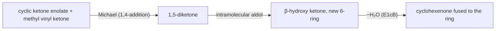

# 16.4 · Enolates and the aldol reaction

So far the carbonyl carbon has been the electrophile. This lesson turns the carbonyl compound into a nucleophile. A hydrogen on the carbon next to C=O, the α-carbon, is unusually acidic, and removing it gives an enolate, a carbanion that is stabilised by the carbonyl. Enolates attack alkyl halides, other carbonyls and conjugated alkenes. Together these reactions build most of the carbon skeletons in synthesis, in cells as well as in flasks.

## Why it matters

Your muscles run the aldol reaction backwards and forwards every day. Aldolase, an enzyme of glycolysis, splits fructose 1,6-bisphosphate into two three-carbon pieces by a retro-aldol reaction, and the reverse aldol builds glucose during gluconeogenesis (lesson [06.4](../module-06/lesson-04.md)). In the lab, the same C–C bond-forming step makes fragrance ketones from benzaldehyde and acetone and builds the steroid ring system by the Robinson annulation. The chemist's problem is control: mix two enolisable carbonyl compounds with base and you get four products. This lesson is about getting one.

## Core ideas

> [!NOTE]
> Enol and enolate chemistry is settled theory. The $\mathrm{p}K_a$ values are the approximate class values of OpenStax Table 22.1 (acetone 19.3, ethyl ester 25, 1,3-diketone 9, diisopropylamine 36), checked 2026-10-17. Reaction conditions (LDA at −78 °C, NaOEt in ethanol) are the standard textbook choices.

### Keto–enol tautomerism

A ketone with an α-hydrogen is in equilibrium with its **enol**, C=C–OH. The two are **tautomers**: isomers that differ by moving a proton and a double bond. Acid or base catalyses the change. For simple ketones the keto form dominates heavily (acetone contains far less than one enol molecule per million), because C=O is a stronger bond than C=C. When the enol is stabilised by conjugation and an internal hydrogen bond, as in 2,4-pentanedione, the enol becomes the major form.

The enol matters even when it is rare: it is the nucleophile in acid-catalysed α-halogenation and in the racemisation of a ketone with a stereocentre at the α-carbon.

### Acidity of α-hydrogens and the choice of base

Removing an α-H gives an **enolate**, with the negative charge shared between carbon and oxygen. The more electron-withdrawing groups on that carbon, the more acidic the H:

| Compound | Acidic H | approximate $\mathrm{p}K_a$ |
|---|---|---|
| 2,4-pentanedione (between two C=O) | CH₂ | 9 |
| ethyl acetoacetate | CH₂ | 11 |
| diethyl malonate | CH₂ | 13 |
| ethanol | O–H | 16 |
| acetaldehyde | CH₃ | 17 |
| acetone | CH₃ | 19 |
| ethyl acetate | CH₃ | 25 |
| diisopropylamine | N–H | 36 |

The base's conjugate acid decides the position of the equilibrium, as in lesson [15.4](../module-15/lesson-04.md): $K = 10^{\,\mathrm{p}K_a(\text{base-H}) - \mathrm{p}K_a(\text{C–H})}$.

- **NaOH or NaOEt** with acetone: $K = 10^{16-19.3} \approx 5\times10^{-4}$. Only a trace of enolate forms, in the presence of lots of ketone. Good for aldol reactions, which need both.
- **LDA** (lithium diisopropylamide) with acetone: $K \approx 10^{17}$. Complete, irreversible enolate formation. Good for alkylation, where leftover ketone would cause side reactions.
- **NaOEt** with a 1,3-dicarbonyl ($\mathrm{p}K_a$ 9–13): complete, because these are more acidic than ethanol.

### Kinetic and thermodynamic enolates

2-Methylcyclohexanone has α-H on both sides. LDA at −78 °C removes the more accessible proton fastest, on the CH₂ side: the **kinetic enolate**, the less substituted one. With a weaker base at room temperature, where protons can shuttle back and forth, the more substituted, more stable **thermodynamic enolate** dominates. Choosing the conditions chooses the carbon that reacts.

### Alkylation: enolate + alkyl halide

An enolate attacks a methyl or primary alkyl halide by SN2 (lesson [15.5](../module-15/lesson-05.md)). Secondary and tertiary halides eliminate instead. Two classic routes use stabilised enolates, which form completely with NaOEt:

- **Malonic ester synthesis**: diethyl malonate → alkylate → hydrolyse both esters → heat. The resulting 1,3-diacid loses CO₂ through a cyclic six-atom transition state. Net result: R–X becomes **R–CH₂–COOH**.
- **Acetoacetic ester synthesis**: ethyl acetoacetate → alkylate → hydrolyse and decarboxylate. Net result: R–X becomes **R–CH₂–CO–CH₃**, a methyl ketone.

### The aldol reaction

An enolate adds to the C=O of a second molecule (lesson [16.2](lesson-02.md)'s nucleophilic addition, with a carbon nucleophile). Two acetaldehyde molecules give 3-hydroxybutanal, a **β-hydroxy carbonyl** ("aldol" = aldehyde + alcohol). With heat, the product loses water by E1cB (enolate first, then loss of hydroxide) to give an **α,β-unsaturated carbonyl**, conjugated and therefore stable: the **aldol condensation**.

Aldehydes work well as acceptors. Ketone acceptors are poor: the acetone self-aldol equilibrium lies on the side of acetone, for the same steric reason that acetone barely forms a hydrate.

### Crossed aldols: the mixture problem and two fixes

Mix two different enolisable aldehydes with NaOH and each can be donor or acceptor: four products. Two strategies give one:

1. **One partner cannot form an enolate** and is a good acceptor: benzaldehyde, formaldehyde, or 2,2-dimethylpropanal have no α-H. Benzaldehyde + acetone with NaOH gives (E)-4-phenylbut-3-en-2-one (benzalacetone): the **Claisen–Schmidt** reaction.
2. **Form one enolate completely first** with LDA at −78 °C, then add the other carbonyl compound.

### Claisen, Michael and Robinson

- **Claisen condensation**: an ester enolate attacks a second ester; the tetrahedral intermediate expels alkoxide (lesson [16.3](lesson-03.md)), giving a β-keto ester. Two ethyl acetate molecules give ethyl acetoacetate. The equilibrium is unfavourable until the base removes the very acidic CH₂ of the product ($\mathrm{p}K_a$ 11), which pulls it through; acid work-up then gives the neutral β-keto ester.
- **Michael addition**: a stabilised enolate adds to the β-carbon of an α,β-unsaturated carbonyl (1,4- or **conjugate addition**), because that carbon carries partial positive charge through conjugation.
- **Robinson annulation**: a Michael addition followed by an intramolecular aldol condensation, building a new six-membered ring with a C=C–C=O. It is how the Wieland–Miescher ketone, a classic steroid building block, is made.



## Worked example

### 1. NaOEt or LDA for an alkylation?

You want to methylate cyclohexanone with CH₃I. With NaOEt ($\mathrm{p}K_a$ of ethanol 16, ketone about 19):

$$K = 10^{16 - 19} = 10^{-3}$$

At any moment about one ketone in a thousand is an enolate. The rest is ketone, which the enolate can attack (aldol), and ethoxide, which reacts with CH₃I itself (Williamson, lesson 16.1). You get a mixture. With LDA ($\mathrm{p}K_a$ 36), $K = 10^{17}$: all of the ketone becomes enolate before any CH₃I is added, and there is no free ketone left to attack. One equivalent of LDA at −78 °C, then CH₃I, gives 2-methylcyclohexanone cleanly.

### 2. Acetoacetic ester route to 2-heptanone

2-Heptanone, $\mathrm{CH_3CO(CH_2)_4CH_3}$, is a methyl ketone with a butyl group on the CH₂: it is "R–CH₂–CO–CH₃" with R = butyl. So:

1. Ethyl acetoacetate + NaOEt in ethanol: complete enolate ($\mathrm{p}K_a$ 11 < 16).
2. Add 1-bromobutane: SN2 at the primary carbon gives ethyl 2-acetylhexanoate.
3. Aqueous NaOH, then acid and heat: the ester hydrolyses to the β-keto acid, which loses CO₂.

Product: CH₃COCH₂CH₂CH₂CH₂CH₃, 2-heptanone. You will run exactly these three steps through the route checker in lesson 16.7 (`enolate_alkylation`, `ester_hydrolysis`, `decarboxylate`). A second alkylation before step 3 would put two groups on the central carbon.

## Hands-on

What you need: the [Module 16 lab folder](../../labs/module-16/) with Python 3.14 and RDKit 2026.9.1, paper and pencil, and a [notebook page](../../templates/notebook-page.md). Time: about 60 minutes. Paper and screen only.

### Part A — Python: who can be a donor, and how big is the mess? (25 min)

Open `lesson04_aldol.py` and write the two TODO functions:

- `alpha_hydrogens(mol)`: every sp³ carbon next to a C=O that has at least one H, with its H count (SMARTS `[CX4;!H0][CX3]=O`).
- `crossed_aldol_products(a, b)`: run the library's `aldol_addition` on the pairs (a, a), (a, b) and (b, b) and collect every product.

```bash
py lesson04_aldol.py
py lesson04_aldol.py "CC=O" "O=CC(C)(C)C"
```

How you know it worked: NaOEt gives $K \approx 5\times10^{-4}$ with acetone, LDA $5\times10^{16}$. Benzaldehyde and 2,2-dimethylpropanal show no enolisable positions; 2-methylcyclohexanone shows one CH (1 H) and one CH₂ (2 H). Acetaldehyde + propanal gives **4** aldol products; benzaldehyde + acetone gives **1**. Your own run with acetaldehyde and 2,2-dimethylpropanal gives 2: acetaldehyde's self-aldol and one crossed product, because the second aldehyde can only accept.

<details><summary>Reference solution for Part A</summary>

`alpha_hydrogens`: loop over `m.GetSubstructMatches(Chem.MolFromSmarts("[CX4;!H0][CX3]=O"))`, store `m.GetAtomWithIdx(c).GetTotalNumHs()` for each first atom `c`, return the sorted items. `crossed_aldol_products`: for each pair, `for products, *_ in run_reaction("aldol_addition", pair): found |= products`. Full code in `lesson04_aldol_solution.py`.

The library only uses aldehydes as acceptors, matching the rule that ketone acceptors are poor. It ignores stereochemistry: 3-hydroxy-2-methylpentanal, for example, has two stereocentres and forms as a mixture of diastereomers.

</details>

### Part B — product drill (20 min)

Type the SMILES of each product (after work-up) into `ANSWERS` in `lesson04_aldol.py`:

a. Acetone with LDA at −78 °C, then CH₃I.
b. Diethyl malonate with NaOEt, then 1-bromobutane; then aqueous acid and heat.
c. Benzaldehyde and acetone (1 : 1) with NaOH, heated.
d. Ethyl acetate with NaOEt, then dilute acid.
e. 2-Methylcyclohexanone with LDA at −78 °C, then CH₃I.

<details><summary>Worked answers to Part B</summary>

a. Butanone, `CCC(C)=O`. Complete enolate, SN2 on CH₃I.
b. Hexanoic acid, `CCCCCC(=O)O`. Malonic ester synthesis: butyl + CH₂COOH.
c. Benzalacetone, `CC(=O)/C=C/c1ccccc1` (the checker ignores E/Z; E is the product). Benzaldehyde cannot form an enolate; acetone's enolate adds to it, then water is lost by E1cB to give the conjugated enone.
d. Ethyl acetoacetate, `CCOC(=O)CC(C)=O`. Claisen condensation, driven by deprotonating the product.
e. 2,6-Dimethylcyclohexanone, `CC1CCCC(C)C1=O`. The kinetic enolate forms on the less substituted CH₂ side.

</details>

### Part C — pencil: a Robinson annulation (15 min)

2-Methylcyclohexane-1,3-dione reacts with methyl vinyl ketone (but-3-en-2-one) and a base. Draw (1) the Michael adduct and (2) the bicyclic enone after the intramolecular aldol condensation. Mark which carbon of methyl vinyl ketone the enolate attacks and why.

<details><summary>Worked answer to Part C</summary>

(1) The CH between the two C=O groups ($\mathrm{p}K_a$ about 11) is removed. The enolate attacks the terminal CH₂ of methyl vinyl ketone, the β-carbon, which is electron-poor through conjugation with the C=O (1,4-addition). Product: 2-methyl-2-(3-oxobutyl)cyclohexane-1,3-dione, a triketone.

(2) The CH₃ of the new side-chain ketone forms an enolate and attacks one ring C=O, closing a six-membered ring; loss of water gives the conjugated enone. Product: the Wieland–Miescher ketone, a decalin with an angular methyl group, a ketone and an enone. The ring size is set by counting: attack from the side-chain CH₃ onto a ring carbonyl makes a six-membered ring, which forms easily (lesson 15.2).

</details>

## Common mistakes

- **Using NaOH or NaOEt to alkylate a simple ketone.** Only a trace of enolate forms; the rest gives aldol and Williamson side products. Use LDA, or a 1,3-dicarbonyl that NaOEt deprotonates completely.
- **Alkylating with a secondary or tertiary halide.** Enolates are strong bases; these halides eliminate (lesson 15.6).
- **Mixing two enolisable aldehydes and expecting one crossed product.** Count donors and acceptors; four products is the default. Use a non-enolisable partner or a preformed LDA enolate.
- **Forgetting the decarboxylation step.** Malonic and acetoacetic syntheses end with hydrolysis and heat; the ester groups do not stay.
- **Attacking the carbonyl carbon of an enone in a Michael reaction.** Stabilised enolates add to the β-carbon (1,4); Grignard reagents and hydrides usually add to the C=O (1,2).

## Key takeaways

- α-Hydrogens are acidic ($\mathrm{p}K_a$ about 19 for ketones, 25 for esters, 9–13 between two C=O) because the enolate is resonance-stabilised.
- Compare $\mathrm{p}K_a$ values to choose the base: NaOEt gives a trace of a simple enolate, LDA gives all of it (kinetic, less substituted side at −78 °C).
- Enolate + primary halide is SN2 alkylation; malonic and acetoacetic esters turn R–X into RCH₂COOH or RCH₂COCH₃.
- Aldol addition gives β-hydroxy carbonyls; heat gives α,β-unsaturated carbonyls. Crossed aldols need a non-enolisable partner or a preformed enolate.
- Claisen condensation makes β-keto esters; Michael adds to the β-carbon; Robinson annulation = Michael + aldol, a new six-membered ring.

## Sources

- [OpenStax Organic Chemistry, 22.1 Keto–Enol Tautomerism](https://openstax.org/books/organic-chemistry/pages/22-1-keto-enol-tautomerism) — tautomer equilibria and catalysis.
- [OpenStax Organic Chemistry, 22.5 Acidity of Alpha Hydrogen Atoms](https://openstax.org/books/organic-chemistry/pages/22-5-acidity-of-alpha-hydrogen-atoms-enolate-ion-formation) — Table 22.1 $\mathrm{p}K_a$ values and LDA.
- [OpenStax Organic Chemistry, 22.7 Alkylation of Enolate Ions](https://openstax.org/books/organic-chemistry/pages/22-7-alkylation-of-enolate-ions) — malonic and acetoacetic ester syntheses.
- [OpenStax Organic Chemistry, 23.1 The Aldol Reaction](https://openstax.org/books/organic-chemistry/pages/23-1-carbonyl-condensations-the-aldol-reaction) and [23.5 Mixed Aldol Reactions](https://openstax.org/books/organic-chemistry/pages/23-5-mixed-aldol-reactions) — aldol additions, condensations and the mixture problem.
- [OpenStax Organic Chemistry, 23.7 The Claisen Condensation](https://openstax.org/books/organic-chemistry/pages/23-7-the-claisen-condensation-reaction) — mechanism and driving force.
- [OpenStax Organic Chemistry, 23.10 The Michael Reaction](https://openstax.org/books/organic-chemistry/pages/23-10-conjugate-carbonyl-additions-the-michael-reaction) and [23.12 The Robinson Annulation](https://openstax.org/books/organic-chemistry/pages/23-12-the-robinson-annulation-reaction) — conjugate addition and ring building.
