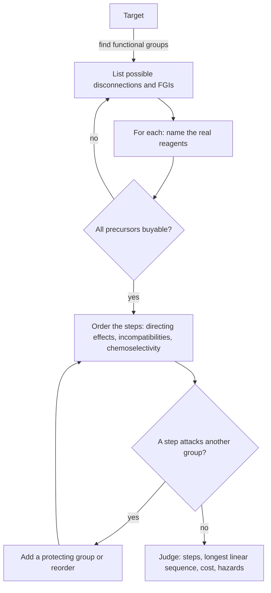

# 16.7 · Retrosynthesis and multi-step planning

Lessons 16.1 to 16.6 taught reactions forwards: given these reagents, what forms? A synthetic chemist usually faces the opposite question: here is the molecule I need, what do I make it from? This lesson teaches retrosynthesis, the method E. J. Corey formalised and was awarded the 1990 Nobel Prize for: work backwards one bond at a time until you reach compounds you can buy. Then it ends the module with its practical piece, two complete routes that you plan on paper and verify with a route checker built on everything in this module.

## Why it matters

A medicinal chemist needs 5 g of a new compound by Friday. The first route she sketches has nine steps in a straight line. If each step gives 80 %, the overall yield is $0.8^9 = 13$ %, and she must start with nearly 40 g of material. A second plan makes two halves in four steps each and joins them at the end: the longest sequence is five steps, $0.8^5 = 33$ %. Same reagents, more than twice the material. Route design is a decision about time, money, waste and safety, not only about correct arrows.

## Core ideas

> [!NOTE]
> Retrosynthetic analysis and the disconnection approach are stable teaching chemistry. The route checker in `labs/module-16/` is a small teaching model built with RDKit 2026.9.1 reaction SMARTS (checked 2026-10-17): it knows about 25 classic reactions, directing effects and a few incompatibilities, and nothing about real yields. Professional retrosynthesis software exists and changes quickly; this lesson does not depend on any of it.

### Thinking backwards

Retrosynthesis writes the target first and uses an open arrow, ⇒, meaning "can be made from". Each backwards step is one of three moves:

- A **disconnection**: imagine breaking one bond. You get two **synthons**, idealised fragments with a charge (for example R⁻ and ⁺CH(OH)R′). Then name a real **reagent** that behaves like each synthon (RMgBr for R⁻, an aldehyde R′CHO for ⁺CH(OH)R′).
- A **functional-group interconversion (FGI)**: change one group into another that is easier to disconnect or to make, for example amine ⇒ nitro compound, or alcohol ⇒ ketone.
- **Adding a group** that you will remove later, such as a protecting group or the ester of acetoacetic ester.

Good disconnections are next to a functional group, because that is where the reactions of this module make bonds.

### The disconnection table

Each reaction in this module, read backwards, is a disconnection:

| If the target contains | Disconnect to | Lesson |
|---|---|---|
| a secondary or tertiary alcohol | RMgBr + aldehyde or ketone (each C–C bond at the carbinol carbon) | 16.2 |
| R–CH₂CH₂OH | RMgBr + ethylene oxide | 16.1 |
| an ether R–O–CH₂R′ | alkoxide + primary halide | 16.1 |
| an ester or amide | acid chloride or anhydride + alcohol or amine | 16.3 |
| a β-hydroxy carbonyl | two carbonyl compounds (aldol) | 16.4 |
| an α,β-unsaturated carbonyl | aldol condensation, or Wittig at the C=C | 16.4, 16.2 |
| R–CH₂–COCH₃ or R–CH₂–COOH | acetoacetic or malonic ester + R–X | 16.4 |
| a 1,5-dicarbonyl | enolate + enone (Michael) | 16.4 |
| an aryl ketone | arene + acid chloride (Friedel–Crafts) | 16.5 |
| an aryl amine | FGI to the nitro compound, then nitration | 16.5, 16.6 |
| an alkyl amine | carbonyl compound + amine (reductive amination) | 16.6 |

### Order of events and chemoselectivity

Once you have the disconnections, decide their order. Three questions decide it:

1. **Directing effects** (lesson [16.5](lesson-05.md)): which substituent must be on an aromatic ring first so the next goes to the right place? Which group must be converted (CH₃ → COOH, NO₂ → NH₂) to switch its directing effect?
2. **Incompatible groups**: will a later reagent attack a group made earlier? A Grignard reagent cannot coexist with O–H, N–H or C=O in the same molecule (lesson [16.2](lesson-02.md)); Friedel–Crafts fails once a meta director is on the ring.
3. **Chemoselectivity**: can a reagent tell two groups apart? NaBH₄ reduces a ketone and leaves an ester, nitro group or C=C alone; H₂ over Pd reduces C=C but, under mild conditions, not a ketone or an aromatic ring; an amine is acylated faster than an alcohol or phenol. If no reagent can tell the groups apart, protect one (an acetal for a ketone, an acetamide for an aniline) and remove the protection later.

### Judging a route

- **Fewer steps.** Each step costs time and material.
- **Convergent beats linear.** Overall yield is set by the **longest linear sequence**. Making two halves in parallel and joining them shortens it.
- **Cheap, available starting materials.** In the lab exercises, "available" means listed in `starting_materials.csv`.
- **Safety and waste.** Prefer reagents with low hazards (Dess–Martin or TEMPO over Cr(VI)), and reactions that keep most atoms in the product.



## Worked example

### 1. Paracetamol from phenol

Paracetamol (acetaminophen), N-(4-hydroxyphenyl)acetamide, is a classic teaching-lab synthesis.

**Backwards.**

- The amide is the obvious disconnection: paracetamol ⇒ 4-aminophenol + an acetyl source (acetic anhydride).
- 4-Aminophenol is an aryl amine: FGI ⇒ 4-nitrophenol.
- 4-Nitrophenol ⇒ phenol by nitration. OH is a strong ortho/para director, so this works, with the ortho isomer as a by-product to separate.

**Forwards, with the checks.**

1. Phenol + dilute HNO₃ → 4-nitrophenol (plus 2-nitrophenol, removed). Phenol is so activated that dilute acid is enough; this is single nitration only.
2. 4-Nitrophenol + Fe/HCl (or H₂, Pd) → 4-aminophenol.
3. 4-Aminophenol + acetic anhydride → paracetamol. Chemoselectivity: the molecule has two nucleophiles, NH₂ and OH. The amine is the stronger nucleophile, so with about one equivalent of anhydride the N is acetylated and the phenol OH is left. A second equivalent and a catalyst would acetylate the O as well.

The file `routes/route_EX.txt` contains exactly these three lines, and the checker passes it.

### 2. Linear versus convergent

A target is made in six steps in a line, each 80 %: overall $0.8^6 = 26$ %. Redesign it as two three-step branches joined in a seventh step. The longest linear sequence is now four steps (three on one branch, plus the join): $0.8^4 = 41$ %, although the total number of steps went up from six to seven.

## Hands-on

What you need: the [Module 16 lab folder](../../labs/module-16/) with Python 3.14 and RDKit 2026.9.1, the [lab report template](../../templates/lab-report.md), paper, pencil and a text editor. Time: about 2 hours. This is the module's practical piece: it uses every lesson from 16.1 to 16.6. Everything is on paper and on screen; no reagent in this lesson is handled at home.

Start by listing what the checker knows:

```bash
py lesson07_practical.py --list
```

Each route file in `labs/module-16/routes/` takes one step per line: `step; reaction; reactants joined by "."; product`, all as SMILES. Every reactant must be in `starting_materials.csv` or made earlier in the same file. Run the checker on all route files at once with `py lesson07_practical.py`, or on one file at a time.

### Part A — three warm-up routes (30 min)

Write `routes/route_W1.txt`, `route_W2.txt` and `route_W3.txt`:

- **W1**: 2-heptanone by the acetoacetic ester synthesis (the plan in lesson [16.4](lesson-04.md), worked example 2).
- **W2**: 2-phenylethyl acetate, a honey- and rose-scented ester, from bromobenzene. Two steps.
- **W3**: 4-bromobenzoic acid from toluene. Two steps; the order matters.

How you know it worked: each file ends with "route passes". If a step fails, read the message: it names the reaction's reagents, a wrong position with the director responsible, or a missing starting material.

<details><summary>Worked answers to Part A</summary>

W1: `enolate_alkylation` (ethyl acetoacetate + 1-bromobutane → ethyl 2-acetylhexanoate), `ester_hydrolysis`, `decarboxylate` → `CCCCCC(C)=O`.

W2: disconnect the ester (O–acyl bond) ⇒ 2-phenylethanol + acetic anhydride; 2-phenylethanol is R–CH₂CH₂OH ⇒ PhMgBr + ethylene oxide. Forwards: `grignard` (`Brc1ccccc1.C1CO1` → `OCCc1ccccc1`), then `acylation` with `CC(=O)OC(C)=O` → `CC(=O)OCCc1ccccc1`.

W3: brominate first (CH₃ directs para; separate from the ortho isomer), then oxidise CH₃ to COOH with KMnO₄: `bromination_arene` → `Cc1ccc(Br)cc1`, `oxidise_strong` → `OC(=O)c1ccc(Br)cc1`. Oxidising first would give benzoic acid, a meta director, and 3-bromobenzoic acid; the checker reports "wrong position" if you try to claim the para product.

All reference routes, with two deliberately wrong ones, are in `lesson07_practical_solution.py`.

</details>

### Part B — module practical: the final multi-step plan (75 min)

Two targets, each from catalogue compounds only:

- **P1**: 1-(3-nitrophenyl)ethan-1-ol, `CC(O)c1cccc([N+](=O)[O-])c1`, from benzene.
- **P2**: 2-methyl-4-phenylbutan-2-ol, `CC(C)(O)CCc1ccccc1`, a floral fragrance alcohol, from any catalogue compounds.

For each target:

1. **Retrosynthesis tree on paper.** Draw the target, list at least two disconnections or FGIs at the first level, name the synthons and the real reagents, and continue each branch until you reach catalogue compounds. Use the disconnection table above.
2. **Choose a route** and justify the order of steps in three or four sentences: which directing effect, which incompatibility, which chemoselectivity decides it?
3. **Write the route file** (`routes/route_P1.txt`, `routes/route_P2.txt`) and run the checker until it passes.
4. **Break it on purpose.** Swap two steps or change one reagent, run the checker, and record its message. Explain in one sentence why the chemistry fails.
5. **Score the route**: number of steps, longest linear sequence, the overall yield at 80 % per step (the script prints it), and one hazard you would plan for at the bench (use the reagent column of `--list`).

Write it up on the [lab report template](../../templates/lab-report.md): aim, retrosynthesis trees, routes with reagents, checker output, the failure analysis, scores, and a one-paragraph conclusion on which route you would run and why. The checker does not know yields, purification or conditions; Module 24's virtual bench covers procedure.

How you know it worked: both route files pass; each tree has at least two first-level options; the justification names the specific effect behind each ordering decision.

<details><summary>Worked answers to Part B</summary>

**P1.** Retrosynthesis: the secondary alcohol ⇒ (FGI, reduction) 3-nitroacetophenone. Two first-level options at the alcohol: a Grignard disconnection (CH₃MgBr + 3-nitrobenzaldehyde) fails, because a Grignard reagent attacks nitro groups (the checker says so if you try it); the FGI to the ketone works. 3-Nitroacetophenone ⇒ acetophenone (nitration; the acetyl group directs meta) ⇒ benzene + acetyl chloride (Friedel–Crafts).

Route: `fc_acylation` → acetophenone; `nitration` → 3-nitroacetophenone; `reduce_nabh4` → target. Order: acylation must come first because Friedel–Crafts fails on nitrobenzene. Nitration must come before the reduction, because the C=O is the meta director; after reduction, CH(OH)CH₃ would direct ortho/para. NaBH₄ is chosen because it reduces the ketone and leaves the nitro group (H₂/Pd would reduce both). Three steps, 51 % at 80 % per step. Hazards: AlCl₃ and acetyl chloride react violently with water and release HCl; nitrating acid is corrosive and oxidising.

**P2.** Retrosynthesis: tertiary alcohol with two CH₃ groups. Disconnection a: CH₃MgBr + 4-phenylbutan-2-one (benzylacetone). Disconnection b: 2-phenylethylmagnesium bromide + acetone. Branch a: benzylacetone ⇒ (FGI, C=C reduction) benzalacetone ⇒ benzaldehyde + acetone (Claisen–Schmidt, lesson 16.4). Branch b: 2-phenylethyl bromide ⇒ 2-phenylethanol (PBr₃) ⇒ PhMgBr + ethylene oxide.

Route a: `aldol_condensation` (benzaldehyde + acetone) → benzalacetone; `hydrogenate_alkene` (H₂, Pd/C) → benzylacetone; `grignard` (CH₃Br + benzylacetone) → target. Three steps, 51 %. Benzaldehyde has no α-H, so the crossed aldol gives one product; H₂/Pd under mild conditions reduces the C=C and leaves the ketone and the ring; the Grignard comes last because the ketone it needs is made in step 2. Route b also passes in three steps (`grignard`, `pbr3`, `grignard`) and uses two Grignard reactions, which need strictly dry conditions; route a uses cheaper, more tolerant steps. Hazards: H₂ gas with a pyrophoric catalyst (Pd/C can ignite solvent vapour when dry); bromomethane is toxic, and in practice CH₃MgBr is bought as a solution.

Typical "break it" results: nitration before Friedel–Crafts gives "FAIL: Friedel-Crafts does not work on a ring with a meta-directing (deactivating) group"; reduction before nitration gives "wrong position".

</details>

## Common mistakes

- **Disconnecting a bond no reaction can make.** Every disconnection must correspond to a real reaction; check it against the table before you continue the branch.
- **Forgetting synthon polarity.** The fragment that becomes the nucleophile (R⁻) and the one that becomes the electrophile (C=O) are fixed by the reagent; you cannot make R⁺ from a Grignard.
- **Choosing the right reactions in the wrong order.** Draw the intermediate after every step and ask how the next reagent sees the groups already present.
- **Ignoring a second reactive group.** A Grignard step with a nitro, ester or OH group elsewhere in the molecule fails; protect or reorder.
- **Counting total steps instead of the longest linear sequence.** Overall yield depends on the longest chain of steps from a starting material to the target.

## Key takeaways

- Retrosynthesis works backwards: disconnect a bond next to a functional group, name the synthons, then the real reagents; repeat until the precursors are buyable.
- FGIs and protecting groups make disconnections possible; every reaction in this module, read backwards, is a disconnection.
- Order of steps is decided by directing effects, incompatible groups and chemoselectivity.
- Judge routes by the longest linear sequence, starting-material cost and hazards; convergent routes give more material.
- The module practical: two routes, each justified, verified and deliberately broken once, written up as a report.

## Sources

- [OpenStax Organic Chemistry, 9.9 An Introduction to Organic Synthesis](https://openstax.org/books/organic-chemistry/pages/9-9-an-introduction-to-organic-synthesis) — working backwards from a target.
- [OpenStax Organic Chemistry, 16.10 Synthesis of Polysubstituted Benzenes](https://openstax.org/books/organic-chemistry/pages/16-10-synthesis-of-polysubstituted-benzenes) — order of events on aromatic rings.
- [The Nobel Prize in Chemistry 1990](https://www.nobelprize.org/prizes/chemistry/1990/summary/) and [E. J. Corey's Nobel lecture](https://www.nobelprize.org/prizes/chemistry/1990/corey/lecture/) — the origin of retrosynthetic analysis.
- [MIT OpenCourseWare 5.13 Organic Chemistry II](https://ocw.mit.edu/courses/5-13-organic-chemistry-ii-fall-2006/) — synthesis problems at this level.
- [RDKit rdChemReactions](https://www.rdkit.org/docs/source/rdkit.Chem.rdChemReactions.html) — the reaction SMARTS machinery behind the route checker.
