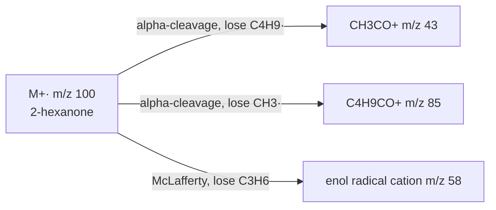

# 17.1 · Mass spectrometry: molecular ion and fragments

A mass spectrometer weighs molecules. It turns them into ions, sorts the ions by mass, and counts them. From one spectrum you can often read the molecular mass, the number of carbons, whether chlorine, bromine or nitrogen is present, and which pieces the molecule breaks into. This lesson teaches you to read electron-ionisation spectra from the NIST Chemistry WebBook, and to use Python to compute exact masses and isotope patterns. It is the first of four tools you will combine in [17.5](lesson-05.md) to identify unknown compounds.

## Why it matters

A bottle in a teaching lab has lost its label. The liquid smells sweet and fruity. Two candidates are on the shelf list: 2-hexanone and 3-hexanone. Both are C₆H₁₂O and both weigh 100 u, so the molecular mass alone cannot decide. But the two ketones break in different places. 2-hexanone gives a large peak at m/z 58 and only a small one at 71; 3-hexanone gives large peaks at 57 and 71 and only a small 58. One mass spectrum, taken in a few minutes on a GC-MS (gas chromatograph coupled to a mass spectrometer, Module 25), settles the question. Every analytical lab, from drug testing to food fraud, uses this logic every day.

## Core ideas

> [!NOTE]
> The physics of ionisation and the fragmentation rules are stable ideas. Isotope masses and abundances are the NIST values (Atomic Weights and Isotopic Compositions), checked 2026-10-17. Spectra are from the NIST Chemistry WebBook (SRD 69), checked 2026-10-17; the site layout may change.

### How an EI spectrum is made

In **electron ionisation** (EI), the sample is a gas at low pressure. A beam of electrons with 70 eV of energy knocks one electron out of a molecule M. That gives the **molecular ion**, M⁺·: a cation (one electron short) and a radical (one unpaired electron). 70 eV is far more than the 10 eV or so needed to ionise an organic molecule, so many molecular ions carry extra energy and break into a cation and a neutral piece. Only ions are detected. The analyser sorts them by **m/z**, mass divided by charge; almost all EI ions have z = 1, so m/z is simply the ion mass in u.

The spectrum is a bar chart: m/z on the x-axis, relative abundance on the y-axis. The tallest bar is the **base peak** and is set to 100 %. The base peak is often a fragment, not the molecular ion.

### Finding the molecular ion

The molecular ion is the highest m/z cluster that is not just an isotope peak. Check it in three ways:

1. **Losses must make sense.** The next peaks down should be at M − 15 (CH₃), M − 18 (H₂O), M − 29 (C₂H₅ or CHO) and so on. A gap of 3 to 14 u below a "molecular ion" means it is not one, because no stable neutral piece weighs 3 to 14.
2. **Nitrogen rule.** A molecule with an odd number of nitrogen atoms has an odd nominal mass; zero or an even number of N gives an even mass. Diethylamine, C₄H₁₁N, weighs 73. The rule works because N is the only common element with an even mass and an odd valence.
3. **Degrees of unsaturation.** Once you have a formula, count rings plus π bonds:

$$\text{DBE} = \frac{2C + 2 + N - H - X}{2}$$

where X counts halogens and O and S are ignored. C₆H₁₂O gives $(12 + 2 - 12)/2 = 1$: one ring or one double bond, for example a C=O. A half-integer DBE means the formula is wrong (or it is an ion, not a molecule).

Alcohols, amines and branched alkanes often show a weak or missing M⁺·, because they break so easily. 1-Butanol (M = 74) shows almost nothing at 74; its spectrum is dominated by M − 18 at 56 and by CH₂OH⁺ at 31.

### Isotope peaks: counting carbons and spotting halogens

Natural carbon is 98.93 % ¹²C and 1.07 % ¹³C (NIST). A molecule with n carbons has about $n \times 1.1\,\%$ chance of carrying one ¹³C, so the **M+1** peak is about $1.1n$ % of M. For butylbenzene, C₁₀H₁₄, M+1 is 11 % of M: ten carbons.

Two halogens change the picture completely:

| Element | Isotopes (abundance) | What you see |
|---|---|---|
| Cl | ³⁵Cl 75.76 %, ³⁷Cl 24.24 % | M and M+2 in about 3 : 1 |
| Br | ⁷⁹Br 50.69 %, ⁸¹Br 49.31 % | M and M+2 in about 1 : 1 |
| two Br | | M, M+2, M+4 in about 1 : 2 : 1 |
| S | ³⁴S 4.25 % | M+2 about 4 % per S |

A pair of peaks 2 u apart in a 1 : 1 ratio is the fingerprint of one bromine atom. These patterns are binomial: each atom picks its isotope independently, which is what the Python lab computes.

### High resolution: the exact mass gives the formula

Nominal masses hide a lot. C₆H₁₂O, C₅H₈O₂, C₇H₁₆ and C₅H₁₂N₂ all weigh 100. Exact masses differ, because only ¹²C is exactly 12 u: ¹H is 1.00783 u, ¹⁶O is 15.99491 u, ¹⁴N is 14.00307 u. A **high-resolution mass spectrometer** (HRMS) measures m/z to four or five decimals:

| Formula | Exact mass / u |
|---|---|
| C₆H₁₂O | 100.08882 |
| C₅H₈O₂ | 100.05243 |
| C₇H₁₆ | 100.12520 |
| C₅H₁₂N₂ | 100.10005 |

Errors are quoted in parts per million: $\text{ppm} = (m_\text{measured} - m_\text{calc}) / m_\text{calc} \times 10^6$. Journals usually accept a formula within 5 ppm. At m/z 100, 5 ppm is 0.0005 u, close to the mass of an electron (0.00055 u), so for a radical cation subtract one electron mass before you compare.

### Why molecules break where they do

A fragment peak is tall when the cation it forms is stable. Five patterns cover most simple spectra:

- **Alpha-cleavage** next to a heteroatom. The bond next to the C bearing O or N breaks, and the lone pair stabilises the cation. Ketones give **acylium ions** R–C≡O⁺: m/z 43 for CH₃CO⁺, 57 for C₂H₅CO⁺, 105 for C₆H₅CO⁺. Amines give iminium ions: CH₂=NH₂⁺ at m/z 30, and diethylamine loses CH₃ to give its base peak at 58.
- **McLafferty rearrangement.** A carbonyl compound with a hydrogen on the third carbon from the C=O (the γ carbon) passes that H to the oxygen through a six-membered ring and splits off an alkene. The result is an even-mass radical cation: m/z 58 for methyl ketones, 60 for carboxylic acids, 74 for methyl esters.
- **Benzylic cleavage.** Alkylbenzenes break at the bond beside the ring and give m/z 91, C₇H₇⁺, which rearranges to the very stable aromatic tropylium ion. m/z 77 (C₆H₅⁺) and 65 follow.
- **Loss of a small stable molecule.** H₂O (18) from alcohols, HCl (36) from chloroalkanes, CO (28) from phenols, C₂H₄ (28) by rearrangement.
- **Alkyl cations.** Alkanes give clusters 14 u apart (29, 43, 57, 71), with more abundant branched cations.

Fragments must add up: if the molecular ion is 100 and a peak is at 85, the lost piece weighed 15 (CH₃).



## Worked example

### 1. The spectrum of 2-hexanone

The NIST WebBook EI spectrum of 2-hexanone shows (relative abundance in brackets): 43 (100), 58 (66), 57 (26), 100 (16), 85 (12).

1. Molecular ion: the highest cluster is at 100 (with a small 101). 100 is even, so zero or two N. 100 − 85 = 15, a methyl loss: sensible.
2. M+1: about 7 % of M (read from the plot) gives $7 / 1.1 \approx 6$ carbons. C₆H₁₂O fits: DBE = 1, the C=O.
3. Base peak 43: CH₃C≡O⁺ from alpha-cleavage on the butyl side. This says "methyl ketone".
4. 58: even mass, so a rearrangement ion. 2-hexanone has H on its γ carbon (C-5), so the McLafferty rearrangement loses propene (42) from 100.
5. 57: C₄H₉⁺, the butyl cation from the same alpha-cleavage, with the charge on the other side.

3-hexanone (CH₃CH₂COCH₂CH₂CH₃) cleaves on both sides of its C=O and gives strong acylium ions at 57 (C₂H₅CO⁺) and 71 (C₃H₇CO⁺). It also has a large 43, but there it is the propyl cation C₃H₇⁺, not CH₃CO⁺. So 43 alone does not separate the isomers; the strong 58 (2-hexanone) against the strong 71 (3-hexanone) does. Same nominal mass, different m/z, different ion: always ask which formula a peak stands for.

### 2. HRMS picks the formula

An unknown gives M⁺· at m/z 100.0883. The radical cation weighs one electron less than the molecule, so compare with neutral mass minus 0.00055 u:

- C₆H₁₂O: $100.08882 - 0.00055 = 100.08827$; error $= (100.0883 - 100.08827)/100.08827 \times 10^6 = +0.3$ ppm. Accepted.
- C₅H₁₂N₂: 100.09950 for the ion; error −112 ppm. Rejected.
- C₅H₈O₂: 100.05188; error +364 ppm. Rejected.

Only C₆H₁₂O survives, with DBE 1.

## Hands-on

What you need: a browser, Python with the course packages (Module 5 setup) and the [Module 17 lab folder](../../labs/module-17/). Record answers on a [spectrum assignment sheet](../../templates/spectrum-assignment.md) (sections 1 and 2). Time: about 60 minutes.

### Part A — Python: masses, DBE and isotope patterns (25 min)

1. Open `lesson01_ms.py`. Complete the three TODOs: `dbe`, the convolution step in `isotope_pattern`, and the ppm error in `candidate_formulas`.
2. Run it from the lab folder:

```bash
py lesson01_ms.py
```

3. Open `runs/lesson01_isotopes.png` and compare the four patterns.

How you know it worked: C₆H₁₂O has DBE 1.0 and exact mass 100.08882; C₁₀H₁₄ has DBE 4.0. C₄H₉Cl shows M+2 at about 32 % of M; C₃H₇Br at about 97 %; CH₂Br₂ shows 172 : 174 : 176 near 51 : 100 : 49. Only C₆H₁₂O fits m/z 100.0883 within 5 ppm.

<details><summary>Reference solution</summary>

`dbe` returns `(2*C + 2 + N - H - X) / 2`; the convolution line is `new[m + a] = new.get(m + a, 0.0) + p * ab`; the error is `(mz - m) / m * 1e6`. Full code: `lesson01_ms_solution.py`. Notice that the list of nominal-mass-100 formulas also includes C₄H₈N₂O and C₅H₁₂N₂: two nitrogens keep the mass even, as the nitrogen rule says.

</details>

### Part B — read four real spectra (35 min)

Open each NIST WebBook page. The link jumps to the EI mass spectrum. For each, find M⁺·, the base peak, and explain the base peak and one other fragment.

- [1-Bromopropane](https://webbook.nist.gov/cgi/cbook.cgi?ID=C106945&Mask=200#Mass-Spec)
- [Butylbenzene](https://webbook.nist.gov/cgi/cbook.cgi?ID=C104518&Mask=200#Mass-Spec)
- [Diethylamine](https://webbook.nist.gov/cgi/cbook.cgi?ID=C109897&Mask=200#Mass-Spec)
- [1-Chlorobutane](https://webbook.nist.gov/cgi/cbook.cgi?ID=C109693&Mask=200#Mass-Spec)

<details><summary>What you should find</summary>

- 1-Bromopropane: M⁺· at 122 and 124, about equal and small (about 9 %): one Br. Base peak 43, C₃H₇⁺, from loss of Br· (79 or 81). The C–Br bond is the weakest bond.
- Butylbenzene: M⁺· 134 (about 26 %). Base peak 91, C₇H₇⁺ (benzylic cleavage, loss of C₃H₇·, 43). Strong 92 (about 60 %): McLafferty-type rearrangement, loss of propene (42).
- Diethylamine: M⁺· 73, odd, so one N. Base peak 58: alpha-cleavage, loss of CH₃· (15), giving CH₃CH=NH⁺CH₂CH₃. 30 is CH₂=NH₂⁺.
- 1-Chlorobutane: M⁺· 92 with 94 at one third of its height, both tiny. Base peak 56, C₄H₈⁺·: loss of HCl (36). Do not mistake 56 for the molecular ion: 56 has no partner 2 u higher at one third of its height, so it carries no Cl.

</details>

## Common mistakes

- Taking the highest peak in the plot as the molecular ion without checking. It may be an isotope peak (M+1, M+2) or, if M⁺· is missing, a fragment. Check that the losses below it make sense.
- Calling the base peak the molecular ion. In 2-hexanone, 1-bromopropane and 1-chlorobutane, the base peak is a fragment.
- Forgetting the nitrogen rule. An odd molecular ion means an odd number of nitrogen atoms. Do not try to fit an odd mass with C, H and O only.
- Reading a 3 : 1 pair as "two compounds". A pair 2 u apart in 3 : 1 is one Cl; 1 : 1 is one Br.
- Comparing an HRMS radical cation with the neutral mass. At 5 ppm, the electron mass matters.

## Key takeaways

- EI at 70 eV makes M⁺· and fragments; the base peak is the most stable cation, not necessarily M.
- Odd nominal mass means an odd number of N. DBE = (2C + 2 + N − H − X)/2 counts rings plus π bonds.
- M+1 ≈ 1.1 % per carbon; M+2 of 33 % means one Cl, of 100 % means one Br.
- HRMS within 5 ppm fixes the molecular formula.
- Alpha-cleavage (43, 57, 105, 30, 58), McLafferty (58, 60, 74) and benzylic cleavage (91) explain most simple spectra.

## Sources

- [OpenStax Organic Chemistry, 12.1 Mass Spectrometry of Small Molecules](https://openstax.org/books/organic-chemistry/pages/12-1-mass-spectrometry-of-small-molecules-magnetic-sector-instruments) — how EI instruments work.
- [OpenStax Organic Chemistry, 12.2 Interpreting Mass Spectra](https://openstax.org/books/organic-chemistry/pages/12-2-interpreting-mass-spectra) — molecular ion, base peak, high resolution.
- [OpenStax Organic Chemistry, 12.3 Mass Spectrometry of Some Common Functional Groups](https://openstax.org/books/organic-chemistry/pages/12-3-mass-spectrometry-of-some-common-functional-groups) — alpha-cleavage, McLafferty rearrangement, alcohol and amine spectra.
- [NIST, Atomic Weights and Isotopic Compositions](https://physics.nist.gov/cgi-bin/Compositions/stand_alone.pl) — isotope masses and abundances used in the lab.
- [NIST Chemistry WebBook](https://webbook.nist.gov/chemistry/) — the EI spectra used here (2-hexanone, 1-bromopropane, butylbenzene, diethylamine, 1-chlorobutane), checked 2026-10-17.
