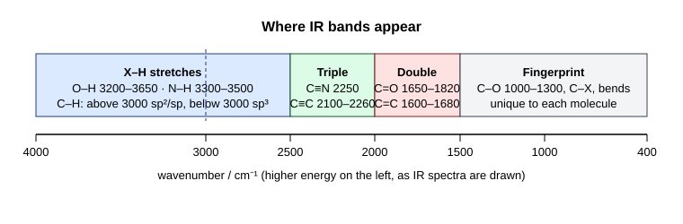

# 17.2 · Infrared spectroscopy: functional groups

An infrared (IR) spectrum shows which bonds in a molecule vibrate at which frequencies. Each kind of bond, O–H, C=O, C≡N, absorbs in its own narrow window, so a glance at an IR spectrum tells you which functional groups are present and, just as usefully, which are absent. This lesson explains where the bands come from, using the harmonic oscillator of [12.4](../module-12/lesson-04.md) and the normal modes of [14.4](../module-14/lesson-04.md), and trains you to read real spectra from the NIST WebBook and SDBS.

## Why it matters

A student oxidises 1-butanol and wants to know whether she made butanal (an aldehyde) or went too far to butanoic acid (Module 16, [16.1](../module-16/lesson-01.md)). An IR spectrum takes a minute. If the broad O–H band of the alcohol at 3300 cm⁻¹ is gone and a sharp C=O appears near 1730 cm⁻¹ with two small bands near 2720 and 2820, she has the aldehyde. If a very broad band covers 2500–3300 cm⁻¹ under the C–H peaks and the C=O sits near 1710, she has the acid. No other single technique answers "which functional group?" so quickly and cheaply, which is why every organic lab has an IR spectrometer next to the bench.

## Core ideas

> [!NOTE]
> The physics (vibrations, selection rule) and the band positions are stable. Band ranges here follow OpenStax Organic Chemistry (2023), sections 12.7 and 12.8. The NIST WebBook and SDBS were checked on 2026-10-17; their web pages may change, and SDBS asks you to accept its disclaimer each time you use it.

### Bonds are springs

A bond between two atoms behaves roughly like a spring. In [12.4](../module-12/lesson-04.md) you met the quantum harmonic oscillator: its levels are equally spaced, and a photon is absorbed when its energy matches the spacing. In wavenumbers (cm⁻¹, the number of waves per centimetre, proportional to energy):

$$\tilde{\nu} = \frac{1}{2\pi c}\sqrt{\frac{k}{\mu}}, \qquad \mu = \frac{m_1 m_2}{m_1 + m_2}$$

Here $k$ is the force constant (bond stiffness, N/m), $\mu$ the reduced mass and $c$ the speed of light in cm/s. Two rules follow:

- **Stiffer bonds absorb higher.** $k$ grows with bond order: C–C about 1200 cm⁻¹, C=C about 1650, C≡C about 2150.
- **Lighter atoms absorb higher.** Any bond to H has $\mu$ close to 1 u, so X–H stretches sit at 2700–3700 cm⁻¹, far from everything else. Replacing H by deuterium almost doubles $\mu$ and moves C–H from about 3000 to about 2200 cm⁻¹.

Tiny numeric example: C=O with $k \approx 1200$ N/m and $\mu = 12 \times 16 / 28 = 6.86$ u $= 1.14 \times 10^{-26}$ kg gives $\sqrt{1200 / 1.14\times10^{-26}} / (2\pi \times 3.00\times10^{10}) \approx 1720$ cm⁻¹. Real ketones absorb at 1715.

### Only vibrations that change the dipole absorb

A vibration absorbs IR light only if it changes the molecule's dipole moment. You saw this with CO₂ in [14.4](../module-14/lesson-04.md): the symmetric stretch does not change the dipole and is IR-silent; the asymmetric stretch (2349 cm⁻¹) and the bend (667 cm⁻¹) absorb. So polar bonds give strong bands (C=O, O–H, C–O) and nearly symmetric ones give weak bands (C≡C in the middle of a chain, C=C in a symmetric alkene). Intensity is information too.

### The map: four regions



Spectra are drawn with wavenumber decreasing to the right and absorption pointing down (as % transmittance). Read from left to right:

| Band (cm⁻¹) | Shape | Meaning |
|---|---|---|
| 3200–3550 | strong, broad, rounded | O–H of an alcohol or phenol, hydrogen-bonded |
| 2500–3300 | very broad, under the C–H peaks | O–H of a carboxylic acid (H-bonded dimer) |
| 3300–3500 | one (NH) or two (NH₂) sharper bands | N–H of an amine or amide |
| ~3300 | strong, narrow | ≡C–H of a terminal alkyne |
| 3000–3100 | medium, small | =C–H of alkenes and arenes |
| 2850–2960 | strong | C–H of sp³ carbons |
| 2720 and 2820 | weak pair | C–H of an aldehyde (CHO) |
| 2210–2260 | medium, sharp | C≡N |
| 2100–2260 | weak | C≡C |
| 1650–1820 | strong, sharp | C=O (see the next table) |
| 1600–1680 | weak to medium | C=C; arenes show 1600 and 1500 |
| 1520 and 1350 | both strong | N–O of a nitro group |
| 1000–1300 | strong | C–O of alcohols, ethers, esters |

The 3000 line is the quickest test in IR: C–H bands only below 3000 mean only sp³ C–H; bands above 3000 mean alkene, arene or alkyne C–H.

### The carbonyl band tells you which carbonyl

The C=O band is the strongest in most spectra. Its position depends on what is attached:

| Compound class | C=O (cm⁻¹, liquid) | Other clue |
|---|---|---|
| ester | 1735–1750 | strong C–O at 1000–1300 |
| aldehyde | 1720–1740 | C–H pair near 2720, 2820 |
| ketone | 1705–1720 | nothing else special |
| carboxylic acid | 1700–1725 | very broad O–H 2500–3300 |
| amide | 1640–1690 | N–H bands (unless tertiary) |
| aryl or α,β-unsaturated ketone/aldehyde | 1680–1700 | arene or C=C bands |
| acid chloride | ~1800 | — |

Conjugation with a C=C or a ring lowers the C=O by 20–30 cm⁻¹, because resonance gives the bond a little single-bond character ([07.3](../module-07/lesson-03.md)).

### Gas phase versus liquid

Where a spectrum was measured matters. The NIST WebBook's IR spectra are mostly **gas-phase**. SDBS spectra are measured as a **liquid film** or in a KBr disc (solids). In the gas, molecules do not hydrogen-bond, so an alcohol's O–H is a sharp band near 3650–3670 cm⁻¹ instead of a broad one at 3300, a carboxylic acid shows a free (monomer) C=O near 1780 instead of 1710, and most carbonyls appear 10–20 cm⁻¹ higher. Tables, including the ones above, are for condensed phases. Always check the "state" line before you compare.

### The fingerprint region

Below 1500 cm⁻¹ there are many bands from bending and from coupled C–C and C–O vibrations. They are hard to assign one by one but form a pattern unique to each compound, like a fingerprint. Use it to confirm a match against a reference spectrum, not to identify groups, apart from the strong C–O band.

## Worked example

### 1. Hooke's law: why C≡N is at 2250 and C–D at 2200

C≡N: $\mu = 12.01 \times 14.01 / 26.02 = 6.47$ u $= 1.074 \times 10^{-26}$ kg. With $k \approx 1850$ N/m:

$$\tilde{\nu} = \frac{\sqrt{1850 / 1.074\times10^{-26}}}{2\pi \times 2.998\times10^{10}\ \text{cm s}^{-1}} = \frac{4.15\times10^{14}\ \text{s}^{-1}}{1.884\times10^{11}\ \text{cm s}^{-1}} \approx 2200\ \text{cm}^{-1}$$

Measured nitriles absorb at 2210–2260. C–D with the C–H force constant (about 500 N/m) gives 2220 cm⁻¹ instead of 3020: the ratio is $\sqrt{\mu_\text{CD}/\mu_\text{CH}} = 1.36$. The force constant is the same, because isotopes do not change the bonding.

### 2. Which C₄H₈O₂?

A liquid C₄H₈O₂ (DBE 1) shows: a very broad band from 2500 to 3300 cm⁻¹ with sharp C–H peaks on top, a strong band at 1710 cm⁻¹, and a broad band near 935 cm⁻¹.

1. DBE 1 and a strong band at 1710: one C=O, no other π bond or ring.
2. The very broad 2500–3300 band: a carboxylic acid O–H, hydrogen-bonded in dimers.
3. Not an ester: an ester C=O would be at 1735–1750, and there would be no O–H at all.
4. Candidates: butanoic acid or 2-methylpropanoic acid. IR alone cannot separate them; the NMR lessons will ([17.3](lesson-03.md)).

## Hands-on

What you need: a browser, Python with the course packages and the [Module 17 lab folder](../../labs/module-17/). Fill in section 3 of a [spectrum assignment sheet](../../templates/spectrum-assignment.md) for Part B. Time: about 55 minutes.

### Part A — Python: Hooke's law and a band classifier (20 min)

1. Open `lesson02_ir.py`. Complete `wavenumber()` and the two classifier rules marked TODO (ester and nitrile).
2. Run it:

```bash
py lesson02_ir.py
```

How you know it worked: C–H about 3020, C=O about 1720, C≡N about 2200 cm⁻¹, C–H/C–D ratio 1.36. The six described spectra come out as A ketone, B carboxylic acid, C alcohol, D nitrile, E terminal alkyne, F ester.

<details><summary>Reference solution</summary>

`wavenumber` returns `math.sqrt(k / reduced_mass_kg(a, b)) / (2 * math.pi * C_CM_PER_S)`. Ester rule: `has(peaks, 1735, 1755, "s") and has(peaks, 1000, 1300, "s")`. Nitrile rule: `has(peaks, 2210, 2260, "ms", "sharp")`. Full code: `lesson02_ir_solution.py`. The classifier is deliberately simple; try spectrum F with its C=O moved to 1715 and see it become a "ketone", which is why you never decide on one band alone.

</details>

### Part B — real spectra: gas against liquid (35 min)

1. Open the NIST gas-phase IR spectra (the link jumps to the spectrum): [2-hexanone](https://webbook.nist.gov/cgi/cbook.cgi?ID=C591786&Mask=80#IR-Spec), [butanoic acid](https://webbook.nist.gov/cgi/cbook.cgi?ID=C107926&Mask=80#IR-Spec), [propanenitrile](https://webbook.nist.gov/cgi/cbook.cgi?ID=C107120&Mask=80#IR-Spec), [1-octyne](https://webbook.nist.gov/cgi/cbook.cgi?ID=C629050&Mask=80#IR-Spec). For each, write the position of the diagnostic band.
2. Open [SDBS](https://sdbs.db.aist.go.jp/), accept the disclaimer, and search by compound name for `butanoic acid` and then `1-butanol`. Open the IR spectrum of each (liquid film).
3. Compare the O–H and C=O bands of butanoic acid in the gas (NIST) and liquid (SDBS) spectra.

<details><summary>What you should find</summary>

- 2-Hexanone (gas): C=O at about 1730 cm⁻¹; in the liquid it would be about 1715.
- Butanoic acid (gas): a sharp free O–H near 3580 and a C=O near 1780 (monomer). SDBS (liquid): a very broad O–H from about 2500 to 3300 and a C=O near 1710 (hydrogen-bonded dimer). Same molecule, very different picture.
- Propanenitrile: sharp C≡N near 2250–2270.
- 1-Octyne: a sharp ≡C–H stretch near 3330 and a weak C≡C near 2120.
- 1-Butanol (SDBS, liquid): a strong broad O–H centred near 3300–3350 and a strong C–O near 1060; no C=O.

</details>

## Common mistakes

- Calling any band near 1700 "a ketone". Check the partners first: broad O–H means acid, a strong C–O means ester, the 2720/2820 pair means aldehyde.
- Mixing up the broad alcohol O–H (3200–3550, rounded) and the acid O–H (2500–3300, very broad, ragged with C–H on top).
- Expecting every group to show a strong band. Internal C≡C and symmetric C=C can be almost invisible, because they hardly change the dipole.
- Comparing a gas-phase NIST spectrum with liquid-phase tables. Read the state first; gas-phase O–H is sharp and C=O is higher.
- Trying to assign every peak in the fingerprint region. Use it to confirm a match, not to find groups.

## Key takeaways

- $\tilde{\nu} = (1/2\pi c)\sqrt{k/\mu}$: stiffer bonds and lighter atoms absorb at higher wavenumber.
- A band needs a change in dipole; polar bonds give strong bands.
- Read in this order: O–H/N–H (3200–3550), the 3000 line, 2100–2260, C=O (1650–1820) and its partners, C–O (1000–1300).
- C=O position separates ester (~1740), aldehyde (~1730), ketone (~1715), acid (~1710 with broad O–H) and amide (~1650).
- NIST IR is mostly gas phase, SDBS liquid or solid. Compare like with like.

## Sources

- [OpenStax Organic Chemistry, 12.7 Interpreting Infrared Spectra](https://openstax.org/books/organic-chemistry/pages/12-7-interpreting-infrared-spectra) — regions of the IR spectrum.
- [OpenStax Organic Chemistry, 12.8 Infrared Spectra of Some Common Functional Groups](https://openstax.org/books/organic-chemistry/pages/12-8-infrared-spectra-of-some-common-functional-groups) — band positions by functional group.
- [NIST Chemistry WebBook](https://webbook.nist.gov/chemistry/) — gas-phase IR spectra of 2-hexanone, butanoic acid, propanenitrile and 1-octyne, checked 2026-10-17.
- [SDBS (AIST)](https://sdbs.db.aist.go.jp/) — liquid-film IR spectra; the disclaimer forbids automated downloading, so search by hand.
- [NIST CODATA 2022: atomic mass constant](https://physics.nist.gov/cgi-bin/cuu/Value?u) — 1 u in kg, used in the lab.
