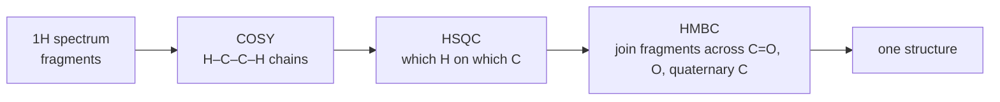

# 17.4 · Carbon NMR and 2D NMR basics

Carbon-13 NMR shows the carbon skeleton directly: one line for each kind of carbon, spread over a range twenty times wider than proton shifts, so lines rarely overlap. With DEPT experiments you also learn how many hydrogens each carbon carries. Two-dimensional (2D) NMR then links the pieces: which protons couple to each other, which proton sits on which carbon, and which carbons are two or three bonds away. This lesson teaches you to count and place ¹³C signals, to read DEPT, and to know which 2D experiment answers which question.

## Why it matters

A perfume chemist has a C₄H₁₀O sample that must be 2-butanol and not one of its six isomers, because each smells and reacts differently. The ¹H spectrum is crowded: several signals overlap between 1 and 2 ppm. The ¹³C spectrum is clean: 2-butanol must show exactly four lines, one of them a CH near 69 ppm (a carbon bonded to O). 2-Methyl-2-propanol would show two lines, diethyl ether two, 2-methyl-1-propanol three. A ¹³C spectrum with DEPT settles the identity in minutes, and that is how routine identity checks on solvents, flavours and drug ingredients are done.

## Core ideas

> [!NOTE]
> Shift ranges and the logic of DEPT and 2D experiments are stable. Ranges follow OpenStax Organic Chemistry (2023) 13.11–13.13 and Reich's tables; the 2D summary follows LibreTexts *Introduction to Organic Spectroscopy*, chapter 7. Checked 2026-10-17.

### Why ¹³C spectra look different

Only 1.07 % of carbon is ¹³C ([17.1](lesson-01.md)), and ¹³C gives a weaker signal per nucleus than ¹H. So ¹³C spectra are recorded by adding hundreds or thousands of scans (signal averaging), which the Fourier-transform method makes fast. Two consequences shape how spectra look:

- **No C–C splitting.** Two ¹³C atoms are almost never next to each other in the same molecule, so carbons do not split each other.
- **Broadband decoupling.** Protons would split each carbon signal. The spectrometer irradiates all protons during acquisition, which removes this splitting. Every carbon then gives a single line.

**Integrals are not reliable in routine ¹³C spectra.** Carbons relax at different rates and decoupling boosts protonated carbons more (the nuclear Overhauser effect). Quaternary carbons (no H) are usually small. Count lines; do not read their heights as numbers of carbons.

### Shift ranges

¹³C shifts span about 0–220 ppm (TMS = 0). The same factors as in ¹H apply: electronegative neighbours and sp² carbons move signals downfield.

| δ (ppm) | Carbon type |
|---|---|
| 10–35 | sp³ CH₃ and CH₂ in chains |
| 25–50 | sp³ CH and quaternary C; C next to C=O |
| 40–60 | C–N; OCH₃ of esters and ethers (50–60) |
| 50–90 | C–O of alcohols and ethers (CH–OH near 69, C–OH of a tertiary alcohol near 69–72) |
| 65–90 | alkyne C≡C |
| 100–150 | alkene and aromatic C |
| 115–125 | nitrile C≡N |
| 160–185 | C=O of acids, esters, amides |
| 190–220 | C=O of aldehydes (190–205) and ketones (205–220) |

The carbonyl region is the most useful: one look separates a ketone (above 200) from an ester or acid (about 170–180).

### Counting signals: symmetry again

Equivalent carbons give one line, with the same test as for protons ([17.3](lesson-03.md)). 2-Methyl-2-propanol, (CH₃)₃COH, has four carbons but only two lines. 1,4-Dichlorobenzene has six ring carbons but two lines; 1,2-dichlorobenzene has three; 1,3-dichlorobenzene four. The number of lines is often the fastest way to tell isomers apart.

### DEPT: how many hydrogens on each carbon

**DEPT** (Distortionless Enhancement by Polarisation Transfer) uses pulses that transfer signal from protons to their carbons. Quaternary carbons have no protons, so they vanish. Two versions are run:

| Experiment | CH₃ | CH₂ | CH | C (no H) |
|---|---|---|---|---|
| broadband ¹³C | up | up | up | up (small) |
| DEPT-90 | — | — | up | — |
| DEPT-135 | up | down | up | — |

Read them together: a line in DEPT-90 is CH; a line pointing down in DEPT-135 is CH₂; up in DEPT-135 but missing in DEPT-90 is CH₃; present in the broadband spectrum but absent from both DEPTs is quaternary C (including C=O and C≡N carbons).

### 2D NMR: three questions, three experiments

A 2D spectrum has a shift axis on each side; a cross peak at (δ₁, δ₂) means the two nuclei are connected in a defined way.

- **COSY** (¹H–¹H correlation spectroscopy): which protons couple to each other, usually through three bonds (H–C–C–H). It traces chains of CH groups.
- **HSQC** (heteronuclear single-quantum coherence): which proton is directly bonded to which carbon (one bond). It transfers your ¹H assignments to the ¹³C spectrum.
- **HMBC** (heteronuclear multiple-bond correlation): protons and carbons two or three bonds apart. It crosses quaternary carbons, C=O groups and heteroatoms, where COSY stops, and so joins fragments.



## Worked example

### 1. Which C₄H₁₀O?

A sample C₄H₁₀O shows four ¹³C lines near 10, 23, 32 and 69 ppm. DEPT-90 shows only the line at 69. DEPT-135 shows 10, 23 and 69 up and 32 down.

1. 69 in DEPT-90: a CH; at 69 it carries the O. A CH–O.
2. 32 down in DEPT-135: a CH₂.
3. 10 and 23 up in DEPT-135, absent from DEPT-90: two different CH₃.
4. Total: 2 CH₃ + 1 CH₂ + 1 CH = C₄H₉, plus OH = C₄H₁₀O.
5. Only one isomer has two different CH₃, one CH₂ and one CH–O: CH₃CH₂CH(OH)CH₃, 2-butanol. The CH₃ at 23 is on the CH–O carbon; the one at 10 is at the end of the ethyl group.

### 2. HMBC joins an ester

A C₅H₁₀O₂ ester could be methyl butanoate (CH₃CH₂CH₂COOCH₃) or propyl acetate (CH₃COOCH₂CH₂CH₃). Both have a C=O near 171–174 ppm. Look at the HMBC cross peaks to the C=O:

- In propyl acetate, the O–CH₂ protons (near 4.0 ppm) and the CH₃CO singlet (near 2.0) both correlate with the C=O.
- In methyl butanoate, the OCH₃ singlet (near 3.7) and the CH₂ next to C=O (near 2.3) correlate with the C=O.

COSY cannot see across the ester oxygen, because there is no H–C–C–H path through it; HMBC can. You will meet these two esters again in [17.5](lesson-05.md).

## Hands-on

What you need: a browser, Python with the course packages and the [Module 17 lab folder](../../labs/module-17/). Use section 5 of the [spectrum assignment sheet](../../templates/spectrum-assignment.md) for Part B. Time: about 55 minutes.

### Part A — Python: signals and DEPT from symmetry (20 min)

1. Open `lesson04_c13.py`. Complete `carbon_signals()` (group carbons by symmetry rank and H count) and `dept_counts()`.
2. Run it:

```bash
py lesson04_c13.py
```

How you know it worked: 1-butanol 4 signals, 2-methyl-2-propanol 2, diethyl ether 2, 1,2- / 1,3- / 1,4-dichlorobenzene 3 / 4 / 2. Observations P, Q, R, S, T match 2-butanol, 2-methyl-2-propanol, 2-methyl-1-propanol, 2-methoxypropane and 1,2-dichlorobenzene.

<details><summary>Reference solution</summary>

In the loop: `r = ranks[a.GetIdx()]`, `t = TYPE[a.GetTotalNumHs()]`, `classes.setdefault(r, [t, 0])[1] += 1`. In `dept_counts`: `for t, _ in carbon_signals(smiles): counts[t] += 1`. Full code: `lesson04_c13_solution.py`. Notice that 1-butanol (1 CH₃, 3 CH₂) and methyl propyl ether (2 CH₃, 2 CH₂) both show four lines, and diethyl ether (CH₃ + CH₂) and 2-methyl-2-propanol (CH₃ + C) both show two: the line count alone cannot separate them, DEPT can. When two isomers have the same DEPT counts too, only the shifts (for example a C–O line near 60–70 ppm) can decide.

</details>

### Part B — real ¹³C spectra from SDBS (35 min)

Open [SDBS](https://sdbs.db.aist.go.jp/), accept the disclaimer, and search by name for `2-butanol`, `tert-butyl methyl ether` (or `%methyl tert-butyl ether`), `1,2-dichlorobenzene` and `1,4-dichlorobenzene`. Open each ¹³C NMR spectrum. For each line, give δ and your assignment, and predict what DEPT-135 would show.

<details><summary>What you should find</summary>

- 2-Butanol: four lines, near 10 (CH₃), 23 (CH₃), 32 (CH₂, down in DEPT-135) and 69 (CH–O).
- tert-Butyl methyl ether: three lines: near 27 (three equivalent CH₃), 49 (OCH₃) and 73 (quaternary C–O, absent in DEPT). The quaternary line is the smallest.
- 1,2-Dichlorobenzene: three aromatic lines, about 127–133 ppm; the C–Cl line (quaternary) is weaker.
- 1,4-Dichlorobenzene: two aromatic lines near 130–133 ppm. The count alone separates the two isomers.

</details>

## Common mistakes

- Reading ¹³C peak heights as numbers of carbons. Count lines; quaternary carbons are small for reasons that have nothing to do with how many there are.
- Forgetting that C=O, C≡N and other quaternary carbons disappear in DEPT. A carbonyl line in the broadband spectrum with nothing in DEPT is normal.
- Mixing up the DEPT-135 sign convention. CH₂ points down; CH and CH₃ point up; DEPT-90 separates CH from CH₃.
- Missing symmetry. Two lines for a six-carbon benzene ring is a strong hint of para substitution.
- Expecting COSY to connect fragments across O or C=O. Use HMBC.

## Key takeaways

- One ¹³C line per kind of carbon; no C–C splitting, no H splitting after decoupling, no reliable integrals.
- Ranges: 10–50 sp³ C, 50–90 C–O, 100–150 C=C and aromatic, 160–185 acid/ester/amide C=O, 190–220 aldehyde/ketone C=O.
- DEPT-90: CH only. DEPT-135: CH and CH₃ up, CH₂ down. Missing from both: quaternary.
- COSY links H to H, HSQC links H to its own C, HMBC links H to C two or three bonds away.

## Sources

- [OpenStax Organic Chemistry, 13.10 13C NMR Spectroscopy: Signal Averaging and FT-NMR](https://openstax.org/books/organic-chemistry/pages/13-10-13c-nmr-spectroscopy-signal-averaging-and-ft-nmr) — why ¹³C needs many scans.
- [OpenStax Organic Chemistry, 13.11 Characteristics of 13C NMR Spectroscopy](https://openstax.org/books/organic-chemistry/pages/13-11-characteristics-of-13c-nmr-spectroscopy) — shift ranges, decoupling.
- [OpenStax Organic Chemistry, 13.12 DEPT 13C NMR Spectroscopy](https://openstax.org/books/organic-chemistry/pages/13-12-dept-13c-nmr-spectroscopy) — DEPT-90 and DEPT-135.
- [OpenStax Organic Chemistry, 13.13 Uses of 13C NMR Spectroscopy](https://openstax.org/books/organic-chemistry/pages/13-13-uses-of-13c-nmr-spectroscopy) — using signal counts to decide structures.
- [LibreTexts, Two-Dimensional NMR Spectroscopy](https://chem.libretexts.org/Bookshelves/Organic_Chemistry/Introduction_to_Organic_Spectroscopy/07%3A_Two-Dimensional_NMR_Spectroscopy) — COSY, HSQC and HMBC.
- [Hans Reich, NMR Spectroscopy collection](https://organicchemistrydata.org/hansreich/resources/nmr/) — ¹³C shift tables.
- [SDBS (AIST)](https://sdbs.db.aist.go.jp/) — ¹³C spectra of 2-butanol, tert-butyl methyl ether and the dichlorobenzenes, searched by name.
