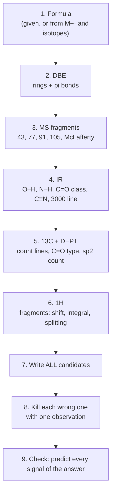

# 17.5 · Putting it together: solving unknowns

Each spectrum answers a different question. Mass spectrometry gives the molecular formula, IR the functional groups, ¹³C NMR the number and kinds of carbon, ¹H NMR how the pieces join. None of them alone identifies most compounds; together they almost always do. This lesson gives you a fixed order of work, a worked unknown solved from start to finish, a small Python filter that shows how fast the candidate list shrinks, and five real unknowns to solve before the 50-unknown project in [17.6](lesson-06.md).

## Why it matters

Structure determination is a daily job. A synthetic chemist checks every product before the next step (Module 24). A forensic lab identifies a powder, an environmental lab a pollutant in groundwater, a flavour company a new aroma compound. The people who do this well are not the ones who remember the most numbers; they are the ones who work in a fixed order, write down every candidate, and look for the one observation that kills each wrong one. Most wrong answers come from deciding too early and then reading the spectra to fit.

## Core ideas

> [!NOTE]
> The workflow is stable. The NIST WebBook and SDBS interfaces were checked on 2026-10-17 and may change; SDBS has no CAS-number search, so you search it by compound name or formula.

### The workflow



### Step by step

1. **Formula.** Use the given formula or derive it from M⁺·, the nitrogen rule and the isotope peaks ([17.1](lesson-01.md)).
2. **DBE.** $(2C + 2 + N - H - X)/2$. A benzene ring is 4 (three C=C and one ring). DBE ≥ 4 with 6+ carbons: suspect an aromatic ring and look for ¹H at 6.5–8.5 and ¹³C at 110–160.
3. **MS fragments.** Look for the ions that name a group: 43 (CH₃CO⁺ or C₃H₇⁺), 77 (C₆H₅⁺), 91 (C₇H₇⁺, benzyl), 105 (C₆H₅CO⁺), even-mass McLafferty ions, M − 15, M − 18, M − 31 (OCH₃), M − 45 (OC₂H₅ or COOH).
4. **IR.** Is there O–H or N–H? Is there a C=O, and which kind? Anything at 2100–2260? Anything above 3000 ([17.2](lesson-02.md))?
5. **¹³C.** How many lines, compared with the number of carbons (symmetry)? Is there a C=O, and is it above 190 (aldehyde, ketone) or 160–185 (acid, ester, amide)? How many sp² carbons? Use DEPT if you have it ([17.4](lesson-04.md)).
6. **¹H.** Scale the integrals to the formula. Turn each signal into a fragment: "3H singlet at 3.8 = OCH₃ on oxygen", "2H quartet at 4.1 + 3H triplet at 1.3 = OCH₂CH₃" ([17.3](lesson-03.md)). Substitution on a benzene ring shows in the aromatic pattern: five H for monosubstituted, two 2H doublets for para.
7. **Candidates.** Join the fragments in every way the formula and DBE allow. Write them all down, even the unlikely ones. SMILES ([15.1](../module-15/lesson-01.md)) is a quick way to list them.
8. **Eliminate.** For each candidate, find the one observation it cannot explain.
9. **Check.** Predict every signal of your answer: the shift, integral and splitting of each ¹H, each ¹³C line, the main IR bands and the main fragments. If one does not fit, go back.

### Weigh the evidence

Some observations are almost proof; some are only hints:

| Strong evidence | Weak evidence |
|---|---|
| Molecular formula from HRMS | Peak heights in ¹³C |
| Number of ¹³C lines | A single IR band in the fingerprint region |
| ¹H integrals and clean first-order multiplets | Exact ¹H shifts (solvent and concentration move them) |
| C=O position in ¹³C (above or below 190) | Absence of M⁺· in EI |
| An HMBC correlation across O or C=O | Small fragment peaks in MS |

## Worked example

### Unknown C₉H₁₀O₂ (CAS 100-06-1)

**Data.** MS: M⁺· 150 (about 36 %), base peak 135, also 77 and 107. IR (liquid or solid): strong C=O near 1680 cm⁻¹, bands at 1600 and 1510, strong C–O near 1260, nothing above 3100. ¹H (CDCl₃): δ 7.93 (d, J ≈ 9 Hz, 2H), 6.93 (d, J ≈ 9 Hz, 2H), 3.87 (s, 3H), 2.55 (s, 3H). ¹³C: seven lines near 197, 164, 131 (CH), 130, 114 (CH), 55, 26.

1. **Formula and DBE.** C₉H₁₀O₂: $(18 + 2 - 10)/2 = 5$. A benzene ring (4) plus one C=O (1).
2. **MS.** 150 − 135 = 15: loss of CH₃, giving an acylium ion; this fits a methyl ketone, CH₃–CO–Ar, losing its methyl. 135 − 28 (CO) = 107.
3. **IR.** C=O at 1680, lower than a plain ketone (1715): conjugated with the ring. No O–H. Strong C–O at 1260: an aryl ether.
4. **¹³C.** Seven lines for nine carbons: symmetry. 197 is a ketone C=O (above 190). 164 is an aromatic C bonded to O. 55 is OCH₃; 26 is CH₃–C=O.
5. **¹H.** Two 2H doublets with the same J: a para-disubstituted benzene. 3.87, 3H singlet: OCH₃ on oxygen. 2.55, 3H singlet: CH₃C=O.
6. **Candidates.** The fragments are C₆H₄ (para), OCH₃, COCH₃. Joining them para gives 4'-methoxyacetophenone, CH₃O–C₆H₄–COCH₃. Alternatives: methyl 4-methylbenzoate (CH₃–C₆H₄–COOCH₃) has the same formula and also two 3H singlets and two doublets.
7. **Eliminate.** Methyl 4-methylbenzoate is an ester: its C=O would be near 167 ppm, not 197, its IR C=O near 1720, and its methyl on the ring would be at 2.4 ppm next to an OCH₃ at 3.9 — close to the observed shifts, so ¹H alone is weak evidence. The ¹³C line at 197 is the decisive observation. The ortho and meta isomers would show four different aromatic H, not two doublets.
8. **Answer:** 4'-methoxyacetophenone (1-(4-methoxyphenyl)ethan-1-one), PubChem CID 7476.

## Hands-on

What you need: a browser, Python with the course packages, the [Module 17 lab folder](../../labs/module-17/), and one printed or copied [spectrum assignment sheet](../../templates/spectrum-assignment.md) per unknown. Time: about 90 minutes.

### Part A — simulation warm-up (10 min)

[Simulation: NMR — identify an unknown from its 1H spectrum](../../simulations/nmr/index.html?preset=unknown)

Task: read every signal (shift, integral, multiplicity, J) before you look at the candidate list, then choose. Target: the correct structure with every signal assigned.

### Part B — Python: watch the candidate list shrink (20 min)

1. Open `lesson05_solver.py`. Complete `consistent()` and the singlet test in `features()`.
2. Run it:

```bash
py lesson05_solver.py
```

How you know it worked: 13 C₅H₁₀O₂ candidates; "MS + IR only" leaves 5 esters, adding ¹³C and DEPT leaves 3, adding the ¹H counts leaves 2 (methyl butanoate and propyl acetate). The script cannot decide between those two; the shift of the singlet can.

<details><summary>Reference solution</summary>

`consistent` returns `all(f[k] == v for k, v in evidence.items())`. The singlet test adds `r` when no carbon bonded to `heavy` carries an H. Full code: `lesson05_solver_solution.py`. Ethyl propanoate drops out at the last step because it has no singlet at all: its OCH₂ is a quartet and its CH₂C=O another quartet.

</details>

### Part C — five real unknowns (60 min)

For each unknown, first use only the formula and the NIST mass and IR spectra (the links jump to the spectrum; the compound name is at the top of the page, so scroll no higher, or press <kbd>F11</kbd> for full screen to hide the tab title). Write your candidates. Then open the details line, search SDBS by that name, and use the ¹H and ¹³C spectra to decide and to assign every signal.

| No. | Formula | CAS | NIST MS | NIST IR (gas) |
|---|---|---|---|---|
| P1 | C₅H₁₀O₂ | 109-60-4 | [MS](https://webbook.nist.gov/cgi/cbook.cgi?ID=C109604&Mask=200#Mass-Spec) | [IR](https://webbook.nist.gov/cgi/cbook.cgi?ID=C109604&Mask=80#IR-Spec) |
| P2 | C₅H₁₀O₂ | 623-42-7 | [MS](https://webbook.nist.gov/cgi/cbook.cgi?ID=C623427&Mask=200#Mass-Spec) | [IR](https://webbook.nist.gov/cgi/cbook.cgi?ID=C623427&Mask=80#IR-Spec) |
| P3 | C₉H₈O | 104-55-2 | [MS](https://webbook.nist.gov/cgi/cbook.cgi?ID=C104552&Mask=200#Mass-Spec) | [IR](https://webbook.nist.gov/cgi/cbook.cgi?ID=C104552&Mask=80#IR-Spec) |
| P4 | C₄H₁₁N | 109-73-9 | [MS](https://webbook.nist.gov/cgi/cbook.cgi?ID=C109739&Mask=200#Mass-Spec) | [IR](https://webbook.nist.gov/cgi/cbook.cgi?ID=C109739&Mask=80#IR-Spec) |
| P5 | C₆H₁₂O₂ | 110-19-0 | [MS](https://webbook.nist.gov/cgi/cbook.cgi?ID=C110190&Mask=200#Mass-Spec) | none in NIST; use SDBS |

<details><summary>P1 — SDBS name and answer</summary>

Search SDBS for `propyl acetate`. Answer: propyl acetate, CH₃COOCH₂CH₂CH₃. MS base peak 43 (CH₃CO⁺) and 61 (CH₃C(OH)₂⁺, an ester rearrangement); ¹H singlet near 2.0 (CH₃CO), triplet near 4.0 (OCH₂). The 2.0 singlet rules out methyl butanoate.

</details>

<details><summary>P2 — SDBS name and answer</summary>

Search SDBS for `methyl butanoate` (or `methyl butyrate`). Answer: methyl butanoate, CH₃CH₂CH₂COOCH₃. MS 74 (McLafferty ion of a methyl ester) and 71 (C₃H₇CO⁺); ¹H singlet near 3.7 (OCH₃) and a triplet near 2.3 (CH₂C=O).

</details>

<details><summary>P3 — SDBS name and answer</summary>

Search SDBS for `cinnamaldehyde` (or `trans-cinnamaldehyde`). Answer: (E)-3-phenylprop-2-enal. DBE 6: ring + C=C + C=O. ¹H doublet near 9.7 (CHO, small J to its neighbour), alkene H with J about 16 Hz (trans), five aromatic H. MS 131 (M − H) and 103 (M − CHO).

</details>

<details><summary>P4 — SDBS name and answer</summary>

Search SDBS for `butylamine`. Answer: butan-1-amine, CH₃CH₂CH₂CH₂NH₂. Odd M⁺· 73 (one N); base peak 30 (CH₂=NH₂⁺, alpha-cleavage), which rules out sec- and tert-butylamine (their alpha-cleavage ions are 44 and 58). Isobutylamine also gives 30; the ¹H spectrum decides (a 3H triplet near 0.9 here, not a 6H doublet). IR: two N–H bands near 3300–3400 in the liquid.

</details>

<details><summary>P5 — SDBS name and answer</summary>

Search SDBS for `isobutyl acetate`. Answer: 2-methylpropyl acetate, CH₃COOCH₂CH(CH₃)₂. MS 43, 56 and 73; ¹H: 6H doublet near 0.9, 1H multiplet near 1.9, 2H doublet near 3.9 (OCH₂ next to a CH), 3H singlet near 2.05. The OCH₂ doublet rules out butyl acetate (triplet) and sec-butyl acetate (OCH, not OCH₂).

</details>

## Common mistakes

- Starting with the ¹H spectrum and guessing. Do formula and DBE first: they remove most wrong ideas for free.
- Stopping at the first structure that fits. Write all candidates; isomers often fit everything except one observation.
- Using a weak observation (a ¹H shift difference of 0.1 ppm) to reject a candidate when a strong one (¹³C C=O at 197 vs 167) is available.
- Not checking the final answer against every signal. One unexplained peak means a wrong structure or an impurity; decide which.
- Mixing phases or solvents when comparing with a reference: NIST IR is gas phase; NMR shifts move a little with solvent.

## Key takeaways

- Work in a fixed order: formula → DBE → MS → IR → ¹³C → ¹H → all candidates → eliminate → check.
- DBE of 4 or more with aromatic signals means a benzene ring; para substitution gives two 2H doublets.
- Every candidate needs one decisive observation against it; record it.
- Counts (lines, integrals) narrow the list; shifts usually make the final call.

## Sources

- [OpenStax Organic Chemistry, 7.2 Calculating the Degree of Unsaturation](https://openstax.org/books/organic-chemistry/pages/7-2-calculating-the-degree-of-unsaturation) — the DBE formula with halogens, N and O.
- [OpenStax Organic Chemistry, 13.13 Uses of 13C NMR Spectroscopy](https://openstax.org/books/organic-chemistry/pages/13-13-uses-of-13c-nmr-spectroscopy) — using ¹³C to decide between structures.
- [NIST Chemistry WebBook: 4-Acetylanisole](https://webbook.nist.gov/cgi/cbook.cgi?ID=C100061&Mask=200#Mass-Spec) — the EI spectrum of the worked example (M⁺· 150, base peak 135), checked 2026-10-17.
- [SDBS (AIST)](https://sdbs.db.aist.go.jp/) — ¹H and ¹³C spectra of the practice unknowns, searched by name.
- [PubChem: 4'-Methoxyacetophenone](https://pubchem.ncbi.nlm.nih.gov/compound/7476) — structure, CAS 100-06-1 and identifiers.
