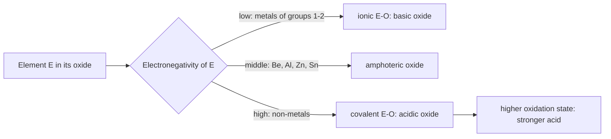

# 18.1 · Periodic trends in depth and the main-group elements

Lesson 07.2 explained periodic trends in words: shielding and effective nuclear charge. Inorganic chemistry needs that idea as a number. This lesson gives you Slater's rules, a quick estimate of the charge an electron really feels, and uses it to explain why transition metals lose 4s electrons first. It then covers electron affinity, three patterns that tame the main-group elements, and the acid–base behaviour of oxides, which you test in your kitchen.

## Why it matters

A battery chemist choosing between lithium and sodium and a pharmacist asking why milk of magnesia neutralises stomach acid are both asking periodic-table questions. The answers come from a few quantities: how strongly the nucleus holds the outer electrons, how much energy an atom gains by taking an extra electron, and whether the element's oxide is acidic or basic. Estimate these from the element's position and you can predict compounds you have never seen.

## Core ideas

> [!NOTE]
> Slater's rules (1930), electron affinity and the main-group patterns are settled chemistry. The ionisation energies come from the NIST Atomic Spectra Database (retrieved 2026-10-16) and the electron affinities from the primary measurements listed on the electron affinity data page (retrieved 2026-10-17). These values are revised only in the last digits.

### Slater's rules: a number for shielding

Lesson [07.2](../module-07/lesson-02.md) defined the **effective nuclear charge** $Z_\text{eff} = Z - S$, where the **shielding constant** $S$ is how much nuclear charge the other electrons cancel. Slater's rules estimate $S$. Write the configuration in groups:

$$(1s)\ (2s,2p)\ (3s,3p)\ (3d)\ (4s,4p)\ (4d)\ \dots$$

Then, for the electron you care about:

| Other electron is... | For an s or p electron | For a d electron |
|---|---|---|
| in the same group | 0.35 each (0.30 inside 1s) | 0.35 each |
| in a group to the left, shell $n-1$ | 0.85 each | 1.00 each |
| in a group to the left, shell $n-2$ or lower | 1.00 each | 1.00 each |
| in a group to the left, same shell (3s, 3p for a 3d electron) | does not occur | 1.00 each |
| in a group to the right | 0 | 0 |

Sodium's 3s electron: two in shell 1 shield 1.00 each, eight in shell 2 shield 0.85 each, so $S = 2 + 6.8 = 8.8$ and $Z_\text{eff} = 11 - 8.8 = 2.20$. Lesson 07.2 estimated 1.84 from the ionisation energy: Slater's number is an estimate in the right range.

Two results follow at once:

- **Across a period** each step adds a proton and an electron in the same group, which shields only 0.35: $Z_\text{eff}$ rises by 0.65 per element, so atoms shrink and ionisation energy rises.
- **After the d-block**, ten protons have been added but the ten 3d electrons shield a 4p electron only 0.85 each. Gallium's 4p electron has $Z_\text{eff} = 5.00$, aluminium's 3p 3.50, so gallium's first ionisation energy (5.999 eV) is no lower than aluminium's (5.986 eV). This is the **d-block contraction**.

### Why 4s electrons leave first

Lesson 07.2 stated the rule: a transition metal fills 4s before 3d but loses 4s first. In iron ($[\text{Ar}]\,3d^6 4s^2$) a 3d electron is shielded by the 18 argon-core electrons at 1.00 each and by the other five 3d electrons at 0.35: $Z_\text{eff} = 26 - 19.75 = 6.25$. A 4s electron is shielded by the 14 electrons of shell 3 at 0.85 and the 10 of shells 1 and 2 at 1.00, plus the other 4s electron at 0.35: $Z_\text{eff} = 26 - 22.25 = 3.75$. The 4s electron feels much less charge and sits farther out, so it leaves first. Every 3d ion in this module is therefore written $[\text{Ar}]\,3d^n$.

### Electron affinity

The **electron affinity** (EA) is the energy released when a gas-phase atom takes an extra electron: $\text{X}(g) + e^- \to \text{X}^-(g)$. In this course a positive EA means energy is released (the anion is stable). Measured values (eV):

| H | Li | O | F | Na | Cl | Br | I |
|---|---|---|---|---|---|---|---|
| 0.754 | 0.618 | 1.461 | 3.401 | 0.548 | 3.613 | 3.364 | 3.059 |

Three irregularities:

- **Chlorine, not fluorine, has the largest EA.** The incoming electron is crowded in fluorine's small 2p shell.
- **Nitrogen and the noble gases form no stable anion.** The extra electron would have to pair in nitrogen's half-filled 2p set, or start a new shell.
- **Second electron affinities are negative.** $\text{O}^-(g) + e^- \to \text{O}^{2-}(g)$ costs several hundred kJ/mol, because the ion is already negative. O²⁻ exists only because a lattice pays for it; lesson 18.2 calculates how much.

**Electronegativity** (lesson [07.3](../module-07/lesson-03.md)) combines IE and EA: an atom that holds its electrons tightly and gains energy by taking more also pulls shared electrons towards itself (Pauling scale: F 3.98, O 3.44, Cl 3.16, C 2.55, Na 0.93).

### Three patterns of the main-group elements

Most "exceptions" among the main-group elements (groups 1, 2 and 13–18) follow from three patterns.

**The first-row anomaly.** Li to F are small, and their compact 2p orbitals overlap well side by side, so they form strong π bonds; their heavier cousins do not. That is why nitrogen is N≡N (bond energy about 945 kJ/mol) but white phosphorus is P₄ with only single bonds, and why CO₂ is a gas of small molecules while SiO₂ is a hard network solid with only Si–O single bonds. Small size also limits the number of neighbours: NCl₅ does not exist, PCl₅ does (because phosphorus has room for five, not because it "uses 3d orbitals").

**The diagonal relationship.** Going one step right raises $Z_\text{eff}$ and shrinks the atom; going one step down does the opposite. A diagonal step roughly cancels, so Li resembles Mg, Be resembles Al, and B resembles Si. Lithium burns in air to give some nitride Li₃N, as magnesium gives Mg₃N₂, while sodium forms no stable nitride. Be(OH)₂ and Al(OH)₃ are both amphoteric.

**The inert-pair effect.** At the bottom of groups 13–15 the ns² pair becomes reluctant to take part in bonding. Thallium is mostly Tl⁺, lead mostly Pb²⁺ (PbO₂ is a strong oxidant, the positive plate of a car battery), bismuth mostly Bi³⁺. The cause is relativistic: heavy-atom 6s electrons move so fast near the nucleus that the orbital contracts and drops in energy.

### Oxides: acidic, basic or amphoteric

The rule, built on the acid–base ideas of lesson [08.4](../module-08/lesson-04.md):

- **Metal oxides are basic.** The O²⁻ ion takes a proton from water: $\text{Na}_2\text{O} + \text{H}_2\text{O} \to 2\,\text{NaOH}$. Low electronegativity means the M–O bond is ionic.
- **Non-metal oxides are acidic.** The O is covalently bound, and water adds to the central atom: $\text{SO}_3 + \text{H}_2\text{O} \to \text{H}_2\text{SO}_4$, $\text{CO}_2 + \text{H}_2\text{O} \rightleftharpoons \text{H}_2\text{CO}_3$.
- **In between are amphoteric oxides**, such as Al₂O₃, ZnO and BeO, which react with both acids and strong bases (Al₂O₃ dissolves in NaOH as $[\text{Al(OH)}_4]^-$).
- **For one element, a higher oxidation state is more acidic.** CrO is basic, Cr₂O₃ amphoteric, CrO₃ acidic; Mn₂O₇ (manganese +7) is an acid anhydride.

The same logic makes small, highly charged metal ions acidic in water: the cation pulls electron density out of a bound water, which loses a proton: $[\text{Al(H}_2\text{O)}_6]^{3+} \rightleftharpoons [\text{Al(OH)(H}_2\text{O)}_5]^{2+} + \text{H}^+$, with p$K_a$ about 5.



## Worked example

### 1. Where does potassium's 19th electron go?

Compare the two choices for K: $[\text{Ar}]\,4s^1$ or $[\text{Ar}]\,3d^1$.

- In 4s: shell 3 (8 electrons) shields 0.85 each, shells 1–2 (10 electrons) 1.00 each. $S = 6.8 + 10 = 16.8$, $Z_\text{eff} = 19 - 16.8 = 2.20$.
- In 3d: all 18 argon-core electrons are in groups to the left, 1.00 each. $S = 18$, $Z_\text{eff} = 1.00$.

A 3d electron would feel almost no net charge; the penetrating 4s orbital holds it more firmly. So potassium is $[\text{Ar}]\,4s^1$, as observed. In iron the balance flips because 3d electrons there see $Z = 26$.

### 2. The oxides of period 3

| Oxide | Na₂O | MgO | Al₂O₃ | SiO₂ | P₄O₁₀ | SO₃ | Cl₂O₇ |
|---|---|---|---|---|---|---|---|
| Oxidation state of E | +1 | +2 | +3 | +4 | +5 | +6 | +7 |
| Character | strongly basic | basic | amphoteric | weakly acidic | acidic | strongly acidic | strongly acidic |
| With water | NaOH | Mg(OH)₂, barely soluble | none | none (dissolves in hot NaOH) | H₃PO₄ | H₂SO₄ | HClO₄ |

Across the period the electronegativity and the oxidation state of E both rise, so the oxides move from basic to acidic.

## Hands-on

What you need: the [Module 18 lab folder](../../labs/module-18/) with Python 3.14 (packages pinned in `labs/common/requirements.txt`); for Part C a red-cabbage indicator (as in lesson [08.4](../module-08/lesson-04.md)), four clear glasses, milk of magnesia (pharmacy), baking soda, a drinking straw, a teaspoon, safety glasses, white paper. Time: about 60 minutes.

### Part A — pencil (15 min)

1. Calculate $Z_\text{eff}$ for a 3p electron of chlorine and a 2p electron of fluorine. Which one feels more charge, and does that match their first ionisation energies (12.968 and 17.423 eV)?
2. Write the configurations of Zn and Zn²⁺. Why does zinc show only the +2 oxidation state?
3. Predict the formula of the compound formed when lithium burns in nitrogen.
4. Put these in order of increasing acidity of the oxide: MgO, SO₃, Al₂O₃, P₄O₁₀, Na₂O.

<details><summary>Answers to Part A</summary>

1. Cl: $S = 6 \times 0.35 + 8 \times 0.85 + 2 \times 1.00 = 10.90$, $Z_\text{eff} = 6.10$. F: $S = 6 \times 0.35 + 2 \times 0.85 = 3.80$, $Z_\text{eff} = 5.20$. Chlorine's electron feels more charge but is one shell farther out (3p against 2p), and the distance wins: fluorine has the higher ionisation energy. $Z_\text{eff}$ alone does not compare different shells.
2. Zn $[\text{Ar}]\,3d^{10}4s^2$; Zn²⁺ $[\text{Ar}]\,3d^{10}$. The remaining full 3d shell is tightly held ($Z_\text{eff}$ = 8.85), so no bond repays removing a third electron.
3. Li₃N (Li⁺ and N³⁻). Small Li⁺ gives a lattice energy large enough to pay for N³⁻; larger Na⁺ does not. Diagonal relationship with Mg₃N₂.
4. Na₂O < MgO < Al₂O₃ < P₄O₁₀ < SO₃.

</details>

### Part B — Python: Slater's rules against NIST data (25 min)

Open `lesson01_trends.py` and write `slater_zeff(z, n, l)`; `configuration(z)` in `inorg18.py` supplies the configuration, Cr and Cu exceptions included. Then run:

```bash
py lesson01_trends.py
```

How you know it worked: Na 3s gives 2.20, Fe 3d 6.25 and Fe 4s 3.75. In periods 2 and 3, $Z_\text{eff}$ correlates with the NIST first ionisation energy with $r$ = 0.965 and 0.949. Ga 4p gives 5.00 against 3.50 for Al. The plot is saved to `runs/lesson01_zeff.png`.

<details><summary>Reference solution</summary>

Loop over `configuration(z)`. For each subshell `(cn, cl, k)`: if it is in the target's Slater group, add 0.35 (0.30 for 1s) times the number of *other* electrons (`k - 1` for the target's own subshell). Otherwise, for an s or p target, add `0.85 * k` if `cn == n - 1` and `1.00 * k` if `cn < n - 1`; for a d target, add `1.00 * k` for every group that comes before it. Return `z - s`. Full code in `lesson01_trends_solution.py`.

The plot shows steps at boron and oxygen that Slater's smooth $Z_\text{eff}$ cannot follow: they come from the higher energy of p and from electron pairing, which the rules ignore.

</details>

### Part C — kitchen: acidic and basic oxides (20 min)

> [!CAUTION]
> Wear safety glasses. Only breathe out through the straw; never suck liquid up it. Do not drink any of the test liquids. Milk of magnesia is a medicine: use one teaspoon and put the bottle back out of children's reach. If you make fresh indicator, handle the just-boiled water carefully.

1. Pour about 50 mL of indicator into each of four glasses on the white paper. Glass 1 is the reference.
2. Glass 2: stir in one teaspoon of milk of magnesia, the hydroxide of a basic metal oxide.
3. Glass 3: blow gently through the straw for two minutes. Breath is about 4 % CO₂, a non-metal oxide.
4. Glass 4: stir in a quarter teaspoon of baking soda, note the colour, then blow for two minutes.
5. Photograph the glasses and record the colours on a [notebook page](../../templates/notebook-page.md).

How you know it worked: glass 2 turns blue-green (pH about 10); glass 3 shifts towards a redder purple (pH about 5–6); glass 4 starts blue and changes much less.

<details><summary>Explaining your result</summary>

Magnesium has a low electronegativity, so its hydroxide releases OH⁻. Carbon is a non-metal: water adds to CO₂ to give carbonic acid. Bicarbonate takes up the extra H⁺ (lesson 08.4's buffer). If glass 3 barely changes, dilute the indicator and repeat. Amphoterism cannot be tested at home: it needs a strong base, a lab reagent.

</details>

## Common mistakes

- **Comparing $Z_\text{eff}$ across shells.** A larger $Z_\text{eff}$ in a higher shell can still mean a weaker hold (Cl against F).
- **Removing 3d electrons before 4s.** For every transition-metal ion, take the 4s electrons first: Fe³⁺ is $[\text{Ar}]\,3d^5$, not $[\text{Ar}]\,3d^3 4s^2$.
- **Reading the electron-affinity sign the wrong way.** Some books give EA as the energy change of attachment (negative when released). Check the convention before using it in a cycle (lesson 18.2).
- **Calling every oxide of a metal basic.** High oxidation states are acidic: CrO₃ and Mn₂O₇ are acid anhydrides.

## Key takeaways

- Slater's rules turn shielding into a number: $Z_\text{eff}$ rises by 0.65 per element across a period and jumps after the d-block.
- Transition metals lose 4s electrons first because a 4s electron feels far less charge than a 3d electron in the same atom.
- Electron affinity peaks at chlorine; second electron affinities are negative, so ions such as O²⁻ exist only in a lattice or in solution.
- The first-row anomaly, the diagonal relationship and the inert-pair effect explain most of the "exceptions" among the main-group elements.
- Oxides move from basic (metals) through amphoteric to acidic (non-metals and high oxidation states).

## Sources

- [LibreTexts, Slater's Rules](https://chem.libretexts.org/Courses/Ursinus_College/CHEM322%3A_Inorganic_Chemistry/01%3A_Atomic_Structure/1.03%3A_Multi-Electron_Atoms/1.3.04%3A_Slater's_Rules) — the grouping and the 0.35, 0.85 and 1.00 shielding constants.
- [NIST Atomic Spectra Database, Ionization Energies](https://physics.nist.gov/PhysRefData/ASD/ionEnergy.html) — first ionisation energies used in Part B (copied in `ionization_energies.csv`).
- [Electron affinity (data page)](https://en.wikipedia.org/wiki/Electron_affinity_(data_page)) — measured electron affinities, with the primary photodetachment papers cited for each element (for example Berzinsh et al. 1995 for Cl, Blondel et al. 1989 for F and Br).
- [OpenStax Chemistry 2e, 18.1 Periodicity](https://openstax.org/books/chemistry-2e/pages/18-1-periodicity) — main-group properties.
- [OpenStax Chemistry 2e, 18.9 Compounds of Oxygen](https://openstax.org/books/chemistry-2e/pages/18-9-occurrence-preparation-and-compounds-of-oxygen) — acidic, basic and amphoteric oxides.
