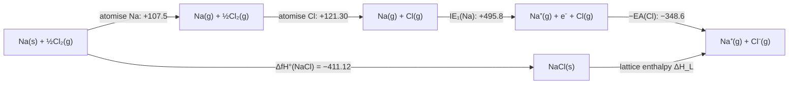

# 18.2 · Solid structures and lattice energy

Most inorganic compounds are solids, and their properties come from how the atoms or ions are packed. This lesson describes the few packing patterns that cover most metals and salts, then puts a number on the energy that holds an ionic crystal together. You build the Born–Haber cycle from real NIST and CODATA data, compare it with the lattice models that started in lesson 04.3, and use the result to explain why NaCl exists and NaCl₂ does not.

## Why it matters

Magnesium oxide melts at about 2850 °C and lines steel furnaces; sodium chloride melts at 801 °C. Both have the same crystal structure. The difference is the lattice energy: doubling both ionic charges and shrinking the ions makes it about five times larger. Lattice energy also decides which compounds can exist at all. Chemists searching for new battery cathodes or solid electrolytes screen thousands of candidate salts with exactly the estimates in this lesson before anyone makes one.

## Core ideas

> [!NOTE]
> Packing geometry, the Born–Haber cycle and the lattice models are settled science. The thermochemical data are NIST WebBook (NIST-JANAF) and CODATA key values, the electron affinities primary measurements, all retrieved 2026-10-17. Tables differ in the last digit or two; the conclusions do not change.

### Packing spheres

Think of identical atoms as hard spheres. The densest way to stack layers of spheres fills 74 % of space, and there are two versions: **cubic close packing** (ccp, layers ABCABC..., also called face-centred cubic, fcc) and **hexagonal close packing** (hcp, ABAB...). In both, each atom touches 12 others: its **coordination number** (CN) is 12. Copper, aluminium and gold are ccp; magnesium and zinc are hcp. Iron at room temperature is **body-centred cubic** (bcc): one atom at the centre of a cube of eight, CN 8, 68 % filled.

A **unit cell** is the smallest box that, repeated in three directions, builds the crystal. Its edge is the **lattice constant** $a$. Atoms on the cell's faces, edges and corners are shared with neighbouring cells, so they count $\tfrac12$, $\tfrac14$ and $\tfrac18$.

### Ionic structures: anions packed, cations in the holes

In most salts the larger anions form a packed array and the smaller cations sit in the gaps between them. Four structures cover a large share of simple salts:

| Structure | Example | CN cation : anion | Formula units per cell | Madelung constant $M$ |
|---|---|---|---|---|
| rock salt | NaCl, MgO, LiF | 6 : 6 | 4 | 1.7476 |
| caesium chloride | CsCl | 8 : 8 | 1 | 1.7627 |
| zinc blende | ZnS | 4 : 4 | 4 | 1.6381 (for $\lvert z_+z_-\rvert$ = 1) |
| fluorite | CaF₂ | 8 : 4 | 4 | 2.5194 (for $\lvert z_+z_-\rvert$ = 2) |

Which one a salt adopts depends mainly on the **radius ratio** $r_+/r_-$: a small cation can only touch four anions, a large one fits eight. The rough rule is CN 4 below 0.414, CN 6 from 0.414 to 0.732 and CN 8 above. For NaCl, $102/181 = 0.56$ (Shannon radii, CN 6), so CN 6: correct. The rule is right only about half the time for real salts, because bonds are not purely ionic and ions are not hard spheres. Use it as a first guess.

### Lattice energy

The **lattice energy** is the energy needed to separate one mole of an ionic solid into gas-phase ions, $\text{NaCl}(s) \to \text{Na}^+(g) + \text{Cl}^-(g)$. This course gives it as a positive number. (Some books give the reverse process and a negative sign; check before you compare.)

Lesson [04.3](../module-04/lesson-03.md) summed the Coulomb attraction over an infinite rock-salt crystal and found the Madelung constant $M = 1.7476$ and 861 kJ/mol for NaCl. That is too large, because ions repel when their electron clouds overlap. Two classic corrections:

$$U_\text{Born–Landé} = \frac{N_A M \lvert z_+ z_-\rvert e^2}{4\pi\varepsilon_0 r_0}\left(1 - \frac{1}{n}\right) \qquad U_\text{Born–Mayer} = \frac{N_A M \lvert z_+ z_-\rvert e^2}{4\pi\varepsilon_0 r_0}\left(1 - \frac{\rho}{r_0}\right)$$

Here $r_0$ is the shortest cation–anion distance, $n$ the Born exponent (5 to 12, larger for bigger ions; 8 for NaCl) and $\rho = 0.345$ Å a repulsion range. The prefactor $N_A e^2/(4\pi\varepsilon_0)$ is 1389.35 kJ mol⁻¹ Å. For NaCl, $r_0 = a/2 = 2.820$ Å and the Born–Mayer result is 756 kJ/mol.

When the structure is unknown, the **Kapustinskii equation** uses only the number of ions per formula unit $\nu$ and the sum of the radii, with an average Madelung constant built in:

$$U \approx \frac{1202.5\,\nu\,\lvert z_+ z_-\rvert}{r_+ + r_-}\left(1 - \frac{0.345}{r_+ + r_-}\right)\ \text{kJ/mol, radii in Å}$$

All three show the two levers: **charge** (the product $z_+z_-$) and **size** ($1/r_0$). MgO has the NaCl structure with $z_+z_- = 4$ and a smaller $r_0$, so its lattice energy is about five times larger.

### The Born–Haber cycle

Lattice energy cannot be measured directly, but Hess's law (lesson [08.1](../module-08/lesson-01.md)) gives it from measured steps. Go from the elements to the gas ions by one path, and to the solid by the other:



Both paths start at the elements and end at the gas ions, so

$$\Delta H_L = -\Delta_f H^\circ + \Delta H_\text{atom}(\text{M}) + \Delta H_\text{atom}(\text{X}) + IE - EA$$

The atomisation enthalpies are the formation enthalpies of the gas atoms from the CODATA table. IE and EA are energies of single atoms in eV; multiply by 96.485 to get kJ/mol.

A small detail from lesson [13.2](../module-13/lesson-02.md): the cycle gives an **enthalpy**, while the lattice models give an **energy**. Breaking NaCl(s) makes 2 mol of gas, so $\Delta H = \Delta U + \Delta n_\text{gas}RT = \Delta U + 2RT$, which adds 4.96 kJ/mol at 298 K. It is small, but include it when you compare to better than 1 %.

## Worked example

### 1. The lattice enthalpy of NaCl

Data: $\Delta_f H^\circ$(NaCl, s) = −411.12 kJ/mol (NIST-JANAF); $\Delta_f H^\circ$(Na, g) = 107.5 and $\Delta_f H^\circ$(Cl, g) = 121.301 kJ/mol (CODATA); $IE_1$(Na) = 5.139 eV (NIST ASD); EA(Cl) = 3.612725 eV.

$$\Delta H_L = 411.12 + 107.5 + 121.30 + 5.139 \times 96.485 - 3.6127 \times 96.485$$

$$= 411.12 + 107.5 + 121.30 + 495.84 - 348.57 = 787.2\ \text{kJ/mol}$$

The Born–Mayer energy, 755.6 kJ/mol, plus $2RT$ gives 760.6 kJ/mol: 3.4 % below the cycle. Most of the gap is the **dispersion** (van der Waals) attraction between the ions' electron clouds, which the purely ionic model leaves out. The model still gets 96.6 % of the answer from one charge, one distance and one Madelung constant.

### 2. Density from the lattice constant

The rock-salt cell of NaCl has $a$ = 5.640 Å and contains 4 formula units (count them: 8 corner and 6 face Cl⁻ give $8 \times \tfrac18 + 6 \times \tfrac12 = 4$; 12 edge and 1 centre Na⁺ give $12 \times \tfrac14 + 1 = 4$).

$$\rho = \frac{4 \times 58.44\ \text{g/mol}}{N_A\,a^3} = \frac{233.8}{6.022\times10^{23} \times (5.640\times10^{-8}\ \text{cm})^3} = 2.164\ \text{g/cm}^3$$

The measured density of rock salt is about 2.17 g/cm³. A lattice constant from X-ray diffraction plus the formula gives the density to better than 1 %; the same calculation run backwards was once used to measure Avogadro's constant.

## Hands-on

What you need: the [Module 18 lab folder](../../labs/module-18/) with Python 3.14 (packages pinned in `labs/common/requirements.txt`), a calculator and your notebook. Time: about 60 minutes.

### Part A — pencil: can it exist? (25 min)

Use Kapustinskii with these radii (Å): Na⁺ 1.02, Mg²⁺ 0.72, Cl⁻ 1.81. For a hypothetical ion with no measured radius, use the radius of a neighbour with the same charge: Na²⁺ as Mg²⁺ (0.72), Mg⁺ as Na⁺ (1.02). Other data: $\Delta_f H^\circ$(g) Na 107.5, Mg 147.1, Cl 121.30 kJ/mol; IE Na 5.139 and 47.286 eV, Mg 7.646 and 15.035 eV; EA(Cl) 3.613 eV.

1. Estimate $\Delta_f H^\circ$ of solid NaCl₂ (Na²⁺ and two Cl⁻). Does it exist?
2. Estimate $\Delta_f H^\circ$ of MgCl (Mg⁺ Cl⁻) and of MgCl₂.
3. MgCl comes out with a negative $\Delta_f H^\circ$. Why is it still never made? (Hint: compare $2\,\text{MgCl} \to \text{Mg} + \text{MgCl}_2$.)
4. The CsCl cell has one Cs⁺ at the centre and Cl⁻ on the eight corners. How many formula units does it contain?

<details><summary>Answers to Part A</summary>

1. Kapustinskii for NaCl₂: $\nu = 3$, $z_+z_- = 2$, $r_+ + r_- = 2.53$ Å: $U = 1202.5 \times 3 \times 2/2.53 \times (1 - 0.136) = 2464$, plus $3RT$, so $\Delta H_L \approx 2471$ kJ/mol. Then $\Delta_f H^\circ = 107.5 + 2(121.3) + (5.139 + 47.286)(96.485) - 2(348.6) - 2471 \approx +2240$ kJ/mol. Hugely positive: the second ionisation of Na removes a core 2p electron (47 eV), and no lattice can repay it.
2. MgCl: $U = 1202.5 \times 2/2.83 \times 0.878 = 746$, $\Delta H_L \approx 751$; $\Delta_f H^\circ = 147.1 + 121.3 + 737.7 - 348.6 - 751 \approx -94$ kJ/mol. MgCl₂: $\Delta H_L \approx 2471$ (same sizes as for NaCl₂); $\Delta_f H^\circ = 147.1 + 242.6 + 2188.4 - 697.1 - 2471 \approx -590$ kJ/mol.
3. $\Delta H = -590 - 2(-94) \approx -400$ kJ/mol. MgCl would disproportionate at once into Mg and MgCl₂. A negative $\Delta_f H$ is not enough: the compound must also be more stable than every other combination of the same atoms.
4. One: $8 \times \tfrac18 = 1$ Cl⁻ and 1 Cs⁺.

</details>

### Part B — Python: Born–Haber against the models (35 min)

Open `lesson02_born_haber.py` and write the three TODO functions: `born_haber(row)` (the cycle), `born_mayer(m, zz, r0)` and `kapustinskii(nu, zz, r_sum_a)`. The data for NaCl, KCl, LiF, CaF₂, MgO and CaO are in `born_haber.csv`, with every source in its header. Then run:

```bash
py lesson02_born_haber.py
```

How you know it worked: the Born–Haber lattice enthalpies are NaCl 787.2, KCl 717.2, LiF 1047.7 and CaF₂ 2641.4 kJ/mol. Born–Mayer (with $\nu RT$ added) is 3.4–4.2 % lower for every halide, mean ratio 0.963. For the oxides the script runs the cycle without oxygen's second electron affinity and asks the model for the lattice enthalpy instead: it finds that $\text{O}^-(g) + e^- \to \text{O}^{2-}(g)$ costs about +816 kJ/mol from MgO and +781 kJ/mol from CaO. The plot `runs/lesson02_lattice.png` shows model against cycle. Record the table on a [notebook page](../../templates/notebook-page.md).

<details><summary>Reference solution and discussion</summary>

`born_haber`: `-dfH_solid + dfH_metal_g + n*dfH_atom_g + IE_sum*EV_KJ - n*EA1*EV_KJ`, minus `n*ea2_ev*EV_KJ` when given. `born_mayer`: `COULOMB_KJ_A * m * zz / r0 * (1 - rho / r0)`. `kapustinskii`: `1202.5 * nu * zz / r_sum_a * (1 - 0.345 / r_sum_a)`. Full code in `lesson02_born_haber_solution.py`.

The second electron affinity of oxygen cannot be measured, because O²⁻ does not survive in the gas phase. The two oxides give the same answer within about 5 %, which is good evidence that the cost is real and large. The models' systematic 4 % underestimate for the halides suggests the true cost is somewhat lower than these numbers. This is how the Born–Haber cycle is used in research: to get the one quantity that cannot be measured.

</details>

## Common mistakes

- **Mixing sign conventions.** Lattice energy appears as +787 or −787 kJ/mol in different books. Decide which way the arrow points and keep every step consistent with it.
- **Forgetting stoichiometric factors.** CaF₂ needs two F atoms, two electron affinities and the sum $IE_1 + IE_2$ of calcium.
- **Using the bond enthalpy of Cl₂ instead of the atomisation enthalpy.** Half the Cl–Cl bond enthalpy is the atomisation enthalpy per Cl atom (121.3 kJ/mol); the full bond enthalpy is per mole of Cl₂.
- **Using the lattice constant as $r_0$.** In rock salt $r_0 = a/2$; in fluorite $r_0 = a\sqrt3/4$.
- **Expecting the radius-ratio rule to be exact.** It is a first guess; check real structures in a database before relying on it.

## Key takeaways

- Close packing fills 74 % of space with CN 12; bcc fills 68 % with CN 8. Ionic structures are anion arrays with cations in the holes.
- Lattice energy grows with the product of the charges and with $1/r_0$: MgO's is about five times NaCl's.
- The Born–Haber cycle is Hess's law: NaCl's lattice enthalpy is 787.2 kJ/mol from NIST and CODATA data.
- Born–Mayer and Kapustinskii reproduce the cycle within about 4 %; the missing part is mostly dispersion.
- Lattice-energy estimates explain why NaCl₂ and MgCl are never made and give the unmeasurable second electron affinity of oxygen.

## Sources

- [OpenStax Chemistry 2e, 10.6 Lattice Structures in Crystalline Solids](https://openstax.org/books/chemistry-2e/pages/10-6-lattice-structures-in-crystalline-solids) — packing, unit cells, coordination numbers, radius ratios.
- [OpenStax Chemistry 2e, 7.5 Strengths of Ionic and Covalent Bonds](https://openstax.org/books/chemistry-2e/pages/7-5-strengths-of-ionic-and-covalent-bonds) — the Born–Haber cycle.
- [NIST Chemistry WebBook, sodium chloride](https://webbook.nist.gov/cgi/cbook.cgi?ID=C7647145&Mask=2) — $\Delta_f H^\circ$ = −411.12 kJ/mol (NIST-JANAF); the other solids are listed in `born_haber.csv`.
- [CODATA Key Values for Thermodynamics](https://www.codata.info/resources/databases/key1.html) — formation enthalpies of the gas-phase atoms.
- [Lattice energy](https://en.wikipedia.org/wiki/Lattice_energy) — the Born–Landé, Born–Mayer and Kapustinskii equations and their constants.
- [Madelung constant](https://en.wikipedia.org/wiki/Madelung_constant) — Madelung constants for the four structures.
- R. D. Shannon (1976), revised effective ionic radii, Acta Crystallographica A 32, 751–767, [doi:10.1107/S0567739476001551](https://doi.org/10.1107/S0567739476001551) — the radii used with Kapustinskii.
