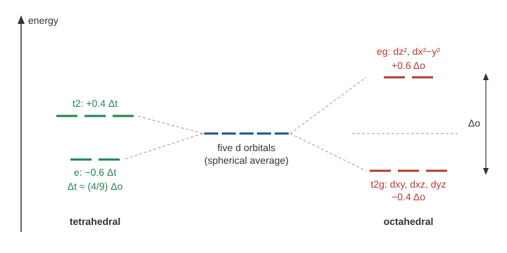

# 18.4 · Crystal field and ligand field theory

Why is one cobalt(III) complex diamagnetic and another, with a different ligand, strongly paramagnetic? Why are four-coordinate platinum(II) complexes flat while four-coordinate cobalt(II) ones are tetrahedral? Crystal field theory answers both with one picture: the ligands push the five d orbitals apart in energy, and the electrons then fill the new levels. This lesson builds that picture from the d-orbital shapes of lesson 12.5, turns it into numbers (the splitting, the stabilisation energy and the high/low-spin decision), and then upgrades it with molecular orbitals from lesson 12.6 to ligand field theory.

## Why it matters

The spin state of iron decides whether haemoglobin carries oxygen: binding O₂ switches iron(II) from high to low spin and changes its size, which moves the protein (Module 26). Spin-crossover materials, which switch between high and low spin with temperature or light, are studied for sensors and memory. And the splitting is the energy of the light a complex absorbs, which is its colour (lesson 18.5). One number per complex, Δ, links all three.

## Core ideas

> [!NOTE]
> Crystal and ligand field theory are settled. The splittings quoted are standard literature values from a university lecture table and OpenStax; the free-ion pairing energies are from LibreTexts (all retrieved 2026-10-17). Individual measured values vary by a few hundred cm⁻¹ between sources, solvents and counter-ions. 1 cm⁻¹ per ion is 0.011963 kJ/mol.

### d orbitals in an octahedral field

Recall the shapes from lesson [12.5](../module-12/lesson-05.md). Three d orbitals, $d_{xy}$, $d_{xz}$ and $d_{yz}$, have their lobes *between* the axes. Two, $d_{z^2}$ and $d_{x^2-y^2}$, point *along* the axes. Put six ligands on the ±x, ±y and ±z axes and treat them as negative point charges: that is **crystal field theory** (CFT). An electron in $d_{z^2}$ or $d_{x^2-y^2}$ points straight at the ligands and is repelled; one in $d_{xy}$, $d_{xz}$ or $d_{yz}$ avoids them.

The five orbitals split into two sets:

- **e<sub>g</sub>** ($d_{z^2}$, $d_{x^2-y^2}$), raised by $+0.6\,\Delta_o$;
- **t₂g** ($d_{xy}$, $d_{xz}$, $d_{yz}$), lowered by $-0.4\,\Delta_o$.

The gap $\Delta_o$ is the **octahedral splitting**. The weighted average stays where it was ($2 \times 0.6 = 3 \times 0.4$), like a see-saw balanced at its centre.



For one d electron the splitting is measured directly. $[\text{Ti(H}_2\text{O)}_6]^{3+}$ (d¹) absorbs most strongly at 499 nm (OpenStax), which is $10^7/499 = 20\,040$ cm⁻¹, or 240 kJ/mol. That is the energy to lift the electron from t₂g to e<sub>g</sub>, so $\Delta_o = 20\,040$ cm⁻¹.

### Tetrahedral and square-planar fields

In a **tetrahedron** the four ligands sit between the axes, so the order inverts: **e** ($d_{z^2}$, $d_{x^2-y^2}$) drops by $0.6\,\Delta_t$ and **t₂** rises by $0.4\,\Delta_t$. With fewer ligands, none pointing straight at an orbital, the splitting is small: $\Delta_t \approx \tfrac49\,\Delta_o$. $[\text{Co(NH}_3)_4]^{2+}$ has 5900 cm⁻¹ against 10 200 cm⁻¹ for $[\text{Co(NH}_3)_6]^{2+}$.

In a **square plane** (remove the two z ligands from an octahedron) $d_{x^2-y^2}$, pointing at all four ligands, rises far above the other four. A d⁸ ion fills the four lower orbitals and leaves $d_{x^2-y^2}$ empty, which pays off most when the splitting is large: heavy metals (Pt²⁺, Pd²⁺, Au³⁺) and strong ligands. That is why cisplatin is flat (lesson [18.3](lesson-03.md)).

### What sets the size of Δ

| Factor | Example (Δo, cm⁻¹) |
|---|---|
| Ligand | $[\text{CrF}_6]^{3-}$ 15 060, $[\text{Cr(H}_2\text{O)}_6]^{3+}$ 17 400, $[\text{Cr(CN)}_6]^{3-}$ 26 600 |
| Metal charge | $[\text{Co(NH}_3)_6]^{2+}$ 10 200, $[\text{Co(NH}_3)_6]^{3+}$ 22 870 |
| Row (3d → 4d → 5d) | $[\text{Co(NH}_3)_6]^{3+}$ 22 870, $[\text{Rh(NH}_3)_6]^{3+}$ 34 100, $[\text{Ir(NH}_3)_6]^{3+}$ 41 200 |
| Geometry | tetrahedral about 4/9 of octahedral |

Ligands ordered by the splitting they cause form the **spectrochemical series** (OpenStax gives the short form):

$$\text{I}^- < \text{Br}^- < \text{Cl}^- < \text{F}^- < \text{H}_2\text{O} < \text{NH}_3 < \text{en} < \text{NO}_2^- < \text{CN}^-$$

with CO at the strong end. Ligands at the left are **weak-field**, at the right **strong-field**. Notice that it is not ordered by charge: neutral NH₃ beats F⁻. The point-charge model cannot explain that; ligand field theory can.

### Crystal-field stabilisation energy

Fill the split orbitals with the metal's d electrons. The **crystal-field stabilisation energy** (CFSE) is the energy gained relative to the unsplit average:

$$\text{CFSE} = (-0.4\,n_{t_{2g}} + 0.6\,n_{e_g})\,\Delta_o$$

Cr³⁺ (d³, $t_{2g}^3$): $-1.2\,\Delta_o$. For $[\text{Cr(H}_2\text{O)}_6]^{3+}$ that is $-1.2 \times 17\,400$ cm⁻¹ $= -250$ kJ/mol. Ions with a big CFSE (d³, low-spin d⁶) are slow to swap ligands, because any change of geometry costs part of it: $[\text{Cr(H}_2\text{O)}_6]^{3+}$ and $[\text{Co(NH}_3)_6]^{3+}$ are the classic slow-exchange (inert) complexes.

### High spin or low spin

For d⁴ to d⁷ in an octahedron there are two ways to fill. Take d⁶:

- **high spin** $t_{2g}^4 e_g^2$: Hund's rule, four unpaired electrons, CFSE $= -0.4\,\Delta_o$;
- **low spin** $t_{2g}^6$: no unpaired electrons, CFSE $= -2.4\,\Delta_o$, but two more electron pairs.

Each electron moved from e<sub>g</sub> down to t₂g gains $\Delta_o$ and has to pair, which costs the **pairing energy** $P$ (extra electron–electron repulsion plus lost exchange energy). So:

$$\Delta_o > P \Rightarrow \text{low spin} \qquad \Delta_o < P \Rightarrow \text{high spin}$$

Free-ion pairing energies (LibreTexts): Fe²⁺ 19 150, Co³⁺ 23 625, Co²⁺ 20 800, Fe³⁺ 29 875 cm⁻¹. In a complex the d electrons spread partly onto the ligands, so they repel each other less: the measured electron-repulsion parameter of $[\text{Cr(H}_2\text{O)}_6]^{3+}$ is only about 65 % of the free ion's (the **nephelauxetic effect**, "cloud expanding"). Pairing energies fall with it. A rule of thumb that works for the examples in this lesson is $P_\text{complex} \approx 0.8\,P_\text{free}$; Part B tests it.

Tetrahedral complexes are almost always high spin, because $\Delta_t$ is small. 4d and 5d complexes are almost always low spin, because their Δ is large and their bigger orbitals lower $P$.

### Ligand field theory: adding covalent bonding

**Ligand field theory** (LFT) treats the metal–ligand bonds with molecular orbitals (lesson [12.6](../module-12/lesson-06.md)). Each ligand's lone pair overlaps with the metal orbitals that point at it: $d_{z^2}$, $d_{x^2-y^2}$, 4s and 4p. The e<sub>g</sub> orbitals become *antibonding*, pushed up; in a σ-only picture the t₂g orbitals stay non-bonding. Δ is the gap between them, as before. Now add π bonding with the t₂g set:

- **π donors** (F⁻, Cl⁻, OH⁻, O²⁻) have filled p orbitals that push the t₂g level *up*, closer to e<sub>g</sub>: **smaller Δ**.
- **π acceptors** (CO, CN⁻) have empty π* orbitals that accept electron density from t₂g and pull it *down*: **larger Δ**.

That is why halides sit at the weak end of the series and CN⁻ and CO at the strong end, regardless of charge.

### Jahn–Teller distortion

When a degenerate set is unevenly filled, the complex distorts to remove the degeneracy (the **Jahn–Teller theorem**). The clear cases have uneven e<sub>g</sub>: high-spin d⁴ (Cr²⁺, Mn³⁺) and d⁹ (Cu²⁺). Copper(II) complexes are almost never regular octahedra: two trans bonds are longer than the other four. Lowering $d_{z^2}$ by stretching along z stabilises the electron pair in it more than it costs the single electron in $d_{x^2-y^2}$.

## Worked example

### 1. Two cobalt(III) complexes: which is low spin?

Both are Co(III), d⁶. Take $P \approx 0.8 \times 23\,625 = 18\,900$ cm⁻¹.

| | $[\text{CoF}_6]^{3-}$ | $[\text{Co(NH}_3)_6]^{3+}$ |
|---|---|---|
| $\Delta_o$ (cm⁻¹) | 13 100 | 22 870 |
| $\Delta_o$ vs $P$ | smaller | larger |
| Prediction | high spin, $t_{2g}^4 e_g^2$, 4 unpaired | low spin, $t_{2g}^6$, 0 unpaired |

How much is at stake? Low spin minus high spin is $(-2.4 + 0.4)\,\Delta_o + 2P = -2\Delta_o + 2P$ (two extra pairs). For $[\text{CoF}_6]^{3-}$: $-26\,200 + 37\,800 = +11\,600$ cm⁻¹ = +139 kJ/mol, so high spin wins clearly. For $[\text{Co(NH}_3)_6]^{3+}$: $-45\,740 + 37\,800 = -7\,940$ cm⁻¹ = −95 kJ/mol, so low spin wins. Both match experiment: $[\text{CoF}_6]^{3-}$ is paramagnetic, $[\text{Co(NH}_3)_6]^{3+}$ diamagnetic. With the free-ion $P$ (23 625 cm⁻¹) the model would wrongly call the ammine high spin: the nephelauxetic reduction matters.

### 2. Rank the splittings

Order by $\Delta_o$, without a table: $[\text{Co(NH}_3)_6]^{2+}$, $[\text{CoF}_6]^{3-}$, $[\text{Co(NH}_3)_6]^{3+}$, $[\text{Rh(NH}_3)_6]^{3+}$.

- Co²⁺ against Co³⁺ with the same ligand: the higher charge pulls the ligands closer, so $[\text{Co(NH}_3)_6]^{2+}$ is smallest.
- Same metal and charge, F⁻ against NH₃: F⁻ is a π donor and weaker in the series.
- Co against Rh with the same ligand: 4d orbitals reach farther and overlap better, so Rh is largest.

Result: $[\text{Co(NH}_3)_6]^{2+}$ (10 200) < $[\text{CoF}_6]^{3-}$ (13 100) < $[\text{Co(NH}_3)_6]^{3+}$ (22 870) < $[\text{Rh(NH}_3)_6]^{3+}$ (34 100).

## Hands-on

What you need: the [Module 18 lab folder](../../labs/module-18/) with Python 3.14 (numpy and matplotlib, pinned in `labs/common/requirements.txt`), paper and pencil. Time: about 50 minutes.

### Part A — pencil: box diagrams (20 min)

For each complex, draw the split d levels with arrows for the electrons, give the number of unpaired electrons and the CFSE in units of Δ:

1. $[\text{Fe(H}_2\text{O)}_6]^{2+}$ (weak field) and $[\text{Fe(CN)}_6]^{4-}$
2. $[\text{Mn(H}_2\text{O)}_6]^{2+}$ (weak field)
3. $[\text{Ni(H}_2\text{O)}_6]^{2+}$ and $[\text{NiCl}_4]^{2-}$ (tetrahedral)
4. $[\text{Cu(H}_2\text{O)}_6]^{2+}$: which d orbital holds the single unpaired electron after the Jahn–Teller elongation along z?

<details><summary>Answers to Part A</summary>

1. Fe(II), d⁶. Water: high spin $t_{2g}^4 e_g^2$, 4 unpaired, CFSE −0.4 Δo. Cyanide: low spin $t_{2g}^6$, 0 unpaired, −2.4 Δo (OpenStax: high spin and low spin respectively).
2. Mn(II), d⁵, high spin $t_{2g}^3 e_g^2$, 5 unpaired, CFSE 0. No stabilisation at all: lesson 18.5 shows why this complex is almost colourless.
3. Ni(II), d⁸. Octahedral $t_{2g}^6 e_g^2$, 2 unpaired, −1.2 Δo (no spin choice for d⁸). Tetrahedral $e^4 t_2^4$, 2 unpaired, $-0.6 \times 4 + 0.4 \times 4 = -0.8\,\Delta_t$.
4. Cu(II), d⁹, $t_{2g}^6 e_g^3$. Elongation along z lowers $d_{z^2}$, which takes two electrons; the single electron is in $d_{x^2-y^2}$, the orbital pointing at the four short-bonded ligands.

</details>

### Part B — Python: CFSE and the spin-state decision (30 min)

Open `lesson04_cfse.py`. The helper `fill()` already places electrons in the lower and upper sets for a given spin. Write `cfse(d, geometry, spin)` and `predict_spin(d, geometry, delta, p)`. The script reads `complexes.csv` (13 complexes with literature splittings and free-ion pairing energies), predicts each spin state with $P = 0.8\,P_\text{free}$, compares with the observed spin, and prints the CFSE table for d⁰–d¹⁰. Then run it twice:

```bash
py lesson04_cfse.py
py lesson04_cfse.py 1.0
```

How you know it worked: with the default 0.8 all 8 spin choices are right; $[\text{Fe(CN)}_6]^{4-}$ has CFSE −2.4 Δo = −924 kJ/mol and $[\text{Ti(H}_2\text{O)}_6]^{3+}$ −96 kJ/mol. With the free-ion pairing energy (1.0) the model gets 6 of 8 and wrongly calls $[\text{Co(H}_2\text{O)}_6]^{3+}$ and $[\text{Co(NH}_3)_6]^{3+}$ high spin. The CFSE table for weak-field (high-spin) ions reads 0, −0.4, −0.8, −1.2, −0.6, 0, −0.4, −0.8, −1.2, −0.6, 0: the "double hump" plotted in `runs/lesson04_cfse.png`. Record the two runs on a [notebook page](../../templates/notebook-page.md).

<details><summary>Reference solution and discussion</summary>

`cfse`: `n_low, n_high, _ = fill(d, geometry, spin)`, then `-0.4*n_low + 0.6*n_high` (octahedral) or `-0.6*n_low + 0.4*n_high` (tetrahedral), rounded. `predict_spin`: tetrahedral d³–d⁶ return `"HS"`; anything else outside octahedral d⁴–d⁷ returns `"-"`; otherwise `"LS"` if `p is None or delta > p`, else `"HS"`. Full code in `lesson04_cfse_solution.py`.

The double hump is real. Measured hydration enthalpies of the M²⁺ ions from Ca²⁺ to Zn²⁺, and the lattice energies of their oxides and chlorides (lesson [18.2](lesson-02.md)), rise across the series with two humps at d³ and d⁸. The ions with zero CFSE (Ca²⁺ d⁰, Mn²⁺ d⁵, Zn²⁺ d¹⁰) lie on a smooth line; subtract it and what is left is about the CFSE. The factor 0.8 is a rule of thumb fitted to these examples, not a law: spin-crossover compounds have Δ and P so close that temperature decides.

</details>

## Common mistakes

- **Using the same Δ for tetrahedral and octahedral complexes.** Δt is only about 4/9 of Δo, and the order of the sets is inverted.
- **Comparing Δ with the free-ion pairing energy without thinking.** Pairing energies are smaller in complexes; borderline cases (Δ within about 20 % of P) need experiment.
- **Forgetting that d¹–d³ and d⁸–d¹⁰ have no spin choice in an octahedron.** Only d⁴–d⁷ do.
- **Expecting the spectrochemical series to follow ligand charge.** F⁻ and Cl⁻ are weak because they are π donors; neutral CO is the strongest because it is a π acceptor.
- **Counting the CFSE as the full energy difference between spin states.** Add the pairing energy for every extra pair.

## Key takeaways

- An octahedral field splits d into t₂g (−0.4 Δo) and e<sub>g</sub> (+0.6 Δo); a tetrahedral field inverts and shrinks this (Δt ≈ 4/9 Δo); a square plane leaves $d_{x^2-y^2}$ far above the rest, ideal for d⁸.
- Δ grows with ligand field strength, metal charge and row: Co³⁺ 22 870, Rh³⁺ 34 100, Ir³⁺ 41 200 cm⁻¹ with NH₃.
- Low spin when Δo > P, with P in a complex about 80 % of the free-ion value; tetrahedral complexes are high spin, 4d and 5d low spin.
- Ligand field theory explains the spectrochemical series: π donors shrink Δ, π acceptors enlarge it.
- Uneven e<sub>g</sub> filling (high-spin d⁴, d⁹) gives a Jahn–Teller distortion, as in almost every Cu(II) complex.

## Sources

- [OpenStax Chemistry 2e, 19.3 Spectroscopic and Magnetic Properties of Coordination Compounds](https://openstax.org/books/chemistry-2e/pages/19-3-spectroscopic-and-magnetic-properties-of-coordination-compounds) — crystal field splitting, the spectrochemical series, Δt ≈ 4/9 Δo, $[\text{Ti(H}_2\text{O)}_6]^{3+}$ at 499 nm, high- and low-spin iron complexes.
- [LibreTexts, Spin Pairing Energy](https://chem.libretexts.org/Bookshelves/Physical_and_Theoretical_Chemistry_Textbook_Maps/Supplemental_Modules_(Physical_and_Theoretical_Chemistry)/Electronic_Structure_of_Atoms_and_Molecules/Electronic_Configurations/Spin_Pairing_Energy) — free-ion pairing energies of Mn²⁺, Fe³⁺, Fe²⁺, Co³⁺, Co²⁺.
- [LibreTexts, The Nephelauxetic Effect](https://chem.libretexts.org/Bookshelves/Inorganic_Chemistry/Map%3A_Inorganic_Chemistry_(Housecroft)/20%3A_d-Block_Metal_Chemistry_-_Coordination_Complexes/20.09%3A_Evidence_for_Metal-Ligand_Covalent_Bonding/20.9A%3A_The_Nephelauxetic_Effect) — reduced electron repulsion in $[\text{Cr(H}_2\text{O)}_6]^{3+}$ compared with the free ion.
- [University of Mustansiriyah lecture: crystal field theory](https://uomustansiriyah.edu.iq/media/lectures/6/6_2018_12_16!12_03_30_PM.pdf) — the table of Δ values for Cr(III), Co(II), Co(III), Rh(III), Ir(III) and Fe cyanides used in `complexes.csv`.
- [MIT OpenCourseWare 5.111SC](https://ocw.mit.edu/courses/5-111sc-principles-of-chemical-science-fall-2014/) — transition-metal lectures (crystal field theory, magnetism and colour).
