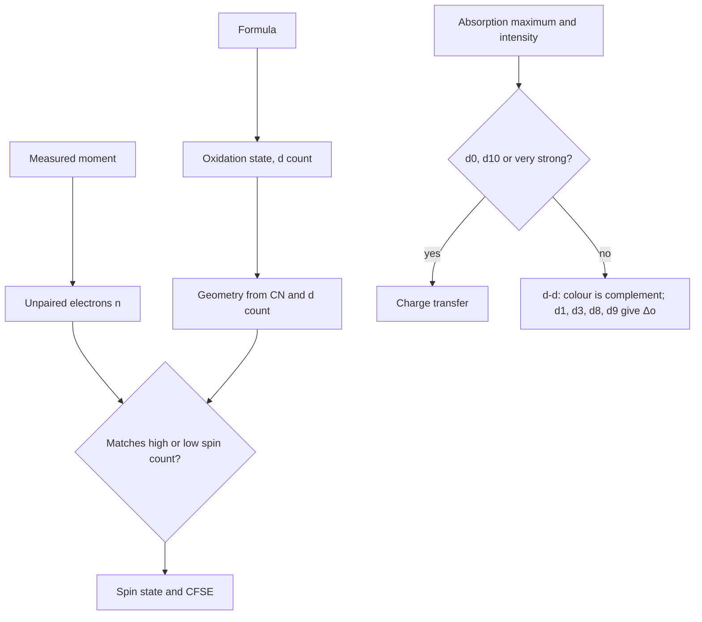

# 18.5 · Colour and magnetism of transition-metal complexes

Colour and magnetism are the two quick measurements that tell you what is inside a transition-metal complex. The colour comes from light absorbed across the splitting Δ, and its intensity tells you which selection rules the transition breaks. The magnetic moment counts the unpaired electrons, and so tells you the spin state. This lesson turns both into numbers using lessons 18.4 and 12.6, then ends with the module practical: nine complex cards to decode with everything from this module.

## Why it matters

A synthetic chemist who has just made a new iron complex has a coloured powder and two cheap instruments: a UV-Vis spectrometer and a magnetic balance (or an NMR spectrometer for the Evans method). Ten minutes with them answers the first questions any reviewer will ask: is iron +2 or +3, high or low spin, octahedral or tetrahedral, and is the colour from d–d or charge-transfer bands? The same reasoning reads gemstones (ruby is Cr³⁺ in Al₂O₃), pigments and the iron centres of proteins (Module 26).

## Core ideas

> [!NOTE]
> The physics here is settled. The colour bands follow the MIT 5.111SC handout, the intensity ranges and measured magnetic moments come from LibreTexts, and the example spectra from OpenStax and the lesson 18.4 table (all retrieved 2026-10-17). Real absorption bands are broad, so colour names are approximate.

### Colour is what is left

A solution looks coloured when it absorbs part of white light; you see the rest. The colour you see is roughly the **complement** of the colour absorbed, opposite on the colour wheel:

| Absorbed (nm) | 400–430 violet | 430–490 blue | 490–560 green | 560–580 yellow | 580–620 orange | 620–800 red |
|---|---|---|---|---|---|---|
| Seen | yellow | orange | red-purple | violet | blue | green |

Energy and wavelength are linked by $E = hc/\lambda$ (lesson [04.5](../module-04/lesson-05.md)). In wavenumbers the conversion is one line: $\tilde\nu\,(\text{cm}^{-1}) = 10^7/\lambda\,(\text{nm})$. So the splitting is the colour: $[\text{Ti(H}_2\text{O)}_6]^{3+}$ absorbs at 499 nm (green), $\Delta_o$ = 20 040 cm⁻¹, and the solution is purple. Strong-field complexes absorb at shorter wavelengths and often look yellow, orange or red; weak-field complexes absorb towards the red and often look blue or green (OpenStax).

### Getting Δo from a spectrum

For a d¹ ion there is one transition and its energy is $\Delta_o$. For octahedral d³ and d⁸ ions the lowest-energy d–d band also equals $\Delta_o$, and for d⁹ (Cu²⁺) the main band is close to it. For $[\text{Cr(H}_2\text{O)}_6]^{3+}$, $\Delta_o$ = 17 400 cm⁻¹ puts the lowest band at 575 nm (yellow absorbed, violet seen); the higher bands come from electron repulsion and need the Tanabe–Sugano diagrams of Module 20. Other d counts have several bands of mixed origin, so do not read $\Delta_o$ off the first peak without that analysis.

### How strong is a band? Selection rules

Lesson [12.6](../module-12/lesson-06.md) gave two rules for electric-dipole transitions. Both apply here:

- **Laporte rule**: in a molecule with a centre of inversion, transitions between states of the same parity (g → g) are forbidden. All d orbitals are g, so d–d bands in an octahedral complex are forbidden. They appear only because vibrations briefly break the symmetry, and they stay weak.
- **Spin rule**: $\Delta S = 0$. A transition that must flip a spin is forbidden.

The intensity is measured by the **molar absorption coefficient** $\varepsilon$ in L mol⁻¹ cm⁻¹ (the Beer–Lambert law, Module 19):

| Kind of band | Typical $\varepsilon$ | Example |
|---|---|---|
| spin- and Laporte-forbidden d–d | about 0.1 | $[\text{Mn(H}_2\text{O)}_6]^{2+}$, very pale pink |
| spin-allowed, Laporte-forbidden d–d (octahedral) | about 1–10 | $[\text{Ti(H}_2\text{O)}_6]^{3+}$, $[\text{Cr(H}_2\text{O)}_6]^{3+}$ |
| d–d in tetrahedral complexes (no inversion centre) | about 50–150 | tetrahedral Co(II) chlorides, deep blue |
| charge transfer (Laporte-allowed) | about 10³ to 10⁶ | $\text{MnO}_4^-$, about $2\times10^3$ at 525 nm |

High-spin Mn²⁺ is d⁵ with one electron in each d orbital: any d–d excitation must pair two electrons and flip a spin, so every band is doubly forbidden. In a **charge-transfer** (CT) band an electron moves between the ligands and the metal. Permanganate has Mn(VII), d⁰: it has no d electrons at all, yet it is intensely purple, because an electron jumps from an oxygen lone pair to the empty metal d orbitals (ligand-to-metal CT). CT bands are Laporte-allowed, so they are hundreds to thousands of times stronger than d–d bands. Use the rule: **a d⁰ or d¹⁰ complex that is coloured, or any very intense band, is charge transfer.**

### Magnetism counts unpaired electrons

A substance with unpaired electrons is **paramagnetic**: it is pulled into a magnetic field. One with all electrons paired is **diamagnetic**: weakly pushed out. The strength of the pull is the magnetic susceptibility, measured with a Gouy balance (weigh the sample with and without a magnet) or by the Evans NMR method. It is reported as an effective magnetic moment $\mu_\text{eff}$ in Bohr magnetons (BM).

For first-row ions most of the moment comes from spin, so the **spin-only formula** works well:

$$\mu_\text{so} = \sqrt{n(n+2)}\ \text{BM}$$

| unpaired $n$ | 0 | 1 | 2 | 3 | 4 | 5 |
|---|---|---|---|---|---|---|
| $\mu_\text{so}$ (BM) | 0 | 1.73 | 2.83 | 3.87 | 4.90 | 5.92 |

Observed moments (LibreTexts) are close: Cr(III) 3.7–3.9, high-spin Mn(II) and Fe(III) 5.6–6.1, low-spin Fe(III) 1.8–2.1, Cu(II) 1.7–2.2. They are larger where the orbital motion also contributes: high-spin octahedral Co(II) is 4.3–5.2 BM against 3.87 spin-only. Because the steps between $n$ values are about 1 BM, a moment still identifies $n$ without doubt.

Combined with lesson 18.4, $n$ gives the spin state. Fe(II), d⁶: 4 unpaired means high spin, 0 means low spin. Fe(III), d⁵: 5 or 1.



## Worked example

### 1. Two iron(III) salts

$\text{K}_3[\text{Fe(CN)}_6]$ has $\mu_\text{eff}$ about 2.0 BM and is bright red-orange; a pale salt of $[\text{Fe(H}_2\text{O)}_6]^{3+}$ has about 5.9 BM.

- Both are Fe(III), d⁵ (group 8 − 3).
- 2.0 BM is closest to $\mu_\text{so}(1) = 1.73$: one unpaired electron, low spin $t_{2g}^5$. 5.9 BM matches $\mu_\text{so}(5) = 5.92$: high spin $t_{2g}^3 e_g^2$.
- CFSE: low spin $-2.0\,\Delta_o$; high spin 0.
- Colour: the aqua ion, high-spin d⁵, has only spin-forbidden d–d bands, so its colour is faint (in practice its colour often comes from partly hydrolysed species). The cyanide complex's strong colour is mostly charge transfer.

Cyanide is a strong-field ligand and water a weak one, so the result is what lesson 18.4 predicts (OpenStax and the MIT handout describe the same pair).

### 2. Three chromium(III) complexes

All three are Cr³⁺, d³, so the lowest band is $\Delta_o$ (lesson 18.4 table):

| Complex | $\Delta_o$ (cm⁻¹) | $\lambda = 10^7/\Delta_o$ | Absorbed | Expected colour |
|---|---|---|---|---|
| $[\text{CrF}_6]^{3-}$ | 15 060 | 664 nm | red | green |
| $[\text{Cr(H}_2\text{O)}_6]^{3+}$ | 17 400 | 575 nm | yellow | violet |
| $[\text{Cr(CN)}_6]^{3-}$ | 26 600 | 376 nm | near-UV, edge of violet | pale yellow |

Moving one ligand along the spectrochemical series moves the colour across the wheel. Ruby is the same ion, Cr³⁺, in the oxide lattice of Al₂O₃: a field between those of fluoride and cyanide gives its red.

## Hands-on

What you need: the [Module 18 lab folder](../../labs/module-18/) with Python 3.14 (packages pinned in `labs/common/requirements.txt`), paper and pencil, and the [lab-report template](../../templates/lab-report.md). Time: about 100 minutes.

### Part A — pencil warm-up (20 min)

1. Suppose an octahedral Ni(II) complex shows three bands, at 1100, 650 and 390 nm (made-up but realistic numbers). Which band gives $\Delta_o$, and what is it in cm⁻¹ and kJ/mol?
2. What colour do you expect for a complex whose only visible band is at 600 nm?
3. A cobalt(II) complex has $\mu_\text{eff}$ = 4.6 BM. How many unpaired electrons, and what spin state? Why is the moment above 3.87?
4. $[\text{Zn(H}_2\text{O)}_6]^{2+}$ is colourless and $[\text{CrO}_4]^{2-}$ (chromate, Cr(VI)) is yellow. Explain both in one sentence each.

<details><summary>Answers to Part A</summary>

1. Ni(II) is d⁸: the lowest-energy band, at 1100 nm, is $\Delta_o$ = $10^7/1100$ = 9 090 cm⁻¹ = 109 kJ/mol. The other two bands involve electron repulsion (Module 20). Absorbing red (650 nm) and violet (390 nm) leaves green.
2. 600 nm is orange: the complex looks blue.
3. 4.6 BM is closest to $n$ = 3 (3.87) rather than 4 or 5. Co(II) is d⁷: 3 unpaired is high spin ($t_{2g}^5 e_g^2$). High-spin octahedral Co(II) has an orbital contribution, which LibreTexts gives as 4.3–5.2 BM.
4. Zn²⁺ is d¹⁰: no d–d transitions, and its CT bands are in the ultraviolet. Chromate is d⁰: its colour is an O → Cr charge-transfer band in the violet, so it looks yellow.

</details>

### Part B — module practical: decode nine complexes (80 min)

`cards.csv` describes nine complexes as a lab would see them: formula, geometry, the absorption maximum or the colour absorbed, the band intensity (very weak, weak or strong) and the measured magnetic moment. The sources for every number are in the file's header.

1. **Predict first, on paper.** Copy this table and fill in every cell for all nine cards before you open the code: oxidation state; d count; unpaired electrons from $\mu_\text{eff}$; spin state (HS, LS or no choice); CFSE in units of Δ; $\Delta_o$ in cm⁻¹ where the band gives it; expected colour; band type (d–d or charge transfer).
2. **Code.** Open `lesson05_practical.py` and write `unpaired_from_mu(mu)`, `spin_label(d, geometry, n)` and `band_type(d, intensity)`. The helpers for d count, colour and spin-only moments are in `inorg18.py`.
3. **Run and compare** with your table:

```bash
py lesson05_practical.py
```

4. **Report.** Write a one-page report with the [lab-report template](../../templates/lab-report.md): your table, every disagreement between your prediction, the script and the observed colour, and for each one which step (oxidation state, spin, selection rule, colour wheel) explains it. Add one paragraph on what this exercise does not train: you did not weigh a sample on a Gouy balance or record a spectrum, and real bands are broad and overlap.

How you know it worked: the script prints d counts 1, 3, 3, 6, 6, 5, 5, 0 and 9; unpaired electrons 1, 3, 3, 4, 0, 1, 5, 0, 1; $[\text{Fe(H}_2\text{O)}_6]^{2+}$ high spin, $[\text{Fe(CN)}_6]^{4-}$ low spin, $[\text{Fe(CN)}_6]^{3-}$ low spin, $[\text{Mn(H}_2\text{O)}_6]^{2+}$ high spin; $\Delta_o$ 20 040, 17 391 and 15 060 cm⁻¹ for cards 1–3; charge transfer for cards 6 and 8. The expected colour agrees with the observed one for 8 of 9 cards; the odd one is card 7.

<details><summary>Reference solution and discussion</summary>

`unpaired_from_mu`: `return min(range(6), key=lambda n: abs(spin_only(n) - mu))`. `spin_label`: compare `n` with the two counts from `unpaired_options`. `band_type`: `"charge transfer"` for d⁰, d¹⁰ or a strong band; `"spin-forbidden d-d"` for very weak; otherwise `"d-d (Laporte-forbidden)"`. Full code in `lesson05_practical_solution.py`.

Card 7, $[\text{Mn(H}_2\text{O)}_6]^{2+}$: the script calls it "almost colourless" and the solution is very pale pink. Both are right: with $\varepsilon$ about 0.1 you only see the colour in concentrated solution. Card 8, permanganate: d⁰, so it has no d–d bands at all; its purple is O → Mn charge transfer at 525 nm. Card 6, ferricyanide: low-spin d⁵ with one unpaired electron; its strong red-orange colour comes mostly from charge transfer, not d–d. Card 9, $[\text{Cu(NH}_3)_4]^{2+}$: square planar (the Jahn–Teller limit of an elongated octahedron), d⁹ with one unpaired electron, absorbing orange-red and looking deep blue. Typical student errors: forgetting that MnO₄⁻ is Mn(VII); assigning ferricyanide as high spin from "iron(III) is d⁵"; reading the colour absorbed as the colour seen.

</details>

## Common mistakes

- **Reporting the absorbed colour as the colour of the solution.** A complex that absorbs red looks green.
- **Reading Δo from the first band of any ion.** That works for octahedral d¹, d³, d⁸ and (roughly) d⁹; other d counts need a Tanabe–Sugano analysis.
- **Calling every strong colour d–d.** d–d bands are weak; d⁰ and d¹⁰ species and very intense bands mean charge transfer.
- **Expecting moments to equal the spin-only values exactly.** Orbital contributions add up to about 1 BM for some ions (high-spin Co²⁺); choose the nearest integer $n$.
- **Forgetting the oxidation state before counting d electrons.** Mn in MnO₄⁻ is +7, so d⁰.

## Key takeaways

- Colour is the complement of the absorbed band; $\tilde\nu = 10^7/\lambda$ turns a wavelength (nm) into a splitting (cm⁻¹).
- For octahedral d¹, d³, d⁸ and d⁹ the lowest band gives Δo directly.
- d–d bands are Laporte-forbidden and weak; spin-forbidden ones (high-spin Mn²⁺) are almost invisible; charge-transfer bands are strong.
- $\mu_\text{so} = \sqrt{n(n+2)}$ BM counts unpaired electrons; with the d count it fixes the spin state.
- A formula, one spectrum and one magnetic measurement give a complex's oxidation state, d count, spin, splitting and the origin of its colour.

## Sources

- [OpenStax Chemistry 2e, 19.3](https://openstax.org/books/chemistry-2e/pages/19-3-spectroscopic-and-magnetic-properties-of-coordination-compounds) — colour and the splitting, $[\text{Ti(H}_2\text{O)}_6]^{3+}$ at 499 nm, colours and spin states of iron and copper complexes.
- [LibreTexts, Selection Rules for Electronic Spectra of Transition Metal Complexes](https://chem.libretexts.org/Bookshelves/Physical_and_Theoretical_Chemistry_Textbook_Maps/Supplemental_Modules_(Physical_and_Theoretical_Chemistry)/Spectroscopy/Electronic_Spectroscopy/Selection_Rules_for_Electronic_Spectra_of_Transition_Metal_Complexes) — Laporte and spin rules and typical molar absorption coefficients.
- [LibreTexts, Magnetic Moments of Transition Metals](https://chem.libretexts.org/Bookshelves/Inorganic_Chemistry/Supplemental_Modules_and_Websites_(Inorganic_Chemistry)/Crystal_Field_Theory/Magnetic_Moments_of_Transition_Metals) — spin-only and observed moments, the Gouy method.
- [MIT OpenCourseWare 5.111SC](https://ocw.mit.edu/courses/5-111sc-principles-of-chemical-science-fall-2014/) — lecture 28 handout: visible bands, complementary colours, the ferricyanide and aqua iron(III) examples.
