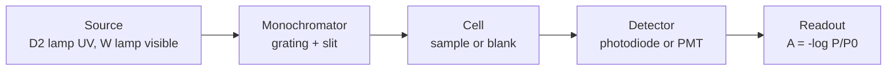

# 19.1 · UV-Vis spectrophotometry and Beer-Lambert

A UV-Vis spectrophotometer shines ultraviolet or visible light through a solution and measures how much gets through. It is the most common instrument in any chemistry lab, because many compounds absorb light, and how much they absorb tells you how much is there. You met the Beer–Lambert law for mixtures in [Lesson 03.1](../module-03/lesson-01.md) and the calibration line in [Lesson 09.4](../module-09/lesson-04.md). This lesson opens the instrument: what is inside it, why the law bends at high absorbance, and how to plan a measurement so the answer is as precise as the instrument allows.

## Why it matters

A quality lab checks the blue dye in a sports drink. The drink straight from the bottle reads an absorbance of 2.40. A junior analyst reads that on the calibration line and reports 15 mg/L. The true value is 64 mg/L, four times higher. Nothing was broken: the instrument simply cannot report an absorbance above about 2.4, because a little light always reaches the detector without passing through the sample. A ten-second check of where the reading sits on the calibration would have caught it. The fix, diluting into the range where the line is straight, costs one pipette. In this lesson you learn to see that trap before it bites.

## Core ideas

> [!NOTE]
> Stable: the Beer–Lambert law, the stray-light equation and the photometric-error analysis (Harvey, chapter 10, checked 2026-10-17). Instrument details change: typical bandwidths, cell materials and the numbers quoted for stray light differ between models, so read your instrument's specification sheet. All data in this lesson's lab are simulated.

### Transmittance and absorbance

Light of power $P_0$ enters a cell; power $P_T$ leaves it. The **transmittance** is the fraction that gets through, $T = P_T/P_0$. The **absorbance** is

$$A = -\log_{10} T$$

An absorbance of 1 means 10 % of the light gets through; 2 means 1 %; 3 means 0.1 %. Absorbance is used because, for a dilute solution, it is proportional to concentration. That is the **Beer–Lambert law**:

$$A = \varepsilon\, b\, c$$

Here $\varepsilon$ is the **molar absorptivity** (L mol⁻¹ cm⁻¹), $b$ the path length (cm) and $c$ the concentration (mol/L). If you work in mg/L, use the **absorptivity** $a$ (L mg⁻¹ cm⁻¹) instead; $\varepsilon = a \times M$, with $M$ in mg/mol. Absorbances of different species add ([Lesson 03.1](../module-03/lesson-01.md)).

Why molecules absorb at all: a photon whose energy matches the gap between two electronic states can lift an electron to the higher one ([Lesson 04.5](../module-04/lesson-05.md), [Lesson 12.6](../module-12/lesson-06.md)). Conjugated π systems and transition-metal complexes have gaps in the visible, so they are coloured; a blue dye absorbs orange-red light near 630 nm.

### What is inside the instrument



- **Source.** A deuterium lamp for the UV (about 190–350 nm) and a tungsten-halogen lamp for the visible.
- **Monochromator.** A grating spreads the light; a slit picks out a narrow band. The width of that band is the **bandwidth**.
- **Cell (cuvette).** Usually 1 cm. Quartz (fused silica) is needed below about 300 nm; glass and ordinary plastic absorb there and are fine only in the visible.
- **Detector.** A photodiode, a photomultiplier, or in a **diode-array** instrument a row of photodiodes that records the whole spectrum at once after the grating.

A **single-beam** instrument measures the blank, then the sample, so a drifting lamp causes errors. A **double-beam** instrument switches the beam between blank and sample many times a second and cancels the drift.

### Choosing the wavelength

Measure at an absorption maximum, $\lambda_\text{max}$. There the sensitivity is highest, and the absorbance changes slowly with wavelength, so a slightly mis-set wavelength or a finite bandwidth does little harm. Choose a slit that is narrow compared with the width of the band, but wide enough to let enough light through.

### Why the law bends

Beer–Lambert is a limiting law: it holds for dilute solutions. Three kinds of deviation matter in practice.

- **Chemical.** If the analyte takes part in an equilibrium, for example a weak-acid indicator whose two forms absorb differently, the absorbance depends on pH as well as on concentration. Buffer all standards and samples the same way.
- **Polychromatic light.** The band that passes the slit has a finite width. If $\varepsilon$ changes across that band, the response curves down. Measuring at the top of a broad peak keeps this small.
- **Stray light.** Some light reaches the detector without passing through the sample: reflections inside the instrument, light scattered by dust, light of other wavelengths. If a fraction $s$ of the incident light is stray, the instrument reports

$$A_\text{obs} = -\log_{10}\frac{T + s}{1 + s}$$

At low absorbance $T \gg s$ and nothing changes. At high absorbance $T$ shrinks towards $s$, and the reading flattens. When $T \to 0$, $A_\text{obs} \to -\log_{10}\frac{s}{1+s}$: with $s = 0.4\,\%$ that ceiling is 2.40. You saw the same flattening with phone photos in [Lesson 09.6](../module-09/lesson-06.md).

### Where the measurement is most precise

Noise in the transmittance becomes an error in the concentration. If the noise $s_T$ is the same size at every transmittance (a common case for simple instruments), the relative error of the concentration is

$$\frac{s_c}{c} = \frac{0.4343\, s_T}{T\,\lvert\log_{10} T\rvert}$$

It is large at low absorbance (two nearly equal signals are subtracted) and at high absorbance (almost no light arrives). The minimum is at $A = 0.434$. With $s_T = 0.002$, the error is 0.5 % at $A = 0.43$, about 1 % at 0.1 and 1.0, and 4 % at 2.0. Harvey's rule of thumb: keep readings between about 0.1 and 1. Instruments limited by photon noise have a flatter minimum near 1, so the exact best value depends on the detector; the "stay in the middle" lesson does not.

[Simulation: Spectrometer — Beer–Lambert calibration](../../simulations/spectrometer/index.html?preset=beer-lambert)

## Worked example

### 1. From a reading to a concentration

A blue dye is calibrated at 630 nm in a 1 cm cell. Standards from 0 to 6 mg/L give a straight line $A = 0.0018 + 0.1578\,c$ with $s_r = 0.0020$. The sports drink straight from the bottle reads 2.40. That is above the top standard (0.95 at 6 mg/L), so the line says nothing about it.

Dilute 1 + 19 (5.00 mL of drink to 100.0 mL). Three readings average 0.510, close to the best absorbance:

$$c_\text{cell} = \frac{0.510 - 0.0018}{0.1578} = 3.22\ \text{mg/L}, \qquad c_\text{drink} = 20 \times 3.22 = 64.4\ \text{mg/L}$$

With Harvey's eq. 5.12 ([Lesson 09.4](../module-09/lesson-04.md)) $s_c = 0.010$ mg/L in the cell, so the drink holds $64.4 \pm 0.2$ mg/L.

If the dye is Brilliant Blue FCF, the disodium salt has $M = 792.9$ g/mol (PubChem CID 19700). The absorptivity $a = 0.1578$ L mg⁻¹ cm⁻¹ then corresponds to $\varepsilon = 0.1578 \times 792\,900 = 1.25 \times 10^5$ L mol⁻¹ cm⁻¹, typical of an intensely coloured dye.

### 2. How much does stray light cost?

The instrument has $s = 0.40\,\%$. A sample with true absorbance 2.00 has $T = 0.0100$:

$$A_\text{obs} = -\log_{10}\frac{0.0100 + 0.0040}{1.0040} = 1.856$$

The reading is 7 % low. At a true absorbance of 1.00 it is 1.5 % low, and at 0.50 only 0.7 %. So stray light sets the top of the linear range, and the residuals of a straight line through all the standards show it as a hump followed by a drop.

## Hands-on

**What you need:** a computer with the [Module 19 lab folder](../../labs/module-19/) (setup in its README); pencil and paper. **Time:** about 60 minutes. Record your work on the [lab report template](../../templates/lab-report.md).

### Part A — simulation: see the law bend (15 min)

[Simulation: Spectrometer — stray light and the top of the range](../../simulations/spectrometer/index.html?preset=stray-light)

1. In the `beer-lambert` preset, measure five standards and note the slope.
2. Switch to `stray-light`. Raise the stray-light fraction from 0 to 1 %. Watch the top standards flatten.
3. Find the concentration at which the reading is 5 % low, for $s = 0.1\,\%$ and $s = 1\,\%$.

**How you know it worked:** with $s = 1\,\%$ the highest possible reading is $-\log_{10}(0.01/1.01) = 2.00$.

### Part B — Python: fit the stray light and plan the dilution (35 min)

1. Open `lesson01_uvvis.py`. Complete TODO 1 (the stray-light absorbance) and TODO 2 (the relative concentration error).
2. Run it from the lab folder:

```bash
py lesson01_uvvis.py
```

3. Open `runs/lesson01_uvvis.png`. Look at the middle panel: the residuals of one straight line through all ten standards.
4. Answer: which standards would you keep for the working calibration, and why?

**How you know it worked:** the straight line through all points has residuals that rise then fall sharply (the last is −0.30); the stray-light model returns $a = 0.160$ L mg⁻¹ cm⁻¹ and $s = 0.40\,\%$; the diluted drink gives $64.4 \pm 0.2$ mg/L; the error table has its minimum (0.54 %) at $A = 0.4343$.

<details><summary>Reference solution</summary>

```python
# TODO 1
T = 10.0 ** (-A_true)
return -np.log10((T + s) / (1 + s))
# TODO 2
T = 10.0 ** (-A)
return 0.4343 * s_T / (T * np.abs(np.log10(T)))
```

Keep the standards up to about 6 mg/L ($A \le 0.95$), where the stray-light model and the straight line agree within 1.5 %; above that the reading is more than 1.5 % low and rising. Alternatively, fit the stray-light model over the whole range, but a straight line in the working range with samples diluted into it is simpler and is what methods normally specify. The full script is `lesson01_uvvis_solution.py`.

</details>

### Part C — pencil (10 min)

1. A solution transmits 25 % of the light. What is its absorbance?
2. A compound has $\varepsilon = 15\,400$ L mol⁻¹ cm⁻¹ at its maximum. What concentration gives $A = 0.43$ in a 1 cm cell?
3. You must measure at 260 nm. Which cuvette do you use?
4. A sample reads 1.9 on an instrument with 0.4 % stray light. What do you do?

<details><summary>Answers</summary>

1. $A = -\log_{10} 0.25 = 0.60$.
2. $c = 0.43/15\,400 = 2.8 \times 10^{-5}$ mol/L.
3. Quartz (fused silica); glass and ordinary plastic absorb below about 300 nm.
4. Dilute it by a known factor (for example 1 + 3) so it reads near 0.5, measure again, and multiply back. At 1.9 the reading is several percent low and the precision is poor.

</details>

## Common mistakes

- **Reading a sample above the top standard.** The line is unknown there, and stray light makes it worse. Dilute into the range.
- **Using a plastic or glass cell in the UV.** The cell itself absorbs below about 300 nm and the blank is huge. Use quartz.
- **Measuring on the side of a peak.** A small wavelength error or the finite bandwidth then changes the slope. Measure at $\lambda_\text{max}$ unless an interferent forces you elsewhere.
- **Different pH in standards and samples.** An indicator-like analyte then gives two different calibration lines. Buffer everything the same way.
- **Trusting $R^2$ over the full range.** A line through bent data can still have $R^2 = 0.98$; the residual pattern is what shows the bend ([Lesson 05.3](../module-05/lesson-03.md)).

## Key takeaways

- $A = -\log_{10} T = \varepsilon b c$, valid for dilute solutions; absorbances add.
- Choose $\lambda_\text{max}$, a quartz cell below 300 nm, and a slit narrow compared with the band.
- Stray light caps the highest readable absorbance at $-\log_{10}[s/(1+s)]$ and bends the top of the calibration.
- The relative error of concentration is smallest near $A = 0.43$; plan dilutions so samples read between about 0.1 and 1.
- Find the linear range from the residuals, not from $R^2$.

## Sources

- [LibreTexts — Harvey, Analytical Chemistry 2.1, 10.2 Spectroscopy Based on Absorption](https://chem.libretexts.org/Bookshelves/Analytical_Chemistry/Analytical_Chemistry_2.1_by_David_Harvey/Analytical_Chemistry_2.1_(Harvey)/10%3A_Spectroscopic_Methods/10.02%3A_Spectroscopy_Based_on_Absorption) (transmittance, absorbance, chemical and instrumental limits, the stray-light equation).
- [LibreTexts — Harvey, Analytical Chemistry 2.1, 10.3 UV/Vis and IR Spectroscopy](https://chem.libretexts.org/Bookshelves/Analytical_Chemistry/Analytical_Chemistry_2.1_by_David_Harvey/Analytical_Chemistry_2.1_(Harvey)/10%3A_Spectroscopic_Methods/10.03%3A_UV_Vis_and_IR_Spectroscopy) (instrument designs, quartz below 300 nm, choice of wavelength and slit, relative error minimum at A = 0.4343).
- [LibreTexts — Harvey, Analytical Chemistry 2.1, 10.1 Overview of Spectroscopy](https://chem.libretexts.org/Bookshelves/Analytical_Chemistry/Analytical_Chemistry_2.1_by_David_Harvey/Analytical_Chemistry_2.1_(Harvey)/10%3A_Spectroscopic_Methods/10.01%3A_Overview_of_Spectroscopy) (sources, monochromators, detectors).
- [PubChem — Brilliant Blue FCF (CID 19700)](https://pubchem.ncbi.nlm.nih.gov/compound/19700) (formula C₃₇H₃₄N₂Na₂O₉S₃, molar mass 792.9 g/mol).
