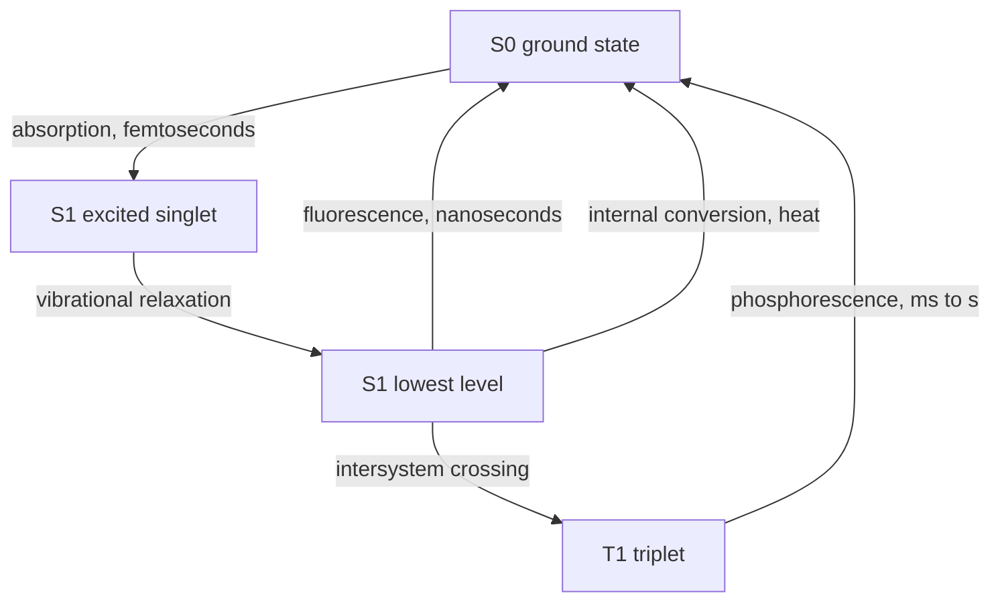

# 19.2 · Fluorescence and atomic spectroscopy

Absorbance measures light that goes missing. Fluorescence measures light that a molecule sends back out, and atomic spectroscopy measures the sharp lines of free atoms in a flame or a plasma. These methods reach far lower concentrations than UV-Vis: picomolar for a good fluorophore, nanograms per litre for metals by ICP-MS. This lesson explains where that sensitivity comes from, what spoils it, and how a chemist picks the right instrument for a metal in water or a drug in urine.

## Why it matters

A hospital lab measures quinine, a drug and the bitter taste in tonic water, in urine. Quinine fluoresces strongly, so the method is sensitive. But urine is full of chloride, and chloride switches the fluorescence off: at 1000 mg/L of salt the signal falls to about a third. A method that ignored this would report a third of the real dose. In a water lab the question is different: is the lead in a school's drinking water below the limit? A flame instrument cannot see it; a graphite furnace or ICP-MS can. Choosing wrongly gives "not detected" for water that is not safe.

## Core ideas

> [!NOTE]
> Stable: the photophysics, Stern–Volmer quenching, the Boltzmann distribution and the classic interferences (Harvey 10.4–10.7, checked 2026-10-17). Instrument detection limits, prices and which technique a regulator names change over time and between models. Constants: CODATA 2022 (NIST), where $h$, $c$ and $k$ are exact.

### What happens after a molecule absorbs



The molecule first loses some vibrational energy as heat, then emits. So the emitted light has lower energy, a longer wavelength, than the absorbed light. That gap is the **Stokes shift**. Quinine absorbs at 350 nm and fluoresces at 450 nm: UV in, blue out. The **quantum yield** $\Phi$ is the fraction of excited molecules that fluoresce; for quinine in dilute sulfuric acid it is 0.55.

### Why fluorescence is so sensitive

The detector sits at 90° to the exciting beam. With no analyte it sees almost nothing, so a tiny signal stands out against a dark background. Absorbance, by contrast, is a small difference between two large signals. The fluorescence intensity is

$$I_f = 2.303\,k\,\Phi\,\varepsilon\,b\,c\,P_0$$

where $k$ is an instrument constant and $P_0$ the source power. A stronger lamp gives more signal, which is never true for absorbance. Selectivity is also better: few compounds both absorb at your excitation wavelength and emit at your emission wavelength.

The equation is an approximation of $I_f \propto 1 - 10^{-A}$. It holds only while the sample absorbs very little, $A$ below about 0.01. Above that, the front of the cell absorbs most of the light and the back sees little; this **inner-filter effect** bends the calibration down (−1.2 % at $A = 0.01$, −11 % at $A = 0.1$). Dilute until the absorbance is tiny.

### Quenching

A **quencher** takes the energy from an excited molecule before it can emit. For collisional quenching the **Stern–Volmer equation** holds:

$$\frac{F_0}{F} = 1 + K_\text{SV}[Q]$$

$F_0$ is the signal without quencher and $K_\text{SV}$ the Stern–Volmer constant. A plot of $F_0/F$ against $[Q]$ is a straight line through 1. Halides quench quinine; dissolved oxygen quenches many fluorophores. The cure is to remove the quencher (extract the analyte) or to match it in standards and samples.

### Atomic absorption (AAS)

Metals in solution do not have sharp spectra; free atoms do. An **atomiser** turns the sample into a cloud of free atoms; a beam passes through it.

- The light comes from a **hollow-cathode lamp** whose cathode is made of the analyte metal, so it emits exactly the lines the atoms absorb. Atomic lines are so narrow that a continuum source with a monochromator would barely register an absorbance.
- A **flame** (air–acetylene, 2100–2400 °C; nitrous oxide–acetylene, 2600–2800 °C) is fast and precise (RSD 0.3–1 %) but wastes most of the sample. It suits mg/L levels.
- A **graphite furnace** dries, ashes and then flashes 5–50 µL of sample to 2000–3000 °C. The atom cloud is up to 1000 times more concentrated, so it reaches µg/L levels, at the price of 1–5 % RSD and a minute per sample. Harvey's example: zinc gives $A = 0.20$ at 0.3 mg/L in a flame but at 0.0007 mg/L in a furnace.

Three interferences recur:

| Interference | Example | Fix |
|---|---|---|
| Chemical | phosphate or aluminium binds calcium into a compound that does not atomise | **releasing agent** (La³⁺ or Sr²⁺ grabs the phosphate) or **protecting agent** (EDTA), or a hotter flame |
| Ionisation | in a hot flame, easily ionised atoms (Na, K) become ions and stop absorbing at the atom line | **ionisation suppressor**: a large excess of K or Cs, which ionises first and floods the flame with electrons |
| Spectral | smoke, salts and molecules absorb or scatter, worst below 300 nm | **background correction** with a deuterium lamp or the Zeeman effect |

Matrix effects that remain are handled by standard additions ([Lesson 09.4](../module-09/lesson-04.md)).

### Atomic emission and the Boltzmann factor

In emission, the hot source both atomises and excites the atoms, and you measure the light they give out. The fraction in the excited state follows the Boltzmann distribution:

$$\frac{N^*}{N_0} = \frac{g^*}{g_0}\,e^{-\Delta E/kT}, \qquad \Delta E = \frac{hc}{\lambda}$$

For the sodium line at 589.0 nm ($g^*/g_0 = 3$), $\Delta E = 3.37 \times 10^{-19}$ J. At 2500 K only $1.7 \times 10^{-4}$ of the atoms are excited; for zinc at 213.9 nm it is $6 \times 10^{-12}$. Absorption uses the 99.98 % in the ground state, so it barely cares; emission depends on the tiny excited fraction, so it needs heat. An argon **inductively coupled plasma (ICP)** reaches about 10 000 K at its base and 6000–8000 K where the light is viewed. That makes **ICP-OES** (optical emission) a multi-element method with a linear range of four to five orders of magnitude. **ICP-MS** sends the ions from the same plasma into a mass spectrometer ([Lesson 17.1](../module-17/lesson-01.md)) and reaches ng/L. Flame emission is still the simple choice for Na and K, which are easy to excite.

## Worked example

### 1. Chloride and quinine

Quinine (10 mg/L) is measured with chloride added. $F_0/F$ against $[\text{Cl}^-]$ is a straight line with slope $K_\text{SV} = 129$ L/mol. A urine sample contains 1000 mg/L NaCl:

$$[\text{Cl}^-] = \frac{1.000\ \text{g/L}}{58.44\ \text{g/mol}} = 0.0171\ \text{mol/L}, \qquad \frac{F}{F_0} = \frac{1}{1 + 129 \times 0.0171} = 0.31$$

Only 31 % of the signal is left; at 100 mg/L NaCl, 82 % (Harvey reports 83 %). That is why the clinical method extracts quinine into an organic solvent and back into dilute sulfuric acid: the chloride stays behind.

### 2. Lead in school drinking water

The action level is in the low µg/L range. Flame AAS needs mg/L (Harvey: lead gives $A = 0.20$ at 5 mg/L), so it cannot see it. A graphite furnace (0.08 mg/L for the same absorbance, with a usable LOD far lower) or ICP-MS is the right choice. If many elements are needed in hundreds of samples, ICP-MS wins on throughput as well.

## Hands-on

**What you need:** the [Module 19 lab folder](../../labs/module-19/); pencil. **Time:** about 50 minutes. You will see quinine fluoresce in tonic water under a UV torch in Module 25; this lesson works with simulated data only.

### Part A — Python: quenching, inner filter and Boltzmann (30 min)

1. Open `lesson02_fluor_atomic.py`. Complete TODO 1 (the Stern–Volmer fit) and TODO 2 (the Boltzmann ratio).
2. Run it:

```bash
py lesson02_fluor_atomic.py
```

3. Open `runs/lesson02_fluor_atomic.png`. Check that the Stern–Volmer points lie on a line starting at 1.
4. From the table, find the temperature at which the zinc line would have $N^*/N_0 = 10^{-6}$ (read it off the right-hand plot).

**How you know it worked:** $K_\text{SV} \approx 129$ L/mol with intercept 0.99; 100 ppm NaCl leaves 82 % and 1000 ppm 31 %; Na at 2500 K gives $1.7 \times 10^{-4}$ and at 7000 K $9.2 \times 10^{-2}$; Zn at 2500 K gives $6.2 \times 10^{-12}$.

<details><summary>Reference solution</summary>

```python
# TODO 1
m, b, s_r, res = line_fit(q_mol_per_L, F0 / F)
return m, b
# TODO 2
dE = H_PLANCK * C_LIGHT / (wavelength_nm * 1e-9)
return g_ratio * np.exp(-dE / (K_B * T))
```

Zinc reaches $10^{-6}$ near 4500 K, which no chemical flame reaches; that is why zinc is measured by AAS or in a plasma. The full script is `lesson02_fluor_atomic_solution.py`.

</details>

### Part B — pencil: pick the method (20 min)

For each case, choose a technique and name one interference you would guard against.

1. Calcium in milk, about 1200 mg/L, phosphate-rich.
2. Cadmium in rice digest, expected 0.02 mg/kg, few samples.
3. Twenty trace metals in 300 groundwater samples a week.
4. Riboflavin (a fluorescent vitamin) in an energy drink that also contains salt.

<details><summary>Answers</summary>

1. Flame AAS after dilution; phosphate is a chemical interference, so add lanthanum as a releasing agent.
2. Graphite-furnace AAS (or ICP-MS); use background correction, because the digest matrix absorbs and scatters.
3. ICP-MS (or ICP-OES for the higher ones); multi-element and fast. Watch for polyatomic ions with the same mass, which collision cells remove.
4. Fluorescence; dilute so $A < 0.01$ to avoid the inner filter, and check quenching by the salt with a spike or standard additions.

</details>

## Common mistakes

- **Running fluorescence on a concentrated sample.** Above $A \approx 0.01$ the inner filter bends the line, and at high concentration the signal can even fall. Dilute.
- **Ignoring quenchers.** Chloride, oxygen or heavy atoms in the sample lower the signal. Match the matrix or remove the quencher.
- **Reaching for flame AAS at µg/L levels.** It is a mg/L technique. Use a furnace or ICP-MS.
- **Forgetting the releasing agent for Ca or Mg.** Phosphate and aluminium hold the metal in a refractory compound and the result comes out low.
- **Assuming hotter is always better.** A hotter flame ionises easy elements like K and Na; add an ionisation suppressor.

## Key takeaways

- Fluorescence is sensitive because it is measured against a dark background, and it scales with source power; it is linear only for $A < 0.01$.
- Stern–Volmer: $F_0/F = 1 + K_\text{SV}[Q]$; quenchers must be removed or matched.
- AAS uses a hollow-cathode lamp; flames suit mg/L, graphite furnaces µg/L.
- Chemical, ionisation and spectral interferences have standard fixes: releasing agents, ionisation suppressors, background correction.
- The Boltzmann factor makes emission need a hot source; the ICP gives multi-element emission, and ICP-MS reaches ng/L.

## Sources

- [LibreTexts — Harvey, Analytical Chemistry 2.1, 10.6 Photoluminescent Spectroscopy](https://chem.libretexts.org/Bookshelves/Analytical_Chemistry/Analytical_Chemistry_2.1_by_David_Harvey/Analytical_Chemistry_2.1_(Harvey)/10%3A_Spectroscopic_Methods/10.06%3A_Photoluminescent_Spectroscopy) (fluorescence intensity equation, linear below A ≈ 0.01, quinine at 350/450 nm, Φ = 0.55, chloride quenching 83 % at 100 ppm NaCl).
- [LibreTexts — Harvey, Analytical Chemistry 2.1, 10.4 Atomic Absorption Spectroscopy](https://chem.libretexts.org/Bookshelves/Analytical_Chemistry/Analytical_Chemistry_2.1_by_David_Harvey/Analytical_Chemistry_2.1_(Harvey)/10%3A_Spectroscopic_Methods/10.04%3A_Atomic_Absorption_Spectroscopy) (hollow-cathode lamps, flame temperatures, furnace stages, flame vs furnace concentrations, interferences and their fixes).
- [LibreTexts — Harvey, Analytical Chemistry 2.1, 10.7 Atomic Emission Spectroscopy](https://chem.libretexts.org/Bookshelves/Analytical_Chemistry/Analytical_Chemistry_2.1_by_David_Harvey/Analytical_Chemistry_2.1_(Harvey)/10%3A_Spectroscopic_Methods/10.07%3A_Atomic_Emission_Spectroscopy) (ICP temperatures, Boltzmann argument, linear range, Na and K by flame).
- [NIST CODATA 2022 — Boltzmann constant](https://physics.nist.gov/cgi-bin/cuu/Value?k) (k = 1.380 649 × 10⁻²³ J/K, exact).
