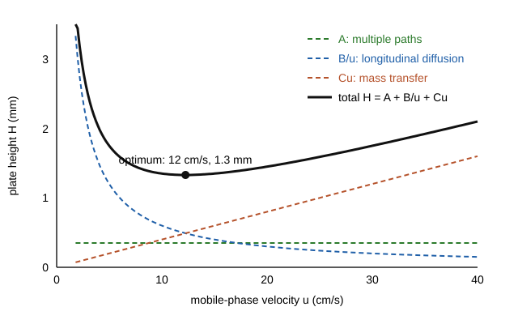

# 19.3 · Extraction and the theory of chromatography

Most real samples are mixtures, and most instruments need the analyte on its own. Extraction moves a compound from one liquid into another; chromatography repeats that sharing thousands of times along a column, until compounds that differ only slightly come out at different times. Both rest on one idea: a compound distributes itself between two phases in a fixed ratio. This lesson turns that idea into the numbers a chromatographer uses every day: retention factor, selectivity, plates and resolution, and the van Deemter curve that says how fast a column can be run.

## Why it matters

A food lab must measure the preservative benzoic acid in a soft drink. Shaken with an organic solvent at the drink's own pH, about 3, almost all of it moves into the solvent. Shaken at pH 8, almost none does. Choosing the wrong pH turns a clean method into a zero result. Later the same lab's chromatogram shows two peaks that overlap. One analyst buys a longer column; a second changes the solvent by 5 %. The second fixes it in an afternoon, the first after a week and a large invoice. The theory in this lesson tells you which lever moves the separation most.

## Core ideas

> [!NOTE]
> Stable: distribution equilibria, the plate model, the Purnell resolution equation and the van Deemter equation (Harvey 7.7, 12.2, 12.3, checked 2026-10-17). The van Deemter terms here are the classic simplified form; modern treatments split them further, but the shape and the decisions are the same. All lab data are simulated.

### Partition and distribution

A solute S shaken between water and an immiscible organic solvent reaches equilibrium. The **partition coefficient** compares the concentrations of one chemical form:

$$K_D = \frac{[\text{S}]_\text{org}}{[\text{S}]_\text{aq}}$$

The **distribution ratio** $D$ compares the total concentrations of all forms. They are equal only if S has one form in each phase. A weak acid HA has two forms in water, HA and A⁻, but only neutral HA dissolves in the organic solvent ([Lesson 07.4](../module-07/lesson-04.md): ions are held by water). So

$$D = \frac{K_D\,[\text{H}_3\text{O}^+]}{[\text{H}_3\text{O}^+] + K_a}$$

At a pH two units below the p$K_a$, $D \approx K_D$; two units above, $D$ is about 100 times smaller ([Lesson 08.4](../module-08/lesson-04.md)).

### One big extraction or several small ones?

After one extraction with volume $V_\text{org}$, the fraction left in the water is

$$q_1 = \frac{V_\text{aq}}{D\,V_\text{org} + V_\text{aq}}$$

and after $n$ extractions with fresh solvent each time, $q_n = q_1^{\,n}$. With $D = 4$ and 100 mL of water, one 30 mL extraction leaves 45.5 %; three 10 mL extractions leave 36.4 %. Same solvent, better result: split the solvent.

### From extraction to chromatography

In a column, a **mobile phase** (gas or liquid) flows past a **stationary phase** (a liquid film or the surface of particles). A solute spends part of its time in each. The **retention time** $t_R$ is when its peak comes out; $t_M$ (the void time) is when an unretained compound comes out.

- **Retention factor:** $k = \dfrac{t_R - t_M}{t_M}$. How long the solute spends in the stationary phase compared with the mobile phase. Good values are about 2–10.
- **Selectivity:** $\alpha = k_B / k_A$ for two neighbours, B eluting later. If $\alpha = 1$, no column can separate them.
- **Plate number:** $N = 16\,(t_R/w)^2$, with $w$ the baseline width (from tangents). From the width at half height, $N = 5.545\,(t_R/w_{1/2})^2$. More plates mean narrower peaks.
- **Plate height:** $H = L/N$, with $L$ the column length. Smaller $H$ means a more efficient column.
- **Resolution:** $R_s = \dfrac{2\,(t_{R,B} - t_{R,A})}{w_A + w_B}$. At $R_s = 1.5$ two equal peaks are separated to baseline; at 1.0 they overlap by about 2 %.

### The Purnell equation: three levers

$$R_s = \frac{\sqrt{N}}{4}\cdot\frac{\alpha - 1}{\alpha}\cdot\frac{k_B}{1 + k_B}$$

- **Efficiency** $N$: resolution grows only as $\sqrt{N}$. Doubling the column length doubles $N$ and the run time but raises $R_s$ only by 1.41.
- **Selectivity** $\alpha$: the most powerful lever. Going from 1.05 to 1.10 nearly doubles $(\alpha-1)/\alpha$. You change it with the stationary phase, the solvent or (in GC) the temperature.
- **Retention** $k$: raising $k$ from 1 to 3 raises $k/(1+k)$ from 0.50 to 0.75, but above about 10 you gain little and wait a long time.

### The van Deemter equation

A peak broadens as it travels, for three reasons. Their sum is the plate height as a function of the mobile-phase velocity $u$:

$$H = A + \frac{B}{u} + C\,u$$

- $A$, **multiple paths**: in a packed column, molecules take paths of different lengths around the particles. It does not depend on $u$, and it is zero in an open (capillary) tube.
- $B/u$, **longitudinal diffusion**: the band spreads along the column by diffusion while it waits. Faster flow leaves less time for it.
- $Cu$, **mass transfer**: molecules take time to move in and out of the stationary phase, so the ones in the mobile phase run ahead. Faster flow makes it worse.



Setting $dH/du = 0$ gives the best velocity and the smallest plate height:

$$u_\text{opt} = \sqrt{B/C}, \qquad H_\text{min} = A + 2\sqrt{BC}$$

Above the optimum the curve rises slowly, so chromatographers often run a little faster than $u_\text{opt}$ and accept a few percent fewer plates for a shorter run.

## Worked example

### 1. Benzoic acid from a soft drink

Benzoic acid has p$K_a$ = 4.20 (PubChem). Take $K_D = 50$ (an assumed value for this example) and equal volumes, 50 mL of each phase.

- At pH 2.0: $D = 50 \times 10^{-2}/(10^{-2} + 10^{-4.2}) = 49.7$; $q_1 = 50/(49.7 \times 50 + 50) = 0.020$, so 98 % is extracted.
- At pH 6.0: $D = 0.78$; 44 % is extracted.
- At pH 8.0: $D = 0.008$; under 1 %.

Acidify before extracting an acid; make the water basic to keep it behind (or to wash it back out).

### 2. Fix the overlap

Two peaks at 6.40 and 6.70 min, widths 0.30 and 0.32 min, $t_M$ = 1.00 min. Then $R_s = 2 \times 0.30/0.62 = 0.97$; $k_B = 5.70$, $k_A = 5.40$, $\alpha = 1.056$; $N = 16 \times (6.70/0.32)^2 = 7010$.

To reach $R_s = 1.5$ by length alone needs $(1.5/0.97)^2 = 2.4$ times the plates: a 2.4 times longer column and run. Raising $\alpha$ to 1.09 with a small solvent change gives $(\alpha - 1)/\alpha = 0.083$ instead of 0.053, so $R_s \approx 0.97 \times 0.083/0.053 = 1.5$ with the same column and almost the same run time.

## Hands-on

**What you need:** the [Module 19 lab folder](../../labs/module-19/); pencil. **Time:** about 60 minutes.

### Part A — simulation: feel the van Deemter curve (15 min)

[Simulation: Chromatography — van Deemter curve and plate height](../../simulations/chromatography/index.html?preset=van-deemter)

1. Change the flow in steps from very slow to very fast and note the plate number at each.
2. Find the flow that gives the most plates. Then double it and note how many plates you lose.
3. Switch from the packed to the capillary column and watch the $A$ term disappear.

### Part B — Python: extraction and a van Deemter fit (30 min)

1. Open `lesson03_extraction_vandeemter.py`. Complete TODO 1 (fraction left after $n$ extractions) and TODO 2 (the van Deemter fit, $u_\text{opt}$ and $H_\text{min}$).
2. Run it:

```bash
py lesson03_extraction_vandeemter.py
```

3. Open `runs/lesson03_vandeemter.png` and find where the $B/u$ and $Cu$ curves cross. Compare with $u_\text{opt}$.

**How you know it worked:** one 30 mL extraction leaves 45.5 %, six 5 mL extractions 33.5 %; benzoic acid is 98.0 % extracted at pH 2 and 0.8 % at pH 8; the fit gives $A = 0.33$ mm, $B = 5.98$ mm cm/s, $C = 0.040$ mm s/cm, $u_\text{opt} = 12.2$ cm/s, $H_\text{min} = 1.31$ mm and about 1530 plates for the 2 m column.

<details><summary>Reference solution</summary>

```python
# TODO 1
return (V_aq / (D * V_org + V_aq)) ** n
# TODO 2
p, cov = curve_fit(van_deemter, u, H, p0=[0.5, 5.0, 0.05])
A, B, C = p
u_opt = np.sqrt(B / C)
H_min = A + 2 * np.sqrt(B * C)
return p, np.sqrt(np.diag(cov)), u_opt, H_min
```

The $B/u$ and $Cu$ curves cross exactly at $u_\text{opt}$, because there $B/u = Cu$. Running at twice the optimum costs 16 % of the plates, so only 8 % of the resolution ($\sqrt{0.84} = 0.92$), for half the run time. The full script is `lesson03_extraction_vandeemter_solution.py`.

</details>

### Part C — pencil (15 min)

1. A peak has $t_R$ = 8.0 min and $w_{1/2}$ = 0.040 min on a 30 m capillary column. Find $N$ and $H$.
2. Two compounds have $\alpha = 1.02$ and $k = 5$. How many plates do you need for $R_s = 1.5$?
3. Caffeine (neutral) and benzoic acid are in the same drink. At what pH would you extract the benzoic acid alone into the organic phase, and at what pH would you leave it behind?

<details><summary>Answers</summary>

1. $N = 5.545 \times (8.0/0.040)^2 = 222\,000$; $H = 30\,000\ \text{mm}/222\,000 = 0.14$ mm, typical of a good capillary column.
2. $\sqrt{N} = 4 \times 1.5 \times (1.02/0.02) \times (6/5) = 367$, so $N \approx 135\,000$. That is hard; change $\alpha$ instead.
3. Caffeine is extracted at any pH, so you cannot take benzoic acid alone. At pH 8 benzoate stays in the water while caffeine moves out; then acidify the water to pH 2 and extract the benzoic acid in a second step.

</details>

## Common mistakes

- **Extracting an acid at high pH (or a base at low pH).** The ion stays in the water. Set the pH two units on the neutral side of the p$K_a$.
- **Using one big portion of solvent.** Several small portions extract more with the same volume.
- **Buying plates to fix a selectivity problem.** Resolution grows only as $\sqrt{N}$; change $\alpha$ first.
- **Pushing $k$ very high.** Above about 10 the resolution hardly improves and peaks get broad and late.
- **Running far below $u_\text{opt}$.** On the steep left side of the van Deemter curve, diffusion ruins the peaks; it is safer to be a little fast than a little slow.

## Key takeaways

- $K_D$ is for one chemical form; $D$ includes all forms and depends on pH for acids and bases.
- Several small extractions beat one large one: $q_n = [V_\text{aq}/(D V_\text{org} + V_\text{aq})]^n$.
- $k$, $\alpha$, $N = 16(t_R/w)^2$, $H = L/N$ and $R_s$ describe every chromatogram; $R_s = 1.5$ is baseline separation.
- Purnell: selectivity is the strongest lever, efficiency the most expensive.
- van Deemter $H = A + B/u + Cu$ has a minimum at $u_\text{opt} = \sqrt{B/C}$; slightly faster costs little.

## Sources

- [LibreTexts — Harvey, Analytical Chemistry 2.1, 7.7 Liquid-Liquid Extractions](https://chem.libretexts.org/Bookshelves/Analytical_Chemistry/Analytical_Chemistry_2.1_by_David_Harvey/Analytical_Chemistry_2.1_(Harvey)/07%3A_Obtaining_and_Preparing_Samples_for_Analysis/7.07%3A_Liquid-Liquid_Extractions) (K_D, D, fraction left after n extractions, D for a weak acid).
- [LibreTexts — Harvey, Analytical Chemistry 2.1, 12.2 General Theory of Column Chromatography](https://chem.libretexts.org/Bookshelves/Analytical_Chemistry/Analytical_Chemistry_2.1_by_David_Harvey/Analytical_Chemistry_2.1_(Harvey)/12%3A_Chromatographic_and_Electrophoretic_Methods/12.02%3A_General_Theory_of_Column_Chromatography) (k, α, N = 16(t_R/w)², H = L/N, resolution from widths).
- [LibreTexts — Harvey, Analytical Chemistry 2.1, 12.3 Optimizing Chromatographic Separations](https://chem.libretexts.org/Bookshelves/Analytical_Chemistry/Analytical_Chemistry_2.1_by_David_Harvey/Analytical_Chemistry_2.1_(Harvey)/12%3A_Chromatographic_and_Electrophoretic_Methods/12.03%3A_Optimizing_Chromatographic_Separations) (Purnell equation, van Deemter terms, general elution problem).
- [PubChem — Benzoic acid (CID 243)](https://pubchem.ncbi.nlm.nih.gov/compound/243) (pKa 4.20 at 25 °C).
