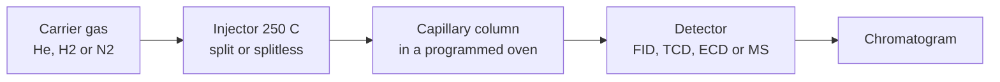
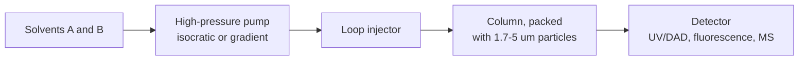

# 19.4 · Gas and liquid chromatography

Gas chromatography (GC) and high-performance liquid chromatography (HPLC) are the two workhorses of a modern analytical lab. GC separates compounds that can be vaporised; HPLC separates almost everything else, from caffeine to proteins. Both apply the theory of [Lesson 19.3](lesson-03.md), but their hardware, their choices and their failure modes differ. This lesson walks through each instrument from injector to detector, shows how a peak is identified with a retention index and a database, and shows how an internal standard rescues a calibration from a shaky injection.

## Why it matters

A perfume maker receives a batch of citrus oil. The GC shows a big peak where limonene should be and a smaller one near it. Is the second peak linalool, a valued note, or a cheaper substitute? On one column the two candidates come out close together; on a polar column they are 350 index units apart. Running both columns and comparing with published retention indices answers the question in an hour, without buying a single reference standard. Meanwhile, a pharmacy lab checks the ethanol in hand sanitizer. Its manual injections vary by ±15 %, but the results agree to 0.4 %, because every vial contains an internal standard.

## Core ideas

> [!NOTE]
> Stable: the separation principles, the retention-index idea and internal-standard calibration (Harvey 12.4–12.5, checked 2026-10-17). These details go out of date: column brands and phases, pressure limits of current HPLC and UHPLC pumps, and carrier-gas economics (helium prices and supply; Lab Manager article, read 2026-10-17). The retention indices quoted were read from the NIST Chemistry WebBook on 2026-10-17.

### GC or HPLC?

GC needs a sample that vaporises below about 300 °C without breaking down: solvents, fuels, fragrances, pesticides, fatty-acid esters. Non-volatile or heat-sensitive compounds (sugars, amino acids, most drugs, proteins) go to HPLC, or are first turned into volatile derivatives for GC.

### The gas chromatograph



- **Carrier gas.** Helium, hydrogen or nitrogen. Hydrogen diffuses fastest and has the flattest van Deemter curve, with its optimum at about 30–60 cm/s against 20–40 cm/s for helium and 15–20 cm/s for nitrogen, so it allows faster runs. Helium is non-renewable and has become expensive, so many labs are moving to hydrogen from on-site generators, with leak sensors and revalidated methods.
- **Column.** A fused-silica capillary 15–60 m long, about 0.25 mm inside, coated with a 0.25 µm film. Like dissolves like: a non-polar polydimethylsiloxane (5 % phenyl, "DB-5" type) separates mainly by boiling point; a polar polyethylene glycol ("wax") also holds back compounds that can hydrogen-bond.
- **Injection.** In **split** mode only 0.1–10 % of the vaporised sample enters the column, which keeps peaks sharp for concentrated samples. In **splitless** mode almost all of it goes in, for trace analysis.
- **Temperature programme.** A single temperature cannot elute both light and heavy compounds well (the *general elution problem*). Starting cool and ramping (for example 60 °C, then 3 K/min) keeps early peaks apart and late ones sharp.
- **Detectors.** The **flame ionisation detector (FID)** burns the eluate in a hydrogen flame and counts the ions; it responds to almost every organic compound, roughly in proportion to carbon, has a linear range of 10⁶–10⁷, and ignores water and CO₂. The **thermal conductivity detector (TCD)** is universal but less sensitive. The **electron-capture detector (ECD)** is very sensitive to halogenated compounds such as pesticides. A **mass spectrometer (GC-MS)** gives a spectrum for every peak ([Lesson 17.1](../module-17/lesson-01.md)).

### Identifying a peak: the retention index

Retention times shift with column length, flow and temperature. The **retention index** $I$ removes most of that by measuring a peak against the n-alkanes run under the same conditions. By definition an alkane with $n$ carbons has $I = 100n$. For a temperature-programmed run (the linear, van den Dool–Kratz form):

$$I = 100\left[n + \frac{t_x - t_n}{t_{n+1} - t_n}\right]$$

where $t_n$ and $t_{n+1}$ are the alkanes eluting just before and after peak $x$. Harvey gives the isothermal (Kováts) form, which uses logarithms of adjusted retention times. Published indices, such as those on the NIST Chemistry WebBook "Gas Chromatography" pages, are tied to a phase type. Matching on two phases of different polarity is much stronger evidence than one match, and GC-MS adds a third, independent check.

### The liquid chromatograph



- **Reversed phase** is the most common mode: a non-polar C18 (octadecyl) bonded phase with a polar mobile phase of water and methanol or acetonitrile. Polar compounds come out first. **Normal phase** (polar column, non-polar solvent) is the reverse. **Ion exchange** separates ions by charge, as in the protein purification of [Lesson 06.2](../module-06/lesson-02.md).
- **Isocratic or gradient.** A fixed solvent composition is simple; a **gradient** that raises the organic fraction during the run solves the general elution problem for LC.
- **Particles and pressure.** Smaller particles shrink the $A$ and $C$ terms, so $H$ falls and the optimum moves to higher velocity. The price is pressure, which grows roughly as $1/d_p^2$: halving the particle size gives about 1.4 times the efficiency at four times the pressure. Classic HPLC pumps stop at about 400 bar; UHPLC systems run sub-2 µm particles at much higher pressures. **Core–shell** particles (a solid core with a thin porous shell) give near sub-2 µm efficiency at lower pressure.
- **Detectors.** UV/Vis (ng range; the solvent must be transparent at the wavelength), the **diode-array detector (DAD)**, which records a full spectrum every fraction of a second ([Lesson 19.1](lesson-01.md)), fluorescence ([Lesson 19.2](lesson-02.md)), refractive index (universal, insensitive, no gradients) and LC-MS with electrospray ionisation.

### Internal standards

In [Lesson 09.4](../module-09/lesson-04.md) you were promised the **internal standard**: a compound, not in the sample, added in the same amount to every standard and sample. You plot the ratio of the analyte peak area to the internal-standard area against concentration. If the injected volume is 10 % low, both peaks are 10 % low and the ratio does not change. It also corrects for losses during sample preparation if added at the start. A good internal standard is chemically similar to the analyte, elutes near it but fully separated, and is absent from samples. In GC-MS the best choice is often the analyte labelled with deuterium or ¹³C.

[Simulation: Chromatography — GC with a temperature programme](../../simulations/chromatography/index.html?preset=gc)

## Worked example

### 1. Which peak is linalool?

A citrus oil runs on a DB-5 column with an alkane ladder: C10 at 10.95 min and C11 at 13.60 min. Peak X elutes at 11.77 min and peak Y at 13.55 min.

$$I_X = 100\left[10 + \frac{11.77 - 10.95}{13.60 - 10.95}\right] = 1031, \qquad I_Y = 100\left[10 + \frac{13.55 - 10.95}{2.65}\right] = 1098$$

The NIST WebBook lists limonene at 1031 and linalool at 1098 on DB-5 under similar ramped conditions. On a DB-Wax column the same peaks give 1196 and 1552, against NIST's 1196 for limonene and 1552 for linalool. Linalool's OH group hydrogen-bonds with the polyethylene glycol, which holds it back by over 450 units; limonene, a hydrocarbon, moves only about 165. Two columns, two matches: X is limonene, Y is linalool.

### 2. Ethanol in hand sanitizer with an internal standard

Standards of 0.20–1.00 % v/v ethanol each contain 0.50 % v/v 1-butanol. The raw ethanol areas scatter by 11 % about their line because injections vary; the area ratios scatter by only 0.7 %. The ratio line is $R = 0.0000 + 1.2461\,c$. The sanitizer, diluted 1 + 99 with the same internal standard, gives a mean ratio of 0.851:

$$c_\text{vial} = \frac{0.851}{1.2461} = 0.683\ \%\ \text{v/v}, \qquad c_\text{product} = 100 \times 0.683 = 68.3 \pm 0.3\ \%\ \text{v/v}$$

That is just below a 70 % label claim; the next step is to check whether the specification allows it.

## Hands-on

**What you need:** the [Module 19 lab folder](../../labs/module-19/); a web browser for the NIST Chemistry WebBook. **Time:** about 70 minutes. Use the [spectrum assignment template](../../templates/spectrum-assignment.md) for Part C.

### Part A — simulation: the general elution problem (15 min)

1. In the `gc` preset, run the mixture isothermally at 60 °C, then at 150 °C. Note which peaks merge and which take too long.
2. Set a ramp (60 °C, then 5 K/min). Find a programme that resolves every pair with $R_s \ge 1.5$ in under 20 minutes.
3. Switch the carrier from nitrogen to hydrogen at the same efficiency and note the run time.

### Part B — Python: retention indices and an internal standard (35 min)

1. Open `lesson04_gc.py`. Complete TODO 1 (the linear retention index) and TODO 2 (the internal-standard fit and result).
2. Run it:

```bash
py lesson04_gc.py
```

3. Open `runs/lesson04_gc.png` and compare the scatter of the two calibration panels.

**How you know it worked:** peaks X and Y give 1031 and 1098 on DB-5, 1196 and 1552 on DB-Wax; without the internal standard $s_r$ is 11.4 % of the mean, with it 0.7 %; the sanitizer is $68.3 \pm 0.3$ % v/v.

<details><summary>Reference solution</summary>

```python
# TODO 1
return 100 * (n + (t_x - alkanes[n]) / (alkanes[n1] - alkanes[n]))
# TODO 2
m, b, s_r, res = line_fit(c_std, ratio_std)
c, s_c = conc_from_line(ratio_sample, c_std, ratio_std, m, b, s_r)
return m, b, s_r, c, s_c
```

The full script is `lesson04_gc_solution.py`.

</details>

### Part C — the NIST WebBook (20 min)

1. Open the NIST WebBook gas-chromatography pages for [limonene](https://webbook.nist.gov/cgi/cbook.cgi?ID=C138863&Mask=2000) and [linalool](https://webbook.nist.gov/cgi/cbook.cgi?ID=C78706&Mask=2000).
2. In the tables headed "Kovats' RI, non-polar column, temperature ramp" and "Kovats' RI, polar column, temperature ramp" (and the "Van Den Dool and Kratz RI" tables), find two values each for DB-5 (or HP-5) and DB-Wax (or Carbowax 20M).
3. How much do values for the same compound and phase type differ between laboratories? Is a 5-unit difference between your peak and the database significant?

<details><summary>What you should find</summary>

Limonene: DB-5 and HP-5 about 1031; DB-Wax about 1189–1200 (Carbowax 20M isothermal 1221). Linalool: DB-5 about 1098–1101; DB-Wax and Carbowax 20M about 1552. Values for one phase type spread by several units between laboratories and more between isothermal and ramped runs, so a difference of about 5 units is within normal scatter. A difference of 50 is not.

</details>

## Common mistakes

- **Identifying a peak from one retention time.** Many compounds share a time on one column. Use retention indices on two phases, or a mass spectrum.
- **Comparing an index from a ramped run with an isothermal database value.** They can differ by 20 units or more on polar phases. Compare like with like.
- **Choosing an internal standard that overlaps a sample peak.** Run a sample without it first to check that its place in the chromatogram is empty.
- **Running smaller particles at the old flow without checking pressure.** The pump stops or the column is damaged. Work out the pressure first (you will do this in the module practical).
- **Injecting non-volatile material into a GC.** It stays at the head of the column and ruins later runs. Use HPLC or derivatise.

## Key takeaways

- GC for volatile, heat-stable compounds; HPLC for the rest. Reversed-phase C18 with water and methanol or acetonitrile is the default HPLC mode.
- GC choices: carrier (H₂ fastest), phase polarity, split or splitless, temperature programme, detector (FID, TCD, ECD, MS).
- The retention index $I = 100[n + (t_x - t_n)/(t_{n+1} - t_n)]$ ties a peak to the alkanes; two phases of different polarity give strong identification.
- An internal standard cancels injection-volume and preparation errors because both peaks change together.
- Smaller HPLC particles give more plates and a higher optimum flow, at pressure rising as $1/d_p^2$.

## Sources

- [LibreTexts — Harvey, Analytical Chemistry 2.1, 12.4 Gas Chromatography](https://chem.libretexts.org/Bookshelves/Analytical_Chemistry/Analytical_Chemistry_2.1_by_David_Harvey/Analytical_Chemistry_2.1_(Harvey)/12%3A_Chromatographic_and_Electrophoretic_Methods/12.04%3A_Gas_Chromatography) (columns, phases, split and splitless, temperature programming, FID, TCD, ECD, MS, Kováts index).
- [LibreTexts — Harvey, Analytical Chemistry 2.1, 12.5 High-Performance Liquid Chromatography](https://chem.libretexts.org/Bookshelves/Analytical_Chemistry/Analytical_Chemistry_2.1_by_David_Harvey/Analytical_Chemistry_2.1_(Harvey)/12%3A_Chromatographic_and_Electrophoretic_Methods/12.05%3A_High-Performance_Liquid_Chromatography) (columns, normal and reversed phase, gradients, particle size versus pressure, detectors).
- [NIST Chemistry WebBook — Limonene, gas chromatography](https://webbook.nist.gov/cgi/cbook.cgi?ID=C138863&Mask=2000) (DB-5 1031, DB-Wax 1189–1196; read 2026-10-17).
- [NIST Chemistry WebBook — Linalool, gas chromatography](https://webbook.nist.gov/cgi/cbook.cgi?ID=C78706&Mask=2000) (DB-5 1098–1101, DB-Wax 1552; read 2026-10-17).
- [Lab Manager — Hydrogen carrier gas as a sustainable alternative to helium](https://www.labmanager.com/environmental-lab-gas-generators-hydrogen-carrier-gas-as-a-sustainable-alternative-to-helium-35537) (optimum velocities of H₂, He and N₂; helium supply; hydrogen safety and revalidation).
