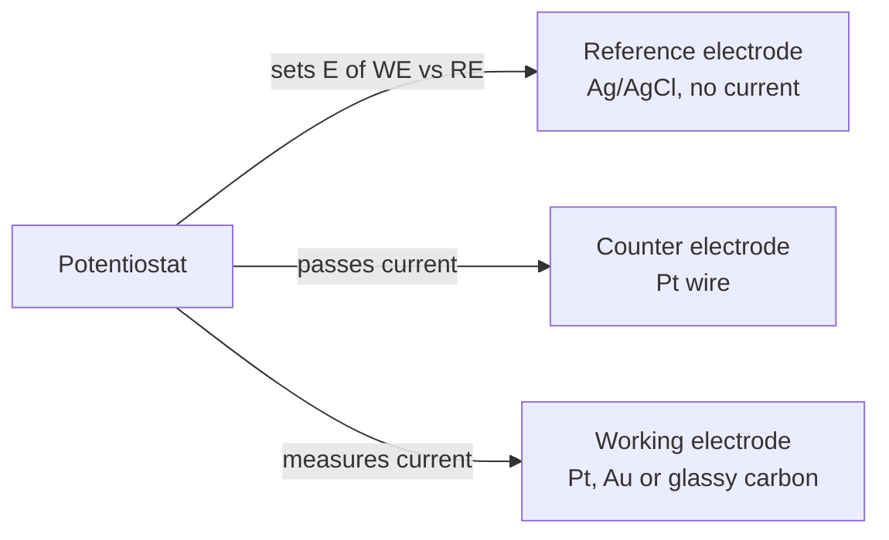

# 19.5 · Electroanalysis and cyclic voltammetry

In [Lesson 10.5](../module-10/lesson-05.md) you measured a potential with no current flowing; in [Lesson 10.4](../module-10/lesson-04.md) you counted the charge of a complete reaction. Voltammetry does something in between: it sweeps the electrode potential and records the current, which is how fast a species reacts at the electrode surface. Cyclic voltammetry (CV) is the chemist's first look at any redox-active compound, and the same electronics run glucose meters and trace-metal analysers. The second half of this lesson is the module practical, a full HPLC method for caffeine, which pulls together everything in Module 19.

## Why it matters

A battery researcher makes a new redox molecule for a flow battery. Before anything else she runs a CV: does it oxidise and reduce cleanly, at what potential, and does it survive the cycle? Ten minutes of scanning answer all three. A glucose test strip and a trace-lead analyser in a water lab make the same kind of measurement: current at a controlled potential.

## Core ideas

> [!NOTE]
> Stable: the three-electrode cell, the shape and diagnostics of a CV, and the Randles–Ševčík equation (Harvey 11.4; Elgrishi et al. 2018; checked 2026-10-17). Constants: CODATA 2022 (NIST), $F$ = 96 485.332 12 C/mol, exact. Sign conventions differ: this course uses the IUPAC one (oxidation current positive, potential increasing to the right); many older US papers plot the opposite way. The CV data in the lab are a finite-difference simulation.

### The three-electrode cell



The reaction happens at the **working electrode**. The **reference electrode** (Ag/AgCl or calomel) carries no current, so its potential stays fixed and the potentiostat sets the working electrode against it. The current flows through the **counter electrode**. The solution contains about 0.1 mol/L of an inert **supporting electrolyte** (for example KCl), which carries the current and stops the analyte ions from being pulled by the field, so that they reach the electrode only by diffusion. Dissolved oxygen is reduced at negative potentials, so it is purged out with nitrogen or argon first.

### What a cyclic voltammogram shows

The potential is swept linearly at a **scan rate** $v$ (for example 100 mV/s) from a start value to a switching potential and back. Take ferricyanide, $[\text{Fe(CN)}_6]^{3-} + e^- \rightleftharpoons [\text{Fe(CN)}_6]^{4-}$, starting at +0.50 V vs Ag/AgCl where nothing happens.

1. As the potential approaches the formal potential $E^{\circ\prime}$, the Nernst equation ([Lesson 08.6](../module-08/lesson-06.md)) demands more reduced form at the surface. Reduction starts; a cathodic (negative) current grows.
2. The surface runs out of ferricyanide, and fresh ions must diffuse from further away. The depleted layer grows, so the current passes a **peak** and then decays.
3. On the way back, the ferrocyanide made near the surface is oxidised again: an anodic peak.

For an electrochemically **reversible** couple (fast electron transfer) at 25 °C:

- the peak separation $\Delta E_p = E_{p,a} - E_{p,c} \approx 57/n$ mV (many textbooks round to 59/n mV);
- the half-wave potential $E_{1/2} = (E_{p,a} + E_{p,c})/2$ is close to $E^{\circ\prime}$;
- the peak currents are equal, $i_{p,a}/i_{p,c} = 1$, when the return peak is measured from the decaying forward current, not from zero;
- $\Delta E_p$ does not change with scan rate.

### The Randles–Ševčík equation

For a reversible couple at 25 °C, controlled by diffusion,

$$i_p = 2.69 \times 10^5\, n^{3/2}\, A\, D^{1/2}\, C\, v^{1/2}$$

with $i_p$ in A, electrode area $A$ in cm², diffusion coefficient $D$ in cm²/s, concentration $C$ in mol/cm³ and $v$ in V/s. The peak current is proportional to concentration, which makes CV quantitative, and to $\sqrt{v}$. A straight line of $i_p$ against $\sqrt{v}$ through the origin shows the species diffuses to the electrode; a current proportional to $v$ itself means it is stuck (adsorbed) on the surface.

### When it is not reversible

- **Quasi-reversible:** electron transfer is not fast enough to keep up. $\Delta E_p$ is larger than 57 mV and grows with scan rate; the peaks get slightly smaller than Randles–Ševčík predicts.
- **Irreversible or followed by a chemical step:** the return peak shrinks or vanishes because the product reacts away before the scan comes back.
- **Charging current:** the electrode surface acts as a capacitor, giving a background current proportional to $v$. Faradaic peaks grow only as $\sqrt{v}$, so at very high scan rates or very low concentrations the background wins. That limits ordinary CV to roughly 10⁻⁵ mol/L and above.

### Amperometry and stripping

Analytical electrochemistry often uses a fixed potential. In **amperometry** the potential is held where the analyte reacts fully and the current is read: the Clark oxygen electrode, glucose sensors (glucose oxidase makes H₂O₂, which is oxidised at a platinum anode) and HPLC electrochemical detectors. In **anodic stripping voltammetry** metal ions (Pb²⁺, Cd²⁺) are first reduced into a thin film on the electrode for several minutes, then oxidised in one quick scan. The preconcentration lowers detection limits by about three orders of magnitude, to µg/L and below.

[Simulation: Voltammetry — a reversible couple](../../simulations/voltammetry/index.html?preset=reversible)

## Worked example

### 1. Predict the peak

A 3.0 mm platinum disc ($A = \pi \times 0.15^2 = 0.0707$ cm²) in 2.0 mmol/L ferricyanide ($C = 2.0 \times 10^{-6}$ mol/cm³), $D = 7.2 \times 10^{-6}$ cm²/s, $v$ = 0.100 V/s, $n = 1$:

$$i_p = 2.69 \times 10^5 \times 0.0707 \times \sqrt{7.2 \times 10^{-6}} \times 2.0 \times 10^{-6} \times \sqrt{0.100} = 3.23 \times 10^{-5}\ \text{A} = 32\ \mu\text{A}$$

At 2.0 µmol/L it would be 32 nA, comparable with the charging current: CV is not a trace method.

### 2. Diagnose the couple

The simulated ferricyanide data give these peaks:

| $v$ (V/s) | $E_{p,c}$ (V) | $E_{p,a}$ (V) | $\Delta E_p$ (mV) | $i_{p,c}$ (µA) |
|---|---|---|---|---|
| 0.025 | 0.190 | 0.254 | 64 | 15.9 |
| 0.100 | 0.182 | 0.252 | 70 | 31.4 |
| 0.400 | 0.180 | 0.262 | 82 | 61.5 |

$E_{1/2} \approx 0.22$ V at every rate, the formal potential in this simulation. $\Delta E_p$ starts close to 57 mV and grows with $v$: quasi-reversible, which is usual for ferricyanide on platinum. The current ratio is 1.01, so no chemical step consumes the product. $i_{p,c}/\sqrt{v}$ falls from 100.7 to 97.3 µA (V/s)⁻½, slightly, because of the slow kinetics. From the slowest scan,

$$D = \left(\frac{100.7 \times 10^{-6}}{2.69 \times 10^5 \times 0.0707 \times 2.0 \times 10^{-6}}\right)^2 = 7.0 \times 10^{-6}\ \text{cm}^2/\text{s}$$

close to the value used to make the data (7.2 × 10⁻⁶). Use the slowest scans, where the couple is closest to reversible.

## Hands-on

**What you need:** the [Module 19 lab folder](../../labs/module-19/); pencil; the [lab report template](../../templates/lab-report.md) for the practical. **Time:** about 2.5 hours in total: 50 minutes for Parts A and B, 100 minutes for the module practical.

### Part A — simulation: watch the peaks move (15 min)

1. In the `reversible` preset, record a CV at 50 mV/s. Read $E_{p,c}$, $E_{p,a}$ and $i_{p,c}$.
2. Repeat at 100, 200 and 400 mV/s. Does $\Delta E_p$ change? Does $i_p$ double when $v$ quadruples?
3. Double the concentration and check that $i_p$ doubles.

**How you know it worked:** for the reversible preset $\Delta E_p$ stays near 57–60 mV at every scan rate, and $i_p$ doubles when $v$ goes from 100 to 400 mV/s.

### Part B — Python: diagnose the ferricyanide data (35 min)

1. Open `lesson05_cv.py`. Complete TODO 1 ($\Delta E_p$ and $E_{1/2}$) and TODO 2 ($D$ from a Randles–Ševčík slope).
2. Run it:

```bash
py lesson05_cv.py
```

3. Open `runs/lesson05_cv.png` and check whether the line of $i_p$ against $\sqrt{v}$ goes through the origin.
4. Decide: reversible, quasi-reversible or followed by a chemical step? Give two pieces of evidence.

**How you know it worked:** the table matches the worked example; $\Delta E_p$ rises from 64 to 82 mV; every $i_{p,a}/i_{p,c}$ is 1.01–1.02; the intercept is under 1 µA; $D$ falls from $7.0 \times 10^{-6}$ (slowest) to $6.5 \times 10^{-6}$ cm²/s (fastest).

<details><summary>Reference solution</summary>

```python
# TODO 1
return 1000 * (Epa - Epc), (Epa + Epc) / 2
# TODO 2
return (slope_A_per_sqrtV / (RS_CONST * N_E ** 1.5 * AREA_CM2 * C_MOL_PER_CM3)) ** 2
```

Quasi-reversible: $\Delta E_p$ is above 57 mV and grows with $v$, and $i_p/\sqrt{v}$ falls slightly. No chemical step: the current ratio stays at 1. Diffusion controlled: $i_p$ is proportional to $\sqrt{v}$ with a near-zero intercept. The fit through all five points gives $D = 6.4 \times 10^{-6}$ cm²/s because the fast scans pull the slope down; the slowest scan is the best estimate. The full script is `lesson05_cv_solution.py`.

</details>

### Part C — module practical: an HPLC method for caffeine in an energy drink (100 min)

You are the method developer. A client asks whether an energy drink labelled 32 mg caffeine per 100 mL (320 mg/L) meets its label, and whether it needs the EU statement "High caffeine content", required above 150 mg/L (Regulation (EU) 1169/2011, Annex III). Your HPLC pump is limited to 400 bar. The drink is diluted 1 + 9 and caffeine is read at 273 nm on a 100 × 4.6 mm C18 column. A matrix peak elutes just after caffeine with $\alpha = 1.10$; caffeine has $k = 3$. All data are simulated.

1. **Column and flow (TODO 1).** Open `practical_hplc.py`. Fit the van Deemter equation to `hplc_vandeemter.csv` for a 5 µm column and a 2.7 µm core–shell column. For each, find $u_\text{opt}$, the flow and pressure it needs, and the fastest velocity the 400 bar pump allows. Run each column at the smaller of the two.
2. **Resolution.** The script computes $N = L/H$ at your chosen velocity and the Purnell resolution. Which column gives $R_s \ge 1.5$?
3. **Validation (TODO 2).** Fit the calibration (2–50 mg/L), compute the LOD and LOQ from ten blanks ([Lesson 09.4](../module-09/lesson-04.md)), and check the spike recovery: the slope of the spiked-sample line divided by the calibration slope.
4. **Report.** Write a one-page lab report: method, choice of column and flow with reasons, calibration and limits, recovery, result with uncertainty, comparison with the label and the 150 mg/L threshold.

```bash
py practical_hplc.py
```

**How you know it worked:** the 5 µm column has $u_\text{opt}$ = 1.43 mm/s (0.92 mL/min, 74 bar) and reaches only $R_s = 1.33$. The core–shell column's optimum (2.74 mm/s) would need 486 bar, so it runs at the pump limit, 1.46 mL/min, with $H$ = 8.8 µm, $N$ ≈ 11 400 and $R_s$ = 1.82. Calibration slope 21.47 area units per mg/L; LOD 0.065 mg/L, LOQ 0.22 mg/L; recovery 98 %; drink $306 \pm 1$ mg/L, 96 % of the label, above 150 mg/L.

<details><summary>Reference solution and discussion</summary>

```python
# TODO 1
(A, B, C), _ = curve_fit(van_deemter, u, H, p0=[3, 8, 2])
u_opt = np.sqrt(B / C)
u_max = P_MAX_BAR / BAR_PER_ML_MIN[col] / flow_from_u(1.0)
u_run = min(u_opt, u_max)
# TODO 2
lod, loq = 3 * s_bl / m, 10 * s_bl / m
```

Choose the core–shell column at 1.46 mL/min. Running below its optimum costs little, because the van Deemter curve is flat near the minimum, and caffeine elutes at 3.0 min instead of 4.7. The 5 µm column would need about 1.3 times more plates to reach $R_s = 1.5$; a longer column would give them, at higher pressure and a longer run.

The residuals show no pattern, the 98 % recovery shows no important matrix effect, and the result is far above the LOQ. It is 4 % below the label; whether that passes depends on the tolerance the client applies, which your report should ask for, not assume. The drink needs the high-caffeine statement. A full uncertainty budget would add the dilution and the standards ([Lesson 09.3](../module-09/lesson-03.md)). The full script is `practical_hplc_solution.py`.

</details>

## Common mistakes

- **Two-electrode thinking.** Without a reference electrode that carries no current, the potential you set drifts as current flows. Use a potentiostat with three electrodes.
- **Leaving oxygen in the cell.** Its reduction adds a large wave at negative potentials. Purge with nitrogen or argon first.
- **Measuring the return peak from zero.** The return peak sits on the decaying forward current; measured from zero, $i_{p,a}/i_{p,c}$ looks too small.
- **Using fast scans for $D$.** Charging current and slow kinetics distort fast scans; use the slow end and check $i_p \propto \sqrt{v}$.
- **Comparing potentials without naming the reference.** A potential vs Ag/AgCl is about 0.2 V lower than the same potential vs SHE. Always state the reference.
- **In the practical: chasing the van Deemter optimum past the pump limit.** The best column on paper is useless if the system cannot run it. Work out the pressure first.

## Key takeaways

- A potentiostat sets the working electrode against a reference that carries no current; the current flows through a counter electrode, in excess supporting electrolyte, without oxygen.
- Reversible CV: $\Delta E_p \approx 57/n$ mV, independent of scan rate; $E_{1/2} \approx E^{\circ\prime}$; $i_{p,a}/i_{p,c} = 1$.
- Randles–Ševčík: $i_p = 2.69 \times 10^5 n^{3/2} A D^{1/2} C v^{1/2}$; $i_p \propto \sqrt{v}$ shows diffusion control.
- A growing $\Delta E_p$ means slow electron transfer; a missing return peak means the product reacts away.
- Amperometry and stripping voltammetry turn the same electronics into sensors and trace-metal methods.
- A validated method combines a separation you can actually run, a calibration with stated limits, a recovery check and a result reported against its specification.

## Sources

- [LibreTexts — Harvey, Analytical Chemistry 2.1, 11.4 Voltammetric and Amperometric Methods](https://chem.libretexts.org/Bookshelves/Analytical_Chemistry/Analytical_Chemistry_2.1_by_David_Harvey/Analytical_Chemistry_2.1_(Harvey)/11%3A_Electrochemical_Methods/11.04%3A_Voltammetric_and_Amperometric_Methods) (three-electrode cell, CV criteria, Randles–Ševčík, stripping, sensors).
- [LibreTexts — Harvey, Analytical Chemistry 2.1, 11.1 Overview of Electrochemistry](https://chem.libretexts.org/Bookshelves/Analytical_Chemistry/Analytical_Chemistry_2.1_by_David_Harvey/Analytical_Chemistry_2.1_(Harvey)/11%3A_Electrochemical_Methods/11.01%3A_Overview_of_Electrochemistry) (potentiostats, controlled-potential methods).
- [Elgrishi et al., A Practical Beginner's Guide to Cyclic Voltammetry, J. Chem. Educ. 2018, 95, 197](https://pubs.acs.org/doi/10.1021/acs.jchemed.7b00361) (electrolyte, purging, sign conventions, reversibility).
- [Wikipedia — Cyclic voltammetry](https://en.wikipedia.org/wiki/Cyclic_voltammetry) (ideal reversible peak separation about 57 mV; real cells often 70–80 mV).
- [Gamry Instruments — Cyclic voltammetry experiment](https://echem101.gamry.com/cyclic-voltammetry-experiment/) (2 mM ferricyanide in 0.1 M KCl, the classic teaching experiment).
- [NIST CODATA 2022 — Faraday constant](https://physics.nist.gov/cgi-bin/cuu/Value?f) (96 485.332 12 C/mol, exact).
- [Regulation (EU) No 1169/2011, Annex III](https://eur-lex.europa.eu/eli/reg/2011/1169/oj) (drinks above 150 mg/L caffeine must state "High caffeine content").
