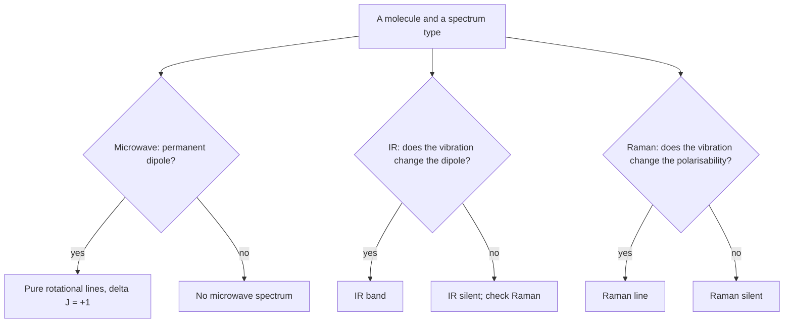

# 20.1 · Light-matter interaction and selection rules

Every spectrum answers two questions: at what energy does a molecule absorb, and how strongly? The energy comes from the gap between two levels. The strength comes from three things: whether the transition is allowed by a selection rule, how many molecules sit in the starting level, and how wide the line is spread. This lesson collects the rules you met one at a time in [12.5](../module-12/lesson-05.md) and [12.6](../module-12/lesson-06.md) into one toolkit that the rest of the module uses for rotation, vibration, Raman and electronic spectra.

## Why it matters

Air is 78 % N₂, 21 % O₂ and 1 % Ar, yet none of them absorbs the infrared light the Earth radiates. The warming comes from trace gases: CO₂ at about 425 parts per million (2026), water vapour and methane. The reason is a selection rule. A vibration absorbs infrared light only if it changes the dipole moment, and the stretch of N₂ or O₂ cannot do that. The same rule tells a lab chemist that N₂ is invisible to an IR spectrometer but shows a clear Raman line, and that HCl can be measured with microwaves while CO₂ cannot. Before you book time on an instrument, you need to know whether your molecule will show anything at all.

## Core ideas

> [!NOTE]
> The physics here is stable. Constants are CODATA 2022 values from NIST, and the HCl and I₂ constants are NIST Chemistry WebBook values, all checked on 2026-10-17. The CO₂ concentration (about 425 ppm in 2026) rises by roughly 2–3 ppm per year.

### Energy: which region of the spectrum

A photon is absorbed only if its energy matches a gap, $\Delta E = h\nu$ (the Bohr condition, [04.5](../module-04/lesson-05.md)). Spectroscopists usually quote the **wavenumber** $\tilde\nu = 1/\lambda$ in cm⁻¹, which is proportional to energy: $\Delta E = hc\tilde\nu$. Useful conversions: 1 cm⁻¹ = 29.979 GHz = 0.0119627 kJ/mol, and $\lambda$ in nm $= 10^7/\tilde\nu$.

| Motion | Typical gap (cm⁻¹) | Region | Example |
|---|---|---|---|
| rotation | 0.1–100 | microwave, far infrared | CO, J = 1 ← 0: 3.845 cm⁻¹ (115.27 GHz) |
| vibration | 200–4000 | infrared | HCl fundamental: 2886 cm⁻¹ (3.47 µm) |
| electronic (valence) | 10 000–100 000 | visible, ultraviolet | I₂ B ← X origin: 15 725 cm⁻¹ (636 nm) |

The ratio of the three scales, roughly 1 : 100 : 10 000, is why a vibrational band carries rotational structure and an electronic band carries vibrational structure. You will use that nesting in lessons 20.3 and 20.4.

### Three processes: absorption, stimulated and spontaneous emission

Einstein described light and a two-level molecule with three rate constants. **Absorption** ($B_{12}$) lifts a molecule from level 1 to level 2 at a rate proportional to the light's energy density. **Stimulated emission** ($B_{21}$) is the reverse, driven by the same light, and emits a photon identical to the one that triggered it (the basis of lasers). **Spontaneous emission** ($A_{21}$) happens without any light. For non-degenerate levels $B_{12} = B_{21}$, and

$$\frac{A_{21}}{B_{21}} = \frac{8\pi h \nu^3}{c^3}$$

The $\nu^3$ is the key fact. A visible transition at 20 000 cm⁻¹ has $A/B$ about $10^{11}$ times larger than a 3.8 cm⁻¹ microwave line. So excited electronic states empty by emitting light within nanoseconds (fluorescence, lesson 20.4), while excited rotational states practically never emit spontaneously and lose their energy in collisions instead.

### Strength: transition dipole times population difference

The intensity of an absorption line is roughly

$$I \propto |\mu_{fi}|^2 \,(N_\text{lower} - N_\text{upper})$$

The first factor is the transition dipole of [12.6](../module-12/lesson-06.md): if it is zero, the line is forbidden. The second factor is set by temperature through the Boltzmann distribution:

$$\frac{N_\text{upper}}{N_\text{lower}} = \frac{g_\text{upper}}{g_\text{lower}}\,e^{-hc\,\Delta\tilde\nu/k_BT}$$

where $g$ is the degeneracy of each level. At 298 K, $k_BT/hc = 207$ cm⁻¹. Compare that with the gap:

- **Rotation** (gaps ≪ 207 cm⁻¹): many levels are filled. For HCl, $J = 1$ holds 2.7 times as many molecules as $J = 0$ because it is three-fold degenerate.
- **Vibration** (gaps of 1000–4000 cm⁻¹): almost every molecule is in $v = 0$. For HCl, $N_1/N_0 = 9 \times 10^{-7}$. Soft, heavy bonds are the exception: I₂ (213 cm⁻¹) has $N_1/N_0 = 0.36$, so its spectra show **hot bands**, transitions that start from $v = 1$.
- **Electronic** (gaps above 10 000 cm⁻¹): the excited state is empty. For I₂, $N_B/N_X \approx 10^{-33}$.

Because both $N$ and $|\mu_{fi}|^2$ matter, a line can be weak because it is nearly forbidden or because its starting level is nearly empty. Keep the two reasons apart.

### Selection rules: gross and specific

A **gross selection rule** says which molecules can show a kind of spectrum at all. A **specific selection rule** says which changes of quantum number are allowed. Both come from the transition dipole integral.

| Spectrum | Gross rule (the molecule must…) | Specific rule (diatomic) | Allowed | Not allowed |
|---|---|---|---|---|
| pure rotation (microwave) | have a permanent dipole moment | $\Delta J = \pm 1$ | HCl, CO, H₂O, NH₃ | N₂, CO₂, CH₄, SF₆ |
| vibration (IR) | change its dipole during the vibration | $\Delta v = \pm 1$ (overtones weak) | HCl, CO, CO₂ asym. stretch and bend | N₂, O₂, H₂, CO₂ sym. stretch |
| vibrational Raman | change its polarisability during the vibration | $\Delta v = \pm 1$ | N₂, O₂, H₂, CO₂ sym. stretch | CO₂ asym. stretch |
| rotational Raman | have an anisotropic polarisability | $\Delta J = 0, \pm 2$ | N₂, CO₂, HCl | CH₄, SF₆ (spherical) |
| electronic | (any molecule) | $\Delta S = 0$, symmetry rules (lesson 20.4) | O₂ in the UV | singlet ↔ triplet (weak) |

The photon carries one unit of angular momentum, which is why one-photon rotational transitions change $J$ by exactly one. Raman scattering involves two photons (one in, one out), so it changes $J$ by 0 or 2. Polarisability, the ease with which the electron cloud is distorted by an electric field, is the subject of lesson 20.3.



### Line widths: why a line is not infinitely sharp

Real lines have a width, measured as the full width at half maximum (FWHM). Three effects compete:

- **Natural width** from the finite lifetime $\tau$ of the upper state: $\Delta\tilde\nu = 1/(2\pi c\tau)$. A state that fluoresces in 10 ns gives $5 \times 10^{-4}$ cm⁻¹.
- **Doppler width** from molecules moving towards and away from the light source:

$$\Delta\nu_D = \nu\sqrt{\frac{8k_BT\ln 2}{mc^2}}$$

  It grows with frequency and temperature and falls with mass. At 298 K it is 0.006 cm⁻¹ for an HCl infrared line, 270 kHz for the CO microwave line at 115 GHz.
- **Pressure (collision) broadening**: collisions interrupt the light-molecule interaction. At one atmosphere this is typically about 0.1 cm⁻¹ and dominates in the infrared and microwave; it falls in proportion to pressure.

Often the instrument is broader than all three. The NIST WebBook HCl spectrum you will use in lesson 20.3 was recorded at 4 cm⁻¹ resolution, so every line there is about 4 cm⁻¹ wide, nearly a thousand times its Doppler width.

## Worked example

### 1. Which gases in air absorb infrared light?

Apply the IR gross rule to each gas: does any vibration change the dipole?

- N₂, O₂ (homonuclear diatomics): the only vibration stretches a symmetric bond, the dipole stays zero. IR inactive, Raman active.
- Ar: an atom has no vibrations. Neither.
- CO₂: the asymmetric stretch (2349 cm⁻¹) and the bend (667 cm⁻¹) change the dipole ([14.4](../module-14/lesson-04.md)). IR active, and the 667 cm⁻¹ bend sits in the middle of the Earth's thermal emission.
- H₂O, CH₄: bent or tetrahedral molecules with polar bonds; several modes change the dipole. IR active.

Only the trace gases absorb, which is why their concentration matters so much for climate.

### 2. Hot bands of I₂ and the width of a visible line

I₂ in its ground state has a fundamental of $\Delta G = 214.502 - 2(0.6147) = 213.27$ cm⁻¹ (NIST constants).

1. Boltzmann ratio at 298 K: $N_1/N_0 = \exp(-213.27 \times 1.4388 / 298.15) = \exp(-1.029) = 0.357$.
2. So about a quarter of all I₂ molecules (with $N_2$ and higher added, 0.36 × 0.64 ≈ 0.23) start an electronic transition from $v'' = 1$. The visible spectrum of iodine vapour contains bands from $v'' = 0, 1$ and 2.
3. Width of a visible I₂ line near 18 000 cm⁻¹: Doppler, with $m = 253.8$ u, $\Delta\tilde\nu_D = 18\,000 \times \sqrt{8 \times 1.380649\times10^{-23} \times 298.15 \times 0.693 / (253.8 \times 1.6605\times10^{-27} \times (2.998\times10^8)^2)} = 0.014$ cm⁻¹.
4. Natural width for a 1 µs lifetime (I₂ B state, order of magnitude): $1/(2\pi \times 2.998\times10^{10} \times 10^{-6}) = 5 \times 10^{-6}$ cm⁻¹. Doppler width wins by a factor of about 3000; to see the natural width you would need a sub-Doppler laser method.

## Hands-on

What you need: pencil and paper, Python with the course packages and the [Module 20 lab folder](../../labs/module-20/). Record results on a [notebook page](../../templates/notebook-page.md). Time: about 40 minutes.

### Part A — pencil: which spectra will you see? (15 min)

For each species decide: pure rotational (microwave) spectrum? IR fundamental(s)? Vibrational Raman line(s)? Give the rule you used.

1. HBr  2. H₂  3. CO  4. CO₂  5. CH₄  6. H₂O  7. SF₆  8. NO (a radical with a small dipole)

<details><summary>Answers</summary>

| Species | Microwave | IR | Raman | Reason |
|---|---|---|---|---|
| HBr | yes | yes | yes | polar diatomic: dipole and polarisability both change |
| H₂ | no | no | yes | no dipole at all; polarisability changes with bond length |
| CO | yes | yes | yes | polar diatomic |
| CO₂ | no | yes (2 modes) | yes (1 mode) | centrosymmetric: no permanent dipole; asymmetric stretch and bend change it; symmetric stretch changes only the polarisability |
| CH₄ | no | yes | yes | a spherical top has no dipole; the T₂ modes change it (lesson 20.6) |
| H₂O | yes | yes | yes | bent, polar; all three modes are both IR and Raman active |
| SF₆ | no | yes | yes | no dipole; different modes are IR or Raman active (mutual exclusion, lesson 20.6) |
| NO | yes | yes | yes | polar diatomic, even if the dipole is small (0.16 D) |

</details>

### Part B — Python: populations, A/B and Doppler widths (25 min)

1. Open `lesson01_light.py` in the lab folder. Complete `boltzmann_ratio()`, `doppler_fwhm()` and `a_over_b_relative()`.
2. Run it:

```bash
py lesson01_light.py
```

3. Look at the four population ratios and decide, for each, whether a spectrum at room temperature starts from one level or several.

How you know it worked: $k_BT/hc = 207.2$ cm⁻¹; HCl $J = 1/J = 0$ ratio 2.71; HCl $v = 1/v = 0$ about $9 \times 10^{-7}$; I₂ $v = 1/v = 0$ 0.357; I₂ B/X about $10^{-33}$. Doppler: CO microwave line about 269 kHz, HCl IR line 0.0060 cm⁻¹, I₂ visible 0.014 cm⁻¹.

<details><summary>Reference solution</summary>

`boltzmann_ratio` returns `g_upper / g_lower * math.exp(-dE_cm * HC_K / T)`; `doppler_fwhm` returns `nu * math.sqrt(8 * K_B * T * math.log(2) / (mass_u * U * C**2))`; `a_over_b_relative` returns `(nu_cm / nu_ref_cm) ** 3`. Full code: `lesson01_light_solution.py`. Interpretation: rotational spectra always start from many levels; vibrational spectra of stiff bonds start from $v = 0$ only; I₂ shows hot bands; electronic spectra start from the ground electronic state.

</details>

## Common mistakes

- Saying "a molecule with no dipole has no spectrum". It has no microwave spectrum, but it can still have IR bands (CO₂, CH₄) and Raman lines (N₂).
- Treating a weak line as forbidden. Check the population first: a hot band is weak because few molecules start there, not because the transition is forbidden.
- Forgetting the degeneracy in the Boltzmann ratio. For rotation, $2J + 1$ often outweighs the exponential, so $J = 1$ beats $J = 0$.
- Using $k_BT$ in joules against gaps in cm⁻¹. Convert one of them: $k_BT/hc = 0.695$ cm⁻¹ per kelvin.
- Blaming the molecule for a broad line. At 4 cm⁻¹ resolution the instrument sets the width, not the Doppler effect or the lifetime.

## Key takeaways

- $\Delta E = hc\tilde\nu$; rotation, vibration and electronic gaps scale roughly 1 : 100 : 10 000 (microwave, infrared, visible-UV).
- Intensity needs a non-zero transition dipole and a population difference; at 298 K, $k_BT/hc = 207$ cm⁻¹.
- Gross rules: microwave needs a permanent dipole, IR a changing dipole, Raman a changing polarisability.
- Specific rules for diatomics: $\Delta J = \pm 1$ (one photon), $\Delta J = 0, \pm 2$ (Raman), $\Delta v = \pm 1$.
- Spontaneous emission scales as $\nu^3$: it rules the visible and is negligible in the microwave.
- Natural, Doppler and pressure widths compete; often the spectrometer's resolution is larger than all of them.

## Sources

- [LibreTexts Physical Chemistry, 13.1 The Electromagnetic Spectrum](https://chem.libretexts.org/Bookshelves/Physical_and_Theoretical_Chemistry_Textbook_Maps/Physical_Chemistry_(LibreTexts)/13%3A_Molecular_Spectroscopy/13.01%3A_The_Electromagnetic_Spectrum) — spectral regions and the motions they probe.
- [LibreTexts Physical Chemistry, 15.2 The Dynamics of Transitions can be Modeled by Rate Equations](https://chem.libretexts.org/Bookshelves/Physical_and_Theoretical_Chemistry_Textbook_Maps/Physical_Chemistry_(LibreTexts)/15%3A_Lasers_Laser_Spectroscopy_and_Photochemistry/15.02%3A_The_Dynamics_of_Transitions_can_be_Modeled_by_Rate_Equations) — Einstein A and B coefficients.
- [LibreTexts Physical Chemistry, 13.12 The Selection Rule for the Rigid Rotor](https://chem.libretexts.org/Bookshelves/Physical_and_Theoretical_Chemistry_Textbook_Maps/Physical_Chemistry_(LibreTexts)/13%3A_Molecular_Spectroscopy/13.12%3A_The_Selection_Rule_for_the_Rigid_Rotor) — the dipole requirement and $\Delta J = \pm 1$.
- [HyperPhysics, Broadening of Spectral Lines](https://hyperphysics.gsu.edu/hbase/atomic/broaden.html) — natural, Doppler and pressure broadening.
- [NIST CODATA 2022 constants](https://physics.nist.gov/cuu/Constants/) — $h$, $c$, $k_B$ and the atomic mass constant used in the lab.
- [NIST Chemistry WebBook, iodine diatomic constants](https://webbook.nist.gov/cgi/cbook.cgi?ID=C7553562&Mask=1000) — I₂ X and B state constants ($\omega_e = 214.502$, $\omega_e x_e = 0.6147$ cm⁻¹; $\nu_{00} = 15\,724.57$ cm⁻¹), checked 2026-10-17.
