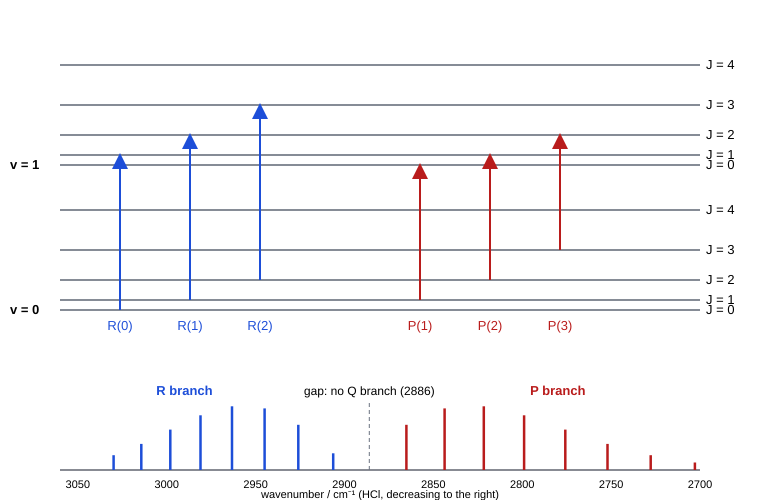

# 20.3 · Vibrational spectra and Raman

A gas-phase infrared band is not one peak but a comb of lines: each vibrational jump carries a rotational jump with it. Read correctly, that comb gives the vibrational frequency, the rotational constants of both levels and the equilibrium bond length, all from one spectrum. This lesson reads the classic example, the HCl band from the NIST WebBook, building on the anharmonic oscillator of [12.4](../module-12/lesson-04.md) and the rotor of [20.2](lesson-02.md). It then turns to Raman scattering, which sees the vibrations that infrared light misses, such as the stretch of N₂ and the symmetric stretch of CO₂ ([14.4](../module-14/lesson-04.md)).

## Why it matters

In [17.2](../module-17/lesson-02.md) you used IR bands to identify functional groups in liquids, where the rotational structure is washed out. In the gas phase that structure is information. Atmospheric monitors use the lines of the CO band near 2143 cm⁻¹ to measure carbon monoxide in air, and the line intensities to measure its temperature. The same analysis is the first experiment of the Technion physical chemistry lab (Module 30, HCl rovibrational spectrum). And when a molecule has a centre of symmetry, IR alone sees only half its vibrations; a chemist characterising a new symmetric complex or a carbon material records a Raman spectrum next to the IR.

## Core ideas

> [!NOTE]
> The physics is stable. The HCl and CO spectra are the NIST WebBook gas-phase spectra (Coblentz Society Nos. 8758 and 8755, recorded 1964, 4 cm⁻¹ resolution); the constants are NIST WebBook values, checked 2026-10-17. Modern Fourier-transform spectrometers resolve lines 100 times finer; the analysis is the same.

### A vibrational band carries rotational lines

A level of a vibrating rotor has energy $G(v) + B_vJ(J+1)$. For the fundamental $v = 1 \leftarrow 0$ of a diatomic in a ¹Σ state (no electronic angular momentum), the rules are $\Delta v = +1$ and $\Delta J = \pm 1$. $\Delta J = 0$ is forbidden, so there is no line at the band centre $\tilde\nu_0 = G(1) - G(0)$. Two branches appear:

- **R branch** ($\Delta J = +1$), on the high side: $R(J) = \tilde\nu_0 + B_1(J+1)(J+2) - B_0J(J+1)$
- **P branch** ($\Delta J = -1$), on the low side: $P(J) = \tilde\nu_0 + B_1(J-1)J - B_0J(J+1)$

$J$ is always the lower-level value. Both formulas collapse into one with a running number $m$ ($m = J+1$ for R, $m = -J$ for P):

$$\tilde\nu(m) = \tilde\nu_0 + (B_1 + B_0)\,m + (B_1 - B_0)\,m^2$$

Because $B_1 < B_0$ (the bond is longer on average in $v = 1$), the $m^2$ term is negative: R lines crowd together as $m$ rises and P lines spread apart. The gap at the centre, between $R(0)$ and $P(1)$, is about $4B$, twice the normal spacing. That gap is how you find the band centre in a real spectrum.

The intensities follow the populations of the lower level, $(2J+1)e^{-hcB_0J(J+1)/k_BT}$, so each branch rises and falls with a maximum near $J = 3$ for HCl at room temperature.



### Combination differences

Two lines that share an upper level differ only by lower-level energies, and two that share a lower level differ only by upper-level energies:

$$R(J-1) - P(J+1) = 4B_0\left(J + \tfrac12\right), \qquad R(J) - P(J) = 4B_1\left(J + \tfrac12\right)$$

So $B_0$ and $B_1$ come out separately, with no model for the vibration at all. From them, $\alpha_e = B_0 - B_1$, $B_e = B_0 + \alpha_e/2$, and the equilibrium bond length $r_e$. One IR band gives what microwave spectroscopy could not: $r_e$, not just $r_0$.

### Isotopes and unresolved bands

Natural chlorine is about 76 % ³⁵Cl and 24 % ³⁷Cl. H³⁷Cl has a slightly larger reduced mass, so its band centre is $2886.0 \times (1 - \sqrt{\mu_{35}/\mu_{37}}) = 2.2$ cm⁻¹ lower. With enough resolution every line is a 3 : 1 doublet; at 4 cm⁻¹ it is one line.

When the line spacing is smaller than the resolution, as for CO ($2B = 3.8$ cm⁻¹) at 4 cm⁻¹, you see only the envelopes of the two branches. Their maxima are separated by

$$\Delta\tilde\nu_{PR} \approx \sqrt{\frac{8Bk_BT}{hc}}$$

which still gives $B$ (or the temperature, if $B$ is known).

### Q branches

A Q branch ($\Delta J = 0$) appears when the molecule has angular momentum about its axis: in diatomics with electronic angular momentum, such as NO, and in **perpendicular bands** of polyatomic molecules, where the dipole changes at right angles to the axis. The CO₂ bend at 667 cm⁻¹ has a sharp Q branch; its asymmetric stretch at 2349 cm⁻¹ (a parallel band) does not.

### Raman scattering

Light's electric field $E$ distorts the electron cloud and induces a dipole $\mu_\text{ind} = \alpha E$. The **polarisability** $\alpha$ measures how easily the cloud is distorted. If $\alpha$ changes as the molecule vibrates at $\tilde\nu_\text{vib}$, the induced dipole oscillates not only at the laser wavenumber $\tilde\nu_0$ but also at $\tilde\nu_0 \pm \tilde\nu_\text{vib}$. Most scattered light keeps the laser colour (Rayleigh scattering); about one photon in a million comes out shifted:

- **Stokes lines** at $\tilde\nu_0 - \tilde\nu_\text{vib}$: the molecule gained a quantum.
- **Anti-Stokes lines** at $\tilde\nu_0 + \tilde\nu_\text{vib}$: the molecule started in an excited level and gave a quantum away. They are weaker by the Boltzmann factor $e^{-hc\tilde\nu_\text{vib}/k_BT}$ (and stronger by a small $\tilde\nu^4$ factor).

Raman spectra are plotted as the **Raman shift** $\tilde\nu_0 - \tilde\nu_\text{scattered}$, so the shift equals the vibrational wavenumber whatever laser is used. A stretch of N₂, O₂ or H₂ changes the polarisability (a longer bond is easier to distort), so all three have Raman lines although they have no IR band. N₂ shows its vibrational Q branch near 2330 cm⁻¹.

Rotation also modulates the induced dipole if $\alpha$ depends on direction (any linear molecule). Rotational Raman follows $\Delta J = 0, \pm 2$, giving Stokes lines at

$$\Delta\tilde\nu = F(J+2) - F(J) = 4B\left(J + \tfrac32\right)$$

the first at $6B$, then spaced by $4B$. For N₂ ($B_0 = 1.990$ cm⁻¹) that is 11.9, 19.9, 27.9 cm⁻¹… with intensities alternating 2 : 1 because of the nuclear spin of ¹⁴N. Spherical tops (CH₄, SF₆) have an isotropic polarisability and no rotational Raman spectrum.

### Mutual exclusion

For a molecule with a centre of inversion, the dipole is odd under inversion and the polarisability is even. A vibration that is symmetric under inversion can change $\alpha$ but not $\mu$; one that is antisymmetric can change $\mu$ but not $\alpha$. So in a centrosymmetric molecule **no vibration is both IR and Raman active**. CO₂ is the textbook case: the symmetric stretch (near 1333 cm⁻¹, split by Fermi resonance into lines at about 1285 and 1388 cm⁻¹, see [14.4](../module-14/lesson-04.md)) appears only in Raman; the bend (667) and asymmetric stretch (2349) only in IR. A band present in both spectra proves that the molecule has no centre of symmetry. Lesson 20.6 makes this exact with character tables.

## Worked example

### 1. CCl₄: Stokes and anti-Stokes

The NIST WebBook lists the symmetric C–Cl stretch of CCl₄ at 459 cm⁻¹ (Raman, liquid). With a 532 nm laser ($\tilde\nu_0 = 18\,797$ cm⁻¹):

1. Stokes line: $18\,797 - 459 = 18\,338$ cm⁻¹, $\lambda = 545.3$ nm. Anti-Stokes: $19\,256$ cm⁻¹, $519.3$ nm.
2. Intensity ratio anti-Stokes/Stokes: Boltzmann $e^{-459 \times 1.4388/298} = 0.109$, times $(19\,256/18\,338)^4 = 1.22$, gives 0.13.
3. Interpretation: the anti-Stokes line is about 8 times weaker. The ratio is a thermometer: Raman spectroscopists use it to measure sample temperature without contact.

### 2. B and temperature from the unresolved CO band

In the NIST CO spectrum (4 cm⁻¹ resolution) the individual lines are not resolved, but the P and R maxima are at about 2119.5 and 2176 cm⁻¹, with the band centre in the dip near 2143 cm⁻¹.

1. $\Delta\tilde\nu_{PR} = 2176 - 2119.5 = 56.5$ cm⁻¹.
2. Assume room temperature, $k_BT/hc = 207.2$ cm⁻¹: $B = \Delta\tilde\nu^2/(8 \times 207.2) = 56.5^2/1658 = 1.93$ cm⁻¹.
3. The microwave value (lesson 20.2) is $B_0 = 1.9225$ cm⁻¹. A blurred band gives $B$ within 1 %; with $B$ known, the same formula would give the gas temperature.

## Hands-on

What you need: a browser, Python with the course packages and the [Module 20 lab folder](../../labs/module-20/). Write your assignment on a [spectrum assignment sheet](../../templates/spectrum-assignment.md). Time: about 55 minutes.

### Part A — the simulation (15 min)

[Simulation: IR and ESR — HCl rotation-vibration band](../../simulations/ir-esr/index.html?preset=hcl)

1. Run the HCl preset at 300 K and label R(0), R(1), P(1), P(2). Find the gap at the band centre.
2. Raise the temperature to 600 K. Which lines grow, and why does the maximum of each branch move outwards?
3. Turn on the ³⁷Cl isotope (if offered) and the highest resolution. How far apart are the doublet partners?

### Part B — Python: assign and fit the NIST HCl band (40 min)

1. Open the [NIST HCl IR spectrum](https://webbook.nist.gov/cgi/cbook.cgi?ID=C7647010&Mask=80) and look at the 2600–3100 cm⁻¹ region by eye: find the two branches and the gap.
2. `hcl_band_peaks.csv` holds the 20 absorption maxima of that spectrum (spectrum index 0, 4 cm⁻¹ resolution), unassigned. Open `lesson03_hcl_band.py`; `assign_branches()` is written for you.
3. Complete `fit_band()`, `combination_differences()` and `rotational_raman()`. Run:

```bash
py lesson03_hcl_band.py
```

4. Open `runs/lesson03_hcl_band.png` and compare the measured peaks with the lines predicted from the NIST constants.

How you know it worked: 10 P and 10 R lines; fit $\tilde\nu_0 = 2886.7$, $B_0 = 10.32$, $B_1 = 10.03$ cm⁻¹ (NIST constants: 2886.0, 10.44, 10.13); combination differences $B_0 = 10.33$, $B_1 = 10.05$; $r_e = 1.282$ Å against 1.2746; $k \approx 481$ N/m; rms residual about 1.4 cm⁻¹; N₂ rotational Raman 11.94, 19.90, 27.85… cm⁻¹.

<details><summary>Reference solution and discussion</summary>

```python
c2, c1, c0 = np.polyfit(m, peaks, 2)
return c0, (c1 - c2) / 2, (c1 + c2) / 2
```

Combination differences build dictionaries `R[J]` and `P[J]` and average $(R(J-1) - P(J+1))/(4(J+\tfrac12))$ and $(R(J) - P(J))/(4(J+\tfrac12))$. Full code: `lesson03_hcl_band_solution.py`.

Your $B_0$ is about 1 % below the NIST constant, and $r_e$ about 0.6 % long. The 1964 prism-grating spectrum was digitised from a paper chart; peak positions carry errors of 1–3 cm⁻¹, and the unresolved ³⁵Cl/³⁷Cl doublets pull each peak slightly low. That is a good lesson in itself: the band centre (a sum of many lines) is accurate to 1 cm⁻¹, while $B_1 - B_0$ (a small curvature) is the least certain number. Module 30 repeats this with a modern high-resolution spectrum.

</details>

## Common mistakes

- Looking for a peak at the band centre. For a ¹Σ diatomic, $\Delta J = 0$ is forbidden: the centre is the gap.
- Numbering P lines from the centre as P(0). The first P line is P(1); there is no P(0), because $J = 0$ cannot go to $J = -1$.
- Using the spacing of R lines as $2B$. Lines converge in R and spread in P because $B_1 < B_0$; use combination differences or the quadratic fit.
- Expecting a Raman line to sit at the vibrational wavenumber. The scattered light is at $\tilde\nu_0 - \tilde\nu_\text{vib}$; the Raman shift is the vibrational wavenumber.
- Concluding "IR inactive, so it does not vibrate". It may be Raman active (N₂, the CO₂ symmetric stretch), or silent in both (some modes of symmetric molecules, lesson 20.6).

## Key takeaways

- A diatomic fundamental has an R branch above and a P branch below the centre, and no Q branch: $\tilde\nu(m) = \tilde\nu_0 + (B_1 + B_0)m + (B_1 - B_0)m^2$.
- Combination differences give $B_0$ and $B_1$ separately; with them come $\alpha_e$, $B_e$ and $r_e$.
- Unresolved bands still give $B$ or $T$ from the separation of the branch maxima, $\sqrt{8Bk_BT/hc}$.
- Raman needs a change in polarisability; Stokes lines are stronger than anti-Stokes by the Boltzmann factor.
- Rotational Raman has $\Delta J = \pm2$: lines at $6B, 10B, 14B$…
- Mutual exclusion: in a centrosymmetric molecule no mode is both IR and Raman active.

## Sources

- [NIST Chemistry WebBook, HCl IR spectrum](https://webbook.nist.gov/cgi/cbook.cgi?ID=C7647010&Mask=80) — Coblentz No. 8758, gas, 4 cm⁻¹ resolution; peaks in `hcl_band_peaks.csv`, retrieved 2026-10-17.
- [NIST Chemistry WebBook, HCl diatomic constants](https://webbook.nist.gov/cgi/cbook.cgi?ID=C7647010&Mask=1000) — H³⁵Cl $\omega_e = 2990.9463$, $\omega_e x_e = 52.8186$, $B_e = 10.593416$, $\alpha_e = 0.307181$ cm⁻¹, $r_e = 1.274552$ Å.
- [NIST Chemistry WebBook, CO IR spectrum](https://webbook.nist.gov/cgi/cbook.cgi?ID=C630080&Mask=80) — Coblentz No. 8755, branch maxima near 2119.5 and 2176 cm⁻¹.
- [LibreTexts Physical Chemistry, 13.2 Rotations Accompany Vibrational Transitions](https://chem.libretexts.org/Bookshelves/Physical_and_Theoretical_Chemistry_Textbook_Maps/Physical_Chemistry_(LibreTexts)/13%3A_Molecular_Spectroscopy/13.02%3A_Rotations_Accompany_Vibrational_Transitions) — P and R branches.
- [LibreTexts Physical Chemistry, 13.3 Unequal Spacings in Vibration-Rotation Spectra](https://chem.libretexts.org/Bookshelves/Physical_and_Theoretical_Chemistry_Textbook_Maps/Physical_Chemistry_(LibreTexts)/13%3A_Molecular_Spectroscopy/13.03%3A_Unequal_Spacings_in_Vibration-Rotation_Spectra) — $B_1 < B_0$ and combination differences.
- [NIST Chemistry WebBook, CCl₄ vibrational levels](https://webbook.nist.gov/cgi/cbook.cgi?ID=C56235&Mask=800) — Raman 458.7 cm⁻¹ (liquid), from Shimanouchi's tables.
