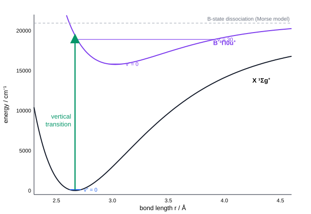
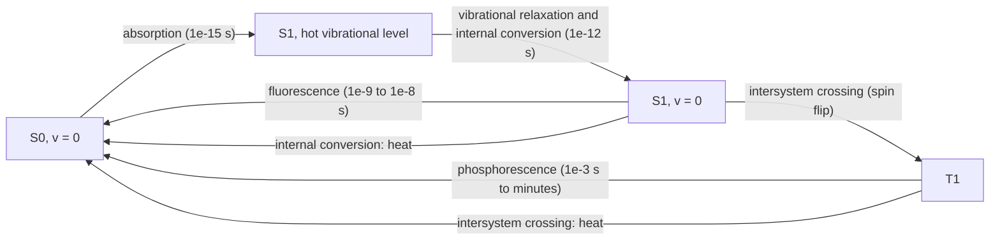

# 20.4 · Electronic spectra and Franck-Condon

When a molecule absorbs visible or ultraviolet light, an electron moves to a new orbital and the molecule finds itself on a new potential-energy curve, with a different bond length and stiffness. The spectrum is then a set of vibrational bands whose intensities are fixed by how well the old and new vibrational wavefunctions overlap: the Franck–Condon principle. This lesson explains the labels of electronic states, their selection rules, the band pattern and what happens to the molecule after it has absorbed, using iodine vapour as the worked case and the Morse oscillator of [12.4](../module-12/lesson-04.md) as the model.

## Why it matters

Iodine vapour is violet because it absorbs green light, but its absorption band is 4000 cm⁻¹ wide, not a sharp line, and it peaks nowhere near the gap between the bottoms of the two potential curves. A sunscreen molecule must absorb UV and then get rid of the energy as heat before it can do chemistry; a fluorescent dye in a medical test must do the opposite and re-emit. Whether a molecule fluoresces, phosphoresces or quietly heats up decides whether it is useful as a label, a laser dye, a photocatalyst or a sunscreen. The Franck–Condon principle and the Jablonski diagram are the two tools chemists use to reason about all of these.

## Core ideas

> [!NOTE]
> The theory is stable. I₂ constants are NIST WebBook values (from Huber and Herzberg and later work), the iodine atom level is from the NIST Atomic Spectra Database, and the I₂ dissociation energy is from Barrow and Yee (1973), all checked on 2026-10-17. The Morse model is an approximation: it is used here to show the principle, not to reproduce every band.

### Born–Oppenheimer: one potential curve per electronic state

Electrons are about 2000 times lighter than a proton and adjust instantly to the positions of the nuclei. So for every electronic state there is a potential-energy curve $V(r)$, and the nuclei vibrate and rotate on that curve (the **Born–Oppenheimer approximation**). The energy of a level is

$$E = T_e + G(v) + F_v(J)$$

where $T_e$ is the electronic energy at the bottom of the curve. Electronic gaps (10⁴ cm⁻¹) are much larger than vibrational (10² –10³) and rotational (1–10) ones, so an electronic band contains vibrational bands, each made of rotational lines.

### Labels of diatomic electronic states

Diatomic states have term symbols like those of atoms ([12.6](../module-12/lesson-06.md)), with Greek letters for $\Lambda$, the component of the orbital angular momentum along the bond: Σ (Λ = 0), Π (1), Δ (2). The superscript is the spin multiplicity $2S+1$. For a homonuclear molecule a subscript g or u gives the parity under inversion, and for Σ states a ± superscript gives the behaviour under reflection in a plane containing the bond. The ground state is labelled X, excited states of the same multiplicity A, B, C… (lower-case a, b, c for other multiplicities).

| Molecule | Ground state | Note |
|---|---|---|
| N₂, I₂ | X ¹Σg⁺ | all electrons paired |
| O₂ | X ³Σg⁻ | two unpaired electrons in π*: paramagnetic (12.6) |
| I₂ excited | B ³Π0u⁺ | the state that makes iodine violet |

The electric-dipole selection rules are $\Delta\Lambda = 0, \pm1$; $\Delta S = 0$; g ↔ u (never g ↔ g, the Laporte rule you met for d–d bands in [18.5](../module-18/lesson-05.md)); and Σ⁺ ↔ Σ⁺, Σ⁻ ↔ Σ⁻. In heavy molecules spin–orbit coupling mixes singlet and triplet character, so $\Delta S = 0$ weakens. That is why the "spin-forbidden" B ← X band of I₂ is strong enough to colour the vapour.

### Vibrational structure: progressions and convergence

Starting from $v'' = 0$, the bands $v' \leftarrow 0$ form a **progression** at

$$\tilde\nu(v') = \tilde\nu_{00} + G'(v') - G'(0)$$

Because the upper curve is anharmonic, the gaps $\Delta G(v' + \tfrac12) = \omega_e' - 2\omega_e x_e'(v'+1)$ shrink as $v'$ rises until the bands merge at the **convergence limit**, where the molecule falls apart. Above it absorption is a continuum. For I₂ the B state dissociates into one ground-state iodine atom and one spin–orbit excited atom, I(²P₁/₂), which lies 7603 cm⁻¹ higher (NIST ASD). So

$$D_0'' = \text{convergence limit} - 7603\ \text{cm}^{-1}$$

and the measured limit near 20 043 cm⁻¹ gives $D_0''$ ≈ 12 440 cm⁻¹ (1.542 eV).

A **Birge–Sponer extrapolation** estimates $D_0$ from the band gaps alone: plot $\Delta G(v+\tfrac12)$ against $v$, extend the straight line to zero and take the area under it. For a Morse oscillator the area is $\omega_e^2/4\omega_e x_e$ minus the zero-point energy. Real curves bend away from the straight line near dissociation, so a linear Birge–Sponer plot usually overestimates $D_0$, sometimes badly.

### The Franck–Condon principle

An electronic transition takes about $10^{-16}$ s, a thousand times faster than a vibration. The nuclei do not move during the jump: the transition is **vertical** on a potential diagram. Its intensity factorises into an electronic part and an overlap of the two vibrational wavefunctions:

$$I(v' \leftarrow v'') \propto |\mu_\text{el}|^2\,\left|\int \psi_{v'}(r)\,\psi_{v''}(r)\,dr\right|^2$$

The squared overlap is the **Franck–Condon factor**. Over all $v'$ (including the continuum) the factors sum to 1, so the band intensity is shared out, not created. The shape of the progression depends on the shift of the bond length:

- $r_e' \approx r_e''$: the 0–0 band dominates and the progression is short. Example: the B–X band of N₂⁺ in the aurora, whose 0–0 band at 391 nm is by far the strongest.
- $r_e' > r_e''$ (an antibonding electron was added): the vertical line from the middle of $v'' = 0$ hits the upper curve on its steep inner wall, high above $v' = 0$. The strongest band has a large $v'$, and the 0–0 band can be almost invisible.

For I₂, $r_e$ grows from 2.666 Å (X) to 3.025 Å (B). The 0–0 band at 15 725 cm⁻¹ has a Franck–Condon factor of only about $2\times10^{-9}$; the maximum is near $v' = 32$, around 19 000 cm⁻¹ (525 nm). Iodine absorbs green and looks violet.



### After absorption: the Jablonski diagram

Most organic molecules have a singlet ground state S₀, excited singlets S₁, S₂ and triplets T₁, T₂. After absorption to a hot vibrational level of S₁ or S₂:



Three consequences follow. **Kasha's rule**: emission comes from the lowest excited state of a given spin, whatever was excited, because relaxation inside the excited manifold is fast. The **Stokes shift**: fluorescence lies at lower energy than absorption, because the molecule relaxes before it emits and lands in hot levels of S₀. The **mirror-image rule**: if the two curves have similar shapes, the fluorescence spectrum looks like the absorption spectrum reflected about the 0–0 band. Phosphorescence is slow because T₁ → S₀ is spin-forbidden; it survives only in rigid or cold samples where collisions do not quench it first.

## Worked example

### 1. Where does the I₂ band peak? A vertical estimate

Use the Morse curve of the B state built from the NIST constants: $D_e' = \omega_e^2/4\omega_e x_e = 125.697^2/(4 \times 0.7642) = 5169$ cm⁻¹ and $a = 1.696$ Å⁻¹ (from $a = \sqrt{2\mu\,\omega_e x_e\,hc}/\hbar$).

1. Go straight up from $r = r_e'' = 2.6663$ Å: $\Delta r = 2.6663 - 3.0247 = -0.3584$ Å, so $a\Delta r = -0.608$.
2. $V_B = T_e + D_e'(1 - e^{-a\Delta r})^2 = 15\,769 + 5169 \times (1 - e^{0.608})^2 = 15\,769 + 5169 \times 0.700 = 19\,387$ cm⁻¹ above the bottom of the X curve.
3. Subtract the zero-point energy of the X state (107 cm⁻¹), since the molecule starts in $v'' = 0$: the photon has about 19 280 cm⁻¹, or 519 nm.
4. The full overlap calculation in the lab gives the strongest band at $v' = 32$, 18 940 cm⁻¹ (528 nm). The vertical estimate is close; it is a little high because the wavefunction of $v'' = 0$ has width and the upper curve is steep.

### 2. Birge–Sponer against the convergence limit

1. B state, Morse-like: $D_0' \approx \sum_v [\omega_e' - 2\omega_e x_e'(v+1)]$ up to the last positive term $= 5106$ cm⁻¹ (81 levels).
2. Experiment: convergence limit $20\,043 - \tilde\nu_{00} = 20\,043 - 15\,725 = 4318$ cm⁻¹.
3. The linear extrapolation is 18 % high. Near dissociation the measured gaps $\Delta G$ fall below the straight line (the real curve is not a Morse curve at long range), so the area under the line is too big.

## Hands-on

What you need: Python with the course packages and the [Module 20 lab folder](../../labs/module-20/); optionally a yellow or green highlighter, a glass of water and a phone torch. Record results on a [notebook page](../../templates/notebook-page.md). Time: about 45 minutes.

### Part A — Python: Franck–Condon factors of I₂ (35 min)

1. Open `lesson04_franck_condon.py`. It builds Morse curves for X and B from the NIST constants and solves for 70 B-state and 3 X-state wavefunctions.
2. Complete `fc_factors()` (one matrix product) and `birge_sponer()`. Run:

```bash
py lesson04_franck_condon.py
```

3. Open `runs/lesson04_i2_fc.png`. On the left, find where the vertical line from $v'' = 0$ meets the B curve. On the right, find the 0–0 band (you will not see it) and the bands that start from $v'' = 1$ and 2 (hot bands).

How you know it worked: the solver reproduces NIST $\Delta G$ (213.27 and 124.17 cm⁻¹); the strongest band from $v'' = 0$ is $v' = 32$ at 18 940 cm⁻¹ (528 nm); the 0–0 factor is about $2\times10^{-9}$; the FC factors over $v' = 0$–69 sum to 0.92; populations 0.673, 0.240, 0.086; envelope maximum near 524 nm; Birge–Sponer 18 606 (X) and 5106 (B) cm⁻¹ against 12 440 and 4318 measured.

<details><summary>Reference solution and discussion</summary>

```python
overlap = psi_upper.T @ psi_lower * dx
return overlap**2
```

`birge_sponer` sums `we - 2 * wexe * (v + 1)` from $v = 0$ to `int(we / (2 * wexe) - 1)`. Full code: `lesson04_franck_condon_solution.py`. The missing 8 % of the FC sum belongs to levels above $v' = 69$ and to the continuum above the dissociation limit. Birge–Sponer fails worst for the X state (50 % high), because the NIST $\omega_e x_e$ describes only the bottom of a deep well that is far from Morse-shaped near the top.

</details>

### Part B — optional observation: Stokes shift in a highlighter (10 min)

> [!CAUTION]
> Use only an ordinary water-based highlighter and tap water. Do not drink the water, keep it away from children and pour it away afterwards. Do not use a UV lamp or laser pointer and never look into a light source.

1. Dip the tip of a yellow or green highlighter in a glass of water for a minute until the water is coloured.
2. In a dim room, shine a phone torch through the glass from the side and look at the beam from above.
3. The beam glows green: the dye (usually pyranine or a fluorescein derivative) absorbs the blue part of the white light and emits at longer wavelength. The glow is fluorescence, and the colour difference between what is absorbed and what is emitted is the Stokes shift.

## Common mistakes

- Taking the band maximum as $\tilde\nu_{00}$ or as $T_e$. When the bond length changes, the maximum lies thousands of cm⁻¹ above the origin.
- Drawing transitions as slanted arrows. They are vertical: the nuclei do not move during the jump.
- Applying $\Delta S = 0$ strictly to heavy molecules. Spin–orbit coupling in I₂, Br₂ and metal complexes makes "forbidden" bands strong.
- Trusting a Birge–Sponer extrapolation to three figures. It assumes a straight $\Delta G$ plot and usually overestimates $D_0$.
- Confusing fluorescence and phosphorescence by colour. The difference is spin and lifetime (nanoseconds against milliseconds or longer), not wavelength.

## Key takeaways

- Each electronic state has its own potential curve: $E = T_e + G(v) + F(J)$.
- Term symbols give Λ, spin and parity; rules: $\Delta\Lambda = 0, \pm1$, $\Delta S = 0$, g ↔ u.
- Transitions are vertical; intensities follow Franck–Condon factors $|\langle v'|v''\rangle|^2$, which sum to 1.
- A longer bond in the upper state gives a long progression with its maximum at high $v'$; I₂ peaks near $v' = 32$, about 525 nm.
- $D_0$ comes from the convergence limit (with the atomic product energies) or, roughly, from a Birge–Sponer plot.
- After absorption: fast relaxation to S₁ $v = 0$, then fluorescence, internal conversion or intersystem crossing to T₁ and slow phosphorescence.

## Sources

- [NIST Chemistry WebBook, I₂ diatomic constants](https://webbook.nist.gov/cgi/cbook.cgi?ID=C7553562&Mask=1000) — X: $\omega_e = 214.502$, $\omega_e x_e = 0.6147$ cm⁻¹, $r_e = 2.6663$ Å; B: $T_e = 15\,769.01$, $\omega_e = 125.697$, $\omega_e x_e = 0.7642$ cm⁻¹, $r_e = 3.0247$ Å; $\nu_{00} = 15\,724.57$ cm⁻¹.
- [LibreTexts Physical Chemistry, 13.6 Electronic Spectra](https://chem.libretexts.org/Bookshelves/Physical_and_Theoretical_Chemistry_Textbook_Maps/Physical_Chemistry_(LibreTexts)/13%3A_Molecular_Spectroscopy/13.06%3A_Electronic_Spectra_Contain_Electronic_Vibrational_and_Rotational_Information) — Born–Oppenheimer and vibronic structure.
- [LibreTexts Physical Chemistry, 13.7 The Franck–Condon Principle](https://chem.libretexts.org/Bookshelves/Physical_and_Theoretical_Chemistry_Textbook_Maps/Physical_Chemistry_(LibreTexts)/13%3A_Molecular_Spectroscopy/13.07%3A_The_Franck-Condon_Principle) — vertical transitions and overlap factors.
- [LibreTexts Physical Chemistry, 15.1 Electronically Excited Molecules can Relax by a Number of Processes](https://chem.libretexts.org/Bookshelves/Physical_and_Theoretical_Chemistry_Textbook_Maps/Physical_Chemistry_(LibreTexts)/15%3A_Lasers_Laser_Spectroscopy_and_Photochemistry/15.01%3A_Electronically_Excited_Molecules_can_Relax_by_a_Number_of_Processes) — Jablonski diagram, fluorescence and phosphorescence.
- [NIST Atomic Spectra Database, levels of neutral iodine](https://physics.nist.gov/PhysRefData/ASD/levels_form.html) — 5p⁵ ²P₁/₂ at 7602.98 cm⁻¹.
- [Barrow and Yee (1973), J. Chem. Soc. Faraday Trans. 2](https://pubs.rsc.org/en/Content/ArticleLanding/1973/F2/F29736900684) — $D_0$(I₂) = 12 440 cm⁻¹ from the B-state convergence.
