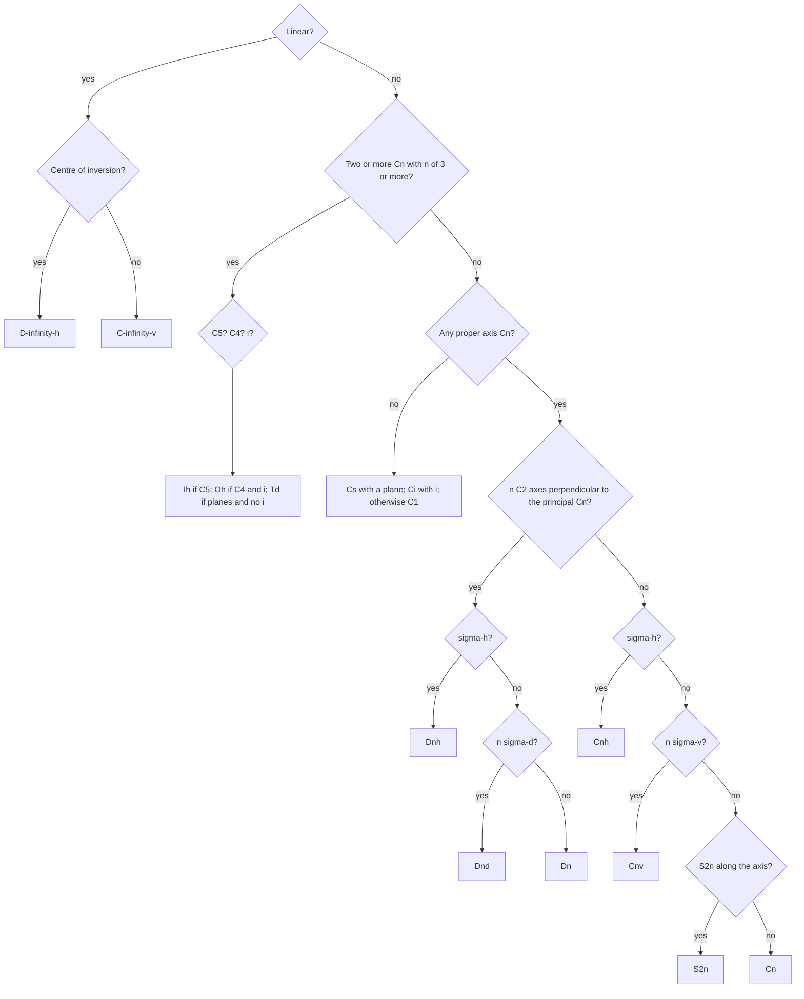

# 20.5 · Symmetry elements and point groups

Many molecules look the same after you turn them, reflect them or invert them through their centre. Each such move is a symmetry operation, and the full set of operations of a molecule forms a mathematical group, its point group. Knowing the point group answers several questions at once: whether the molecule can have a dipole, whether it can exist as two mirror-image forms, which atoms are equivalent, and, in lesson 20.6, how many IR and Raman bands it shows. This lesson teaches you to find the elements and to name the group with one flowchart. You used symmetry informally for VSEPR shapes in [07.4](../module-07/lesson-04.md) and for isomer counting in [18.3](../module-18/lesson-03.md); now it becomes a tool.

## Why it matters

A medicinal chemist draws a new candidate and must know at once whether it can exist as two enantiomers, because regulators require each enantiomer of a chiral drug to be tested. A spectroscopist sees three IR bands for a metal carbonyl and has to decide between a fac and a mer isomer. A materials chemist wants a crystal with a permanent dipole for a piezoelectric sensor. All three questions are answered by the point group, usually in under a minute and without any calculation.

## Core ideas

> [!NOTE]
> Symmetry and group theory are stable mathematics. The notation is the Schoenflies notation used in chemistry (crystallographers use the Hermann–Mauguin notation for the same groups). The Python finder in the lab uses idealised geometries checked on 2026-10-17.

### Five kinds of symmetry operation

A **symmetry operation** moves the molecule so that it looks exactly as before (every atom lands on an atom of the same element). A **symmetry element** is the point, line or plane about which the operation is done.

| Symbol | Operation | Element | Example |
|---|---|---|---|
| $E$ | identity: do nothing | — | every molecule |
| $C_n$ | rotate by $360°/n$ | proper axis | $C_2$ in H₂O, $C_3$ in NH₃, $C_6$ in benzene |
| $\sigma$ | reflect | mirror plane | the molecular plane of H₂O |
| $i$ | invert every point through the centre: $(x, y, z) \to (-x, -y, -z)$ | centre of inversion | CO₂, SF₆, benzene; not CH₄ |
| $S_n$ | rotate by $360°/n$, then reflect through the plane perpendicular to the axis | improper axis | $S_4$ in CH₄, $S_6$ in staggered ethane |

The axis with the highest $n$ is the **principal axis**, drawn vertically by convention. Mirror planes are named relative to it: **σh** (horizontal) is perpendicular to it; **σv** (vertical) contains it; **σd** (dihedral) contains it and bisects the angle between two $C_2$ axes. Two useful identities: $S_1 = \sigma$ and $S_2 = i$.

### Symmetry operations form a group

Doing two symmetry operations one after the other gives another symmetry operation. In H₂O, a $C_2$ rotation followed by reflection in the molecular plane equals reflection in the perpendicular plane. The set of operations has the four properties of a mathematical **group**: closure (any product is in the set), an identity ($E$), an inverse for each operation, and associativity. The number of operations is the **order** $h$: 4 for H₂O ($E, C_2, \sigma_v, \sigma_v'$), 6 for NH₃, 24 for CH₄, 48 for SF₆. Because at least one point stays fixed (the centre of mass), these are **point groups**.

### The point groups chemists meet

| Group | Elements (besides $E$) | Examples |
|---|---|---|
| $C_1$ | none | CHFClBr |
| $C_s$ | one plane | CH₂=CHCl |
| $C_i$ | only $i$ | meso-1,2-dibromo-1,2-dichloroethane (anti conformer) |
| $C_n$ | one $C_n$ | H₂O₂ ($C_2$) |
| $C_{nv}$ | $C_n$ + $n$ σv | H₂O ($C_{2v}$), NH₃ and CHCl₃ ($C_{3v}$) |
| $C_{nh}$ | $C_n$ + σh | trans-ClCH=CHCl ($C_{2h}$) |
| $D_n$ | $C_n$ + $n$ perpendicular $C_2$ | [Co(en)₃]³⁺ ($D_3$) |
| $D_{nh}$ | $D_n$ + σh | BF₃ ($D_{3h}$), XeF₄ ($D_{4h}$), benzene ($D_{6h}$) |
| $D_{nd}$ | $D_n$ + $n$ σd | allene ($D_{2d}$), staggered ethane ($D_{3d}$) |
| $T_d$, $O_h$, $I_h$ | several $C_3$ axes | CH₄; SF₆; C₆₀ |
| $C_{\infty v}$, $D_{\infty h}$ | linear | HCN; CO₂, N₂ |

### The flowchart



Work from the top and stop at the first box that fits. The most common error is to miss the perpendicular $C_2$ axes, which sends a $D$ molecule into a $C$ group.

### Two answers you get for free

**Polarity.** A dipole moment is a vector, and it must stay unchanged under every symmetry operation. It therefore has to lie on every axis and in every plane. That is possible only in $C_1$, $C_s$, $C_n$ and $C_{nv}$. Any molecule with $i$, with a $\sigma_h$, with perpendicular $C_2$ axes or with several $C_3$ axes has no dipole, whatever its bonds: BF₃, CO₂, CCl₄, trans-ClCH=CHCl and SF₆ are non-polar, H₂O, NH₃, CHCl₃ and cis-ClCH=CHCl are polar.

**Chirality.** A molecule is chiral (not superimposable on its mirror image) if and only if it has no improper axis $S_n$ of any order. Because $S_1 = \sigma$ and $S_2 = i$, a molecule with a mirror plane or a centre of inversion is not chiral. Chiral molecules belong to $C_1$, $C_n$, $D_n$ (or the rare $T$, $O$, $I$). [Co(en)₃]³⁺ ($D_3$) is chiral although it has no "stereocentre" in the organic sense, which is why the axis test is better than counting stereocentres.

## Worked example

### 1. Ammonia, step by step

1. Linear? No.
2. More than one $C_3$? No: one $C_3$ through N, perpendicular to the plane of the three H atoms.
3. Principal axis $C_3$. Perpendicular $C_2$ axes? None (turning NH₃ upside down puts N below the H atoms).
4. σh? No (it would also flip N below the H plane).
5. σv? Yes, three: each contains the $C_3$ axis and one N–H bond.
6. Point group $C_{3v}$, order 6: $E$, $2C_3$ ($C_3$ and $C_3^2$), $3\sigma_v$. Polar (dipole along $C_3$), not chiral.

### 2. Staggered and eclipsed ethane

Both conformers have a $C_3$ along the C–C bond and three $C_2$ axes perpendicular to it, so both are $D_3$ groups at least.

- Eclipsed: the plane halfway between the carbons, perpendicular to C–C, reflects each H onto the H straight across. That is σh: $D_{3h}$.
- Staggered: no σh (the H atoms across the bond are 60° apart), but three σd planes, each containing C–C and bisecting two $C_2$ axes, and a centre of inversion in the middle of the bond. $D_{3d}$, with an $S_6$ axis along C–C.

Rotating one methyl group by 60° changes the point group. The Python finder in Part B tells them apart from coordinates alone.

## Hands-on

What you need: toothpicks and grapes, gumdrops or modelling clay, Python with the course packages and the [Module 20 lab folder](../../labs/module-20/). Record your answers on a [notebook page](../../templates/notebook-page.md). Time: about 50 minutes.

### Part A — kitchen models (15 min)

> [!CAUTION]
> Toothpicks have sharp points: adults only, keep them away from small children, and do not eat food that has been handled for the models. No chemicals are used in this activity.

1. Build CH₄ (one large ball, four small ones at tetrahedral angles of about 109.5°), NH₃ (one large ball, three small ones on one side) and BF₃ (one ball, three in a flat triangle).
2. For each, hold the model between your fingers along an imagined axis and turn it: find every $C_3$ and $C_2$. Hold a sheet of paper as a mirror plane.
3. For CH₄, find an $S_4$: turn the model by 90° about an axis bisecting two H–C–H angles, then imagine reflecting through the horizontal plane. Check that every H lands on an H.

<details><summary>What you should find</summary>

- CH₄: 4 $C_3$ (along each C–H), 3 $C_2$ (bisecting opposite H–C–H angles), 3 $S_4$ (along the $C_2$ axes), 6 σd. No $i$. $T_d$.
- NH₃: 1 $C_3$, 3 σv. $C_{3v}$.
- BF₃: 1 $C_3$, 3 $C_2$ (along B–F), σh (the molecular plane), 3 σv, $S_3$. $D_{3h}$.

</details>

### Part B — Python: a symmetry-element finder (25 min)

1. Open `lesson05_pointgroups.py`. `spec20.symmetry_elements()` tests candidate axes and planes on the 3D coordinates in `molecules20.py` and returns what it finds.
2. Complete `point_group()` by following the flowchart. Run:

```bash
py lesson05_pointgroups.py
```

How you know it worked: `8/8 point groups correct` — H₂O $C_{2v}$, NH₃ $C_{3v}$, CH₄ $T_d$, BF₃ $D_{3h}$, C₂H₄ $D_{2h}$, CHFClBr $C_1$, HCN $C_{\infty v}$, CH₂Cl₂ $C_{2v}$.

<details><summary>Reference solution</summary>

`lesson05_pointgroups_solution.py` follows the flowchart line by line. The only subtle step is choosing the principal axis when several $C_2$ axes have the same order (C₂H₄, allene): choose the one that is coaxial with an $S_4$ if there is one, otherwise any. For $D_{2h}$ the choice does not matter.

</details>

### Part C — pencil (10 min)

Assign the point group, and say whether each is polar and whether it is chiral: (a) PCl₅ (trigonal bipyramid), (b) [PtCl₄]²⁻ (square planar), (c) cis-[Co(en)₂Cl₂]⁺ ([18.3](../module-18/lesson-03.md)), (d) cis-ClCH=CHCl.

<details><summary>Answers</summary>

(a) $D_{3h}$: non-polar, not chiral. (b) $D_{4h}$: non-polar, not chiral. (c) $C_2$: the only element is a $C_2$ axis; polar and chiral, so it exists as two enantiomers (the trans isomer, $D_{2h}$, does not). (d) $C_{2v}$: polar, not chiral.

</details>

## Common mistakes

- Missing the perpendicular $C_2$ axes. BF₃ is not $C_{3v}$: it has three $C_2$ axes along the B–F bonds and a σh, so it is $D_{3h}$.
- Calling a molecule chiral because it has no mirror plane. Check for $i$ and every $S_n$ too: a molecule with only a centre of inversion ($C_i$) is not chiral.
- Using the drawn conformation instead of the 3D shape. A flat drawing of CH₄ suggests $D_{4h}$; the real molecule is $T_d$.
- Confusing elements and operations. One $C_3$ axis gives two operations ($C_3$ and $C_3^2$); one $C_4$ axis gives $C_4$, $C_2$ and $C_4^3$.
- Assigning $T_d$ to anything with four ligands. CH₂Cl₂ and CHCl₃ have lower symmetry ($C_{2v}$, $C_{3v}$).

## Key takeaways

- Five operations: $E$, $C_n$, $\sigma$ (h, v, d), $i$, $S_n$; $S_1 = \sigma$ and $S_2 = i$.
- The operations of a molecule form a point group; its order $h$ counts them.
- The flowchart: linear → several high axes → any axis → perpendicular $C_2$s → σh → σv or σd → $S_{2n}$.
- Only $C_1$, $C_s$, $C_n$ and $C_{nv}$ molecules can be polar.
- A molecule is chiral if and only if it has no $S_n$ (no mirror plane, no centre of inversion, no other improper axis).

## Sources

- [LibreTexts Physical Chemistry, 12.2 Symmetry Elements and Operations Define the Point Groups](https://chem.libretexts.org/Bookshelves/Physical_and_Theoretical_Chemistry_Textbook_Maps/Physical_Chemistry_(LibreTexts)/12%3A_Group_Theory_-_The_Exploitation_of_Symmetry/12.02%3A_Symmetry_Elements_and_Operations_Define_the_Point_Groups) — the five operations and the point groups.
- [LibreTexts Physical Chemistry, 12.3 Symmetry Operations Define Groups](https://chem.libretexts.org/Bookshelves/Physical_and_Theoretical_Chemistry_Textbook_Maps/Physical_Chemistry_(LibreTexts)/12%3A_Group_Theory_-_The_Exploitation_of_Symmetry/12.03%3A_Symmetry_Operations_Define_Groups) — group properties and multiplication tables.
- [LibreTexts Physical Chemistry, 12.4 Symmetry Operations as Matrices](https://chem.libretexts.org/Bookshelves/Physical_and_Theoretical_Chemistry_Textbook_Maps/Physical_Chemistry_(LibreTexts)/12%3A_Group_Theory_-_The_Exploitation_of_Symmetry/12.04%3A_Symmetry_Operations_as_Matrices) — the matrices the Python finder applies to coordinates.
- [IUPAC Gold Book, point group](https://goldbook.iupac.org/terms/view/P04703) — definition.
