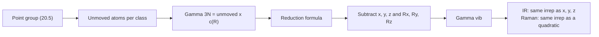

# 20.6 · Character tables and predicting IR and Raman bands

A molecule with $N$ atoms has $3N - 6$ vibrations ($3N - 5$ if linear), but a spectrum rarely shows that many bands. Some vibrations are degenerate and appear once, some are IR-silent, some are Raman-silent and a few are silent in both. Group theory predicts all of this from the point group of [20.5](lesson-05.md) in about ten minutes of arithmetic, using one table per point group. This lesson teaches that arithmetic and ends with the module practical, where you put the whole module together on real NIST data: two diatomic molecules analysed line by line, ten point groups, and band counts for nine polyatomic molecules.

## Why it matters

A chemist makes XeF₄ and wants to show that it is square planar, not tetrahedral. A tetrahedral XeF₄ ($T_d$, like CCl₄) would have two IR bands and four Raman bands, with two bands present in both spectra. A square-planar one ($D_{4h}$) has three IR bands, three Raman bands and no coincidences. The measured spectra show no coincidences, and the structure is settled before anyone grows a crystal. The same reasoning tells an inorganic chemist whether a metal carbonyl is fac or mer from the number of C–O stretching bands, and lets a computational chemist (Module 31) label calculated vibrations.

## Core ideas

> [!NOTE]
> Character tables are fixed mathematics. The tables used here are the standard ones (the lab helper checks their orthogonality). Fundamental frequencies are from the NIST WebBook vibrational tables (Shimanouchi, 1972), checked on 2026-10-17. Axis conventions (which in-plane axis is x) vary between books and change some B labels, never the counts.

### Reading a character table

Here is the table for $C_{2v}$ (H₂O, CH₂Cl₂), with the molecule in the xz plane:

| $C_{2v}$ | $E$ | $C_2$ | $\sigma_v(xz)$ | $\sigma_v'(yz)$ | linear, rotations | quadratic |
|---|---|---|---|---|---|---|
| $A_1$ | 1 | 1 | 1 | 1 | $z$ | $x^2, y^2, z^2$ |
| $A_2$ | 1 | 1 | −1 | −1 | $R_z$ | $xy$ |
| $B_1$ | 1 | −1 | 1 | −1 | $x$, $R_y$ | $xz$ |
| $B_2$ | 1 | −1 | −1 | 1 | $y$, $R_x$ | $yz$ |

- The columns are **classes** of operations. In bigger groups a class holds several equivalent operations, written with a count, such as $2C_3$ or $3\sigma_v$ in $C_{3v}$. The total number of operations is the order $h$.
- Each row is an **irreducible representation** (irrep), a basic pattern of symmetry. A **character** of +1 means "unchanged" under that operation, −1 means "sign reversed".
- **Mulliken labels**: A and B are one-dimensional (A symmetric, B antisymmetric under the principal rotation), E is two-dimensional, T three-dimensional (doubly and triply degenerate). Subscript g/u: symmetric or antisymmetric under inversion. Primes ′/″: symmetric or antisymmetric under σh.
- The right-hand columns show how $x, y, z$ (and so the dipole), the rotations $R_x, R_y, R_z$, and the quadratic functions (and so the polarisability) transform.

### The selection rules in one line

A fundamental is **IR active** if its irrep is the same as that of $x$, $y$ or $z$, because the dipole moment changes like a vector. It is **Raman active** if its irrep is the same as that of a quadratic function ($x^2$, $xy$…), because the polarisability changes like a product of two coordinates. This is the exact form of the gross rules of [20.1](lesson-01.md). In a centrosymmetric group $x, y, z$ are all u and the quadratics all g, which gives the mutual exclusion rule of [20.3](lesson-03.md).

### Counting the modes: unmoved atoms

Give every atom three arrows ($x$, $y$, $z$). These $3N$ arrows form the **3N representation** $\Gamma_{3N}$. Its character under an operation $R$ is

$$\chi_{3N}(R) = (\text{number of atoms not moved by } R) \times c(R)$$

where $c(R)$ is the contribution of one unmoved atom (the trace of the 3 × 3 matrix of $R$):

| $R$ | $E$ | $C_2$ | $C_3$ | $C_4$ | $C_6$ | $\sigma$ | $i$ | $S_3$ | $S_4$ | $S_6$ |
|---|---|---|---|---|---|---|---|---|---|---|
| $c(R)$ | 3 | −1 | 0 | 1 | 2 | 1 | −3 | −2 | −1 | 0 |

(For a proper rotation by $\theta$, $c = 1 + 2\cos\theta$; for an improper one, $c = -1 + 2\cos\theta$.) Atoms that move contribute nothing, because their arrows land on another atom.

### The reduction formula

Any representation is a sum of irreps. The number of times irrep $i$ appears is

$$n_i = \frac{1}{h}\sum_{\text{classes}} g_k\,\chi(R_k)\,\chi_i(R_k)$$

where $g_k$ is the number of operations in class $k$. Reduce $\Gamma_{3N}$, then remove the three translations (the irreps of $x, y, z$) and the three rotations ($R_x, R_y, R_z$); what is left is $\Gamma_\text{vib}$. Check: the dimensions must add up to $3N - 6$.



## Worked example

### 1. Water, $C_{2v}$

1. Unmoved atoms: $E$ 3, $C_2$ 1 (O), $\sigma_v(xz)$ 3 (the molecular plane), $\sigma_v'(yz)$ 1.
2. $\Gamma_{3N}$: $3\times3 = 9$, $1\times(-1) = -1$, $3\times1 = 3$, $1\times1 = 1$.
3. Reduce ($h = 4$): $n(A_1) = (9 - 1 + 3 + 1)/4 = 3$; $n(A_2) = (9 - 1 - 3 - 1)/4 = 1$; $n(B_1) = (9 + 1 + 3 - 1)/4 = 3$; $n(B_2) = (9 + 1 - 3 + 1)/4 = 2$.
4. Subtract translations ($A_1 + B_1 + B_2$) and rotations ($A_2 + B_1 + B_2$): $\Gamma_\text{vib} = 2A_1 + B_1$, three modes.
5. All three are IR active ($A_1$ like $z$, $B_1$ like $x$) and Raman active. NIST: $a_1$ 3657 and 1595, $b_1$ 3756 cm⁻¹. (Books that put water in the yz plane call the antisymmetric stretch $B_2$; same physics.)

### 2. Methane, $T_d$

1. Classes and unmoved atoms: $E$ 5, $8C_3$ 2 (C and one H), $3C_2$ 1, $6S_4$ 1, $6\sigma_d$ 3 (C and two H).
2. $\Gamma_{3N}$: 15, 0, −1, −1, 3.
3. Reduce ($h = 24$): $n(A_1) = (15 + 0 - 3 - 6 + 18)/24 = 1$; $n(A_2) = (15 - 3 + 6 - 18)/24 = 0$; $n(E) = (30 - 6)/24 = 1$; $n(T_1) = (45 + 3 - 6 - 18)/24 = 1$; $n(T_2) = (45 + 3 + 6 + 18)/24 = 3$.
4. Translations $T_2$, rotations $T_1$: $\Gamma_\text{vib} = A_1 + E + 2T_2$. Dimensions $1 + 2 + 6 = 9 = 3 \times 5 - 6$.
5. IR: only the two $T_2$ modes ($x, y, z$ transform as $T_2$). Raman: all four. NIST: $T_2$ at 3019 and 1306 cm⁻¹ in the IR; $A_1$ 2917, $E$ 1534 and both $T_2$ in the Raman. Nine vibrations, two IR bands.

## Hands-on

What you need: pencil, Python with the course packages, the [Module 20 lab folder](../../labs/module-20/) with your completed lessons 20.2, 20.3 and 20.5 scripts, and a [lab report template](../../templates/lab-report.md). Time: about 2 hours.

### Part A — pencil warm-up (20 min)

1. NH₃ ($C_{3v}$): count unmoved atoms for $E$, $2C_3$, $3\sigma_v$, reduce and predict the IR and Raman bands.
2. trans-ClCH=CHCl ($C_{2h}$): predict how many bands appear in both spectra.

<details><summary>Answers</summary>

1. Unmoved 4, 1, 2; $\Gamma_{3N}$ = 12, 0, 2; $n(A_1) = (12 + 0 + 6)/6 = 3$, $n(A_2) = (12 - 6)/6 = 1$, $n(E) = 24/6 = 4$. Remove $A_1 + E$ (translations) and $A_2 + E$ (rotations): $\Gamma_\text{vib} = 2A_1 + 2E$, all IR and Raman active, four bands in each. NIST: 3337, 950 ($a_1$), 3444, 1627 ($e$) cm⁻¹.
2. None: the molecule has a centre of inversion, so mutual exclusion holds ($5A_g + B_g$ Raman only, $2A_u + 4B_u$ IR only).

</details>

### Part B — module practical (about 100 min)

The three parts below use everything in this module. Write them up as one short report with the lab-report template: aim, data and sources, method, results tables, discussion of errors.

1. **HCl and CO from NIST data.** Run `lesson06_practical.py` (it imports your functions from lessons 20.2, 20.3 and 20.5). It prints a side-by-side table: band centre, $B_0$, $B_1$, $r_0$, $r_e$ and force constant for HCl (from the NIST IR spectrum) and CO (from the NIST microwave lines and constants), and checks $B$ of CO from the branch maxima of its unresolved NIST band.
2. **Ten point groups.** Before running, assign by hand the point groups of SF₆, XeF₄, benzene, staggered and eclipsed ethane, trans-ClCH=CHCl, H₂O₂, allene, CHCl₃ and CO₂. Then compare with Part 2 of the output.
3. **Band counts.** Complete `gamma_3n()`, `reduce()` and `activity()`, and fill in the unmoved-atom lists for XeF₄ and SF₆ in `UNMOVED`. The script reduces nine molecules and compares six of them with `nist_fundamentals.csv`.

```bash
py lesson06_practical.py
```

How you know it worked:

- Part 1: HCl $\tilde\nu_0 = 2886.7$, $B_0 = 10.32$, $r_e \approx 1.282$ Å, $k \approx 481$ N/m; CO $\tilde\nu_0 = 2143.2$, $B_0 = 1.92253$ cm⁻¹, $r_0 = 1.1309$ Å, $k \approx 1856$ N/m; branch maxima give $B = 1.926$ cm⁻¹ (or $T \approx 299$ K).
- Part 2: `10/10 correct` (Oh, D4h, D6h, D3d, D3h, C2h, C2, D2d, C3v, D∞h).
- Part 3: every NIST check says `NIST agrees`. XeF₄: $A_{1g} + B_{1g} + B_{2g} + A_{2u} + B_{2u} + 2E_u$, IR 3, Raman 3, none in both. SF₆: $A_{1g} + E_g + T_{2g} + 2T_{1u} + T_{2u}$, IR 2, Raman 3, $T_{2u}$ silent.

<details><summary>Reference solution and what the report should discuss</summary>

Full code: `lesson06_practical_solution.py`. XeF₄ unmoved atoms: 5, 1, 1, 3, 1, 1, 1, 5, 3, 1. SF₆: 7, 1, 1, 3, 3, 1, 1, 1, 5, 3.

Discussion points: (1) CO's triple bond is almost four times stiffer than the H–Cl bond, yet HCl vibrates at a higher wavenumber because its reduced mass is seven times smaller. (2) The HCl constants from a 1964 chart are about 1 % off; the CO microwave constants agree with NIST to six figures; say why (resolution, digitisation, isotope doublets). (3) For XeF₄, three IR bands and three Raman bands with no coincidences rule out a tetrahedral structure. (4) For SF₆, six of its fifteen vibrational coordinates belong to the triply degenerate $T_{1u}$ pair and only two IR bands appear; the $T_{2u}$ mode is seen in neither spectrum directly. (5) Real spectra also show overtones, combination bands and Fermi resonances (CCl₄ near 776 cm⁻¹ is a doublet in NIST's table), so "number of fundamentals" is a lower limit for the number of observed bands.

</details>

## Common mistakes

- Counting an E or T mode as two or three bands. A degenerate set gives one band.
- Forgetting the class sizes $g_k$ in the reduction formula. With them, every $n_i$ comes out a whole number; a fraction means an arithmetic slip.
- Counting atoms that move to an equivalent position as unmoved. Only atoms that stay exactly where they are contribute.
- Forgetting to subtract translations and rotations, which leaves $3N$ instead of $3N - 6$ modes.
- Assuming a predicted band will be seen. Symmetry says "allowed"; intensity can still be tiny, and liquid-phase spectra sometimes show "forbidden" bands weakly.

## Key takeaways

- A character table lists classes, irreps (A, B, E, T; g/u; ′/″) and how $x, y, z$, rotations and quadratics transform.
- $\chi_{3N}(R)$ = unmoved atoms × $c(R)$; reduce with $n_i = (1/h)\sum g_k\chi\chi_i$; subtract translations and rotations.
- IR active: same irrep as $x$, $y$ or $z$. Raman active: same irrep as a quadratic function.
- With a centre of inversion, no mode is both IR and Raman active; coincident bands prove there is no centre.
- Band counts distinguish structures (square planar against tetrahedral XeF₄, fac against mer) without a crystal structure.

## Sources

- [LibreTexts Physical Chemistry, 12.6 Character Tables](https://chem.libretexts.org/Bookshelves/Physical_and_Theoretical_Chemistry_Textbook_Maps/Physical_Chemistry_(LibreTexts)/12%3A_Group_Theory_-_The_Exploitation_of_Symmetry/12.06%3A_Character_Tables_Summarize_the_Properties_of_a_Point_Group) — structure of a character table and Mulliken labels.
- [LibreTexts Physical Chemistry, 12.11 Reducible Representations](https://chem.libretexts.org/Bookshelves/Physical_and_Theoretical_Chemistry_Textbook_Maps/Physical_Chemistry_(LibreTexts)/12%3A_Group_Theory_-_The_Exploitation_of_Symmetry/12.11%3A_Reducible_Representations_are_Comprised_of_Irreducible_Representations) — the reduction formula.
- [LibreTexts Physical Chemistry, 12.13 Symmetry of Vibrations](https://chem.libretexts.org/Bookshelves/Physical_and_Theoretical_Chemistry_Textbook_Maps/Physical_Chemistry_(LibreTexts)/12%3A_Group_Theory_-_The_Exploitation_of_Symmetry/12.13%3A_Symmetry_of_Vibrations_Describes_their_Spectroscopic_Behavior) — IR and Raman activity from symmetry.
- [LibreTexts Physical Chemistry, 13.14 Group Theory Determines Infrared Activity](https://chem.libretexts.org/Bookshelves/Physical_and_Theoretical_Chemistry_Textbook_Maps/Physical_Chemistry_(LibreTexts)/13%3A_Molecular_Spectroscopy/13.14%3A_Group_Theory_Determines_Infrared_Activity) — the transition dipole argument.
- [NIST Chemistry WebBook, methane vibrational levels](https://webbook.nist.gov/cgi/cbook.cgi?ID=C74828&Mask=800) and [water vibrational levels](https://webbook.nist.gov/cgi/cbook.cgi?ID=C7732185&Mask=800) — Shimanouchi fundamentals; the other molecules in `nist_fundamentals.csv` (NH₃, CCl₄, C₂H₄, trans-C₂H₂Cl₂) come from the same tables, retrieved 2026-10-17.
